# C1 — selected poses / S0 review

**REVIEW_READY candidate; no main merge and no owner art acceptance.** Four selected poses plus eebff28 service faces, and one SW focal pose-only candidate. Other source poses/builders remain main.

A3 remains diagnostic at7/9; numeric A4 remains diagnostic at6% adjacent /12% extremes. A4 owner two-second adjacent-tier comparison is a separate PENDING hard gate. A1/A2/A5/A6 and V gates retain every FAIL. Root/live PASS does not imply art acceptance.

Chrome 156.0.8078.73; S0 156.0.8078.48. Cross-patch measurements remain compared against the exact original S0, without filtering outliers. [Raw capture](final/capture.json), [raw performance](final/performance.json), [numeric comparisons](final/comparison.json), [per-image judgments](visual-review.json), [checks](checks.json).

```json
{
  "states": 40,
  "rawStaticOriginals": 80,
  "originalFinalImagesReviewed": 40,
  "A1": {
    "PASS": 32,
    "FAIL": 4,
    "N/A": 4
  },
  "A2": {
    "PASS": 26,
    "FAIL": 10,
    "N/A": 4
  },
  "A3diagnostic": {
    "FAIL": 36,
    "N/A": 4
  },
  "A4diagnostic": {
    "pass": 2,
    "pairs": 38,
    "adjacentOwnerGate": "PENDING"
  },
  "A5": {
    "FAIL": 19,
    "PASS": 21
  },
  "canonicalPerformance": {
    "FAIL": 5,
    "PASS": 7
  },
  "A6": {
    "PASS": 40
  },
  "reproducibility": {
    "FAIL": 27,
    "PASS": 13
  },
  "V": {
    "V1": {
      "FAIL": 22,
      "PASS": 14,
      "N/A": 4
    },
    "V2": {
      "PASS": 34,
      "FAIL": 6
    },
    "V3": {
      "FAIL": 40
    },
    "V4": {
      "FAIL": 6,
      "PASS": 32,
      "N/A": 2
    },
    "V5": {
      "N/A": 21,
      "PASS": 11,
      "FAIL": 8
    },
    "V6": {
      "PASS (static)": 38,
      "N/A": 2
    }
  }
}
```

## nw:focal · -2 · h12

| S0 original | C1 original |
| --- | --- |
| [](../../closeup-polish/S0/baseline/nw-focal__-2__h12.jpg) | [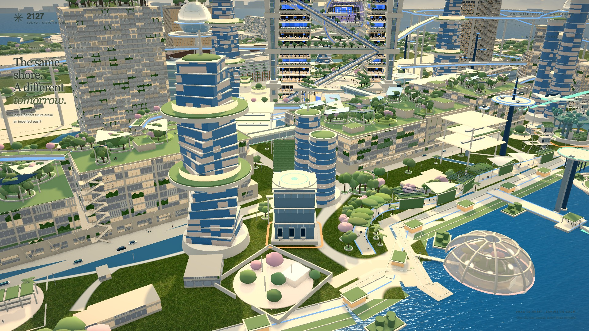](final/nw-focal__-2__h12.jpg) |

Front-on pose exposes the selected eebff28 six-slot service face; shaft and neighboring skyline retain main geometry. The base stays visually generic despite the improved approach view.

A1 PASS; A2 PASS; A3 diagnostic FAIL (3/9); A4 diagnostic 0/2; A4 owner PENDING; A5 FAIL (vsync 60; instant calls diagnostic 947/767, canonical gate below); A6 PASS.

- **V1 FAIL**: Six-slot entrance faces are now front-on, but the small dark base still reads as another blue office block; nearby towers compete, so its service function is not identifiable in two seconds.
- **V2 PASS**: The bay at lower right and Fuji civic sphere/structure above retain the site relationship.
- **V3 FAIL**: Foreground isolated round crowns and roof rows retain the global lollipop/grid planting language; C1 does not change vegetation.
- **V4 FAIL**: The service block remains a conventional box under a cylindrical glass shaft; joints and doors improve construction detail without replacing the office/service typology.
- **V5 N/A**: Day original; matching hour22 image reviewed separately.
- **V6 PASS (static)**: Base faces and upper rings are attached and aligned; no static clipping or floating service parts observed. This image does not prove absence of temporal flicker.

## nw:focal · -2 · h22

| S0 original | C1 original |
| --- | --- |
| [](../../closeup-polish/S0/baseline/nw-focal__-2__h22.jpg) | [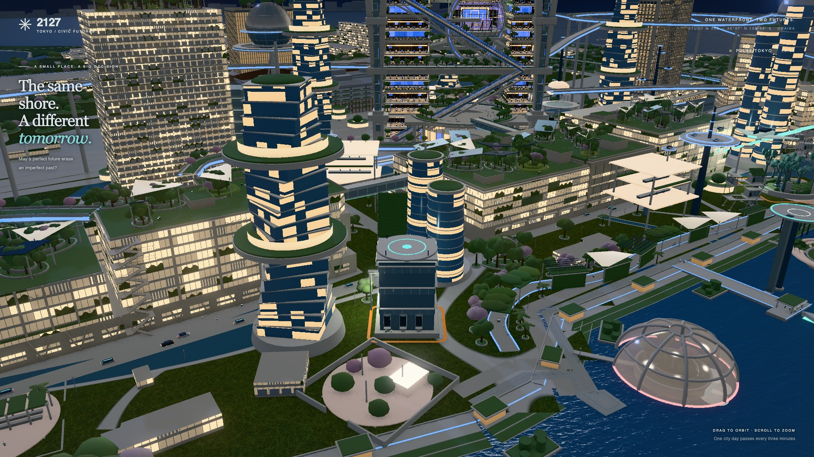](final/nw-focal__-2__h22.jpg) |

Front-on pose exposes the selected eebff28 six-slot service face; shaft and neighboring skyline retain main geometry. The base stays visually generic despite the improved approach view.

A1 PASS; A2 PASS; A3 diagnostic FAIL (3/9); A4 diagnostic 0/2; A4 owner PENDING; A5 PASS (vsync 60; instant calls diagnostic 947/767, canonical gate below); A6 PASS.

- **V1 FAIL**: Six-slot entrance faces are now front-on, but the small dark base still reads as another blue office block; nearby towers compete, so its service function is not identifiable in two seconds.
- **V2 PASS**: The bay at lower right and Fuji civic sphere/structure above retain the site relationship.
- **V3 FAIL**: Foreground isolated round crowns and roof rows retain the global lollipop/grid planting language; C1 does not change vegetation.
- **V4 FAIL**: The service block remains a conventional box under a cylindrical glass shaft; joints and doors improve construction detail without replacing the office/service typology.
- **V5 PASS**: Night outline, pale joints and three near-side port/counter faces remain visible, although the hub is darker than surrounding occupied towers.
- **V6 PASS (static)**: Base faces and upper rings are attached and aligned; no static clipping or floating service parts observed. This image does not prove absence of temporal flicker.

## nw:focal · 0 · h12

| S0 original | C1 original |
| --- | --- |
| [](../../closeup-polish/S0/baseline/nw-focal__0__h12.jpg) | [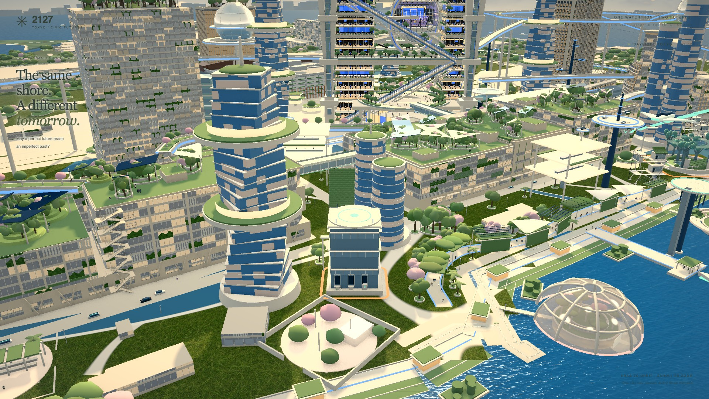](final/nw-focal__0__h12.jpg) |

Front-on pose exposes the selected eebff28 six-slot service face; shaft and neighboring skyline retain main geometry. The base stays visually generic despite the improved approach view.

A1 PASS; A2 PASS; A3 diagnostic FAIL (3/9); A4 diagnostic 1/2; A4 owner PENDING; A5 FAIL (vsync 60; instant calls diagnostic 947/767, canonical gate below); A6 PASS.

- **V1 FAIL**: Six-slot entrance faces are now front-on, but the small dark base still reads as another blue office block; nearby towers compete, so its service function is not identifiable in two seconds.
- **V2 PASS**: The bay at lower right and Fuji civic sphere/structure above retain the site relationship.
- **V3 FAIL**: Foreground isolated round crowns and roof rows retain the global lollipop/grid planting language; C1 does not change vegetation.
- **V4 FAIL**: The service block remains a conventional box under a cylindrical glass shaft; joints and doors improve construction detail without replacing the office/service typology.
- **V5 N/A**: Day original; matching hour22 image reviewed separately.
- **V6 PASS (static)**: Base faces and upper rings are attached and aligned; no static clipping or floating service parts observed. This image does not prove absence of temporal flicker.

## nw:focal · 0 · h22

| S0 original | C1 original |
| --- | --- |
| [](../../closeup-polish/S0/baseline/nw-focal__0__h22.jpg) | [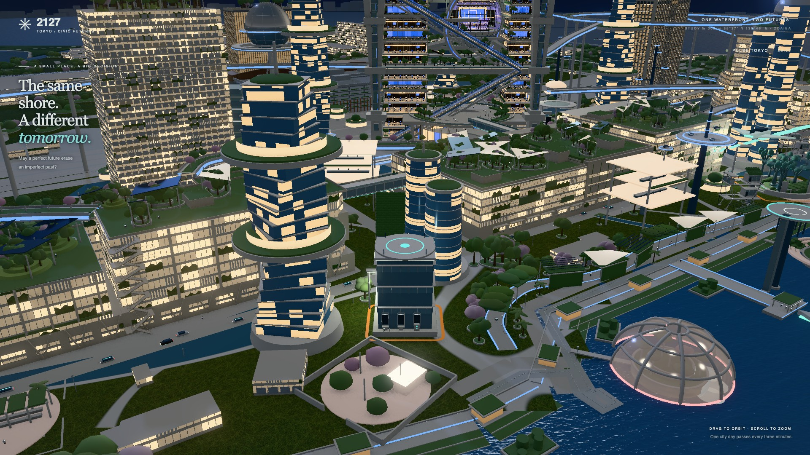](final/nw-focal__0__h22.jpg) |

Front-on pose exposes the selected eebff28 six-slot service face; shaft and neighboring skyline retain main geometry. The base stays visually generic despite the improved approach view.

A1 PASS; A2 PASS; A3 diagnostic FAIL (3/9); A4 diagnostic 1/2; A4 owner PENDING; A5 PASS (vsync 60; instant calls diagnostic 947/767, canonical gate below); A6 PASS.

- **V1 FAIL**: Six-slot entrance faces are now front-on, but the small dark base still reads as another blue office block; nearby towers compete, so its service function is not identifiable in two seconds.
- **V2 PASS**: The bay at lower right and Fuji civic sphere/structure above retain the site relationship.
- **V3 FAIL**: Foreground isolated round crowns and roof rows retain the global lollipop/grid planting language; C1 does not change vegetation.
- **V4 FAIL**: The service block remains a conventional box under a cylindrical glass shaft; joints and doors improve construction detail without replacing the office/service typology.
- **V5 PASS**: Night outline, pale joints and three near-side port/counter faces remain visible, although the hub is darker than surrounding occupied towers.
- **V6 PASS (static)**: Base faces and upper rings are attached and aligned; no static clipping or floating service parts observed. This image does not prove absence of temporal flicker.

## nw:focal · 2 · h12

| S0 original | C1 original |
| --- | --- |
| [](../../closeup-polish/S0/baseline/nw-focal__2__h12.jpg) | [](final/nw-focal__2__h12.jpg) |

Front-on pose exposes the selected eebff28 six-slot service face; shaft and neighboring skyline retain main geometry. The base stays visually generic despite the improved approach view.

A1 PASS; A2 PASS; A3 diagnostic FAIL (3/9); A4 diagnostic 1/2; A4 owner PENDING; A5 FAIL (vsync 60; instant calls diagnostic 957/775, canonical gate below); A6 PASS.

- **V1 FAIL**: The tall glazed shaft is centered and its ring joints read, but resembles adjacent blue towers; the ground service function still cannot be inferred quickly.
- **V2 PASS**: The bay at lower right and Fuji civic sphere/structure above retain the site relationship.
- **V3 FAIL**: Foreground isolated round crowns and roof rows retain the global lollipop/grid planting language; C1 does not change vegetation.
- **V4 FAIL**: The service block remains a conventional box under a cylindrical glass shaft; joints and doors improve construction detail without replacing the office/service typology.
- **V5 N/A**: Day original; matching hour22 image reviewed separately.
- **V6 PASS (static)**: Base faces and upper rings are attached and aligned; no static clipping or floating service parts observed. This image does not prove absence of temporal flicker.

## nw:focal · 2 · h22

| S0 original | C1 original |
| --- | --- |
| [](../../closeup-polish/S0/baseline/nw-focal__2__h22.jpg) | [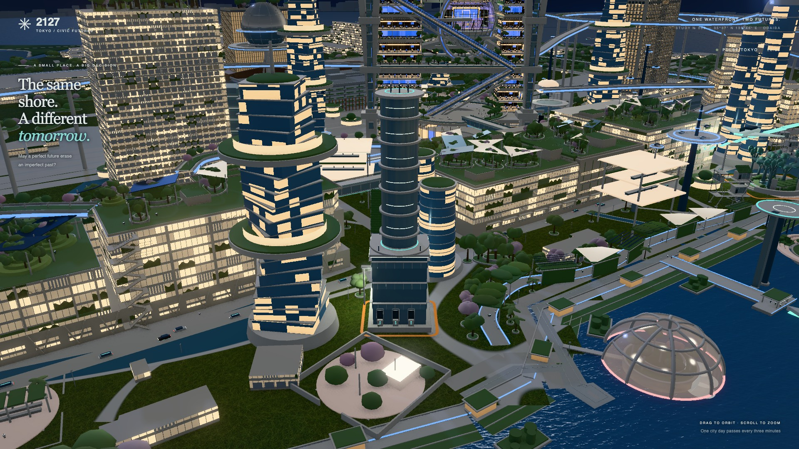](final/nw-focal__2__h22.jpg) |

Front-on pose exposes the selected eebff28 six-slot service face; shaft and neighboring skyline retain main geometry. The base stays visually generic despite the improved approach view.

A1 PASS; A2 PASS; A3 diagnostic FAIL (3/9); A4 diagnostic 1/2; A4 owner PENDING; A5 PASS (vsync 60; instant calls diagnostic 957/775, canonical gate below); A6 PASS.

- **V1 FAIL**: The tall glazed shaft is centered and its ring joints read, but resembles adjacent blue towers; the ground service function still cannot be inferred quickly.
- **V2 PASS**: The bay at lower right and Fuji civic sphere/structure above retain the site relationship.
- **V3 FAIL**: Foreground isolated round crowns and roof rows retain the global lollipop/grid planting language; C1 does not change vegetation.
- **V4 FAIL**: The service block remains a conventional box under a cylindrical glass shaft; joints and doors improve construction detail without replacing the office/service typology.
- **V5 PASS**: Night outline, pale joints and three near-side port/counter faces remain visible, although the hub is darker than surrounding occupied towers.
- **V6 PASS (static)**: Base faces and upper rings are attached and aligned; no static clipping or floating service parts observed. This image does not prove absence of temporal flicker.

## sw:focal · -2 · h12

| S0 original | C1 original |
| --- | --- |
| [](../../closeup-polish/S0/baseline/sw-focal__-2__h12.jpg) | [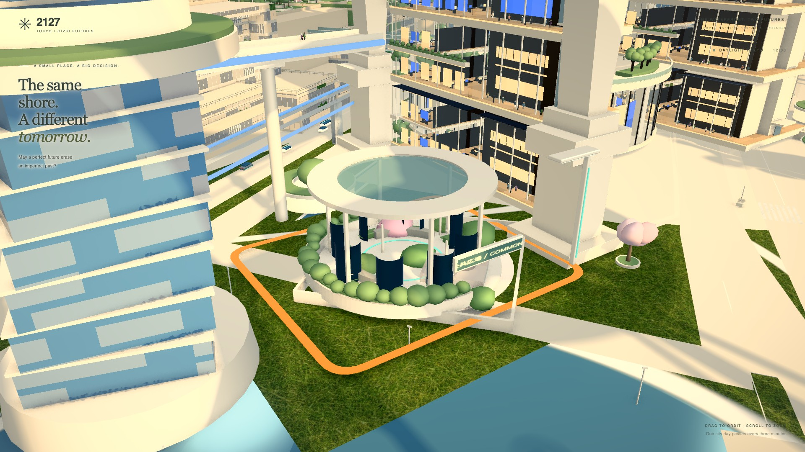](final/sw-focal__-2__h12.jpg) |

Pose-only south approach removes the S0 blue skyway crossing and avoids the r3 support; all pavilion geometry remains main. Central seats are clearer, while surrounding tower and planting still compete.

A1 PASS; A2 PASS; A3 diagnostic FAIL (1/9); A4 diagnostic 0/2; A4 owner PENDING; A5 FAIL (vsync 60; instant calls diagnostic 771/606, canonical gate below); A6 PASS.

- **V1 FAIL**: The public pavilion/sign is clearer without a foreground support, but foliage, the opaque canopy rim and privacy shells still obscure how the seats are used.
- **V2 FAIL**: A cropped smooth blue water surface is visible below, but neither bay horizon, Fuji sphere nor Rainbow Bridge is identifiable in this close crop.
- **V3 FAIL**: A necklace of spherical shrubs, isolated pink/green crowns and roof rows retain the known global planting-language failure.
- **V4 PASS**: Low/private, neutral/mixed and high/shared seating all retain a complete serviced pavilion, platform, canopy and approach; low is not an empty or obsolete site.
- **V5 N/A**: Day original; corresponding hour22 reviewed separately.
- **V6 PASS (static)**: No r3 foreground post blocks the pavilion. Existing screen/bench joints appear grounded; static canopy and foliage show no obvious clipping. Temporal flicker is not established.

## sw:focal · -2 · h22

| S0 original | C1 original |
| --- | --- |
| [](../../closeup-polish/S0/baseline/sw-focal__-2__h22.jpg) | [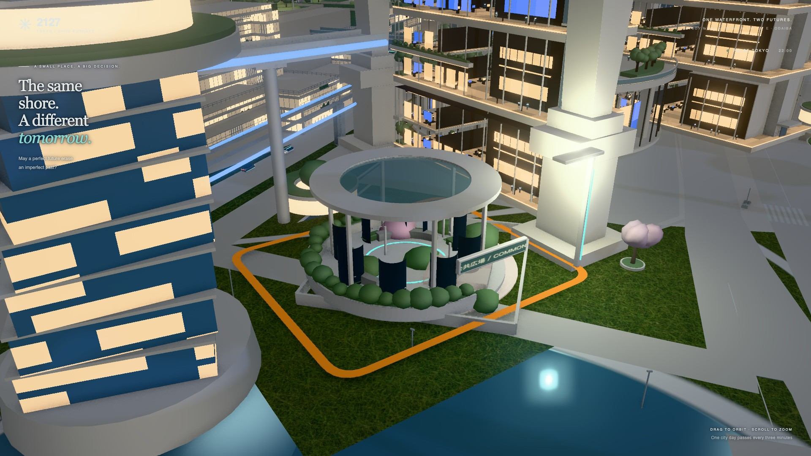](final/sw-focal__-2__h22.jpg) |

Pose-only south approach removes the S0 blue skyway crossing and avoids the r3 support; all pavilion geometry remains main. Central seats are clearer, while surrounding tower and planting still compete.

A1 PASS; A2 PASS; A3 diagnostic FAIL (1/9); A4 diagnostic 0/2; A4 owner PENDING; A5 FAIL (vsync 60.1; instant calls diagnostic 771/606, canonical gate below); A6 PASS.

- **V1 FAIL**: The public pavilion/sign is clearer without a foreground support, but foliage, the opaque canopy rim and privacy shells still obscure how the seats are used.
- **V2 FAIL**: A cropped smooth blue water surface is visible below, but neither bay horizon, Fuji sphere nor Rainbow Bridge is identifiable in this close crop.
- **V3 FAIL**: A necklace of spherical shrubs, isolated pink/green crowns and roof rows retain the known global planting-language failure.
- **V4 PASS**: Low/private, neutral/mixed and high/shared seating all retain a complete serviced pavilion, platform, canopy and approach; low is not an empty or obsolete site.
- **V5 FAIL**: The roof/platform outline stays visible, but dark screens and seat interiors remain hard to distinguish from the surrounding foliage at hour22.
- **V6 PASS (static)**: No r3 foreground post blocks the pavilion. Existing screen/bench joints appear grounded; static canopy and foliage show no obvious clipping. Temporal flicker is not established.

## sw:focal · 0 · h12

| S0 original | C1 original |
| --- | --- |
| [](../../closeup-polish/S0/baseline/sw-focal__0__h12.jpg) | [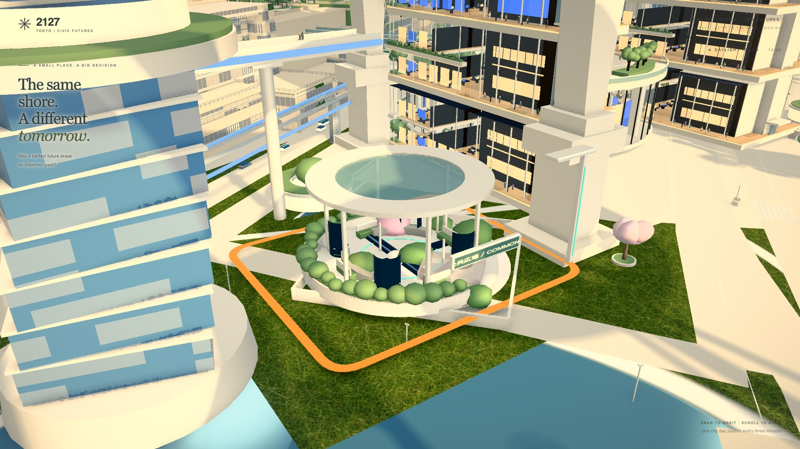](final/sw-focal__0__h12.jpg) |

Pose-only south approach removes the S0 blue skyway crossing and avoids the r3 support; all pavilion geometry remains main. Central seats are clearer, while surrounding tower and planting still compete.

A1 FAIL; A2 PASS; A3 diagnostic FAIL (1/9); A4 diagnostic 0/2; A4 owner PENDING; A5 FAIL (vsync 60; instant calls diagnostic 771/606, canonical gate below); A6 PASS.

- **V1 FAIL**: The public pavilion/sign is clearer without a foreground support, but foliage, the opaque canopy rim and privacy shells still obscure how the seats are used.
- **V2 FAIL**: A cropped smooth blue water surface is visible below, but neither bay horizon, Fuji sphere nor Rainbow Bridge is identifiable in this close crop.
- **V3 FAIL**: A necklace of spherical shrubs, isolated pink/green crowns and roof rows retain the known global planting-language failure.
- **V4 PASS**: Low/private, neutral/mixed and high/shared seating all retain a complete serviced pavilion, platform, canopy and approach; low is not an empty or obsolete site.
- **V5 N/A**: Day original; corresponding hour22 reviewed separately.
- **V6 PASS (static)**: No r3 foreground post blocks the pavilion. Existing screen/bench joints appear grounded; static canopy and foliage show no obvious clipping. Temporal flicker is not established.

## sw:focal · 0 · h22

| S0 original | C1 original |
| --- | --- |
| [](../../closeup-polish/S0/baseline/sw-focal__0__h22.jpg) | [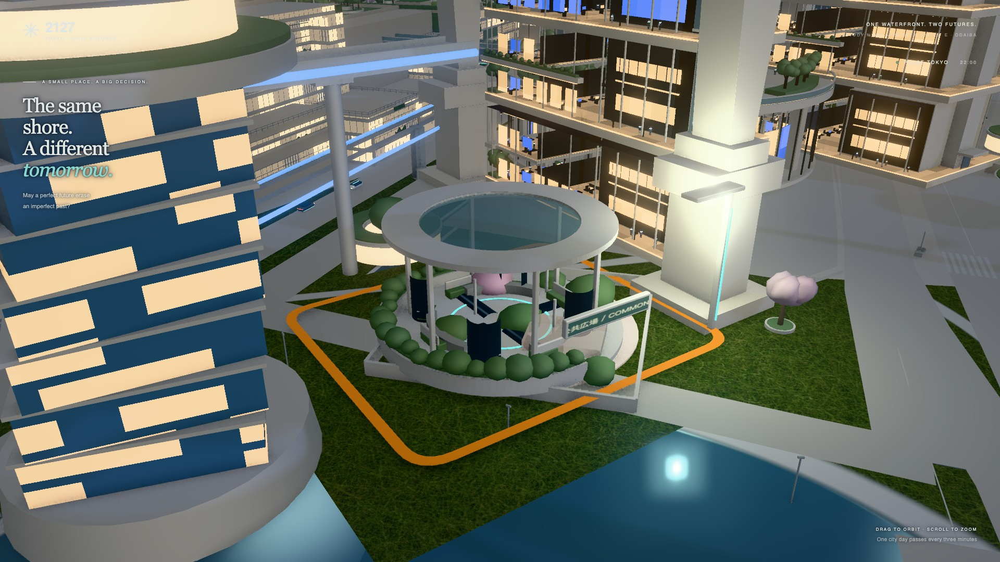](final/sw-focal__0__h22.jpg) |

Pose-only south approach removes the S0 blue skyway crossing and avoids the r3 support; all pavilion geometry remains main. Central seats are clearer, while surrounding tower and planting still compete.

A1 FAIL; A2 PASS; A3 diagnostic FAIL (1/9); A4 diagnostic 0/2; A4 owner PENDING; A5 FAIL (vsync 60; instant calls diagnostic 771/606, canonical gate below); A6 PASS.

- **V1 FAIL**: The public pavilion/sign is clearer without a foreground support, but foliage, the opaque canopy rim and privacy shells still obscure how the seats are used.
- **V2 FAIL**: A cropped smooth blue water surface is visible below, but neither bay horizon, Fuji sphere nor Rainbow Bridge is identifiable in this close crop.
- **V3 FAIL**: A necklace of spherical shrubs, isolated pink/green crowns and roof rows retain the known global planting-language failure.
- **V4 PASS**: Low/private, neutral/mixed and high/shared seating all retain a complete serviced pavilion, platform, canopy and approach; low is not an empty or obsolete site.
- **V5 FAIL**: The roof/platform outline stays visible, but dark screens and seat interiors remain hard to distinguish from the surrounding foliage at hour22.
- **V6 PASS (static)**: No r3 foreground post blocks the pavilion. Existing screen/bench joints appear grounded; static canopy and foliage show no obvious clipping. Temporal flicker is not established.

## sw:focal · 2 · h12

| S0 original | C1 original |
| --- | --- |
| [](../../closeup-polish/S0/baseline/sw-focal__2__h12.jpg) | [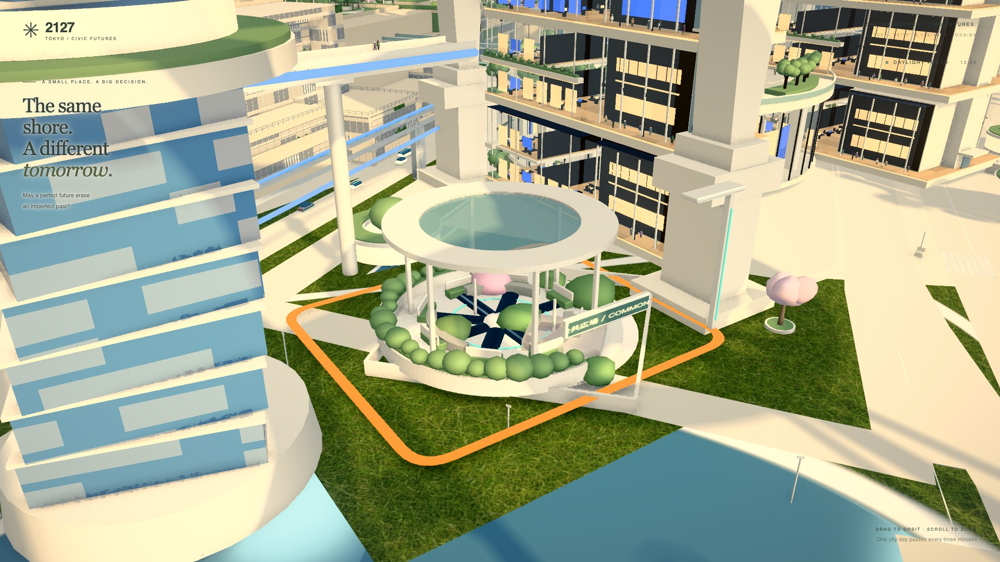](final/sw-focal__2__h12.jpg) |

Pose-only south approach removes the S0 blue skyway crossing and avoids the r3 support; all pavilion geometry remains main. Central seats are clearer, while surrounding tower and planting still compete.

A1 FAIL; A2 PASS; A3 diagnostic FAIL (1/9); A4 diagnostic 0/2; A4 owner PENDING; A5 FAIL (vsync 60; instant calls diagnostic 1139/606, canonical gate below); A6 PASS.

- **V1 FAIL**: The radial shared benches are more exposed with privacy screens absent, but low green crowns and the roof still dominate; the specific shared-seat function does not read immediately.
- **V2 FAIL**: A cropped smooth blue water surface is visible below, but neither bay horizon, Fuji sphere nor Rainbow Bridge is identifiable in this close crop.
- **V3 FAIL**: A necklace of spherical shrubs, isolated pink/green crowns and roof rows retain the known global planting-language failure.
- **V4 PASS**: Low/private, neutral/mixed and high/shared seating all retain a complete serviced pavilion, platform, canopy and approach; low is not an empty or obsolete site.
- **V5 N/A**: Day original; corresponding hour22 reviewed separately.
- **V6 PASS (static)**: No r3 foreground post blocks the pavilion. Existing screen/bench joints appear grounded; static canopy and foliage show no obvious clipping. Temporal flicker is not established.

## sw:focal · 2 · h22

| S0 original | C1 original |
| --- | --- |
| [](../../closeup-polish/S0/baseline/sw-focal__2__h22.jpg) | [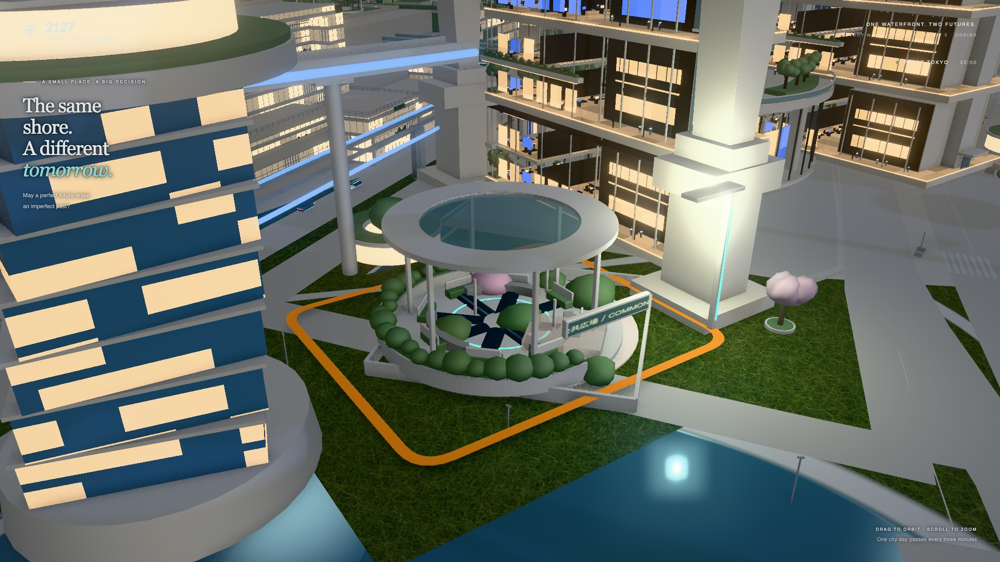](final/sw-focal__2__h22.jpg) |

Pose-only south approach removes the S0 blue skyway crossing and avoids the r3 support; all pavilion geometry remains main. Central seats are clearer, while surrounding tower and planting still compete.

A1 FAIL; A2 PASS; A3 diagnostic FAIL (1/9); A4 diagnostic 0/2; A4 owner PENDING; A5 FAIL (vsync 60; instant calls diagnostic 771/606, canonical gate below); A6 PASS.

- **V1 FAIL**: The radial shared benches are more exposed with privacy screens absent, but low green crowns and the roof still dominate; the specific shared-seat function does not read immediately.
- **V2 FAIL**: A cropped smooth blue water surface is visible below, but neither bay horizon, Fuji sphere nor Rainbow Bridge is identifiable in this close crop.
- **V3 FAIL**: A necklace of spherical shrubs, isolated pink/green crowns and roof rows retain the known global planting-language failure.
- **V4 PASS**: Low/private, neutral/mixed and high/shared seating all retain a complete serviced pavilion, platform, canopy and approach; low is not an empty or obsolete site.
- **V5 FAIL**: Hour22 preserves the canopy/platform silhouette, but shared seats remain dark and masked by green crowns; their use is not readable immediately.
- **V6 PASS (static)**: No r3 foreground post blocks the pavilion. Existing screen/bench joints appear grounded; static canopy and foliage show no obvious clipping. Temporal flicker is not established.

## sw:district · -8 · h12

| S0 original | C1 original |
| --- | --- |
| [](../../closeup-polish/S0/baseline/sw-district__-8__h12.jpg) | [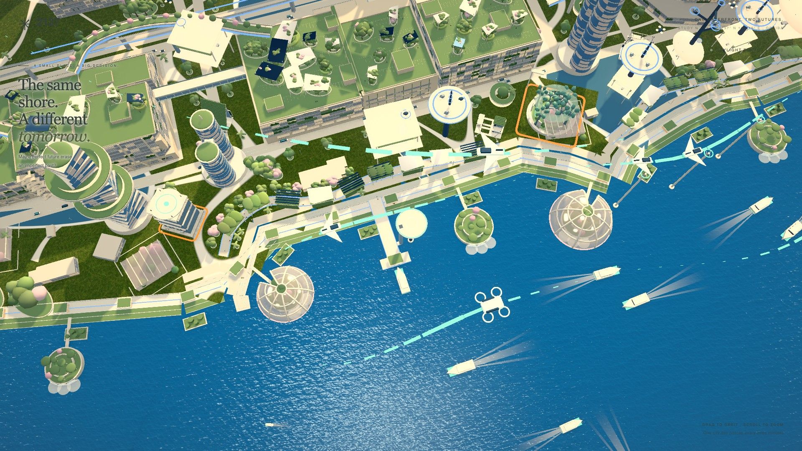](final/sw-district__-8__h12.jpg) |

The selected oblique top view shows the whole waterfront sequence and valid complete-carrier projection; main district geometry/counts are unchanged. Some inland carrier extents remain outside the image and their unclipped AABB stays in raw measurements.

A1 PASS; A2 PASS; A3 diagnostic FAIL (0/9); A4 diagnostic 0/2; A4 owner PENDING; A5 PASS (vsync 59.9; instant calls diagnostic 746/920, canonical gate below); A6 PASS.

- **V1 PASS**: The complete waterfront chain of private climate rooms, shared decks and their land connections reads as a continuous inhabited shore; the result location can be located quickly.
- **V2 PASS**: Open Tokyo Bay water, watercraft and the continuous waterfront establish the location.
- **V3 FAIL**: Roof grids and isolated spherical green/pink crowns remain visible across the district; no vegetation redesign is included.
- **V4 PASS**: Private membrane rooms and public decks retain complete access, floating bases and civic connections. Low remains a mature waterfront alternative.
- **V5 N/A**: Day image; matching night original judged separately.
- **V6 PASS (static)**: Water-room ribs, petals and connecting paths stay attached, with no obvious static clipping or floating joints. Dynamic flicker remains unproven.

## sw:district · -8 · h22

| S0 original | C1 original |
| --- | --- |
| [](../../closeup-polish/S0/baseline/sw-district__-8__h22.jpg) | [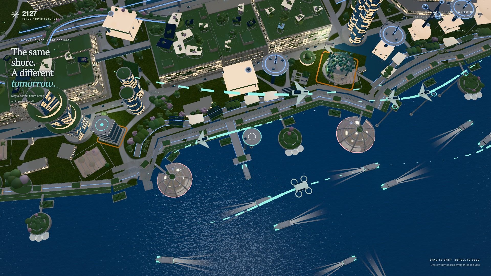](final/sw-district__-8__h22.jpg) |

The selected oblique top view shows the whole waterfront sequence and valid complete-carrier projection; main district geometry/counts are unchanged. Some inland carrier extents remain outside the image and their unclipped AABB stays in raw measurements.

A1 PASS; A2 PASS; A3 diagnostic FAIL (0/9); A4 diagnostic 0/2; A4 owner PENDING; A5 PASS (vsync 60; instant calls diagnostic 746/920, canonical gate below); A6 PASS.

- **V1 PASS**: The complete waterfront chain of private climate rooms, shared decks and their land connections reads as a continuous inhabited shore; the result location can be located quickly.
- **V2 PASS**: Open Tokyo Bay water, watercraft and the continuous waterfront establish the location.
- **V3 FAIL**: Roof grids and isolated spherical green/pink crowns remain visible across the district; no vegetation redesign is included.
- **V4 PASS**: Private membrane rooms and public decks retain complete access, floating bases and civic connections. Low remains a mature waterfront alternative.
- **V5 PASS**: Hour22 keeps the waterfront access, membrane ribs and warm circular deck edges distinct against the bay.
- **V6 PASS (static)**: Water-room ribs, petals and connecting paths stay attached, with no obvious static clipping or floating joints. Dynamic flicker remains unproven.

## sw:district · -5 · h12

| S0 original | C1 original |
| --- | --- |
| [](../../closeup-polish/S0/baseline/sw-district__-5__h12.jpg) | [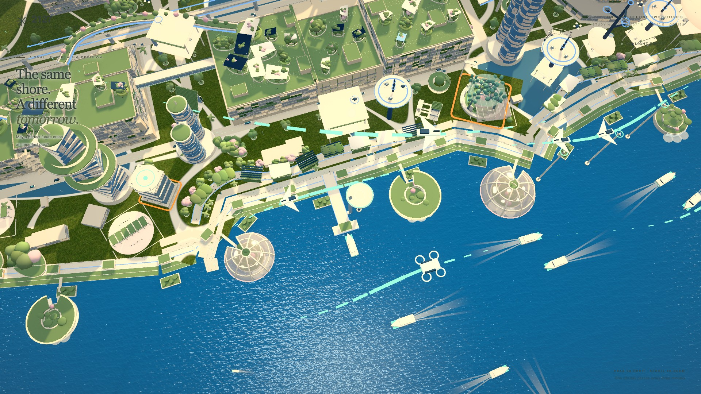](final/sw-district__-5__h12.jpg) |

The selected oblique top view shows the whole waterfront sequence and valid complete-carrier projection; main district geometry/counts are unchanged. Some inland carrier extents remain outside the image and their unclipped AABB stays in raw measurements.

A1 PASS; A2 PASS; A3 diagnostic FAIL (0/9); A4 diagnostic 0/2; A4 owner PENDING; A5 PASS (vsync 60.3; instant calls diagnostic 760/934, canonical gate below); A6 PASS.

- **V1 PASS**: The newly open circular deck and retained membrane rooms form a legible waterfront sequence; both private and shared spaces remain identifiable from above.
- **V2 PASS**: Open Tokyo Bay water, watercraft and the continuous waterfront establish the location.
- **V3 FAIL**: Roof grids and isolated spherical green/pink crowns remain visible across the district; no vegetation redesign is included.
- **V4 PASS**: Private membrane rooms and public decks retain complete access, floating bases and civic connections. Low remains a mature waterfront alternative.
- **V5 N/A**: Day image; matching night original judged separately.
- **V6 PASS (static)**: Water-room ribs, petals and connecting paths stay attached, with no obvious static clipping or floating joints. Dynamic flicker remains unproven.

## sw:district · -5 · h22

| S0 original | C1 original |
| --- | --- |
| [](../../closeup-polish/S0/baseline/sw-district__-5__h22.jpg) | [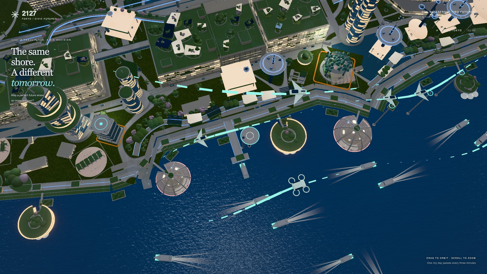](final/sw-district__-5__h22.jpg) |

The selected oblique top view shows the whole waterfront sequence and valid complete-carrier projection; main district geometry/counts are unchanged. Some inland carrier extents remain outside the image and their unclipped AABB stays in raw measurements.

A1 PASS; A2 PASS; A3 diagnostic FAIL (0/9); A4 diagnostic 0/2; A4 owner PENDING; A5 PASS (vsync 60.1; instant calls diagnostic 760/934, canonical gate below); A6 PASS.

- **V1 PASS**: The newly open circular deck and retained membrane rooms form a legible waterfront sequence; both private and shared spaces remain identifiable from above.
- **V2 PASS**: Open Tokyo Bay water, watercraft and the continuous waterfront establish the location.
- **V3 FAIL**: Roof grids and isolated spherical green/pink crowns remain visible across the district; no vegetation redesign is included.
- **V4 PASS**: Private membrane rooms and public decks retain complete access, floating bases and civic connections. Low remains a mature waterfront alternative.
- **V5 PASS**: Hour22 keeps the waterfront access, membrane ribs and warm circular deck edges distinct against the bay.
- **V6 PASS (static)**: Water-room ribs, petals and connecting paths stay attached, with no obvious static clipping or floating joints. Dynamic flicker remains unproven.

## sw:district · 0 · h12

| S0 original | C1 original |
| --- | --- |
| [](../../closeup-polish/S0/baseline/sw-district__0__h12.jpg) | [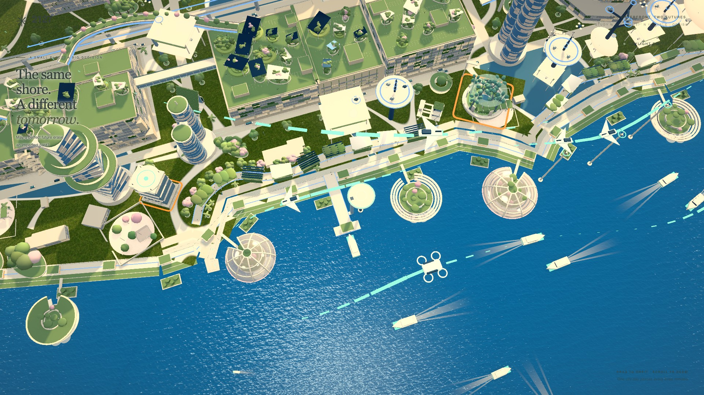](final/sw-district__0__h12.jpg) |

The selected oblique top view shows the whole waterfront sequence and valid complete-carrier projection; main district geometry/counts are unchanged. Some inland carrier extents remain outside the image and their unclipped AABB stays in raw measurements.

A1 PASS; A2 PASS; A3 diagnostic FAIL (0/9); A4 diagnostic 0/2; A4 owner PENDING; A5 PASS (vsync 59.9; instant calls diagnostic 760/934, canonical gate below); A6 PASS.

- **V1 PASS**: Open circular stepped public decks and retained sheltered rooms make the mixed waterfront sequence legible without foreground obstruction.
- **V2 PASS**: Open Tokyo Bay water, watercraft and the continuous waterfront establish the location.
- **V3 FAIL**: Roof grids and isolated spherical green/pink crowns remain visible across the district; no vegetation redesign is included.
- **V4 PASS**: Private membrane rooms and public decks retain complete access, floating bases and civic connections. Low remains a mature waterfront alternative.
- **V5 N/A**: Day image; paired night image reviewed separately.
- **V6 PASS (static)**: Water-room ribs, petals and connecting paths stay attached, with no obvious static clipping or floating joints. Dynamic flicker remains unproven.

## sw:district · 0 · h22

| S0 original | C1 original |
| --- | --- |
| [](../../closeup-polish/S0/baseline/sw-district__0__h22.jpg) | [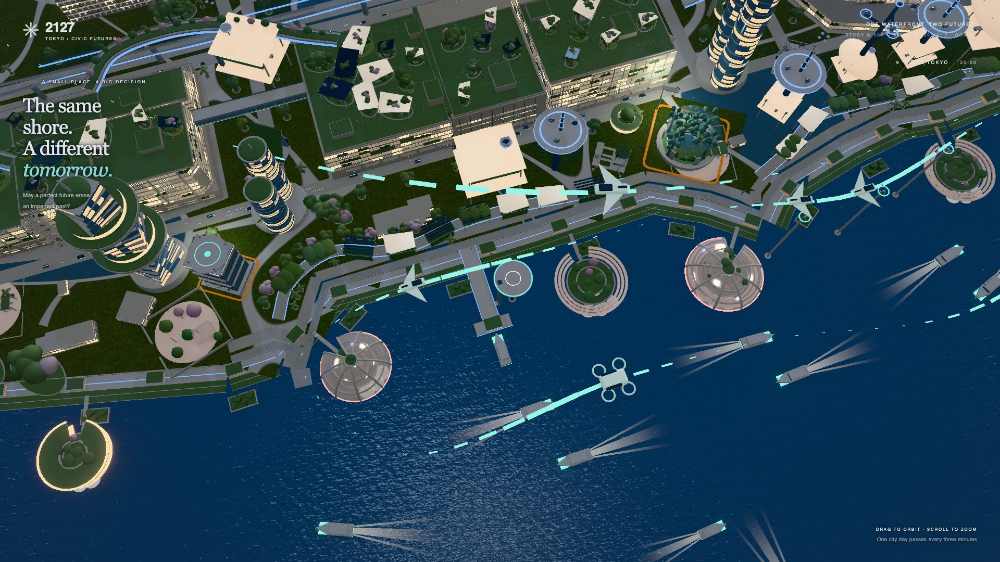](final/sw-district__0__h22.jpg) |

The selected oblique top view shows the whole waterfront sequence and valid complete-carrier projection; main district geometry/counts are unchanged. Some inland carrier extents remain outside the image and their unclipped AABB stays in raw measurements.

A1 PASS; A2 PASS; A3 diagnostic FAIL (0/9); A4 diagnostic 0/2; A4 owner PENDING; A5 PASS (vsync 60.1; instant calls diagnostic 760/934, canonical gate below); A6 PASS.

- **V1 PASS**: Open circular stepped public decks and retained sheltered rooms make the mixed waterfront sequence legible without foreground obstruction.
- **V2 PASS**: Open Tokyo Bay water, watercraft and the continuous waterfront establish the location.
- **V3 FAIL**: Roof grids and isolated spherical green/pink crowns remain visible across the district; no vegetation redesign is included.
- **V4 PASS**: Private membrane rooms and public decks retain complete access, floating bases and civic connections. Low remains a mature waterfront alternative.
- **V5 PASS**: At hour22, stepped decks, membrane ribs and the connecting paths retain distinct outlines and readable changes.
- **V6 PASS (static)**: Water-room ribs, petals and connecting paths stay attached, with no obvious static clipping or floating joints. Dynamic flicker remains unproven.

## sw:district · 5 · h12

| S0 original | C1 original |
| --- | --- |
| [](../../closeup-polish/S0/baseline/sw-district__5__h12.jpg) | [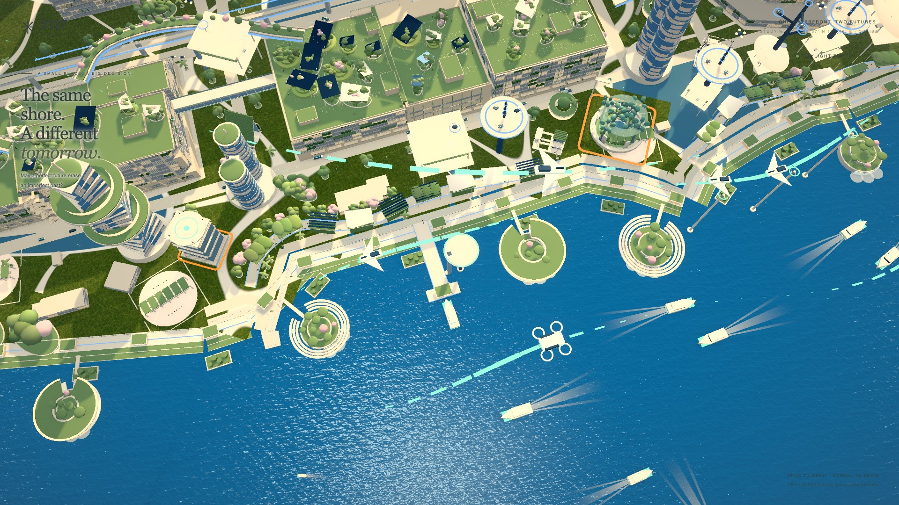](final/sw-district__5__h12.jpg) |

The selected oblique top view shows the whole waterfront sequence and valid complete-carrier projection; main district geometry/counts are unchanged. Some inland carrier extents remain outside the image and their unclipped AABB stays in raw measurements.

A1 PASS; A2 PASS; A3 diagnostic FAIL (0/9); A4 diagnostic 0/2; A4 owner PENDING; A5 PASS (vsync 59.9; instant calls diagnostic 760/934, canonical gate below); A6 PASS.

- **V1 PASS**: Most waterfront rooms are open tiered public decks, with a retained circular sheltered room; their connections and different access types are visible together.
- **V2 PASS**: Open Tokyo Bay water, watercraft and the continuous waterfront establish the location.
- **V3 FAIL**: Roof grids and isolated spherical green/pink crowns remain visible across the district; no vegetation redesign is included.
- **V4 PASS**: Private membrane rooms and public decks retain complete access, floating bases and civic connections. Low remains a mature waterfront alternative.
- **V5 N/A**: Day image; paired night image reviewed separately.
- **V6 PASS (static)**: Water-room ribs, petals and connecting paths stay attached, with no obvious static clipping or floating joints. Dynamic flicker remains unproven.

## sw:district · 5 · h22

| S0 original | C1 original |
| --- | --- |
| [](../../closeup-polish/S0/baseline/sw-district__5__h22.jpg) | [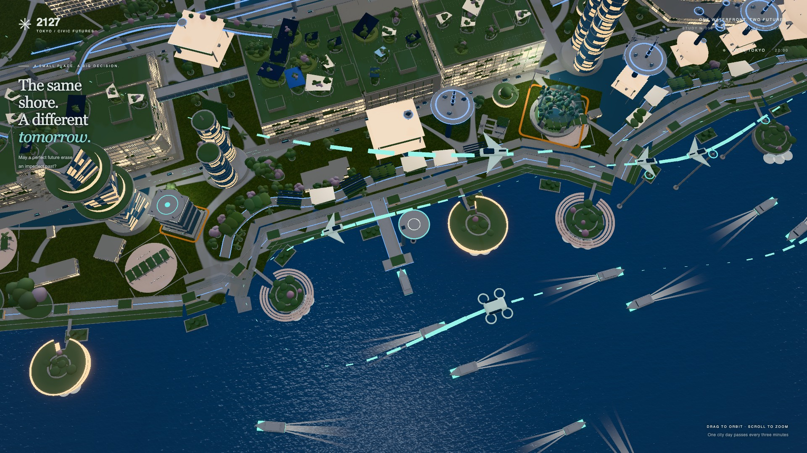](final/sw-district__5__h22.jpg) |

The selected oblique top view shows the whole waterfront sequence and valid complete-carrier projection; main district geometry/counts are unchanged. Some inland carrier extents remain outside the image and their unclipped AABB stays in raw measurements.

A1 PASS; A2 PASS; A3 diagnostic FAIL (0/9); A4 diagnostic 0/2; A4 owner PENDING; A5 PASS (vsync 60.1; instant calls diagnostic 760/934, canonical gate below); A6 PASS.

- **V1 PASS**: Most waterfront rooms are open tiered public decks, with a retained circular sheltered room; their connections and different access types are visible together.
- **V2 PASS**: Open Tokyo Bay water, watercraft and the continuous waterfront establish the location.
- **V3 FAIL**: Roof grids and isolated spherical green/pink crowns remain visible across the district; no vegetation redesign is included.
- **V4 PASS**: Private membrane rooms and public decks retain complete access, floating bases and civic connections. Low remains a mature waterfront alternative.
- **V5 PASS**: At hour22, stepped decks, membrane ribs and the connecting paths retain distinct outlines and readable changes.
- **V6 PASS (static)**: Water-room ribs, petals and connecting paths stay attached, with no obvious static clipping or floating joints. Dynamic flicker remains unproven.

## sw:district · 8 · h12

| S0 original | C1 original |
| --- | --- |
| [](../../closeup-polish/S0/baseline/sw-district__8__h12.jpg) | [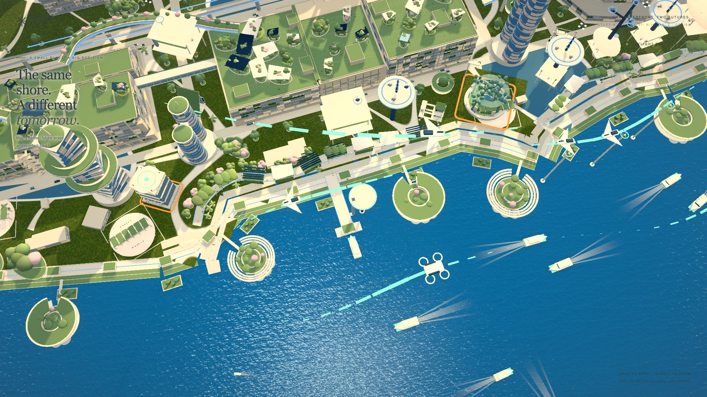](final/sw-district__8__h12.jpg) |

The selected oblique top view shows the whole waterfront sequence and valid complete-carrier projection; main district geometry/counts are unchanged. Some inland carrier extents remain outside the image and their unclipped AABB stays in raw measurements.

A1 PASS; A2 PASS; A3 diagnostic FAIL (0/9); A4 diagnostic 0/2; A4 owner PENDING; A5 PASS (vsync 60; instant calls diagnostic 760/934, canonical gate below); A6 PASS.

- **V1 PASS**: The high-sharing waterfront remains a complete sequence of stepped public decks, sheltered circular rooms and access links, identifiable together at district scale.
- **V2 PASS**: Open Tokyo Bay water, watercraft and the continuous waterfront establish the location.
- **V3 FAIL**: Roof grids and isolated spherical green/pink crowns remain visible across the district; no vegetation redesign is included.
- **V4 PASS**: Private membrane rooms and public decks retain complete access, floating bases and civic connections. Low remains a mature waterfront alternative.
- **V5 N/A**: Day image; paired night image reviewed separately.
- **V6 PASS (static)**: Water-room ribs, petals and connecting paths stay attached, with no obvious static clipping or floating joints. Dynamic flicker remains unproven.

## sw:district · 8 · h22

| S0 original | C1 original |
| --- | --- |
| [](../../closeup-polish/S0/baseline/sw-district__8__h22.jpg) | [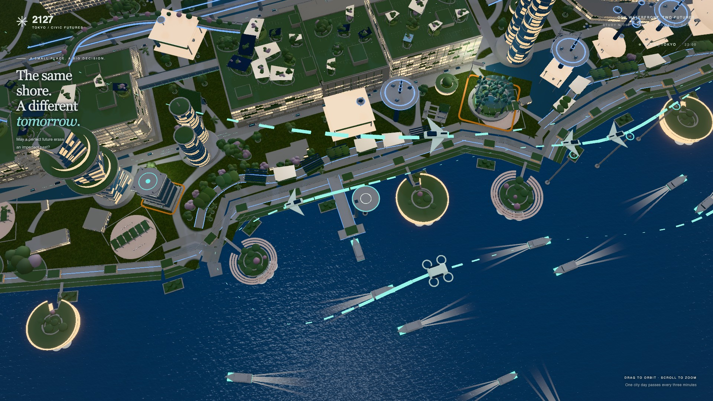](final/sw-district__8__h22.jpg) |

The selected oblique top view shows the whole waterfront sequence and valid complete-carrier projection; main district geometry/counts are unchanged. Some inland carrier extents remain outside the image and their unclipped AABB stays in raw measurements.

A1 PASS; A2 PASS; A3 diagnostic FAIL (0/9); A4 diagnostic 0/2; A4 owner PENDING; A5 PASS (vsync 60.1; instant calls diagnostic 760/934, canonical gate below); A6 PASS.

- **V1 PASS**: The high-sharing waterfront remains a complete sequence of stepped public decks, sheltered circular rooms and access links, identifiable together at district scale.
- **V2 PASS**: Open Tokyo Bay water, watercraft and the continuous waterfront establish the location.
- **V3 FAIL**: Roof grids and isolated spherical green/pink crowns remain visible across the district; no vegetation redesign is included.
- **V4 PASS**: Private membrane rooms and public decks retain complete access, floating bases and civic connections. Low remains a mature waterfront alternative.
- **V5 PASS**: At hour22, stepped decks, membrane ribs and the connecting paths retain distinct outlines and readable changes.
- **V6 PASS (static)**: Water-room ribs, petals and connecting paths stay attached, with no obvious static clipping or floating joints. Dynamic flicker remains unproven.

## se:district · -8 · h12

| S0 original | C1 original |
| --- | --- |
| [](../../closeup-polish/S0/baseline/se-district__-8__h12.jpg) | [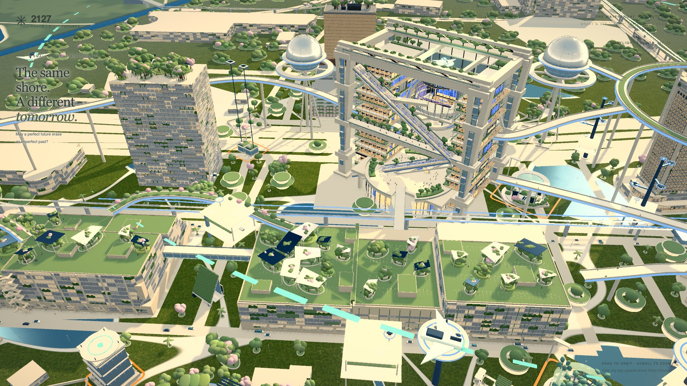](final/se-district__-8__h12.jpg) |

The selected pose moves the complete carrier bounds in front of the near plane, but their projected center stays below the viewport (A2 FAIL). More civic context is visible; all concentration geometry remains main.

A1 PASS; A2 FAIL; A3 diagnostic FAIL (0/9); A4 diagnostic 0/2; A4 owner PENDING; A5 FAIL (vsync 59.9; instant calls diagnostic 899/717, canonical gate below); A6 PASS.

- **V1 FAIL**: The civic frame is the strongest subject; the concentration carriers remain small generic roofs/blue towers distributed around or beyond the frame, so their functional role is not identifiable quickly.
- **V2 PASS**: Fuji civic sphere/frame and the distant bay remain in view.
- **V3 FAIL**: Rectangular roof planting grids, isolated round crowns and spherical street trees retain the global vegetation failure.
- **V4 PASS**: The district remains a connected mature civic network with occupied frame, elevated circulation and complete low-density alternatives; low is not an empty earlier-era city.
- **V5 N/A**: Day image; corresponding night original reviewed separately.
- **V6 PASS (static)**: Visible civic joints, rooftop supports and guideways remain attached with no obvious static clipping. Offscreen parts and temporal flicker are not established.

## se:district · -8 · h22

| S0 original | C1 original |
| --- | --- |
| [](../../closeup-polish/S0/baseline/se-district__-8__h22.jpg) | [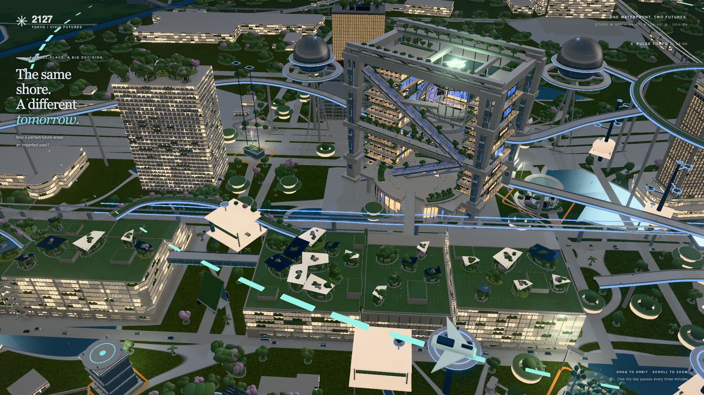](final/se-district__-8__h22.jpg) |

The selected pose moves the complete carrier bounds in front of the near plane, but their projected center stays below the viewport (A2 FAIL). More civic context is visible; all concentration geometry remains main.

A1 PASS; A2 FAIL; A3 diagnostic FAIL (0/9); A4 diagnostic 0/2; A4 owner PENDING; A5 FAIL (vsync 59.9; instant calls diagnostic 899/717, canonical gate below); A6 PASS.

- **V1 FAIL**: The civic frame is the strongest subject; the concentration carriers remain small generic roofs/blue towers distributed around or beyond the frame, so their functional role is not identifiable quickly.
- **V2 PASS**: Fuji civic sphere/frame and the distant bay remain in view.
- **V3 FAIL**: Rectangular roof planting grids, isolated round crowns and spherical street trees retain the global vegetation failure.
- **V4 PASS**: The district remains a connected mature civic network with occupied frame, elevated circulation and complete low-density alternatives; low is not an empty earlier-era city.
- **V5 FAIL**: The illuminated civic landmark dominates; dark small roof carriers and offscreen extents do not make the concentration change reliably readable at night.
- **V6 PASS (static)**: Visible civic joints, rooftop supports and guideways remain attached with no obvious static clipping. Offscreen parts and temporal flicker are not established.

## se:district · -5 · h12

| S0 original | C1 original |
| --- | --- |
| [](../../closeup-polish/S0/baseline/se-district__-5__h12.jpg) | [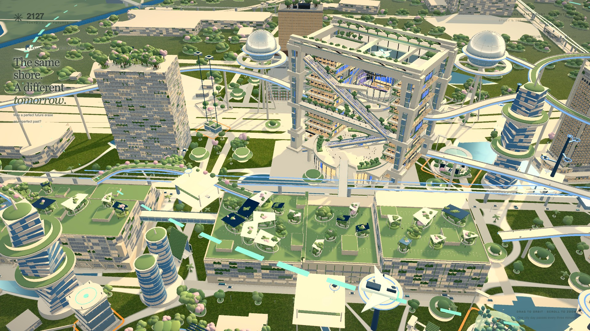](final/se-district__-5__h12.jpg) |

The selected pose moves the complete carrier bounds in front of the near plane, but their projected center stays below the viewport (A2 FAIL). More civic context is visible; all concentration geometry remains main.

A1 PASS; A2 FAIL; A3 diagnostic FAIL (0/9); A4 diagnostic 0/2; A4 owner PENDING; A5 FAIL (vsync 59.9; instant calls diagnostic 899/717, canonical gate below); A6 PASS.

- **V1 FAIL**: The civic frame is the strongest subject; the concentration carriers remain small generic roofs/blue towers distributed around or beyond the frame, so their functional role is not identifiable quickly.
- **V2 PASS**: Fuji civic sphere/frame and the distant bay remain in view.
- **V3 FAIL**: Rectangular roof planting grids, isolated round crowns and spherical street trees retain the global vegetation failure.
- **V4 PASS**: The district remains a connected mature civic network with occupied frame, elevated circulation and complete low-density alternatives; low is not an empty earlier-era city.
- **V5 N/A**: Day image; corresponding night original reviewed separately.
- **V6 PASS (static)**: Visible civic joints, rooftop supports and guideways remain attached with no obvious static clipping. Offscreen parts and temporal flicker are not established.

## se:district · -5 · h22

| S0 original | C1 original |
| --- | --- |
| [](../../closeup-polish/S0/baseline/se-district__-5__h22.jpg) | [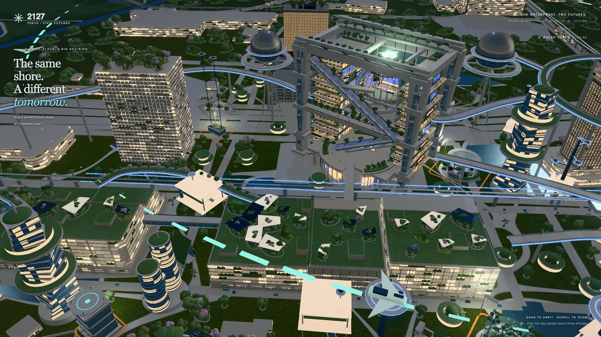](final/se-district__-5__h22.jpg) |

The selected pose moves the complete carrier bounds in front of the near plane, but their projected center stays below the viewport (A2 FAIL). More civic context is visible; all concentration geometry remains main.

A1 PASS; A2 FAIL; A3 diagnostic FAIL (0/9); A4 diagnostic 0/2; A4 owner PENDING; A5 FAIL (vsync 59.9; instant calls diagnostic 899/717, canonical gate below); A6 PASS.

- **V1 FAIL**: The civic frame is the strongest subject; the concentration carriers remain small generic roofs/blue towers distributed around or beyond the frame, so their functional role is not identifiable quickly.
- **V2 PASS**: Fuji civic sphere/frame and the distant bay remain in view.
- **V3 FAIL**: Rectangular roof planting grids, isolated round crowns and spherical street trees retain the global vegetation failure.
- **V4 PASS**: The district remains a connected mature civic network with occupied frame, elevated circulation and complete low-density alternatives; low is not an empty earlier-era city.
- **V5 FAIL**: The illuminated civic landmark dominates; dark small roof carriers and offscreen extents do not make the concentration change reliably readable at night.
- **V6 PASS (static)**: Visible civic joints, rooftop supports and guideways remain attached with no obvious static clipping. Offscreen parts and temporal flicker are not established.

## se:district · 0 · h12

| S0 original | C1 original |
| --- | --- |
| [](../../closeup-polish/S0/baseline/se-district__0__h12.jpg) | [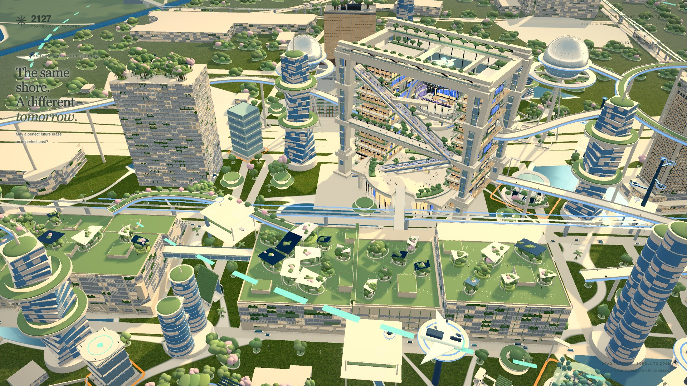](final/se-district__0__h12.jpg) |

The selected pose moves the complete carrier bounds in front of the near plane, but their projected center stays below the viewport (A2 FAIL). More civic context is visible; all concentration geometry remains main.

A1 PASS; A2 FAIL; A3 diagnostic FAIL (0/9); A4 diagnostic 0/2; A4 owner PENDING; A5 FAIL (vsync 60; instant calls diagnostic 897/715, canonical gate below); A6 PASS.

- **V1 FAIL**: More stacked blue towers and cylindrical modules are visible, but their program remains indistinguishable from neighboring towers; the civic landmark still takes attention and much of the carrier remains outside the frame.
- **V2 PASS**: Fuji civic sphere/frame and the distant bay remain in view.
- **V3 FAIL**: Rectangular roof planting grids, isolated round crowns and spherical street trees retain the global vegetation failure.
- **V4 PASS**: Complete stacked volumes, elevated civic connections and occupied terraces retain a mature mixed/high-density alternative, with no empty or earlier-era fallback.
- **V5 N/A**: Day image; corresponding night original reviewed separately.
- **V6 PASS (static)**: Visible civic joints, rooftop supports and guideways remain attached with no obvious static clipping. Offscreen parts and temporal flicker are not established.

## se:district · 0 · h22

| S0 original | C1 original |
| --- | --- |
| [](../../closeup-polish/S0/baseline/se-district__0__h22.jpg) | [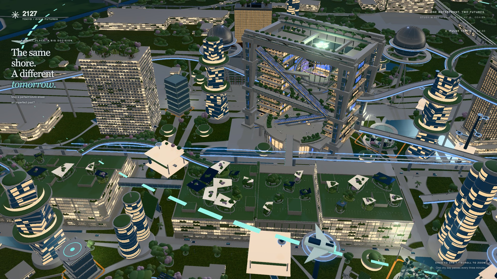](final/se-district__0__h22.jpg) |

The selected pose moves the complete carrier bounds in front of the near plane, but their projected center stays below the viewport (A2 FAIL). More civic context is visible; all concentration geometry remains main.

A1 PASS; A2 FAIL; A3 diagnostic FAIL (0/9); A4 diagnostic 0/2; A4 owner PENDING; A5 FAIL (vsync 60; instant calls diagnostic 897/715, canonical gate below); A6 PASS.

- **V1 FAIL**: More stacked blue towers and cylindrical modules are visible, but their program remains indistinguishable from neighboring towers; the civic landmark still takes attention and much of the carrier remains outside the frame.
- **V2 PASS**: Fuji civic sphere/frame and the distant bay remain in view.
- **V3 FAIL**: Rectangular roof planting grids, isolated round crowns and spherical street trees retain the global vegetation failure.
- **V4 PASS**: Complete stacked volumes, elevated civic connections and occupied terraces retain a mature mixed/high-density alternative, with no empty or earlier-era fallback.
- **V5 FAIL**: The illuminated civic landmark dominates; dark small roof carriers and offscreen extents do not make the concentration change reliably readable at night.
- **V6 PASS (static)**: Visible civic joints, rooftop supports and guideways remain attached with no obvious static clipping. Offscreen parts and temporal flicker are not established.

## se:district · 5 · h12

| S0 original | C1 original |
| --- | --- |
| [](../../closeup-polish/S0/baseline/se-district__5__h12.jpg) | [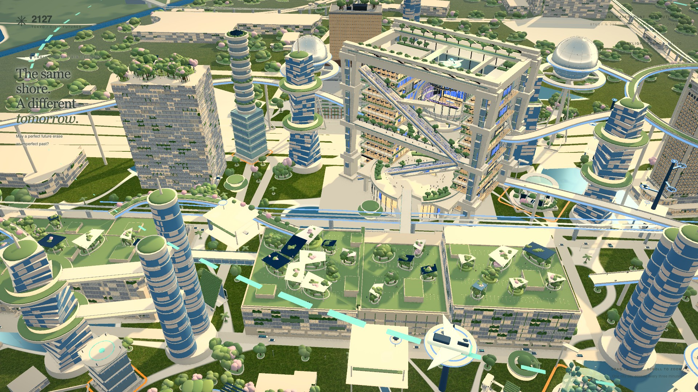](final/se-district__5__h12.jpg) |

The selected pose moves the complete carrier bounds in front of the near plane, but their projected center stays below the viewport (A2 FAIL). More civic context is visible; all concentration geometry remains main.

A1 PASS; A2 FAIL; A3 diagnostic FAIL (0/9); A4 diagnostic 0/2; A4 owner PENDING; A5 FAIL (vsync 60; instant calls diagnostic 925/743, canonical gate below); A6 PASS.

- **V1 FAIL**: More stacked blue towers and cylindrical modules are visible, but their program remains indistinguishable from neighboring towers; the civic landmark still takes attention and much of the carrier remains outside the frame.
- **V2 PASS**: Fuji civic sphere/frame and the distant bay remain in view.
- **V3 FAIL**: Rectangular roof planting grids, isolated round crowns and spherical street trees retain the global vegetation failure.
- **V4 PASS**: Complete stacked volumes, elevated civic connections and occupied terraces retain a mature mixed/high-density alternative, with no empty or earlier-era fallback.
- **V5 N/A**: Day image; corresponding night original reviewed separately.
- **V6 PASS (static)**: Visible civic joints, rooftop supports and guideways remain attached with no obvious static clipping. Offscreen parts and temporal flicker are not established.

## se:district · 5 · h22

| S0 original | C1 original |
| --- | --- |
| [](../../closeup-polish/S0/baseline/se-district__5__h22.jpg) | [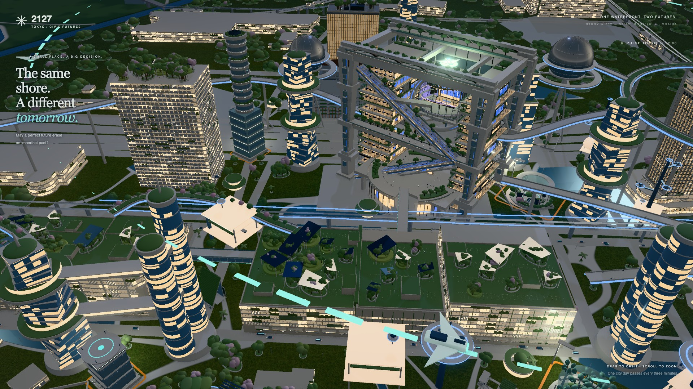](final/se-district__5__h22.jpg) |

The selected pose moves the complete carrier bounds in front of the near plane, but their projected center stays below the viewport (A2 FAIL). More civic context is visible; all concentration geometry remains main.

A1 PASS; A2 FAIL; A3 diagnostic FAIL (0/9); A4 diagnostic 0/2; A4 owner PENDING; A5 FAIL (vsync 60; instant calls diagnostic 925/743, canonical gate below); A6 PASS.

- **V1 FAIL**: More stacked blue towers and cylindrical modules are visible, but their program remains indistinguishable from neighboring towers; the civic landmark still takes attention and much of the carrier remains outside the frame.
- **V2 PASS**: Fuji civic sphere/frame and the distant bay remain in view.
- **V3 FAIL**: Rectangular roof planting grids, isolated round crowns and spherical street trees retain the global vegetation failure.
- **V4 PASS**: Complete stacked volumes, elevated civic connections and occupied terraces retain a mature mixed/high-density alternative, with no empty or earlier-era fallback.
- **V5 FAIL**: The illuminated civic landmark dominates; dark small roof carriers and offscreen extents do not make the concentration change reliably readable at night.
- **V6 PASS (static)**: Visible civic joints, rooftop supports and guideways remain attached with no obvious static clipping. Offscreen parts and temporal flicker are not established.

## se:district · 8 · h12

| S0 original | C1 original |
| --- | --- |
| [](../../closeup-polish/S0/baseline/se-district__8__h12.jpg) | [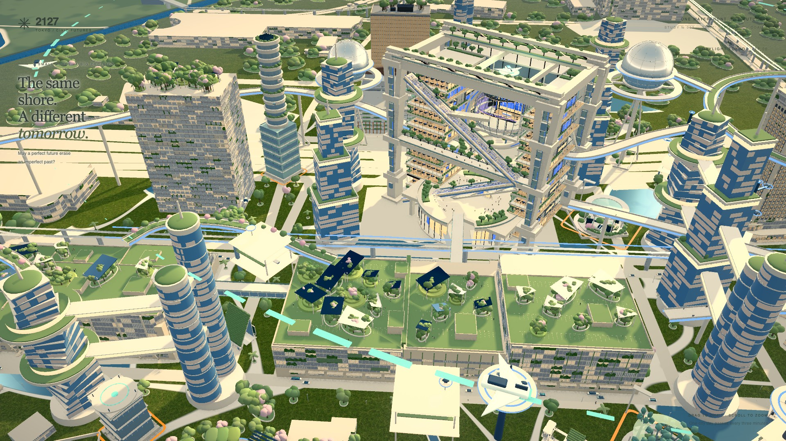](final/se-district__8__h12.jpg) |

The selected pose moves the complete carrier bounds in front of the near plane, but their projected center stays below the viewport (A2 FAIL). More civic context is visible; all concentration geometry remains main.

A1 PASS; A2 FAIL; A3 diagnostic FAIL (0/9); A4 diagnostic 0/2; A4 owner PENDING; A5 FAIL (vsync 60; instant calls diagnostic 925/743, canonical gate below); A6 PASS.

- **V1 FAIL**: More stacked blue towers and cylindrical modules are visible, but their program remains indistinguishable from neighboring towers; the civic landmark still takes attention and much of the carrier remains outside the frame.
- **V2 PASS**: Fuji civic sphere/frame and the distant bay remain in view.
- **V3 FAIL**: Rectangular roof planting grids, isolated round crowns and spherical street trees retain the global vegetation failure.
- **V4 PASS**: Complete stacked volumes, elevated civic connections and occupied terraces retain a mature mixed/high-density alternative, with no empty or earlier-era fallback.
- **V5 N/A**: Day image; corresponding night original reviewed separately.
- **V6 PASS (static)**: Visible civic joints, rooftop supports and guideways remain attached with no obvious static clipping. Offscreen parts and temporal flicker are not established.

## se:district · 8 · h22

| S0 original | C1 original |
| --- | --- |
| [](../../closeup-polish/S0/baseline/se-district__8__h22.jpg) | [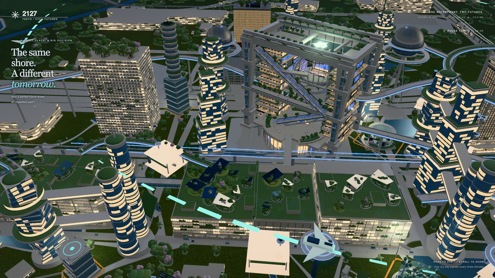](final/se-district__8__h22.jpg) |

The selected pose moves the complete carrier bounds in front of the near plane, but their projected center stays below the viewport (A2 FAIL). More civic context is visible; all concentration geometry remains main.

A1 PASS; A2 FAIL; A3 diagnostic FAIL (0/9); A4 diagnostic 0/2; A4 owner PENDING; A5 FAIL (vsync 60.1; instant calls diagnostic 925/743, canonical gate below); A6 PASS.

- **V1 FAIL**: More stacked blue towers and cylindrical modules are visible, but their program remains indistinguishable from neighboring towers; the civic landmark still takes attention and much of the carrier remains outside the frame.
- **V2 PASS**: Fuji civic sphere/frame and the distant bay remain in view.
- **V3 FAIL**: Rectangular roof planting grids, isolated round crowns and spherical street trees retain the global vegetation failure.
- **V4 PASS**: Complete stacked volumes, elevated civic connections and occupied terraces retain a mature mixed/high-density alternative, with no empty or earlier-era fallback.
- **V5 FAIL**: The illuminated civic landmark dominates; dark small roof carriers and offscreen extents do not make the concentration change reliably readable at night.
- **V6 PASS (static)**: Visible civic joints, rooftop supports and guideways remain attached with no obvious static clipping. Offscreen parts and temporal flicker are not established.

## energy:ring · baseline · h12

| S0 original | C1 original |
| --- | --- |
| [](../../closeup-polish/S0/baseline/energy-ring__baseline__h12.jpg) | [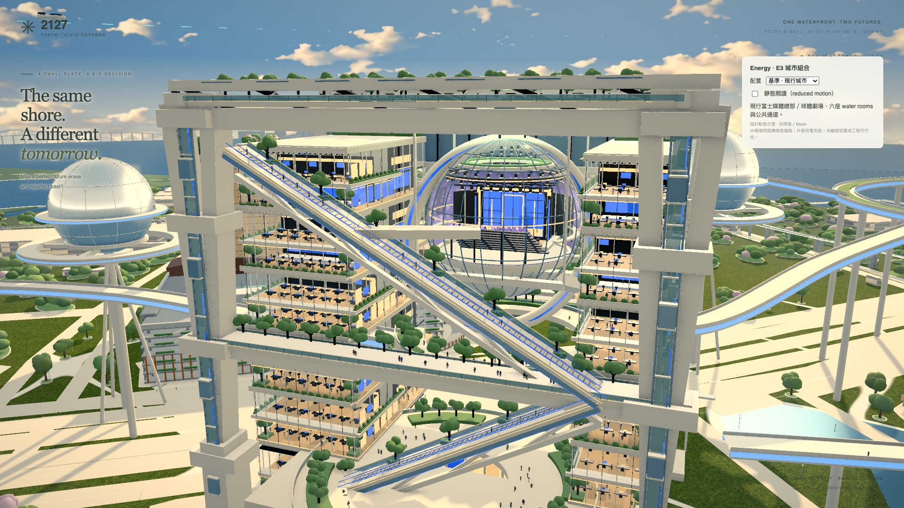](final/energy-ring__baseline__h12.jpg) |

Ring absent by authoritative baseline configuration. The selected pose centers the Fuji sphere and framed public interiors, with the bridge/bay still visible; no energy body is fabricated for the absent state.

A1 N/A; A2 N/A; A3 diagnostic N/A (0/9); A4 diagnostic 0/2; A4 owner N/A; A5 PASS (vsync 60; instant calls diagnostic 421/594, canonical gate below); A6 PASS.

- **V1 N/A**: The ring is absent in baseline.
- **V2 PASS**: Fuji sphere, the bay and part of Rainbow Bridge establish the civic location.
- **V3 FAIL**: Rounded crowns along the civic beam and roof still read as isolated rows; global vegetation remains outside C1.
- **V4 N/A**: No ring body in this configuration; the existing mature civic building is unchanged.
- **V5 N/A**: No ring body in this configuration.
- **V6 N/A**: No ring body to inspect; the surrounding civic geometry shows no new static defect.

## energy:ring · baseline · h22

| S0 original | C1 original |
| --- | --- |
| [](../../closeup-polish/S0/baseline/energy-ring__baseline__h22.jpg) | [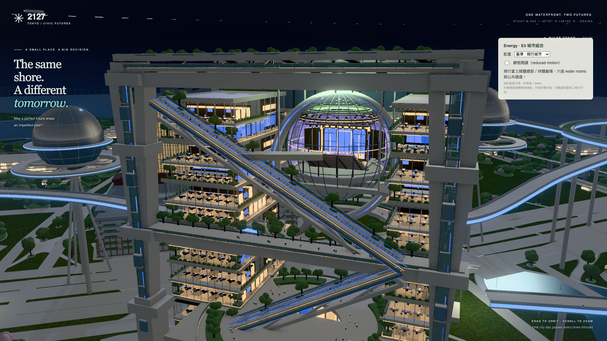](final/energy-ring__baseline__h22.jpg) |

Ring absent by authoritative baseline configuration. The selected pose centers the Fuji sphere and framed public interiors, with the bridge/bay still visible; no energy body is fabricated for the absent state.

A1 N/A; A2 N/A; A3 diagnostic N/A (0/9); A4 diagnostic 0/2; A4 owner N/A; A5 PASS (vsync 60; instant calls diagnostic 421/417, canonical gate below); A6 PASS.

- **V1 N/A**: The ring is absent in baseline.
- **V2 PASS**: Fuji sphere, the bay and part of Rainbow Bridge establish the civic location.
- **V3 FAIL**: Rounded crowns along the civic beam and roof still read as isolated rows; global vegetation remains outside C1.
- **V4 N/A**: No ring body in this configuration; the existing mature civic building is unchanged.
- **V5 N/A**: No ring body in this configuration.
- **V6 N/A**: No ring body to inspect; the surrounding civic geometry shows no new static defect.

## energy:ring · b · h12

| S0 original | C1 original |
| --- | --- |
| [](../../closeup-polish/S0/baseline/energy-ring__b__h12.jpg) | [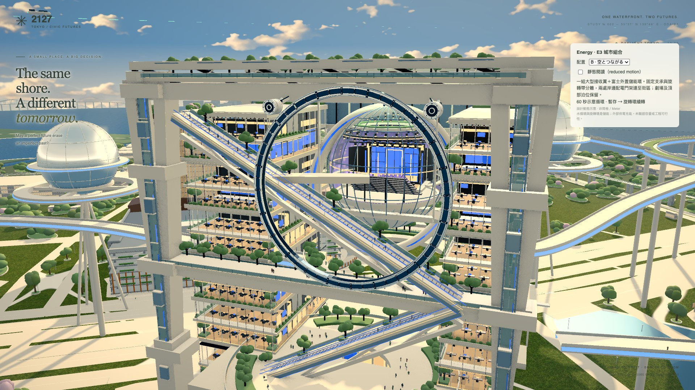](final/energy-ring__b__h12.jpg) |

The selected front-on ring pose exposes the full segmented rotor, drive pods and the civic sphere within its opening. Exact main energy geometry/cycle is retained; narration understanding is not tested.

A1 PASS; A2 PASS; A3 diagnostic FAIL (0/9); A4 diagnostic 0/2; A4 owner N/A; A5 PASS (vsync 60.1; instant calls diagnostic 447/443, canonical gate below); A6 PASS.

- **V1 PASS**: The segmented mechanical ring and two opposed drive pods are distinct from the civic sphere and read quickly as the selected ring facility; this is not proof of understanding the storage cycle.
- **V2 PASS**: The Fuji civic sphere/frame, bay and bridge remain directly behind/beside the ring.
- **V3 FAIL**: Rows of rounded civic trees and isolated ground crowns retain the known global vegetation failure.
- **V4 PASS**: Segmented stator, drive housings and visible joints express a complete civic-scale machine integrated with the frame; no earlier-era fallback.
- **V5 N/A**: Day original; paired hour22 reviewed separately.
- **V6 PASS (static)**: Segmented rims, drive pods and collars remain aligned without obvious static clipping or detached parts. This original does not prove all-time motion quality.

## energy:ring · b · h22

| S0 original | C1 original |
| --- | --- |
| [](../../closeup-polish/S0/baseline/energy-ring__b__h22.jpg) | [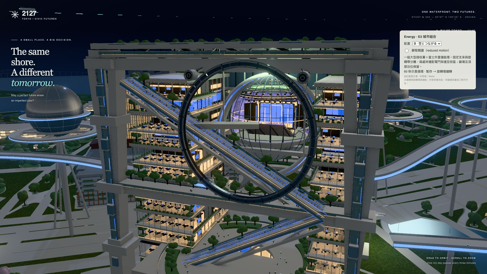](final/energy-ring__b__h22.jpg) |

The selected front-on ring pose exposes the full segmented rotor, drive pods and the civic sphere within its opening. Exact main energy geometry/cycle is retained; narration understanding is not tested.

A1 PASS; A2 PASS; A3 diagnostic FAIL (0/9); A4 diagnostic 0/2; A4 owner N/A; A5 PASS (vsync 60; instant calls diagnostic 447/443, canonical gate below); A6 PASS.

- **V1 PASS**: The segmented mechanical ring and two opposed drive pods are distinct from the civic sphere and read quickly as the selected ring facility; this is not proof of understanding the storage cycle.
- **V2 PASS**: The Fuji civic sphere/frame, bay and bridge remain directly behind/beside the ring.
- **V3 FAIL**: Rows of rounded civic trees and isolated ground crowns retain the known global vegetation failure.
- **V4 PASS**: Segmented stator, drive housings and visible joints express a complete civic-scale machine integrated with the frame; no earlier-era fallback.
- **V5 PASS**: At hour22 the dark ring remains a continuous legible silhouette against occupied interiors, and its presence differs clearly from the absent baseline.
- **V6 PASS (static)**: Segmented rims, drive pods and collars remain aligned without obvious static clipping or detached parts. This original does not prove all-time motion quality.

## energy:ring · mixed · h12

| S0 original | C1 original |
| --- | --- |
| [](../../closeup-polish/S0/baseline/energy-ring__mixed__h12.jpg) | [](final/energy-ring__mixed__h12.jpg) |

The selected front-on ring pose exposes the full segmented rotor, drive pods and the civic sphere within its opening. Exact main energy geometry/cycle is retained; narration understanding is not tested. B and mixed intentionally share the same ring body; no fabricated option-specific ring difference.

A1 PASS; A2 PASS; A3 diagnostic FAIL (0/9); A4 diagnostic 0/2; A4 owner N/A; A5 PASS (vsync 60; instant calls diagnostic 447/443, canonical gate below); A6 PASS.

- **V1 PASS**: The segmented mechanical ring and two opposed drive pods are distinct from the civic sphere and read quickly as the selected ring facility; this is not proof of understanding the storage cycle.
- **V2 PASS**: The Fuji civic sphere/frame, bay and bridge remain directly behind/beside the ring.
- **V3 FAIL**: Rows of rounded civic trees and isolated ground crowns retain the known global vegetation failure.
- **V4 PASS**: Segmented stator, drive housings and visible joints express a complete civic-scale machine integrated with the frame; no earlier-era fallback.
- **V5 N/A**: Day original; paired hour22 reviewed separately.
- **V6 PASS (static)**: Segmented rims, drive pods and collars remain aligned without obvious static clipping or detached parts. This original does not prove all-time motion quality.

## energy:ring · mixed · h22

| S0 original | C1 original |
| --- | --- |
| [](../../closeup-polish/S0/baseline/energy-ring__mixed__h22.jpg) | [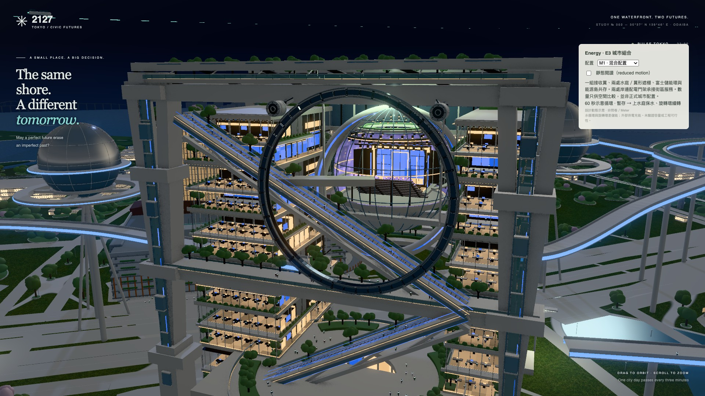](final/energy-ring__mixed__h22.jpg) |

The selected front-on ring pose exposes the full segmented rotor, drive pods and the civic sphere within its opening. Exact main energy geometry/cycle is retained; narration understanding is not tested. B and mixed share the same ring body; only portfolio context changes.

A1 PASS; A2 PASS; A3 diagnostic FAIL (0/9); A4 diagnostic 0/2; A4 owner N/A; A5 PASS (vsync 60; instant calls diagnostic 447/443, canonical gate below); A6 PASS.

- **V1 PASS**: The segmented mechanical ring and two opposed drive pods are distinct from the civic sphere and read quickly as the selected ring facility; this is not proof of understanding the storage cycle.
- **V2 PASS**: The Fuji civic sphere/frame, bay and bridge remain directly behind/beside the ring.
- **V3 FAIL**: Rows of rounded civic trees and isolated ground crowns retain the known global vegetation failure.
- **V4 PASS**: Segmented stator, drive housings and visible joints express a complete civic-scale machine integrated with the frame; no earlier-era fallback.
- **V5 PASS**: At hour22 the dark ring remains a continuous legible silhouette against occupied interiors, and its presence differs clearly from the absent baseline.
- **V6 PASS (static)**: Segmented rims, drive pods and collars remain aligned without obvious static clipping or detached parts. This original does not prove all-time motion quality.

## hero · neutral · h12

| S0 original | C1 original |
| --- | --- |
| [](../../closeup-polish/S0/baseline/hero__neutral__h12.jpg) | [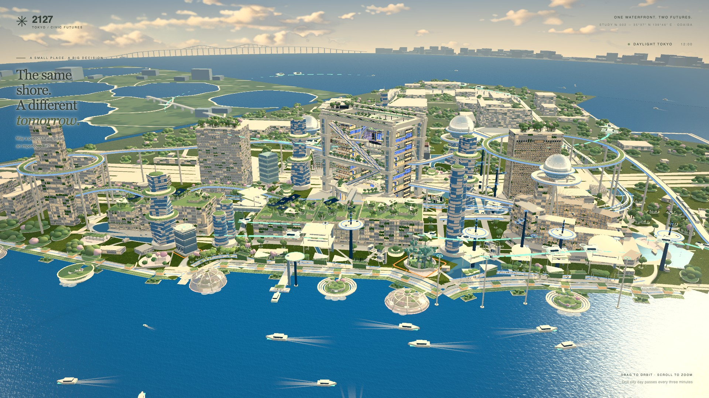](final/hero__neutral__h12.jpg) |

The authored hero position/target/FOV remain unchanged. The localized NW service faces are small at this scale; overall city/waterfront relationships match S0, subject to preserved reload/actor/noise differences.

A1 N/A; A2 N/A; A3 diagnostic N/A (—/9); A4 diagnostic 0/0; A4 owner N/A; A5 PASS (vsync 60; instant calls diagnostic 950/948, canonical gate below); A6 PASS.

- **V1 N/A**: Hero has no selected headline facility.
- **V2 PASS**: Bay, Rainbow Bridge and Fuji civic landmark all establish Odaiba.
- **V3 FAIL**: Whole-city lollipop crowns and regular roof planting grids remain visible; no vegetation redesign is claimed.
- **V4 PASS**: The connected civic chassis, elevated mobility and amphibious waterfront remain a complete mature2127 city.
- **V5 N/A**: Day hero; the matching night original is reviewed separately.
- **V6 PASS (static)**: No new static geometry defect or shifted landmark relationship is visible; temporal/long-run claims are excluded.

## hero · neutral · h22

| S0 original | C1 original |
| --- | --- |
| [](../../closeup-polish/S0/baseline/hero__neutral__h22.jpg) | [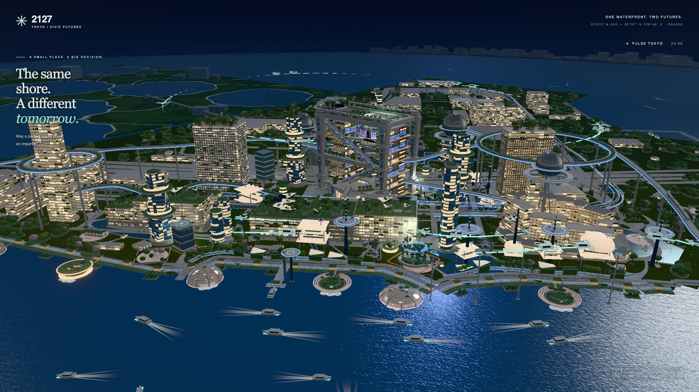](final/hero__neutral__h22.jpg) |

The authored hero position/target/FOV remain unchanged. The localized NW service faces are small at this scale; overall city/waterfront relationships match S0, subject to preserved reload/actor/noise differences.

A1 N/A; A2 N/A; A3 diagnostic N/A (—/9); A4 diagnostic 0/0; A4 owner N/A; A5 PASS (vsync 60.2; instant calls diagnostic 950/948, canonical gate below); A6 PASS.

- **V1 N/A**: Hero has no selected headline facility.
- **V2 PASS**: Bay, Rainbow Bridge and Fuji civic landmark all establish Odaiba.
- **V3 FAIL**: Whole-city lollipop crowns and regular roof planting grids remain visible; no vegetation redesign is claimed.
- **V4 PASS**: The connected civic chassis, elevated mobility and amphibious waterfront remain a complete mature2127 city.
- **V5 PASS**: Bay edge, occupied civic frame, route lighting and complete district silhouettes remain legible at hour22 without a shifted hero.
- **V6 PASS (static)**: No new static geometry defect or shifted landmark relationship is visible; temporal/long-run claims are excluded.

## Canonical A5

Two independent navigations, each ≥16s warmup then ≥5s raw rAF window. Both uncapping flags, default quality; no sample rejection.

| Shot | Hour | FPS / S0 | Ratio | Raw calls | Mean / S0 calls | Gate |
| --- | --- | --- | --- | --- | --- | --- |
| nw:focal | 12 | 91.69 / 95.56 | 95.95% | 957/957 | 957/775 | FAIL |
| nw:focal | 22 | 88.47 / 91.23 | 96.98% | 957/957 | 957/961.5 | PASS |
| sw:focal | 12 | 109.22 / 114.94 | 95.02% | 771/771 | 771/606 | FAIL |
| sw:focal | 22 | 109.80 / 112.86 | 97.29% | 771/771 | 771/606 | FAIL |
| sw:district | 12 | 108.28 / 86.97 | 124.50% | 760/760 | 760/934 | PASS |
| sw:district | 22 | 108.38 / 86.15 | 125.81% | 760/760 | 760/1118.5 | PASS |
| se:district | 12 | 91.96 / 94.17 | 97.65% | 925/925 | 925/743 | FAIL |
| se:district | 22 | 91.98 / 93.16 | 98.73% | 925/925 | 925/743 | FAIL |
| energy:ring | 12 | 100.60 / 98.15 | 102.49% | 447/447 | 447/443 | PASS |
| energy:ring | 22 | 101.13 / 99.83 | 101.30% | 447/447 | 447/443 | PASS |
| hero | 12 | 92.34 / 86.33 | 106.96% | 950/950 | 950/948 | PASS |
| hero | 22 | 91.88 / 89.42 | 102.75% | 950/950 | 950/948 | PASS |

## A4 numeric diagnostics / owner comparison queue

Open the linked full originals side by side. Each adjacent sampled Meter-tier pair awaits owner judgment in two seconds; agent judgments cannot clear this gate.

| Shot | Hour | Pair | Kind | MAD | Threshold | Diagnostic | Owner |
| --- | --- | --- | --- | --- | --- | --- | --- |
| nw:focal | 12 | [-2](final/nw-focal__-2__h12.jpg) → [0](final/nw-focal__0__h12.jpg) | adjacent | 0.65% | 6.00% | FAIL | PENDING |
| nw:focal | 12 | [0](final/nw-focal__0__h12.jpg) → [2](final/nw-focal__2__h12.jpg) | adjacent | 7.19% | 6.00% | PASS | PENDING |
| nw:focal | 12 | [-2](final/nw-focal__-2__h12.jpg) → [2](final/nw-focal__2__h12.jpg) | extremes | 7.61% | 12.00% | FAIL | — |
| nw:focal | 22 | [-2](final/nw-focal__-2__h22.jpg) → [0](final/nw-focal__0__h22.jpg) | adjacent | 0.52% | 6.00% | FAIL | PENDING |
| nw:focal | 22 | [0](final/nw-focal__0__h22.jpg) → [2](final/nw-focal__2__h22.jpg) | adjacent | 6.49% | 6.00% | PASS | PENDING |
| nw:focal | 22 | [-2](final/nw-focal__-2__h22.jpg) → [2](final/nw-focal__2__h22.jpg) | extremes | 6.92% | 12.00% | FAIL | — |
| sw:focal | 12 | [-2](final/sw-focal__-2__h12.jpg) → [0](final/sw-focal__0__h12.jpg) | adjacent | 1.61% | 6.00% | FAIL | PENDING |
| sw:focal | 12 | [0](final/sw-focal__0__h12.jpg) → [2](final/sw-focal__2__h12.jpg) | adjacent | 1.30% | 6.00% | FAIL | PENDING |
| sw:focal | 12 | [-2](final/sw-focal__-2__h12.jpg) → [2](final/sw-focal__2__h12.jpg) | extremes | 2.46% | 12.00% | FAIL | — |
| sw:focal | 22 | [-2](final/sw-focal__-2__h22.jpg) → [0](final/sw-focal__0__h22.jpg) | adjacent | 1.08% | 6.00% | FAIL | PENDING |
| sw:focal | 22 | [0](final/sw-focal__0__h22.jpg) → [2](final/sw-focal__2__h22.jpg) | adjacent | 0.88% | 6.00% | FAIL | PENDING |
| sw:focal | 22 | [-2](final/sw-focal__-2__h22.jpg) → [2](final/sw-focal__2__h22.jpg) | extremes | 1.63% | 12.00% | FAIL | — |
| sw:district | 12 | [-8](final/sw-district__-8__h12.jpg) → [-5](final/sw-district__-5__h12.jpg) | adjacent | 1.02% | 6.00% | FAIL | PENDING |
| sw:district | 12 | [-5](final/sw-district__-5__h12.jpg) → [0](final/sw-district__0__h12.jpg) | adjacent | 1.52% | 6.00% | FAIL | PENDING |
| sw:district | 12 | [0](final/sw-district__0__h12.jpg) → [5](final/sw-district__5__h12.jpg) | adjacent | 1.16% | 6.00% | FAIL | PENDING |
| sw:district | 12 | [5](final/sw-district__5__h12.jpg) → [8](final/sw-district__8__h12.jpg) | adjacent | 1.04% | 6.00% | FAIL | PENDING |
| sw:district | 12 | [-8](final/sw-district__-8__h12.jpg) → [8](final/sw-district__8__h12.jpg) | extremes | 1.60% | 12.00% | FAIL | — |
| sw:district | 22 | [-8](final/sw-district__-8__h22.jpg) → [-5](final/sw-district__-5__h22.jpg) | adjacent | 0.93% | 6.00% | FAIL | PENDING |
| sw:district | 22 | [-5](final/sw-district__-5__h22.jpg) → [0](final/sw-district__0__h22.jpg) | adjacent | 0.90% | 6.00% | FAIL | PENDING |
| sw:district | 22 | [0](final/sw-district__0__h22.jpg) → [5](final/sw-district__5__h22.jpg) | adjacent | 1.48% | 6.00% | FAIL | PENDING |
| sw:district | 22 | [5](final/sw-district__5__h22.jpg) → [8](final/sw-district__8__h22.jpg) | adjacent | 0.99% | 6.00% | FAIL | PENDING |
| sw:district | 22 | [-8](final/sw-district__-8__h22.jpg) → [8](final/sw-district__8__h22.jpg) | extremes | 1.54% | 12.00% | FAIL | — |
| se:district | 12 | [-8](final/se-district__-8__h12.jpg) → [-5](final/se-district__-5__h12.jpg) | adjacent | 2.46% | 6.00% | FAIL | PENDING |
| se:district | 12 | [-5](final/se-district__-5__h12.jpg) → [0](final/se-district__0__h12.jpg) | adjacent | 2.07% | 6.00% | FAIL | PENDING |
| se:district | 12 | [0](final/se-district__0__h12.jpg) → [5](final/se-district__5__h12.jpg) | adjacent | 1.89% | 6.00% | FAIL | PENDING |
| se:district | 12 | [5](final/se-district__5__h12.jpg) → [8](final/se-district__8__h12.jpg) | adjacent | 2.93% | 6.00% | FAIL | PENDING |
| se:district | 12 | [-8](final/se-district__-8__h12.jpg) → [8](final/se-district__8__h12.jpg) | extremes | 6.93% | 12.00% | FAIL | — |
| se:district | 22 | [-8](final/se-district__-8__h22.jpg) → [-5](final/se-district__-5__h22.jpg) | adjacent | 2.21% | 6.00% | FAIL | PENDING |
| se:district | 22 | [-5](final/se-district__-5__h22.jpg) → [0](final/se-district__0__h22.jpg) | adjacent | 1.88% | 6.00% | FAIL | PENDING |
| se:district | 22 | [0](final/se-district__0__h22.jpg) → [5](final/se-district__5__h22.jpg) | adjacent | 2.23% | 6.00% | FAIL | PENDING |
| se:district | 22 | [5](final/se-district__5__h22.jpg) → [8](final/se-district__8__h22.jpg) | adjacent | 2.13% | 6.00% | FAIL | PENDING |
| se:district | 22 | [-8](final/se-district__-8__h22.jpg) → [8](final/se-district__8__h22.jpg) | extremes | 6.36% | 12.00% | FAIL | — |
| energy:ring | 12 | [baseline](final/energy-ring__baseline__h12.jpg) → [b](final/energy-ring__b__h12.jpg) | adjacent | 3.45% | 6.00% | FAIL | — |
| energy:ring | 12 | [b](final/energy-ring__b__h12.jpg) → [mixed](final/energy-ring__mixed__h12.jpg) | adjacent | 0.58% | 6.00% | FAIL | — |
| energy:ring | 12 | [baseline](final/energy-ring__baseline__h12.jpg) → [mixed](final/energy-ring__mixed__h12.jpg) | extremes | 3.45% | 12.00% | FAIL | — |
| energy:ring | 22 | [baseline](final/energy-ring__baseline__h22.jpg) → [b](final/energy-ring__b__h22.jpg) | adjacent | 2.67% | 6.00% | FAIL | — |
| energy:ring | 22 | [b](final/energy-ring__b__h22.jpg) → [mixed](final/energy-ring__mixed__h22.jpg) | adjacent | 0.47% | 6.00% | FAIL | — |
| energy:ring | 22 | [baseline](final/energy-ring__baseline__h22.jpg) → [mixed](final/energy-ring__mixed__h22.jpg) | extremes | 2.67% | 12.00% | FAIL | — |

## Limits

One SW candidate only; no additional rounds. Known global vegetation V3 remains outside C1. Session V1 judgments are not visitor testing; owner art approval and adjacent-tier recognition remain pending. Static V6 cannot exclude all temporal flicker. Development Mac Chrome only, 1920×1080/DPR1/default; no exhibition hardware, Safari/iPad, Windows, long run or deployment. Survey/module-swap source unchanged; their independent suites not rerun. N1 remains unopened.
