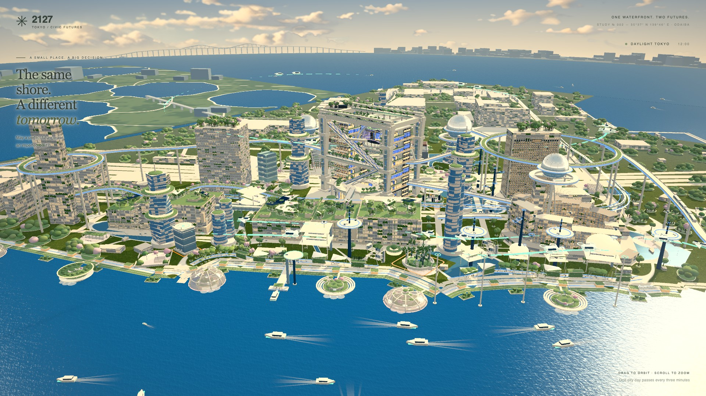
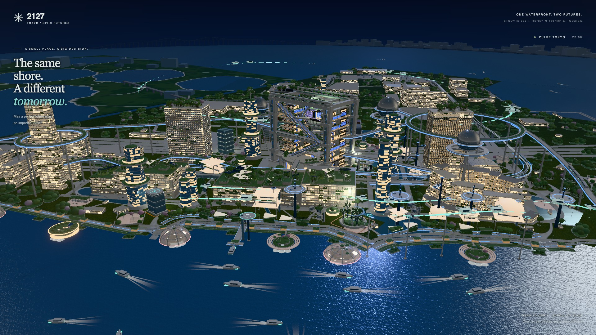
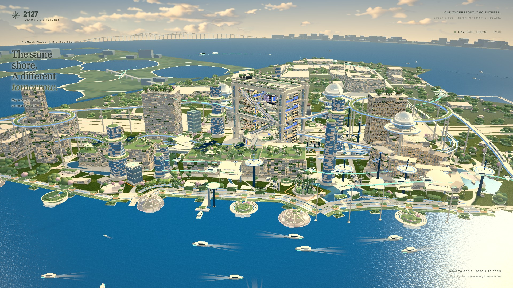
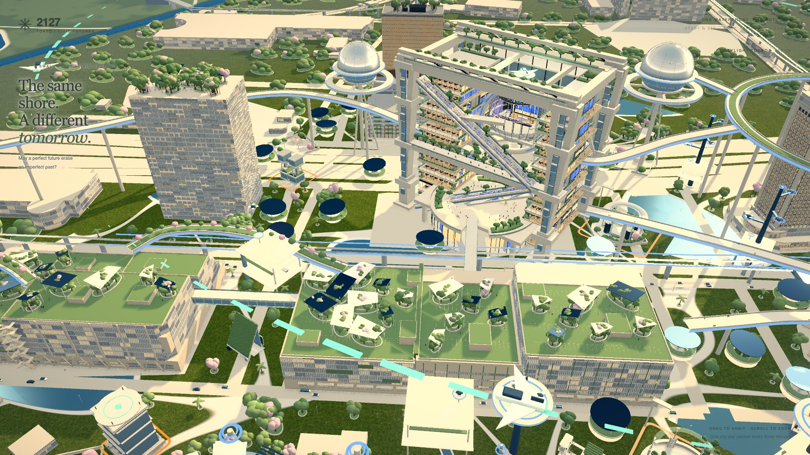
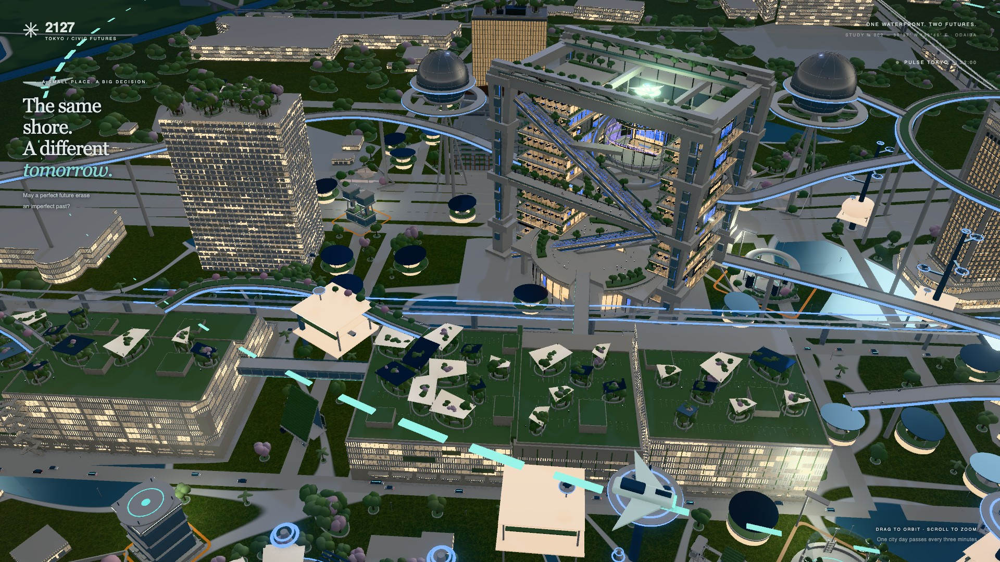
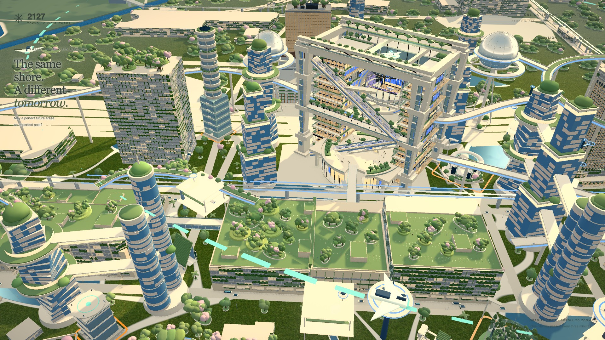
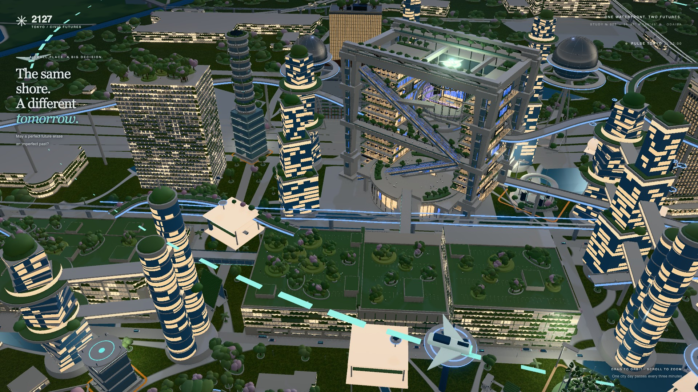
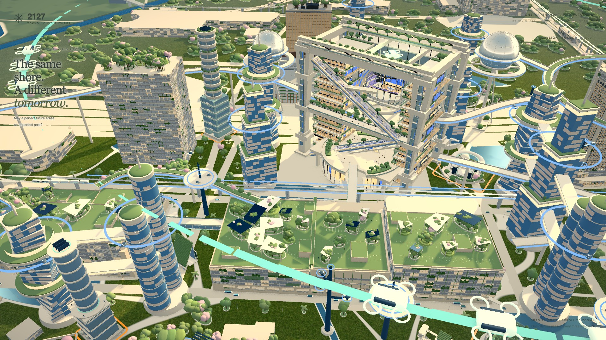
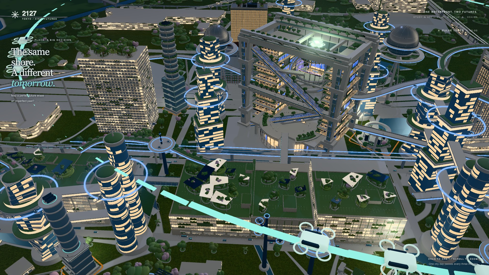

# Sector C — S0 / final review

未經owner接受，未merge main。對S0量度包含累積A/B/C source，不將全部FPS或draw差異歸因C。每shot最多三輪；所有原圖、完整root/carrier/group量度及原門檻保留。不同shot依序打磨，hero重拍可核對累積影響；pairing沒有S0同狀態原圖／draw基準，A5明列UNVERIFIED，不當PASS。[JSON](report.json)、[視覺逐圖理由](visual-review.json)、[驗證](checks.json)。

```json
{
  "finalStates": 34,
  "measuredStates": 94,
  "rounds": [
    {
      "id": "se:focal",
      "directory": "r1/se-focal",
      "states": 8,
      "A4": 0,
      "A4pairs": 6,
      "browser": "156.0.8078.73"
    },
    {
      "id": "se:focal",
      "directory": "r2/se-focal",
      "states": 8,
      "A4": 3,
      "A4pairs": 6,
      "browser": "156.0.8078.73"
    },
    {
      "id": "se:focal",
      "directory": "r3/se-focal",
      "states": 8,
      "A4": 4,
      "A4pairs": 6,
      "browser": "156.0.8078.73"
    },
    {
      "id": "se:district",
      "directory": "r1/se-district",
      "states": 18,
      "A4": 0,
      "A4pairs": 16,
      "browser": "156.0.8078.73"
    },
    {
      "id": "se:district",
      "directory": "r2/se-district",
      "states": 18,
      "A4": 0,
      "A4pairs": 16,
      "browser": "156.0.8078.73"
    },
    {
      "id": "se:district",
      "directory": "r3/se-district",
      "states": 18,
      "A4": 0,
      "A4pairs": 16,
      "browser": "156.0.8078.73"
    },
    {
      "id": "energy:ring",
      "directory": "r1/energy-ring",
      "states": 8,
      "A4": 0,
      "A4pairs": 6,
      "browser": "156.0.8078.73"
    },
    {
      "id": "energy:ring",
      "directory": "r2/energy-ring",
      "states": 8,
      "A4": 0,
      "A4pairs": 6,
      "browser": "156.0.8078.73"
    }
  ],
  "A1": {
    "FAIL": 2,
    "PASS": 24,
    "N/A": 8
  },
  "A2": {
    "PASS": 10,
    "N/A": 8,
    "FAIL": 16
  },
  "A3": {
    "FAIL": 26,
    "N/A": 8
  },
  "A4": {
    "pass": 4,
    "pairs": 28
  },
  "A5": {
    "FAIL": 18,
    "PASS": 10,
    "UNVERIFIED": 6
  },
  "A6": {
    "PASS": 34
  },
  "reproducibility": {
    "FAIL": 24,
    "PASS": 10
  },
  "V": {
    "V1": {
      "FAIL": 9,
      "PASS": 17,
      "N/A": 8
    },
    "V2": {
      "PASS": 34
    },
    "V3": {
      "FAIL": 34
    },
    "V4": {
      "PASS": 34
    },
    "V5": {
      "N/A": 18,
      "FAIL": 5,
      "PASS": 11
    },
    "V6": {
      "STATIC PASS": 30,
      "FAIL": 2,
      "N/A": 2
    }
  }
}
```

## se:focal / se:focal · -2 · h12

| S0 original | Final original |
| --- | --- |
| [](../S0/baseline/se-focal__-2__h12.jpg) | [](r3/se-focal/se-focal__-2__h12.jpg) |

完整投影：width 9.82%、height 17.78%；center (50.11%, 62.64%)、card overlap 0.00%。A1原門檻focal height25–60%／district width≥35%／energy max≥20%；A2 center x8–72% y15–85%、overlap≤5%。

A1 FAIL；A2 PASS；A3 FAIL（1/9）；A4 2/2；A5 FAIL（vsync 60、calls 670）；A6 PASS。

Canonical shot/hero mean 91.86FPS（minimum 93.84）、calls 706（maximum 776.6）；此狀態vsync須≥58、instant calls maximum 748.0。

- **V1 FAIL**：低層服務廊在中央橙框內可見，但被兩側高樓的尺度與亮度壓過；兩個地面小館較遠，不能兩秒辨認分散日常機能方案。
- **V2 PASS**：右側Fuji主框架、劇場球體及後方水岸提供清楚位置關係。
- **V3 FAIL**：左側屋頂仍有細幹球冠及前景空方格植栽；綠化未達整圖飽滿要求。
- **V4 PASS**：低層館有完整玻璃、升降支承及連廊，配合成熟交通和公共地面，沒有以空高桿或荒地代表low。
- **V5 N/A**：日景；同狀態h22另列。
- **V6 STATIC PASS**：此原圖的gallery支承及屋面未見明顯浮空／穿模；不代表完整動態閃爍驗收。

## se:focal / se:focal · -2 · h22

| S0 original | Final original |
| --- | --- |
| [](../S0/baseline/se-focal__-2__h22.jpg) | [](r3/se-focal/se-focal__-2__h22.jpg) |

完整投影：width 9.82%、height 17.78%；center (50.11%, 62.64%)、card overlap 0.00%。A1原門檻focal height25–60%／district width≥35%／energy max≥20%；A2 center x8–72% y15–85%、overlap≤5%。

A1 FAIL；A2 PASS；A3 FAIL（1/9）；A4 1/2；A5 PASS（vsync 60.1、calls 670）；A6 PASS。

Canonical shot/hero mean 97.70FPS（minimum 94.90）、calls 898（maximum 987.3）；此狀態vsync須≥58、instant calls maximum 748.0。

- **V1 FAIL**：低層服務廊在中央橙框內可見，但被兩側高樓的尺度與亮度壓過；兩個地面小館較遠，不能兩秒辨認分散日常機能方案。
- **V2 PASS**：右側Fuji主框架、劇場球體及後方水岸提供清楚位置關係。
- **V3 FAIL**：左側屋頂仍有細幹球冠及前景空方格植栽；綠化未達整圖飽滿要求。
- **V4 PASS**：低層館有完整玻璃、升降支承及連廊，配合成熟交通和公共地面，沒有以空高桿或荒地代表low。
- **V5 FAIL**：小館及服務廊在夜景太暗，橙框比occupied gallery更搶眼；兩側暖窗壓過主體。
- **V6 STATIC PASS**：此原圖的gallery支承及屋面未見明顯浮空／穿模；不代表完整動態閃爍驗收。

## se:focal / se:focal · 0 · h12

| S0 original | Final original |
| --- | --- |
| [](../S0/baseline/se-focal__0__h12.jpg) | [](r3/se-focal/se-focal__0__h12.jpg) |

完整投影：width 10.20%、height 26.44%；center (50.11%, 57.95%)、card overlap 0.00%。A1原門檻focal height25–60%／district width≥35%／energy max≥20%；A2 center x8–72% y15–85%、overlap≤5%。

A1 PASS；A2 PASS；A3 FAIL（3/9）；A4 2/2；A5 FAIL（vsync 60、calls 678）；A6 PASS。

Canonical shot/hero mean 91.86FPS（minimum 93.84）、calls 706（maximum 776.6）；此狀態vsync須≥58、instant calls maximum 745.8。

- **V1 FAIL**：中層hall位置清楚且達畫面高度門檻，但中央void與function modules在此角度被樓板／玻璃遮住，仍似普通細長玻璃樓，兩秒內未讀出混合機能。
- **V2 PASS**：右側Fuji frame及劇場球體、後方水岸保留，可清楚對照場地。
- **V3 FAIL**：鄰樓屋頂細幹球冠及前景稀疏方格植栽仍明顯，未達整圖綠化要求。
- **V4 PASS**：完整中層hall連同多層移動、公共地面與成熟周邊配置，沒有以破舊或未完成代表mixed。
- **V5 N/A**：日景，夜間另列。
- **V6 STATIC PASS**：原圖樓板、玻璃及地面接點未見新增浮空或明顯表面打架；完整動態閃爍未驗。

## se:focal / se:focal · 0 · h22

| S0 original | Final original |
| --- | --- |
| [](../S0/baseline/se-focal__0__h22.jpg) | [](r3/se-focal/se-focal__0__h22.jpg) |

完整投影：width 10.20%、height 26.44%；center (50.11%, 57.95%)、card overlap 0.00%。A1原門檻focal height25–60%／district width≥35%／energy max≥20%；A2 center x8–72% y15–85%、overlap≤5%。

A1 PASS；A2 PASS；A3 FAIL（3/9）；A4 1/2；A5 PASS（vsync 59.9、calls 678）；A6 PASS。

Canonical shot/hero mean 97.70FPS（minimum 94.90）、calls 898（maximum 987.3）；此狀態vsync須≥58、instant calls maximum 745.8。

- **V1 FAIL**：中層hall位置清楚且達畫面高度門檻，但中央void與function modules在此角度被樓板／玻璃遮住，仍似普通細長玻璃樓，兩秒內未讀出混合機能。
- **V2 PASS**：右側Fuji frame及劇場球體、後方水岸保留，可清楚對照場地。
- **V3 FAIL**：鄰樓屋頂細幹球冠及前景稀疏方格植栽仍明顯，未達整圖綠化要求。
- **V4 PASS**：完整中層hall連同多層移動、公共地面與成熟周邊配置，沒有以破舊或未完成代表mixed。
- **V5 FAIL**：hall只有細白樓板帶，玻璃和內部機能較暗；兩側暖亮高樓仍搶走主體，混合功能不清楚。
- **V6 STATIC PASS**：原圖樓板、玻璃及地面接點未見新增浮空或明顯表面打架；完整動態閃爍未驗。

## se:focal / se:focal · 2 · h12

| S0 original | Final original |
| --- | --- |
| [](../S0/baseline/se-focal__2__h12.jpg) | [](r3/se-focal/se-focal__2__h12.jpg) |

完整投影：width 11.53%、height 58.07%；center (50.14%, 42.13%)、card overlap 0.00%。A1原門檻focal height25–60%／district width≥35%／energy max≥20%；A2 center x8–72% y15–85%、overlap≤5%。

A1 PASS；A2 PASS；A3 FAIL（3/9）；A4 2/2；A5 FAIL（vsync 60、calls 706）；A6 PASS。

Canonical shot/hero mean 91.86FPS（minimum 93.84）、calls 706（maximum 776.6）；此狀態vsync須≥58、instant calls maximum 776.6。

- **V1 PASS**：中央細長環層塔完整可見，與中層base形成明確的集中立體機能塔；橙色基地框及右側Fuji令位置可對照，這是session判斷而非真人兩秒實測。
- **V2 PASS**：Fuji主框架和劇場球體清楚，後方海灣保留地理定位。
- **V3 FAIL**：左樓屋頂仍有細桿球冠，前景稀疏屋頂方格保持；塔環綠帶不能令整張圖通過。
- **V4 PASS**：完整高塔、轉接肋、occupied base及環層綠帶形成成熟高集中方案，權威模組保留。
- **V5 N/A**：日景；同狀態h22另列。
- **V6 STATIC PASS**：原圖環層、轉接肋與base連接未見明顯浮空、穿模或表面打架；完整動態閃爍未驗。

## se:focal / se:focal · 2 · h22

| S0 original | Final original |
| --- | --- |
| [](../S0/baseline/se-focal__2__h22.jpg) | [](r3/se-focal/se-focal__2__h22.jpg) |

完整投影：width 11.53%、height 58.07%；center (50.14%, 42.13%)、card overlap 0.00%。A1原門檻focal height25–60%／district width≥35%／energy max≥20%；A2 center x8–72% y15–85%、overlap≤5%。

A1 PASS；A2 PASS；A3 FAIL（3/9）；A4 0/2；A5 PASS（vsync 60、calls 706）；A6 PASS。

Canonical shot/hero mean 97.70FPS（minimum 94.90）、calls 898（maximum 987.3）；此狀態vsync須≥58、instant calls maximum 776.6。

- **V1 PASS**：中央細長環層塔完整可見，與中層base形成明確的集中立體機能塔；橙色基地框及右側Fuji令位置可對照，這是session判斷而非真人兩秒實測。
- **V2 PASS**：Fuji主框架和劇場球體清楚，後方海灣保留地理定位。
- **V3 FAIL**：左樓屋頂仍有細桿球冠，前景稀疏屋頂方格保持；塔環綠帶不能令整張圖通過。
- **V4 PASS**：完整高塔、轉接肋、occupied base及環層綠帶形成成熟高集中方案，權威模組保留。
- **V5 PASS**：高塔完整輪廓與水平白邊可辨，明確區分mixed中層hall；小型機能模組及玻璃細節仍暗，鄰樓較亮。
- **V6 STATIC PASS**：原圖環層、轉接肋與base連接未見明顯浮空、穿模或表面打架；完整動態閃爍未驗。

## se:focal / hero · neutral · h12

| S0 original | Final original |
| --- | --- |
| [](../S0/baseline/hero__neutral__h12.jpg) | [](r3/se-focal/hero__neutral__h12.jpg) |

完整投影：width —、height —；center (—, —)、card overlap —。A1原門檻focal height25–60%／district width≥35%／energy max≥20%；A2 center x8–72% y15–85%、overlap≤5%。

A1 N/A；A2 N/A；A3 N/A（—/9）；A4 0/0；A5 PASS（vsync 60、calls 950）；A6 PASS。

Canonical shot/hero mean 87.90FPS（minimum 82.02）、calls 950（maximum 1042.8）；此狀態vsync須≥58、instant calls maximum 1042.8。

- **V1 N/A**：Hero全城對照，不以單一C主體兩秒辨識門檻判定。
- **V2 PASS**：海灣及Rainbow Bridge保留在背景，Fuji主框架與劇場球體清楚定位。
- **V3 FAIL**：前景方格屋頂與細幹球冠仍明顯，局部冠層改善未令整圖達標。
- **V4 PASS**：低中高建物與公共地面、立體路徑保持成熟2127配置。
- **V5 N/A**：日景，夜間另驗。
- **V6 STATIC PASS**：此張原圖未見新增浮空或明顯表面打架；未完整驗證動態閃爍。

## se:focal / hero · neutral · h22

| S0 original | Final original |
| --- | --- |
| [](../S0/baseline/hero__neutral__h22.jpg) | [](r3/se-focal/hero__neutral__h22.jpg) |

完整投影：width —、height —；center (—, —)、card overlap —。A1原門檻focal height25–60%／district width≥35%／energy max≥20%；A2 center x8–72% y15–85%、overlap≤5%。

A1 N/A；A2 N/A；A3 N/A（—/9）；A4 0/0；A5 PASS（vsync 60、calls 950）；A6 PASS。

Canonical shot/hero mean 87.77FPS（minimum 84.95）、calls 950（maximum 1042.8）；此狀態vsync須≥58、instant calls maximum 1042.8。

- **V1 N/A**：Hero全城對照，不以單一C主體兩秒辨識門檻判定。
- **V2 PASS**：海灣及Rainbow Bridge保留在背景，Fuji主框架與劇場球體清楚定位。
- **V3 FAIL**：前景方格屋頂與細幹球冠仍明顯，局部冠層改善未令整圖達標。
- **V4 PASS**：低中高建物與公共地面、立體路徑保持成熟2127配置。
- **V5 PASS**：暖窗與路徑輪廓可讀，未靠整面霓虹；遠處細節仍有限。
- **V6 STATIC PASS**：此張原圖未見新增浮空或明顯表面打架；未完整驗證動態閃爍。

## se:district / se:district · -8 · h12

| S0 original | Final original |
| --- | --- |
| [](../S0/baseline/se-district__-8__h12.jpg) | [](r3/se-district/se-district__-8__h12.jpg) |

完整投影：width 121.66%、height 235.26%；center (53.90%, 127.75%)、card overlap 2.68%。A1原門檻focal height25–60%／district width≥35%／energy max≥20%；A2 center x8–72% y15–85%、overlap≤5%。

A1 PASS；A2 FAIL；A3 FAIL（0/9）；A4 0/3；A5 FAIL（vsync 60、calls 889）；A6 PASS。

Canonical shot/hero mean 89.50FPS（minimum 89.46）、calls 925（maximum 817.3）；此狀態vsync須≥58、instant calls maximum 788.7。

- **V1 FAIL**：分散的低層環亭可見於中央草地及右側，但仍似綠頂圓盤；Fuji和前景屋頂更搶眼，兩秒內未能清楚讀成分散機能館。
- **V2 PASS**：中央Fuji劇場球體與整個civic frame同時可辨；左上亦保留水岸。
- **V3 FAIL**：左側背景屋頂仍有細桿球冠，前景屋頂仍是稀疏格仔種植；SE新增冠層不足以令整張圖通過。
- **V4 PASS**：低狀態保留完整環亭、公共地面及多層移動系統，沒有以空地或老舊建築代表low。
- **V5 N/A**：hour12日景，夜間可讀性另看同狀態h22。
- **V6 STATIC PASS**：此張原圖未見新增零件浮空、明顯穿模或z-fighting；不代表完整動態閃爍驗收。

## se:district / se:district · -8 · h22

| S0 original | Final original |
| --- | --- |
| [](../S0/baseline/se-district__-8__h22.jpg) | [](r3/se-district/se-district__-8__h22.jpg) |

完整投影：width 121.66%、height 235.26%；center (53.90%, 127.75%)、card overlap 2.68%。A1原門檻focal height25–60%／district width≥35%／energy max≥20%；A2 center x8–72% y15–85%、overlap≤5%。

A1 PASS；A2 FAIL；A3 FAIL（0/9）；A4 0/3；A5 FAIL（vsync 60、calls 889）；A6 PASS。

Canonical shot/hero mean 88.61FPS（minimum 88.51）、calls 925（maximum 817.3）；此狀態vsync須≥58、instant calls maximum 788.7。

- **V1 FAIL**：夜景只見分散暖白圓邊，機能館身暗；視線首先落在Fuji及航線，不能兩秒辨認分散機能方案。
- **V2 PASS**：中央Fuji劇場球體與整個civic frame同時可辨；左上亦保留水岸。
- **V3 FAIL**：左側背景屋頂仍有細桿球冠，前景屋頂仍是稀疏格仔種植；SE新增冠層不足以令整張圖通過。
- **V4 PASS**：低狀態保留完整環亭、公共地面及多層移動系統，沒有以空地或老舊建築代表low。
- **V5 FAIL**：環亭暖白邊可見，但小館及分布仍被Fuji亮室、背景窗帶與前景航線壓過，夜間變化主體不清楚。
- **V6 STATIC PASS**：此張原圖未見新增零件浮空、明顯穿模或z-fighting；不代表完整動態閃爍驗收。

## se:district / se:district · -5 · h12

| S0 original | Final original |
| --- | --- |
| [](../S0/baseline/se-district__-5__h12.jpg) | [](r3/se-district/se-district__-5__h12.jpg) |

完整投影：width 178.81%、height 335.79%；center (65.56%, 157.67%)、card overlap 1.65%。A1原門檻focal height25–60%／district width≥35%／energy max≥20%；A2 center x8–72% y15–85%、overlap≤5%。

A1 PASS；A2 FAIL；A3 FAIL（0/9）；A4 0/2；A5 FAIL（vsync 60、calls 889）；A6 PASS。

Canonical shot/hero mean 89.50FPS（minimum 89.46）、calls 925（maximum 817.3）；此狀態vsync須≥58、instant calls maximum 788.7。

- **V1 PASS**：左下雙塔／扭轉塔與右側立體塔已可辨，保留低環亭；可讀成分散低館與部分立體街區並存，惟邊緣塔群被裁切。
- **V2 PASS**：Fuji劇場球體與完整主框架仍在中央，左上保留水岸，位置可對照。
- **V3 FAIL**：前景稀疏方格植栽與背景細幹球冠保持；新SE環亭冠層不能抵消全圖的格仔感。
- **V4 PASS**：低環亭與完整立體塔／連廊共存，混合狀態是成熟配置而非尚未建完的工地。
- **V5 N/A**：日景；夜間輪廓看同狀態h22。
- **V6 STATIC PASS**：此原圖連廊接至塔身、冠層落於屋面，未見新增z-fighting或浮空；邊緣裁切屬構圖缺口，完整動態閃爍未驗。

## se:district / se:district · -5 · h22

| S0 original | Final original |
| --- | --- |
| [](../S0/baseline/se-district__-5__h22.jpg) | [](r3/se-district/se-district__-5__h22.jpg) |

完整投影：width 178.81%、height 335.79%；center (65.56%, 157.67%)、card overlap 1.65%。A1原門檻focal height25–60%／district width≥35%／energy max≥20%；A2 center x8–72% y15–85%、overlap≤5%。

A1 PASS；A2 FAIL；A3 FAIL（0/9）；A4 0/2；A5 FAIL（vsync 60、calls 889）；A6 PASS。

Canonical shot/hero mean 88.61FPS（minimum 88.51）、calls 925（maximum 817.3）；此狀態vsync須≥58、instant calls maximum 788.7。

- **V1 PASS**：暖亮的左下雙塔和右側塔令部分立體街區可辨；小環亭較弱，但混合配置相對全low仍可讀。
- **V2 PASS**：Fuji劇場球體與完整主框架仍在中央，左上保留水岸，位置可對照。
- **V3 FAIL**：前景稀疏方格植栽與背景細幹球冠保持；新SE環亭冠層不能抵消全圖的格仔感。
- **V4 PASS**：低環亭與完整立體塔／連廊共存，混合狀態是成熟配置而非尚未建完的工地。
- **V5 PASS**：雙塔與右側塔的暖窗／水平環緣清楚，能和全low的暗小館區分；不表示所有離鏡小館都清楚。
- **V6 STATIC PASS**：此原圖連廊接至塔身、冠層落於屋面，未見新增z-fighting或浮空；邊緣裁切屬構圖缺口，完整動態閃爍未驗。

## se:district / se:district · 0 · h12

| S0 original | Final original |
| --- | --- |
| [](../S0/baseline/se-district__0__h12.jpg) | [](r3/se-district/se-district__0__h12.jpg) |

完整投影：width 182.50%、height 340.67%；center (67.52%, 158.86%)、card overlap 1.59%。A1原門檻focal height25–60%／district width≥35%／energy max≥20%；A2 center x8–72% y15–85%、overlap≤5%。

A1 PASS；A2 FAIL；A3 FAIL（0/9）；A4 0/2；A5 FAIL（vsync 59.9、calls 897）；A6 PASS。

Canonical shot/hero mean 89.50FPS（minimum 89.46）、calls 925（maximum 817.3）；此狀態vsync須≥58、instant calls maximum 786.5。

- **V1 PASS**：Fuji左側新增扭轉塔、左下雙塔與右側塔群同低環亭並存；可辨是混合高度的機能街區，外圍仍有裁切。
- **V2 PASS**：中央Fuji劇場球體及周圍frame完整入鏡，左上水岸提供第二個定位線索。
- **V3 FAIL**：前景大屋頂保持大片空方格與分散小植栽，左後方球冠細幹明顯；全圖未達飽滿層次要求。
- **V4 PASS**：中層hall、環亭及數種完整高塔同時存在，低／中／高配置都延續成熟的公共地面和立體系統。
- **V5 N/A**：hour12日景，夜間另列。
- **V6 STATIC PASS**：此張原圖未見新增橋段與塔身脫離或明顯表面打架；邊緣高塔裁切保持構圖限制，動態未作完整閃爍掃描。

## se:district / se:district · 0 · h22

| S0 original | Final original |
| --- | --- |
| [](../S0/baseline/se-district__0__h22.jpg) | [](r3/se-district/se-district__0__h22.jpg) |

完整投影：width 182.50%、height 340.67%；center (67.52%, 158.86%)、card overlap 1.59%。A1原門檻focal height25–60%／district width≥35%／energy max≥20%；A2 center x8–72% y15–85%、overlap≤5%。

A1 PASS；A2 FAIL；A3 FAIL（0/9）；A4 0/2；A5 FAIL（vsync 60、calls 897）；A6 PASS。

Canonical shot/hero mean 88.61FPS（minimum 88.51）、calls 925（maximum 817.3）；此狀態vsync須≥58、instant calls maximum 786.5。

- **V1 PASS**：中央左側扭轉塔與右側塔群暖窗突出，混合機能配置可辨；較低的中層hall依然弱。
- **V2 PASS**：中央Fuji劇場球體及周圍frame完整入鏡，左上水岸提供第二個定位線索。
- **V3 FAIL**：前景大屋頂保持大片空方格與分散小植栽，左後方球冠細幹明顯；全圖未達飽滿層次要求。
- **V4 PASS**：中層hall、環亭及數種完整高塔同時存在，低／中／高配置都延續成熟的公共地面和立體系統。
- **V5 PASS**：扭轉／雙塔窗帶與連廊的水平關係可見，整體高度混合在夜間可讀；小館細節仍有限。
- **V6 STATIC PASS**：此張原圖未見新增橋段與塔身脫離或明顯表面打架；邊緣高塔裁切保持構圖限制，動態未作完整閃爍掃描。

## se:district / se:district · 5 · h12

| S0 original | Final original |
| --- | --- |
| [](../S0/baseline/se-district__5__h12.jpg) | [](r3/se-district/se-district__5__h12.jpg) |

完整投影：width 182.04%、height 340.52%；center (67.75%, 158.94%)、card overlap 1.60%。A1原門檻focal height25–60%／district width≥35%／energy max≥20%；A2 center x8–72% y15–85%、overlap≤5%。

A1 PASS；A2 FAIL；A3 FAIL（0/9）；A4 0/2；A5 FAIL（vsync 60.1、calls 925）；A6 PASS。

Canonical shot/hero mean 89.50FPS（minimum 89.46）、calls 925（maximum 817.3）；此狀態vsync須≥58、instant calls maximum 817.3。

- **V1 PASS**：左下雙塔和水平連廊、中央左側高環塔及右側塔群可讀成更集中的立體機能街區；前景仍有混合低館。
- **V2 PASS**：Fuji劇場球體及完整主框架仍提供清楚定位，左上亦留水岸。
- **V3 FAIL**：大片前景格仔屋頂與後方球冠細幹依然明顯，局部SE綠冠改善未令整體達標。
- **V4 PASS**：高低設施、連廊與多層交通都保留完整運作形態，+2不是半建築或荒地。
- **V5 N/A**：日景；同狀態h22另驗夜景。
- **V6 STATIC PASS**：原圖橋段連接與屋面落點未見新增穿模／浮空；靜態沒有明顯表面打架，未驗完整動態閃爍。

## se:district / se:district · 5 · h22

| S0 original | Final original |
| --- | --- |
| [](../S0/baseline/se-district__5__h22.jpg) | [](r3/se-district/se-district__5__h22.jpg) |

完整投影：width 182.04%、height 340.52%；center (67.75%, 158.94%)、card overlap 1.60%。A1原門檻focal height25–60%／district width≥35%／energy max≥20%；A2 center x8–72% y15–85%、overlap≤5%。

A1 PASS；A2 FAIL；A3 FAIL（0/9）；A4 0/2；A5 FAIL（vsync 60、calls 925）；A6 PASS。

Canonical shot/hero mean 88.61FPS（minimum 88.51）、calls 925（maximum 817.3）；此狀態vsync須≥58、instant calls maximum 817.3。

- **V1 PASS**：左下雙塔連廊及右側暖亮塔群突出，集中配置可辨；中央左側高環塔比其他塔暗。
- **V2 PASS**：Fuji劇場球體及完整主框架仍提供清楚定位，左上亦留水岸。
- **V3 FAIL**：大片前景格仔屋頂與後方球冠細幹依然明顯，局部SE綠冠改善未令整體達標。
- **V4 PASS**：高低設施、連廊與多層交通都保留完整運作形態，+2不是半建築或荒地。
- **V5 PASS**：暖亮雙塔／扭轉塔的高度和連廊關係可讀，暗的高環塔輪廓亦有背景對比；不宣稱小館細節同樣清楚。
- **V6 STATIC PASS**：原圖橋段連接與屋面落點未見新增穿模／浮空；靜態沒有明顯表面打架，未驗完整動態閃爍。

## se:district / se:district · 8 · h12

| S0 original | Final original |
| --- | --- |
| [](../S0/baseline/se-district__8__h12.jpg) | [](r3/se-district/se-district__8__h12.jpg) |

完整投影：width 184.95%、height 332.13%；center (66.75%, 151.21%)、card overlap 1.61%。A1原門檻focal height25–60%／district width≥35%／energy max≥20%；A2 center x8–72% y15–85%、overlap≤5%。

A1 PASS；A2 FAIL；A3 FAIL（0/9）；A4 0/4；A5 FAIL（vsync 60、calls 925）；A6 PASS。

Canonical shot/hero mean 89.50FPS（minimum 89.46）、calls 925（maximum 817.3）；此狀態vsync須≥58、instant calls maximum 817.3。

- **V1 PASS**：新增退台塔與完整雙塔／扭轉塔分布清楚，水平空中連廊可見，可辨為集中式立體機能街區；部分外圍仍被裁。
- **V2 PASS**：Fuji劇場球體與主frame保持在畫面中央，定位清楚；左上亦有水岸。
- **V3 FAIL**：前景方格屋頂和後方細桿球冠仍是主要綠化語彙，SE細化冠層未達整張圖的要求。
- **V4 PASS**：多種完整塔型與公共層、連廊和移動系統共同構成成熟的高集中方案，low替代沒有被解讀為舊時代。
- **V5 N/A**：日景，夜間另列h22。
- **V6 STATIC PASS**：退台、連廊與屋面接點此張未見新增浮空或打架；外圍裁切是構圖缺口，沒有宣稱動態閃爍全驗。

## se:district / se:district · 8 · h22

| S0 original | Final original |
| --- | --- |
| [](../S0/baseline/se-district__8__h22.jpg) | [](r3/se-district/se-district__8__h22.jpg) |

完整投影：width 184.95%、height 332.13%；center (66.75%, 151.21%)、card overlap 1.61%。A1原門檻focal height25–60%／district width≥35%／energy max≥20%；A2 center x8–72% y15–85%、overlap≤5%。

A1 PASS；A2 FAIL；A3 FAIL（0/9）；A4 0/4；A5 FAIL（vsync 60、calls 925）；A6 PASS。

Canonical shot/hero mean 88.61FPS（minimum 88.51）、calls 925（maximum 817.3）；此狀態vsync須≥58、instant calls maximum 817.3。

- **V1 PASS**：新增退台塔與完整雙塔／扭轉塔分布清楚，水平空中連廊可見，可辨為集中式立體機能街區；部分外圍仍被裁。
- **V2 PASS**：Fuji劇場球體與主frame保持在畫面中央，定位清楚；左上亦有水岸。
- **V3 FAIL**：前景方格屋頂和後方細桿球冠仍是主要綠化語彙，SE細化冠層未達整張圖的要求。
- **V4 PASS**：多種完整塔型與公共層、連廊和移動系統共同構成成熟的高集中方案，low替代沒有被解讀為舊時代。
- **V5 PASS**：新退台塔與雙塔的暖窗／水平連廊足夠明顯，高集中輪廓比中性更密集；高環塔仍偏暗但外形可辨。
- **V6 STATIC PASS**：退台、連廊與屋面接點此張未見新增浮空或打架；外圍裁切是構圖缺口，沒有宣稱動態閃爍全驗。

## se:district / hero · neutral · h12

| S0 original | Final original |
| --- | --- |
| [](../S0/baseline/hero__neutral__h12.jpg) | [](r3/se-district/hero__neutral__h12.jpg) |

完整投影：width —、height —；center (—, —)、card overlap —。A1原門檻focal height25–60%／district width≥35%／energy max≥20%；A2 center x8–72% y15–85%、overlap≤5%。

A1 N/A；A2 N/A；A3 N/A（—/9）；A4 0/0；A5 FAIL（vsync 60、calls 950）；A6 PASS。

Canonical shot/hero mean 89.15FPS（minimum 82.02）、calls 1134（maximum 1042.8）；此狀態vsync須≥58、instant calls maximum 1042.8。

- **V1 N/A**：原hero全城總覽，沒有單一近鏡設施作兩秒辨認主體。
- **V2 PASS**：東京灣與彩虹橋清楚，Fuji主框架位於城市中央。
- **V3 FAIL**：前景屋頂仍有稀疏格仔植栽，背景樹冠多為球團／細桿，整體未達綠化門檻。
- **V4 PASS**：大型公共框架、立體移動與完整水岸層次維持成熟2127城市。
- **V5 N/A**：hour12日景，夜間另列。
- **V6 STATIC PASS**：此張總覽未見新增浮空零件或明顯表面打架；不是完整動態閃爍驗收。

## se:district / hero · neutral · h22

| S0 original | Final original |
| --- | --- |
| [](../S0/baseline/hero__neutral__h22.jpg) | [](r3/se-district/hero__neutral__h22.jpg) |

完整投影：width —、height —；center (—, —)、card overlap —。A1原門檻focal height25–60%／district width≥35%／energy max≥20%；A2 center x8–72% y15–85%、overlap≤5%。

A1 N/A；A2 N/A；A3 N/A（—/9）；A4 0/0；A5 PASS（vsync 60、calls 950）；A6 PASS。

Canonical shot/hero mean 88.95FPS（minimum 84.95）、calls 950（maximum 1042.8）；此狀態vsync須≥58、instant calls maximum 1042.8。

- **V1 N/A**：Hero全城總覽沒有單一近鏡設施作主體。
- **V2 PASS**：廣闊東京灣、遠處彩虹橋輪廓與中央Fuji框架仍可定位。
- **V3 FAIL**：屋頂種植格、球團細桿樹依然存在，夜暗不當作綠化通過。
- **V4 PASS**：公共框架、立體路網與成熟水岸層次在夜景保持完整。
- **V5 PASS**：主要建物、公共層及海岸輪廓可讀；不代表遠處每個機能小館細節可讀。
- **V6 STATIC PASS**：此張原圖未見新增浮空或z-fighting，未完成全時序閃爍驗證。

## se:district / se:district · low-solar · h12

| S0 original | Final original |
| --- | --- |
| 無同狀態S0 | [](r3/se-district/se-district__low-solar__h12.jpg) |

完整投影：width 122.19%、height 236.37%；center (53.93%, 127.83%)、card overlap 2.69%。A1原門檻focal height25–60%／district width≥35%／energy max≥20%；A2 center x8–72% y15–85%、overlap≤5%。

A1 PASS；A2 FAIL；A3 FAIL（0/9）；A4 0/1；A5 UNVERIFIED（vsync 60、calls 893）；A6 PASS。

Canonical shot/hero mean 89.50FPS（minimum 89.46）、calls 925（maximum 817.3）；此狀態vsync須≥58、instant calls maximum UNVERIFIED。

- **V1 FAIL**：分散館上方的深藍圓盤雖清楚，但缺少可讀的光伏分格／機能細節，兩秒內未能認出solar配對；Fuji仍更搶眼。
- **V2 PASS**：Fuji劇場球體及civic frame清楚入鏡，左上水岸仍在。
- **V3 FAIL**：配對的低環境狀態保留大片疏格屋頂；背景細桿球冠仍多，SE屋面冠層不足以通過全圖綠化。
- **V4 PASS**：低分散館及其受支承的能源頂蓋是完整替代，公共層／路網沒有被移除或退回舊時代。
- **V5 N/A**：日景，h22另驗。
- **V6 STATIC PASS**：可見頂蓋與既有館面的位置關係，新增支架的屋面接點亦由幾何測試覆蓋；此原圖未見明顯穿模／表面打架，動態閃爍未全驗。

## se:district / se:district · low-solar · h22

| S0 original | Final original |
| --- | --- |
| 無同狀態S0 | [](r3/se-district/se-district__low-solar__h22.jpg) |

完整投影：width 122.19%、height 236.37%；center (53.93%, 127.83%)、card overlap 2.69%。A1原門檻focal height25–60%／district width≥35%／energy max≥20%；A2 center x8–72% y15–85%、overlap≤5%。

A1 PASS；A2 FAIL；A3 FAIL（0/9）；A4 0/1；A5 UNVERIFIED（vsync 59.8、calls 893）；A6 PASS。

Canonical shot/hero mean 88.61FPS（minimum 88.51）、calls 925（maximum 817.3）；此狀態vsync須≥58、instant calls maximum UNVERIFIED。

- **V1 FAIL**：分散館上方的深藍圓盤雖清楚，但缺少可讀的光伏分格／機能細節，兩秒內未能認出solar配對；Fuji仍更搶眼。
- **V2 PASS**：Fuji劇場球體及civic frame清楚入鏡，左上水岸仍在。
- **V3 FAIL**：配對的低環境狀態保留大片疏格屋頂；背景細桿球冠仍多，SE屋面冠層不足以通過全圖綠化。
- **V4 PASS**：低分散館及其受支承的能源頂蓋是完整替代，公共層／路網沒有被移除或退回舊時代。
- **V5 FAIL**：暗藍頂蓋夜間接近黑色圓盤，館身與屋頂配對機能仍不清楚；背景窗帶比主體突出。
- **V6 STATIC PASS**：可見頂蓋與既有館面的位置關係，新增支架的屋面接點亦由幾何測試覆蓋；此原圖未見明顯穿模／表面打架，動態閃爍未全驗。

## se:district / se:district · high-forest · h12

| S0 original | Final original |
| --- | --- |
| 無同狀態S0 | [](r3/se-district/se-district__high-forest__h12.jpg) |

完整投影：width 184.95%、height 332.13%；center (66.75%, 151.21%)、card overlap 1.61%。A1原門檻focal height25–60%／district width≥35%／energy max≥20%；A2 center x8–72% y15–85%、overlap≤5%。

A1 PASS；A2 FAIL；A3 FAIL（0/9）；A4 0/1；A5 UNVERIFIED（vsync 60、calls 1310）；A6 PASS。

Canonical shot/hero mean 89.50FPS（minimum 89.46）、calls 925（maximum 817.3）；此狀態vsync須≥58、instant calls maximum UNVERIFIED。

- **V1 PASS**：完整立體塔與連廊清楚，塔頂及sky-lobby綠冠亦可見；可讀為有綠化的集中街區，尚不像完整vertical-forest系統。
- **V2 PASS**：中央Fuji劇場球體及主框架保持定位，左上水岸仍可見。
- **V3 FAIL**：塔頂新增冠層仍像綠色團塊，背景仍有細桿球冠及前景格仔空面，層次與生態連續性未達標。
- **V4 PASS**：高集中機能館、公共層及partner環境配置都完整保留；仍是成熟方案，綠化品質缺口另列V3。
- **V5 N/A**：日景；夜間另列。
- **V6 STATIC PASS**：原圖新增冠層落在既有屋頂／sky-lobby上，未見明顯浮空或表面打架；不含完整動態閃爍驗證。

## se:district / se:district · high-forest · h22

| S0 original | Final original |
| --- | --- |
| 無同狀態S0 | [](r3/se-district/se-district__high-forest__h22.jpg) |

完整投影：width 184.95%、height 332.13%；center (66.75%, 151.21%)、card overlap 1.61%。A1原門檻focal height25–60%／district width≥35%／energy max≥20%；A2 center x8–72% y15–85%、overlap≤5%。

A1 PASS；A2 FAIL；A3 FAIL（0/9）；A4 0/1；A5 UNVERIFIED（vsync 60、calls 927）；A6 PASS。

Canonical shot/hero mean 88.61FPS（minimum 88.51）、calls 925（maximum 817.3）；此狀態vsync須≥58、instant calls maximum UNVERIFIED。

- **V1 FAIL**：暖窗塔群可辨，但新增綠冠很暗，容易只讀成原有高集中塔群，森林配對不夠清楚。
- **V2 PASS**：中央Fuji劇場球體及主框架保持定位，左上水岸仍可見。
- **V3 FAIL**：塔頂新增冠層仍像綠色團塊，背景仍有細桿球冠及前景格仔空面，層次與生態連續性未達標。
- **V4 PASS**：高集中機能館、公共層及partner環境配置都完整保留；仍是成熟方案，綠化品質缺口另列V3。
- **V5 FAIL**：塔的基本暖窗輪廓清楚，但forest新增綠冠和樓層邊植栽在夜景偏暗，配對變化不清楚。
- **V6 STATIC PASS**：原圖新增冠層落在既有屋頂／sky-lobby上，未見明顯浮空或表面打架；不含完整動態閃爍驗證。

## se:district / se:district · high-docks · h12

| S0 original | Final original |
| --- | --- |
| 無同狀態S0 | [](r3/se-district/se-district__high-docks__h12.jpg) |

完整投影：width 189.56%、height 357.29%；center (67.21%, 163.57%)、card overlap 1.46%。A1原門檻focal height25–60%／district width≥35%／energy max≥20%；A2 center x8–72% y15–85%、overlap≤5%。

A1 PASS；A2 FAIL；A3 FAIL（0/9）；A4 0/1；A5 UNVERIFIED（vsync 60、calls 937）；A6 PASS。

Canonical shot/hero mean 89.50FPS（minimum 89.46）、calls 925（maximum 817.3）；此狀態vsync須≥58、instant calls maximum UNVERIFIED。

- **V1 PASS**：塔身外的藍色空中環、小停泊機與固定航線可辨，能讀成高集中街區的空中接駁配對；實體連接不足另列V6。
- **V2 PASS**：Fuji劇場球體與主框架在中央，水岸在左上；地點仍可定位。
- **V3 FAIL**：背景細幹球冠與前景疏格種植仍多，藍色環與航線沒有解決綠化品質。
- **V4 PASS**：高集中塔街區及自動化移動是完整替代，既有公共層仍在；dock載荷路徑的視覺缺口另列V6。
- **V5 N/A**：日景，夜間另看h22。
- **V6 FAIL**：藍色dock環及小停泊機看似直接懸在塔外，原圖未能讀到支承／連接與載荷路徑；三輪後保留此缺口，不用光效冒充實體完成。

## se:district / se:district · high-docks · h22

| S0 original | Final original |
| --- | --- |
| 無同狀態S0 | [](r3/se-district/se-district__high-docks__h22.jpg) |

完整投影：width 189.56%、height 357.29%；center (67.21%, 163.57%)、card overlap 1.46%。A1原門檻focal height25–60%／district width≥35%／energy max≥20%；A2 center x8–72% y15–85%、overlap≤5%。

A1 PASS；A2 FAIL；A3 FAIL（0/9）；A4 0/1；A5 UNVERIFIED（vsync 60、calls 1327）；A6 PASS。

Canonical shot/hero mean 88.61FPS（minimum 88.51）、calls 925（maximum 817.3）；此狀態vsync須≥58、instant calls maximum UNVERIFIED。

- **V1 PASS**：塔身外的藍色空中環、小停泊機與固定航線可辨，能讀成高集中街區的空中接駁配對；實體連接不足另列V6。
- **V2 PASS**：Fuji劇場球體與主框架在中央，水岸在左上；地點仍可定位。
- **V3 FAIL**：背景細幹球冠與前景疏格種植仍多，藍色環與航線沒有解決綠化品質。
- **V4 PASS**：高集中塔街區及自動化移動是完整替代，既有公共層仍在；dock載荷路徑的視覺缺口另列V6。
- **V5 PASS**：藍環與暖亮塔身在夜間明顯，空中接駁配對可讀；前景高亮航線亦會分走注意。
- **V6 FAIL**：藍色dock環及小停泊機看似直接懸在塔外，原圖未能讀到支承／連接與載荷路徑；三輪後保留此缺口，不用光效冒充實體完成。

## energy:ring / energy:ring · baseline · h12

| S0 original | Final original |
| --- | --- |
| [](../S0/baseline/energy-ring__baseline__h12.jpg) | [](r2/energy-ring/energy-ring__baseline__h12.jpg) |

完整投影：width —、height —；center (—, —)、card overlap —。A1原門檻focal height25–60%／district width≥35%／energy max≥20%；A2 center x8–72% y15–85%、overlap≤5%。

A1 N/A；A2 N/A；A3 N/A（0/9）；A4 0/2；A5 PASS（vsync 60、calls 421）；A6 PASS。

Canonical shot/hero mean 98.99FPS（minimum 93.24）、calls 447（maximum 487.3）；此狀態vsync須≥58、instant calls maximum 653.4。

- **V1 N/A**：Baseline按設計移除蓄電環，沒有該設施可做辨認；保留原地點背景供比較。
- **V2 PASS**：Fuji劇場球體在中央且清楚，左右海灣／遠處橋線提供場地定位。
- **V3 FAIL**：CivicCore露台及左側景觀仍有細幹團狀樹冠；本輪只改環的操作標記，綠化未達整圖門檻。
- **V4 PASS**：沒有環仍是完整成熟的Fuji公共框架與劇場，baseline不代表舊城市。
- **V5 N/A**：此狀態環按設計不存在，無環體夜間輪廓可驗；背景劇場仍可讀。
- **V6 N/A**：環體按baseline移除，沒有該部件可作近距離零件檢查；背景未見新增缺陷。

## energy:ring / energy:ring · baseline · h22

| S0 original | Final original |
| --- | --- |
| [](../S0/baseline/energy-ring__baseline__h22.jpg) | [](r2/energy-ring/energy-ring__baseline__h22.jpg) |

完整投影：width —、height —；center (—, —)、card overlap —。A1原門檻focal height25–60%／district width≥35%／energy max≥20%；A2 center x8–72% y15–85%、overlap≤5%。

A1 N/A；A2 N/A；A3 N/A（0/9）；A4 0/2；A5 FAIL（vsync 60、calls 421）；A6 PASS。

Canonical shot/hero mean 93.68FPS（minimum 94.84）、calls 447（maximum 487.3）；此狀態vsync須≥58、instant calls maximum 458.7。

- **V1 N/A**：Baseline按設計移除蓄電環，沒有該設施可做辨認；保留原地點背景供比較。
- **V2 PASS**：Fuji劇場球體在中央且清楚，左右海灣／遠處橋線提供場地定位。
- **V3 FAIL**：CivicCore露台及左側景觀仍有細幹團狀樹冠；本輪只改環的操作標記，綠化未達整圖門檻。
- **V4 PASS**：沒有環仍是完整成熟的Fuji公共框架與劇場，baseline不代表舊城市。
- **V5 N/A**：此狀態環按設計不存在，無環體夜間輪廓可驗；背景劇場仍可讀。
- **V6 N/A**：環體按baseline移除，沒有該部件可作近距離零件檢查；背景未見新增缺陷。

## energy:ring / energy:ring · b · h12

| S0 original | Final original |
| --- | --- |
| [](../S0/baseline/energy-ring__b__h12.jpg) | [](r2/energy-ring/energy-ring__b__h12.jpg) |

完整投影：width 42.78%、height 79.85%；center (52.01%, 49.70%)、card overlap 0.00%。A1原門檻focal height25–60%／district width≥35%／energy max≥20%；A2 center x8–72% y15–85%、overlap≤5%。

A1 PASS；A2 PASS；A3 FAIL（0/9）；A4 0/2；A5 PASS（vsync 60、calls 447）；A6 PASS。

Canonical shot/hero mean 98.99FPS（minimum 93.24）、calls 447（maximum 487.3）；此狀態vsync須≥58、instant calls maximum 487.3。

- **V1 PASS**：獨立中空轉子、兩個上方固定軸承及重複cassette可辨，與後方劇場球體分開；可讀成工程化蓄電環。
- **V2 PASS**：Fuji劇場球體在中央且清楚，左右海灣／遠處橋線提供場地定位。
- **V3 FAIL**：CivicCore露台及左側景觀仍有細幹團狀樹冠；本輪只改環的操作標記，綠化未達整圖門檻。
- **V4 PASS**：轉子與固定軸承／transfer frame關係清楚，保留大中空與公共路徑，成熟機械系統不依賴霓虹。
- **V5 N/A**：日景，h22另驗。
- **V6 STATIC PASS**：原圖輪帶／軸承接點無明顯表面打架或浮空；full-sweep／包絡測試保留原清場，完整動態閃爍未全驗。

## energy:ring / energy:ring · b · h22

| S0 original | Final original |
| --- | --- |
| [](../S0/baseline/energy-ring__b__h22.jpg) | [](r2/energy-ring/energy-ring__b__h22.jpg) |

完整投影：width 42.78%、height 79.85%；center (52.01%, 49.70%)、card overlap 0.00%。A1原門檻focal height25–60%／district width≥35%／energy max≥20%；A2 center x8–72% y15–85%、overlap≤5%。

A1 PASS；A2 PASS；A3 FAIL（0/9）；A4 0/2；A5 FAIL（vsync 60.2、calls 447）；A6 PASS。

Canonical shot/hero mean 93.68FPS（minimum 94.84）、calls 447（maximum 487.3）；此狀態vsync須≥58、instant calls maximum 487.3。

- **V1 PASS**：獨立中空轉子、兩個上方固定軸承及重複cassette可辨，與後方劇場球體分開；可讀成工程化蓄電環。
- **V2 PASS**：Fuji劇場球體在中央且清楚，左右海灣／遠處橋線提供場地定位。
- **V3 FAIL**：CivicCore露台及左側景觀仍有細幹團狀樹冠；本輪只改環的操作標記，綠化未達整圖門檻。
- **V4 PASS**：轉子與固定軸承／transfer frame關係清楚，保留大中空與公共路徑，成熟機械系統不依賴霓虹。
- **V5 PASS**：四個稀疏操作標記配合金屬邊緣令環的輪廓可讀，與亮劇場分開；cassette細節仍偏暗。
- **V6 STATIC PASS**：原圖輪帶／軸承接點無明顯表面打架或浮空；full-sweep／包絡測試保留原清場，完整動態閃爍未全驗。

## energy:ring / energy:ring · mixed · h12

| S0 original | Final original |
| --- | --- |
| [](../S0/baseline/energy-ring__mixed__h12.jpg) | [](r2/energy-ring/energy-ring__mixed__h12.jpg) |

完整投影：width 42.78%、height 79.85%；center (52.01%, 49.70%)、card overlap 0.00%。A1原門檻focal height25–60%／district width≥35%／energy max≥20%；A2 center x8–72% y15–85%、overlap≤5%。

A1 PASS；A2 PASS；A3 FAIL（0/9）；A4 0/2；A5 PASS（vsync 60、calls 447）；A6 PASS。

Canonical shot/hero mean 98.99FPS（minimum 93.24）、calls 447（maximum 487.3）；此狀態vsync須≥58、instant calls maximum 487.3。

- **V1 PASS**：獨立中空轉子、兩個上方固定軸承及重複cassette可辨，與後方劇場球體分開；可讀成工程化蓄電環。
- **V2 PASS**：Fuji劇場球體在中央且清楚，左右海灣／遠處橋線提供場地定位。
- **V3 FAIL**：CivicCore露台及左側景觀仍有細幹團狀樹冠；本輪只改環的操作標記，綠化未達整圖門檻。
- **V4 PASS**：轉子與固定軸承／transfer frame關係清楚，保留大中空與公共路徑，成熟機械系統不依賴霓虹。
- **V5 N/A**：日景，h22另驗。
- **V6 STATIC PASS**：原圖輪帶／軸承接點無明顯表面打架或浮空；full-sweep／包絡測試保留原清場，完整動態閃爍未全驗。

## energy:ring / energy:ring · mixed · h22

| S0 original | Final original |
| --- | --- |
| [](../S0/baseline/energy-ring__mixed__h22.jpg) | [](r2/energy-ring/energy-ring__mixed__h22.jpg) |

完整投影：width 42.78%、height 79.85%；center (52.01%, 49.70%)、card overlap 0.00%。A1原門檻focal height25–60%／district width≥35%／energy max≥20%；A2 center x8–72% y15–85%、overlap≤5%。

A1 PASS；A2 PASS；A3 FAIL（0/9）；A4 0/2；A5 FAIL（vsync 60、calls 447）；A6 PASS。

Canonical shot/hero mean 93.68FPS（minimum 94.84）、calls 447（maximum 487.3）；此狀態vsync須≥58、instant calls maximum 487.3。

- **V1 PASS**：獨立中空轉子、兩個上方固定軸承及重複cassette可辨，與後方劇場球體分開；可讀成工程化蓄電環。
- **V2 PASS**：Fuji劇場球體在中央且清楚，左右海灣／遠處橋線提供場地定位。
- **V3 FAIL**：CivicCore露台及左側景觀仍有細幹團狀樹冠；本輪只改環的操作標記，綠化未達整圖門檻。
- **V4 PASS**：轉子與固定軸承／transfer frame關係清楚，保留大中空與公共路徑，成熟機械系統不依賴霓虹。
- **V5 PASS**：四個稀疏操作標記配合金屬邊緣令環的輪廓可讀，與亮劇場分開；cassette細節仍偏暗。
- **V6 STATIC PASS**：原圖輪帶／軸承接點無明顯表面打架或浮空；full-sweep／包絡測試保留原清場，完整動態閃爍未全驗。

## energy:ring / hero · neutral · h12

| S0 original | Final original |
| --- | --- |
| [](../S0/baseline/hero__neutral__h12.jpg) | [](r2/energy-ring/hero__neutral__h12.jpg) |

完整投影：width —、height —；center (—, —)、card overlap —。A1原門檻focal height25–60%／district width≥35%／energy max≥20%；A2 center x8–72% y15–85%、overlap≤5%。

A1 N/A；A2 N/A；A3 N/A（—/9）；A4 0/0；A5 PASS（vsync 60、calls 950）；A6 PASS。

Canonical shot/hero mean 86.90FPS（minimum 82.02）、calls 950（maximum 1042.8）；此狀態vsync須≥58、instant calls maximum 1042.8。

- **V1 N/A**：Hero全城對照，不以單一C主體兩秒辨識門檻判定。
- **V2 PASS**：海灣及Rainbow Bridge保留在背景，Fuji主框架與劇場球體清楚定位。
- **V3 FAIL**：前景方格屋頂與細幹球冠仍明顯，局部冠層改善未令整圖達標。
- **V4 PASS**：低中高建物與公共地面、立體路徑保持成熟2127配置。
- **V5 N/A**：日景，夜間另驗。
- **V6 STATIC PASS**：此張原圖未見新增浮空或明顯表面打架；未完整驗證動態閃爍。

## energy:ring / hero · neutral · h22

| S0 original | Final original |
| --- | --- |
| [](../S0/baseline/hero__neutral__h22.jpg) | [](r2/energy-ring/hero__neutral__h22.jpg) |

完整投影：width —、height —；center (—, —)、card overlap —。A1原門檻focal height25–60%／district width≥35%／energy max≥20%；A2 center x8–72% y15–85%、overlap≤5%。

A1 N/A；A2 N/A；A3 N/A（—/9）；A4 0/0；A5 FAIL（vsync 60、calls 950）；A6 PASS。

Canonical shot/hero mean 84.77FPS（minimum 84.95）、calls 1135（maximum 1042.8）；此狀態vsync須≥58、instant calls maximum 1042.8。

- **V1 N/A**：Hero全城對照，不以單一C主體兩秒辨識門檻判定。
- **V2 PASS**：海灣及Rainbow Bridge保留在背景，Fuji主框架與劇場球體清楚定位。
- **V3 FAIL**：前景方格屋頂與細幹球冠仍明顯，局部冠層改善未令整圖達標。
- **V4 PASS**：低中高建物與公共地面、立體路徑保持成熟2127配置。
- **V5 PASS**：暖窗與路徑輪廓可讀，未靠整面霓虹；遠處細節仍有限。
- **V6 STATIC PASS**：此張原圖未見新增浮空或明顯表面打架；未完整驗證動態閃爍。

## A4 原門檻

| Shot | Hour | Pair | MAD | Required | Gap | Result |
| --- | --- | --- | --- | --- | --- | --- |
| se:focal | 12 | -2→0 | 15.239% | 6% | 0.000 pp | PASS |
| se:focal | 12 | 0→2 | 7.174% | 6% | 0.000 pp | PASS |
| se:focal | 12 | -2→2 | 12.903% | 12% | 0.000 pp | PASS |
| se:focal | 22 | -2→0 | 11.112% | 6% | 0.000 pp | PASS |
| se:focal | 22 | 0→2 | 4.888% | 6% | 1.112 pp | FAIL |
| se:focal | 22 | -2→2 | 9.068% | 12% | 2.932 pp | FAIL |
| se:district | 12 | -8→-5 | 2.997% | 6% | 3.003 pp | FAIL |
| se:district | 12 | -5→0 | 2.578% | 6% | 3.422 pp | FAIL |
| se:district | 12 | 0→5 | 2.429% | 6% | 3.571 pp | FAIL |
| se:district | 12 | 5→8 | 2.319% | 6% | 3.681 pp | FAIL |
| se:district | 12 | -8→8 | 6.848% | 12% | 5.152 pp | FAIL |
| se:district | 12 | -8→low-solar | 2.810% | 6% | 3.190 pp | FAIL |
| se:district | 12 | 8→high-forest | 2.179% | 6% | 3.821 pp | FAIL |
| se:district | 12 | 8→high-docks | 3.361% | 6% | 2.639 pp | FAIL |
| se:district | 22 | -8→-5 | 2.764% | 6% | 3.236 pp | FAIL |
| se:district | 22 | -5→0 | 2.180% | 6% | 3.820 pp | FAIL |
| se:district | 22 | 0→5 | 1.850% | 6% | 4.150 pp | FAIL |
| se:district | 22 | 5→8 | 2.813% | 6% | 3.187 pp | FAIL |
| se:district | 22 | -8→8 | 5.800% | 12% | 6.200 pp | FAIL |
| se:district | 22 | -8→low-solar | 2.397% | 6% | 3.603 pp | FAIL |
| se:district | 22 | 8→high-forest | 2.354% | 6% | 3.646 pp | FAIL |
| se:district | 22 | 8→high-docks | 4.085% | 6% | 1.915 pp | FAIL |
| energy:ring | 12 | baseline→b | 3.438% | 6% | 2.562 pp | FAIL |
| energy:ring | 12 | b→mixed | 0.581% | 6% | 5.419 pp | FAIL |
| energy:ring | 12 | baseline→mixed | 3.438% | 12% | 8.562 pp | FAIL |
| energy:ring | 22 | baseline→b | 2.670% | 6% | 3.330 pp | FAIL |
| energy:ring | 22 | b→mixed | 0.469% | 6% | 5.531 pp | FAIL |
| energy:ring | 22 | baseline→mixed | 2.671% | 12% | 9.329 pp | FAIL |

## A5 各輪原始效能

雙uncapping flags，載入≥16s，兩個≥5s rAF窗。

| Directory | Shot | Hour | FPS / S0 | Calls / S0 | Gate |
| --- | --- | --- | --- | --- | --- |
| r1/se-focal | se:focal | 12 | 96.16 / 98.78 (97.3%) | 751/706 | PASS |
| r1/se-focal | se:focal | 22 | 95.03 / 99.90 (95.1%) | 751/897.5 | PASS |
| r1/se-focal | hero | 12 | 91.84 / 86.33 (106.4%) | 950/948 | PASS |
| r1/se-focal | hero | 22 | 91.27 / 89.42 (102.1%) | 950/948 | PASS |
| r2/se-focal | se:focal | 12 | 91.80 / 98.78 (92.9%) | 919/706 | FAIL |
| r2/se-focal | se:focal | 22 | 92.13 / 99.90 (92.2%) | 919/897.5 | FAIL |
| r2/se-focal | hero | 12 | 91.83 / 86.33 (106.4%) | 950/948 | PASS |
| r2/se-focal | hero | 22 | 91.15 / 89.42 (101.9%) | 950/948 | PASS |
| r3/se-focal | se:focal | 12 | 91.86 / 98.78 (93.0%) | 706/706 | FAIL |
| r3/se-focal | se:focal | 22 | 97.70 / 99.90 (97.8%) | 898/897.5 | PASS |
| r3/se-focal | hero | 12 | 87.90 / 86.33 (101.8%) | 950/948 | PASS |
| r3/se-focal | hero | 22 | 87.77 / 89.42 (98.2%) | 950/948 | PASS |
| r1/se-district | se:district | 12 | 96.13 / 94.17 (102.1%) | 855/743 | FAIL |
| r1/se-district | se:district | 22 | 96.91 / 93.16 (104.0%) | 855/743 | FAIL |
| r1/se-district | hero | 12 | 91.03 / 86.33 (105.4%) | 950/948 | PASS |
| r1/se-district | hero | 22 | 88.93 / 89.42 (99.4%) | 950/948 | PASS |
| r2/se-district | se:district | 12 | 91.29 / 94.17 (96.9%) | 885/743 | FAIL |
| r2/se-district | se:district | 22 | 91.54 / 93.16 (98.3%) | 885/743 | FAIL |
| r2/se-district | hero | 12 | 85.72 / 86.33 (99.3%) | 950/948 | PASS |
| r2/se-district | hero | 22 | 84.43 / 89.42 (94.4%) | 950/948 | FAIL |
| r3/se-district | se:district | 12 | 89.50 / 94.17 (95.0%) | 925/743 | FAIL |
| r3/se-district | se:district | 22 | 88.61 / 93.16 (95.1%) | 925/743 | FAIL |
| r3/se-district | hero | 12 | 89.15 / 86.33 (103.3%) | 1134/948 | FAIL |
| r3/se-district | hero | 22 | 88.95 / 89.42 (99.5%) | 950/948 | PASS |
| r1/energy-ring | energy:ring | 12 | 97.52 / 98.15 (99.4%) | 447/443 | PASS |
| r1/energy-ring | energy:ring | 22 | 97.94 / 99.83 (98.1%) | 447/443 | PASS |
| r1/energy-ring | hero | 12 | 86.07 / 86.33 (99.7%) | 950/948 | PASS |
| r1/energy-ring | hero | 22 | 85.58 / 89.42 (95.7%) | 950/948 | PASS |
| r2/energy-ring | energy:ring | 12 | 98.99 / 98.15 (100.9%) | 447/443 | PASS |
| r2/energy-ring | energy:ring | 22 | 93.68 / 99.83 (93.8%) | 447/443 | FAIL |
| r2/energy-ring | hero | 12 | 86.90 / 86.33 (100.7%) | 950/948 | PASS |
| r2/energy-ring | hero | 22 | 84.77 / 89.42 (94.8%) | 1135/948 | FAIL |

## 限制

Chrome156.0.8078.73與S0 .48有patch差異；不把硬件噪聲或跨版本FPS變化當優化。配對像素圖同時包含partner Meter實際變化，不能解讀成隔離的C局部差異。配對的canonical +3效能與其vsync有量度，同狀態S0 draw基準欠缺，A5保持UNVERIFIED。完整carrier跨全城、AABB空隙及off-screen射線保持原定義，FAIL不等於每次都是前景遮擋。靜態V6不證明完整動態無閃爍。未測展示機、Safari/iPad、Windows、真人兩秒辨識、production或Z全城回歸。A/B pending與FAIL保持，無部署。
