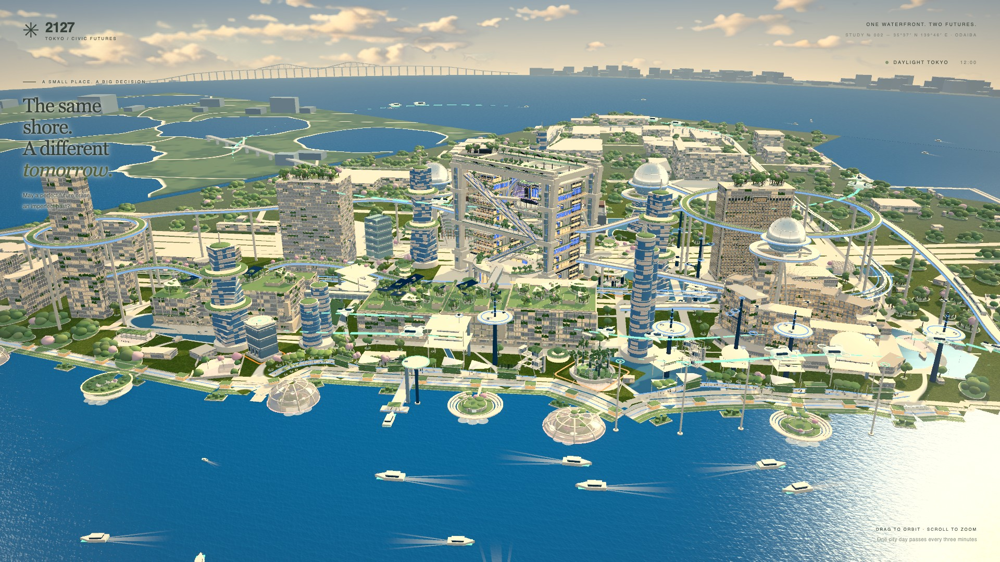
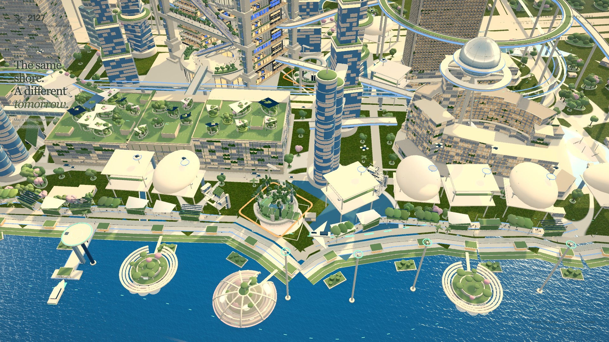
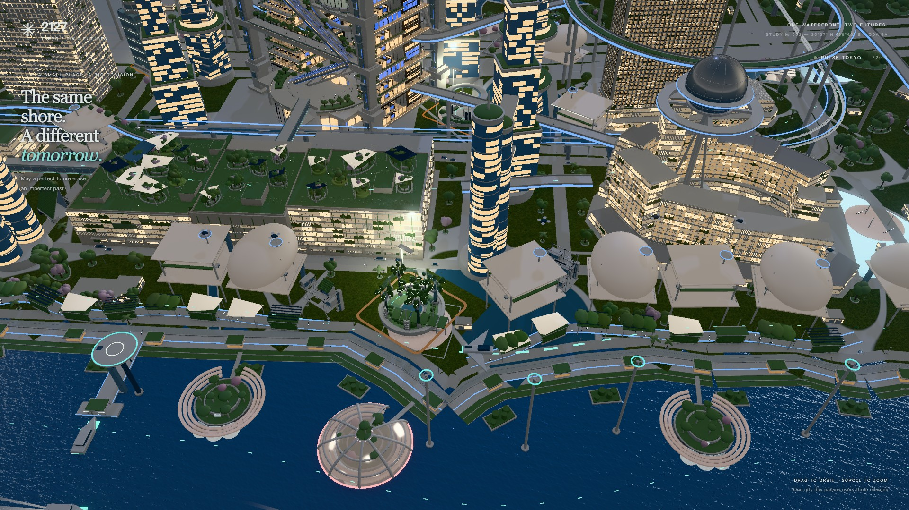
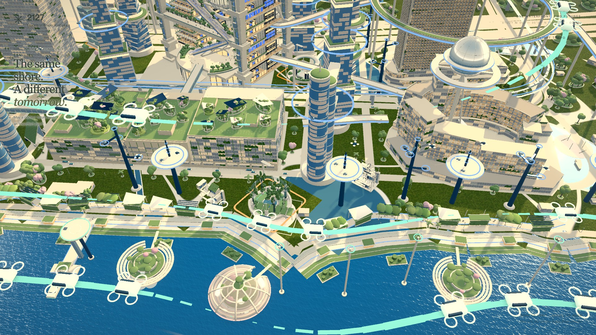
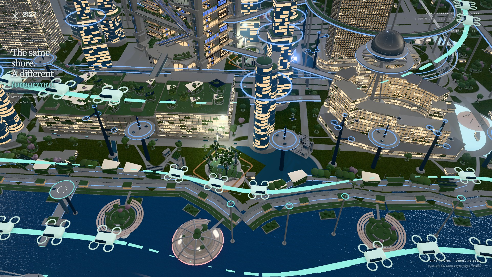
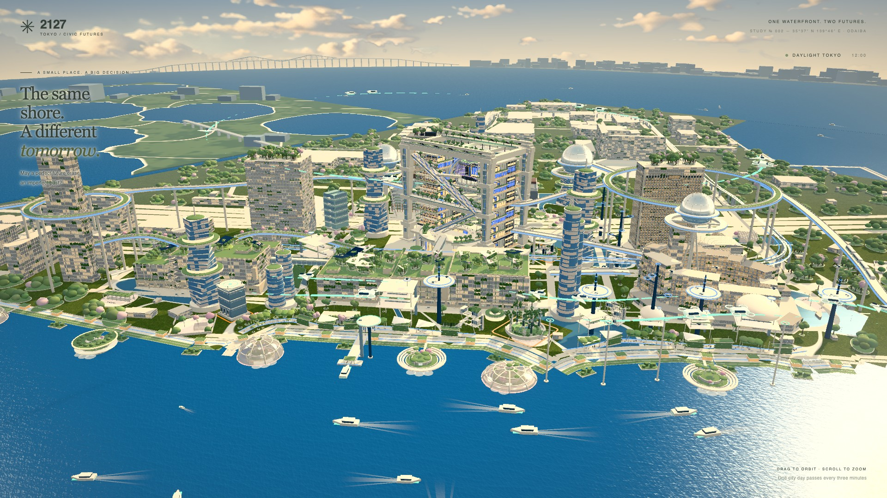
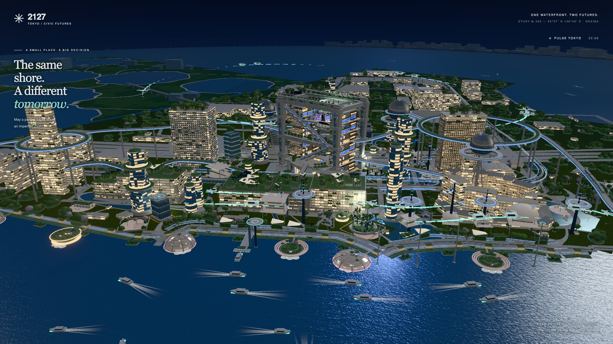

# Sector D — S0 / final review

未經owner接受，未merge main。對S0量度包含累積A/B/C/D source，不將全部FPS或draw差異歸因D。每shot最多三輪；所有原圖、完整root/carrier/group量度及原門檻保留。不同shot依序打磨，hero重拍可核對當時累積影響；每個final是該shot最後一輪當時runtime，source snapshot／hash及local block核對保留，較後shot可能改背景，不能冒充全D當前畫面；完整當前全城另由Z負責。pairing沒有S0同狀態原圖／draw基準，A5明列UNVERIFIED，不當PASS。[JSON](report.json)、[視覺逐圖理由](visual-review.json)、[驗證](checks.json)。

建議暫不接受D美術：身份、綠化、NW hybrid／配對接合及自動gate仍有FAIL。Focal r3比r2退步；wing恢復S0 pose後FPS回復，但日景raw604使calls仍FAIL，A4亦0/8，所有樣本及r2審閱保留於[交付說明](README.md)。Root/live通過只屬行為驗證。

```json
{
  "finalStates": 50,
  "measuredStates": 134,
  "rounds": [
    {
      "id": "nw:focal",
      "directory": "r1/nw-focal",
      "states": 8,
      "A4": 2,
      "A4pairs": 6,
      "browser": "156.0.8078.73"
    },
    {
      "id": "nw:focal",
      "directory": "r2/nw-focal",
      "states": 8,
      "A4": 2,
      "A4pairs": 6,
      "browser": "156.0.8078.73"
    },
    {
      "id": "nw:focal",
      "directory": "r3/nw-focal",
      "states": 8,
      "A4": 2,
      "A4pairs": 6,
      "browser": "156.0.8078.73"
    },
    {
      "id": "nw:district",
      "directory": "r1/nw-district",
      "states": 16,
      "A4": 0,
      "A4pairs": 14,
      "browser": "156.0.8078.73"
    },
    {
      "id": "nw:district",
      "directory": "r2/nw-district",
      "states": 16,
      "A4": 0,
      "A4pairs": 14,
      "browser": "156.0.8078.73"
    },
    {
      "id": "nw:district",
      "directory": "r3/nw-district",
      "states": 16,
      "A4": 0,
      "A4pairs": 14,
      "browser": "156.0.8078.73"
    },
    {
      "id": "energy:garden2",
      "directory": "r1/energy-garden2",
      "states": 8,
      "A4": 1,
      "A4pairs": 6,
      "browser": "156.0.8078.73"
    },
    {
      "id": "energy:garden2",
      "directory": "r2/energy-garden2",
      "states": 8,
      "A4": 1,
      "A4pairs": 6,
      "browser": "156.0.8078.73"
    },
    {
      "id": "energy:wing",
      "directory": "r1/energy-wing",
      "states": 10,
      "A4": 4,
      "A4pairs": 8,
      "browser": "156.0.8078.73"
    },
    {
      "id": "energy:wing",
      "directory": "r2/energy-wing",
      "states": 10,
      "A4": 2,
      "A4pairs": 8,
      "browser": "156.0.8078.73"
    },
    {
      "id": "energy:wing",
      "directory": "r3/energy-wing",
      "states": 10,
      "A4": 0,
      "A4pairs": 8,
      "browser": "156.0.8078.73"
    },
    {
      "id": "energy:island",
      "directory": "r1/energy-island",
      "states": 8,
      "A4": 1,
      "A4pairs": 6,
      "browser": "156.0.8078.73"
    },
    {
      "id": "energy:island",
      "directory": "r2/energy-island",
      "states": 8,
      "A4": 1,
      "A4pairs": 6,
      "browser": "156.0.8078.73"
    }
  ],
  "A1": {
    "PASS": 34,
    "N/A": 16
  },
  "A2": {
    "PASS": 24,
    "N/A": 16,
    "FAIL": 10
  },
  "A3": {
    "FAIL": 34,
    "N/A": 16
  },
  "A4": {
    "pass": 4,
    "pairs": 40
  },
  "A5": {
    "FAIL": 10,
    "PASS": 36,
    "UNVERIFIED": 4
  },
  "A6": {
    "PASS": 50
  },
  "reproducibility": {
    "FAIL": 29,
    "PASS": 21
  },
  "V": {
    "V1": {
      "FAIL": 22,
      "PASS": 22,
      "N/A": 6
    },
    "V2": {
      "PASS": 50
    },
    "V3": {
      "FAIL": 50
    },
    "V4": {
      "PASS": 50
    },
    "V5": {
      "N/A": 28,
      "FAIL": 4,
      "PASS": 18
    },
    "V6": {
      "STATIC PASS": 42,
      "FAIL": 8
    }
  }
}
```

## nw:focal / nw:focal · -2 · h12

| S0 original | Final original |
| --- | --- |
| [](../S0/baseline/nw-focal__-2__h12.jpg) | [](r3/nw-focal/nw-focal__-2__h12.jpg) |

完整投影：width 10.65%、height 25.27%；center (50.00%, 62.44%)、card overlap 0.00%。A1原門檻focal height25–60%／district width≥35%／energy max≥20%；A2 center x8–72% y15–85%、overlap≤5%。

A1 PASS；A2 PASS；A3 FAIL（3/9）；A4 0/2；A5 FAIL（vsync 60.1、calls 949）；A6 PASS。

Canonical shot/hero mean 79.78FPS（minimum 90.78）、calls 959（maximum 852.5）；此狀態vsync須≥58、instant calls maximum 843.7。

- **V1 FAIL**：正面三個人工服務櫃較清楚，但量體仍是泛用玻璃服務樓，兩秒難直接識別為人本服務方案。
- **V2 PASS**：下緣海面與後方富士球體／大型框架提供台場定位。
- **V3 FAIL**：周邊仍有棒棒糖冠層、圓球簇與平綠屋面；不擴大D去改全城植栽。
- **V4 PASS**：人工櫃、到達前場與有人服務完整存在，low不是空地或落後階段；建築語彙仍偏常規，V1缺口保留。
- **V5 N/A**：日景；夜間判斷另列相同狀態h22。
- **V6 STATIC PASS**：原尺寸未見浮件、穿模或明顯鋸齒接點；單張不能證明動態無閃爍。

## nw:focal / nw:focal · -2 · h22

| S0 original | Final original |
| --- | --- |
| [](../S0/baseline/nw-focal__-2__h22.jpg) | [](r3/nw-focal/nw-focal__-2__h22.jpg) |

完整投影：width 10.65%、height 25.27%；center (50.00%, 62.44%)、card overlap 0.00%。A1原門檻focal height25–60%／district width≥35%／energy max≥20%；A2 center x8–72% y15–85%、overlap≤5%。

A1 PASS；A2 PASS；A3 FAIL（3/9）；A4 0/2；A5 FAIL（vsync 60、calls 949）；A6 PASS。

Canonical shot/hero mean 85.65FPS（minimum 86.66）、calls 1147（maximum 1057.7）；此狀態vsync須≥58、instant calls maximum 843.7。

- **V1 FAIL**：人工服務櫃只佔正面很小面積，暗色三層盒體容易被看成普通辦公樓，服務類別不夠直接。
- **V2 PASS**：海面、富士球體與有光的civic框架同時可定位。
- **V3 FAIL**：前後景球簇與扁平屋頂綠地仍明顯，沒有全城改樹來填補。
- **V4 PASS**：人工櫃和到達前場完整，低自動化是有人服務的成熟替代；本體語彙的普通感仍保留為V1缺口。
- **V5 FAIL**：外輪廓能辨認，但人工櫃和mixed自動櫃的差別仍過小，夜間難讀。
- **V6 STATIC PASS**：可見面板、窗框及平台接合未見浮件或穿模；未以單張證明完整動態無閃爍。

## nw:focal / nw:focal · 0 · h12

| S0 original | Final original |
| --- | --- |
| [](../S0/baseline/nw-focal__0__h12.jpg) | [](r3/nw-focal/nw-focal__0__h12.jpg) |

完整投影：width 10.65%、height 25.27%；center (50.00%, 62.44%)、card overlap 0.00%。A1原門檻focal height25–60%／district width≥35%／energy max≥20%；A2 center x8–72% y15–85%、overlap≤5%。

A1 PASS；A2 PASS；A3 FAIL（3/9）；A4 1/2；A5 FAIL（vsync 60、calls 949）；A6 PASS。

Canonical shot/hero mean 79.78FPS（minimum 90.78）、calls 959（maximum 852.5）；此狀態vsync須≥58、instant calls maximum 843.7。

- **V1 FAIL**：三個自動槽與三個人工槽按原配置共存，但正面幾個小櫃難在兩秒讀成混合服務；建築盒體與low太接近。
- **V2 PASS**：海面、富士球體與civic巨框可見，位置可讀。
- **V3 FAIL**：格狀綠屋面、球簇及扁冠樹仍在背景，未達R01的生長層次。
- **V4 PASS**：有人協助與自動服務共存且保持完整前場，不把中值當未完成建物。
- **V5 N/A**：本張日景；h22另評夜間。
- **V6 STATIC PASS**：服務臉、窗框和基座沒有肉眼可見浮件／穿模；完整動態閃爍另待驗。

## nw:focal / nw:focal · 0 · h22

| S0 original | Final original |
| --- | --- |
| [](../S0/baseline/nw-focal__0__h22.jpg) | [](r3/nw-focal/nw-focal__0__h22.jpg) |

完整投影：width 10.65%、height 25.27%；center (50.00%, 62.44%)、card overlap 0.00%。A1原門檻focal height25–60%／district width≥35%／energy max≥20%；A2 center x8–72% y15–85%、overlap≤5%。

A1 PASS；A2 PASS；A3 FAIL（3/9）；A4 1/2；A5 FAIL（vsync 60.1、calls 949）；A6 PASS。

Canonical shot/hero mean 85.65FPS（minimum 86.66）、calls 1147（maximum 1057.7）；此狀態vsync須≥58、instant calls maximum 843.7。

- **V1 FAIL**：三個自動槽與三個人工槽按原配置共存，但正面幾個小櫃難在兩秒讀成混合服務；建築盒體與low太接近。
- **V2 PASS**：海面、富士球體與civic巨框可見，位置可讀。
- **V3 FAIL**：格狀綠屋面、球簇及扁冠樹仍在背景，未達R01的生長層次。
- **V4 PASS**：有人協助與自動服務共存且保持完整前場，不把中值當未完成建物。
- **V5 FAIL**：夜景輪廓存在，但小型服務模式差別仍太弱。
- **V6 STATIC PASS**：服務臉、窗框和基座沒有肉眼可見浮件／穿模；完整動態閃爍另待驗。

## nw:focal / nw:focal · 2 · h12

| S0 original | Final original |
| --- | --- |
| [](../S0/baseline/nw-focal__2__h12.jpg) | [](r3/nw-focal/nw-focal__2__h12.jpg) |

完整投影：width 11.93%、height 58.09%；center (50.00%, 46.03%)、card overlap 0.00%。A1原門檻focal height25–60%／district width≥35%／energy max≥20%；A2 center x8–72% y15–85%、overlap≤5%。

A1 PASS；A2 PASS；A3 FAIL（3/9）；A4 1/2；A5 FAIL（vsync 60、calls 959）；A6 PASS。

Canonical shot/hero mean 79.78FPS（minimum 90.78）、calls 959（maximum 852.5）；此狀態vsync須≥58、instant calls maximum 852.5。

- **V1 FAIL**：高自動化的圓筒與服務基座完整且突出，但圓筒仍像通用設備／辦公塔，不靠說明難兩秒判讀服務機能。
- **V2 PASS**：近處海灣、富士球體及civic框架可見。
- **V3 FAIL**：背景球冠、條帶屋面與格狀綠化仍不達mastertaste；此輪沒有擴全城改樹。
- **V4 PASS**：自動服務端口、垂直量體和進入前場皆完整；保留高自動化成熟替代語義。
- **V5 N/A**：日景；同狀態夜景另列。
- **V6 STATIC PASS**：弧形操作層線緊貼原筒，窗框、基座與上部連接未見明顯浮件或穿模；未驗完整動態閃爍。

## nw:focal / nw:focal · 2 · h22

| S0 original | Final original |
| --- | --- |
| [](../S0/baseline/nw-focal__2__h22.jpg) | [](r3/nw-focal/nw-focal__2__h22.jpg) |

完整投影：width 11.93%、height 58.09%；center (50.00%, 46.03%)、card overlap 0.00%。A1原門檻focal height25–60%／district width≥35%／energy max≥20%；A2 center x8–72% y15–85%、overlap≤5%。

A1 PASS；A2 PASS；A3 FAIL（3/9）；A4 1/2；A5 FAIL（vsync 60、calls 959）；A6 PASS。

Canonical shot/hero mean 85.65FPS（minimum 86.66）、calls 1147（maximum 1057.7）；此狀態vsync須≥58、instant calls maximum 852.5。

- **V1 FAIL**：層間窄光線令高塔輪廓較清楚，但仍不能只憑圓筒辨認為自動服務機能。
- **V2 PASS**：海面、富士球體／civic巨框和岸線提供定位。
- **V3 FAIL**：背景球冠及綠屋面缺乏自然層次，未作範圍外的全城綠化。
- **V4 PASS**：自動端口、垂直服務量體與公共入口完整，保留成熟高自動化語義。
- **V5 PASS**：窄操作層線沿原筒分層，high輪廓與low低樓的高度差在夜景仍清楚；端口身份仍是V1缺口。
- **V6 STATIC PASS**：光線有原筒承托，窗框／基座無明顯浮件或穿模；單張不能證明動態無閃爍。

## nw:focal / hero · neutral · h12

| S0 original | Final original |
| --- | --- |
| [](../S0/baseline/hero__neutral__h12.jpg) | [](r3/nw-focal/hero__neutral__h12.jpg) |

完整投影：width —、height —；center (—, —)、card overlap —。A1原門檻focal height25–60%／district width≥35%／energy max≥20%；A2 center x8–72% y15–85%、overlap≤5%。

A1 N/A；A2 N/A；A3 N/A（—/9）；A4 N/A；A5 PASS（vsync 60、calls 952）；A6 PASS。

Canonical shot/hero mean 87.16FPS（minimum 82.02）、calls 952（maximum 1042.8）；此狀態vsync須≥58、instant calls maximum 1042.8。

- **V1 PASS**：整座civic巨框、球體與多層海濱系統可直接讀成台場未來城市；hero不是服務單體辨識證明。
- **V2 PASS**：海灣、富士球體及彩虹橋的地理關係保留。
- **V3 FAIL**：近岸球簇及棋盤屋頂綠地在全城仍明顯，未達mastertaste層次。
- **V4 PASS**：多層交通、公民空間與水邊皆完整，維持成熟混合配置。
- **V5 N/A**：日景；夜景另列。
- **V6 STATIC PASS**：全尺寸靜態原圖未見新增穿模／浮件；不宣稱所有motion state皆無閃爍。

## nw:focal / hero · neutral · h22

| S0 original | Final original |
| --- | --- |
| [](../S0/baseline/hero__neutral__h22.jpg) | [](r3/nw-focal/hero__neutral__h22.jpg) |

完整投影：width —、height —；center (—, —)、card overlap —。A1原門檻focal height25–60%／district width≥35%／energy max≥20%；A2 center x8–72% y15–85%、overlap≤5%。

A1 N/A；A2 N/A；A3 N/A（—/9）；A4 N/A；A5 PASS（vsync 60、calls 952）；A6 PASS。

Canonical shot/hero mean 88.48FPS（minimum 84.95）、calls 952（maximum 1042.8）；此狀態vsync須≥58、instant calls maximum 1042.8。

- **V1 PASS**：整座civic巨框、球體與多層海濱系統可直接讀成台場未來城市；hero不是服務單體辨識證明。
- **V2 PASS**：海灣、富士球體及彩虹橋的地理關係保留。
- **V3 FAIL**：近岸球簇及棋盤屋頂綠地在全城仍明顯，未達mastertaste層次。
- **V4 PASS**：多層交通、公民空間與水邊皆完整，維持成熟混合配置。
- **V5 PASS**：岸線、框架、交通與樓體夜間可分辨，非每個遠處小服務槽可讀。
- **V6 STATIC PASS**：全尺寸靜態原圖未見新增穿模／浮件；不宣稱所有motion state皆無閃爍。

## nw:district / nw:district · -8 · h12

| S0 original | Final original |
| --- | --- |
| [](../S0/baseline/nw-district__-8__h12.jpg) | [](r3/nw-district/nw-district__-8__h12.jpg) |

完整投影：width 119.57%、height 168.17%；center (56.02%, 71.10%)、card overlap 4.92%。A1原門檻focal height25–60%／district width≥35%／energy max≥20%；A2 center x8–72% y15–85%、overlap≤5%。

A1 PASS；A2 PASS；A3 FAIL（0/9）；A4 0/3；A5 PASS（vsync 60、calls 875）；A6 PASS。

Canonical shot/hero mean 90.68FPS（minimum 75.54）、calls 875（maximum 955.9）；此狀態vsync須≥58、instant calls maximum 947.1。

- **V1 FAIL**：低自動化的大服務屋頂與支承已可讀，但屋頂仍遮住多數人員／服務bar，兩秒不足以辨認人本服務機能。
- **V2 PASS**：海灣與civic球體／巨框仍提供台場定位。
- **V3 FAIL**：左側屋頂棋盤植栽、扁冠及前景球簇仍明顯，沒有擴出D去改全城綠化。
- **V4 PASS**：低方案保留完整有人服務露台、升降支承與輔助停機點，非空或舊時代的過渡形態。
- **V5 N/A**：日景；同狀態h22另評。
- **V6 STATIC PASS**：屋面與露台支承未見明顯浮件／穿模，新增欄邊在原平台內；完整動態無閃爍未驗。

## nw:district / nw:district · -8 · h22

| S0 original | Final original |
| --- | --- |
| [](../S0/baseline/nw-district__-8__h22.jpg) | [](r3/nw-district/nw-district__-8__h22.jpg) |

完整投影：width 119.57%、height 168.17%；center (56.02%, 71.10%)、card overlap 4.92%。A1原門檻focal height25–60%／district width≥35%／energy max≥20%；A2 center x8–72% y15–85%、overlap≤5%。

A1 PASS；A2 PASS；A3 FAIL（0/9）；A4 0/3；A5 PASS（vsync 60、calls 875）；A6 PASS。

Canonical shot/hero mean 90.37FPS（minimum 82.41）、calls 875（maximum 955.9）；此狀態vsync須≥58、instant calls maximum 947.1。

- **V1 FAIL**：低自動化的大服務屋頂與支承已可讀，但屋頂仍遮住多數人員／服務bar，兩秒不足以辨認人本服務機能。
- **V2 PASS**：海灣與civic球體／巨框仍提供台場定位。
- **V3 FAIL**：左側屋頂棋盤植栽、扁冠及前景球簇仍明顯，沒有擴出D去改全城綠化。
- **V4 PASS**：低方案保留完整有人服務露台、升降支承與輔助停機點，非空或舊時代的過渡形態。
- **V5 FAIL**：屋面曲率較r2可讀，但被遮的服務bar夜間仍不清楚。
- **V6 STATIC PASS**：屋面與露台支承未見明顯浮件／穿模，新增欄邊在原平台內；完整動態無閃爍未驗。

## nw:district / nw:district · -5 · h12

| S0 original | Final original |
| --- | --- |
| [](../S0/baseline/nw-district__-5__h12.jpg) | [](r3/nw-district/nw-district__-5__h12.jpg) |

完整投影：width 117.80%、height 164.09%；center (54.95%, 68.61%)、card overlap 5.12%。A1原門檻focal height25–60%／district width≥35%／energy max≥20%；A2 center x8–72% y15–85%、overlap≤5%。

A1 PASS；A2 FAIL；A3 FAIL（0/9）；A4 0/2；A5 PASS（vsync 60、calls 875）；A6 PASS。

Canonical shot/hero mean 90.68FPS（minimum 75.54）、calls 875（maximum 955.9）；此狀態vsync須≥58、instant calls maximum 947.1。

- **V1 FAIL**：自主端盤與有人服務樓並存，但服務bar多被大屋面遮住，兩秒難讀完整的混合服務機能。
- **V2 PASS**：海灣與富士系civic球體／框架可見。
- **V3 FAIL**：屋頂棋盤植栽及海濱球簇／扁冠仍明顯，不作全城綠化來追gate。
- **V4 PASS**：完整有人服務露台和自主端盤共存，保留原hybrid方案與公共前場。
- **V5 N/A**：日景；夜景另列。
- **V6 FAIL**：局部mast與縮小有人樓屋面看似穿頂，缺少明確轉接接頭；這是原hybrid的靜態視覺缺口，未冒充已量的碰撞斷言。

## nw:district / nw:district · -5 · h22

| S0 original | Final original |
| --- | --- |
| [](../S0/baseline/nw-district__-5__h22.jpg) | [](r3/nw-district/nw-district__-5__h22.jpg) |

完整投影：width 117.80%、height 164.09%；center (54.95%, 68.61%)、card overlap 5.12%。A1原門檻focal height25–60%／district width≥35%／energy max≥20%；A2 center x8–72% y15–85%、overlap≤5%。

A1 PASS；A2 FAIL；A3 FAIL（0/9）；A4 0/2；A5 PASS（vsync 60、calls 875）；A6 PASS。

Canonical shot/hero mean 90.37FPS（minimum 82.41）、calls 875（maximum 955.9）；此狀態vsync須≥58、instant calls maximum 947.1。

- **V1 FAIL**：自主端盤與有人服務樓並存，但服務bar多被大屋面遮住，兩秒難讀完整的混合服務機能。
- **V2 PASS**：海灣與富士系civic球體／框架可見。
- **V3 FAIL**：屋頂棋盤植栽及海濱球簇／扁冠仍明顯，不作全城綠化來追gate。
- **V4 PASS**：完整有人服務露台和自主端盤共存，保留原hybrid方案與公共前場。
- **V5 PASS**：藍色端盤、暗桿與淡色有人樓夜間可分辨；服務身份仍屬V1缺口。
- **V6 FAIL**：局部mast與縮小有人樓屋面看似穿頂，缺少明確轉接接頭；這是原hybrid的靜態視覺缺口，未冒充已量的碰撞斷言。

## nw:district / nw:district · 0 · h12

| S0 original | Final original |
| --- | --- |
| [](../S0/baseline/nw-district__0__h12.jpg) | [](r3/nw-district/nw-district__0__h12.jpg) |

完整投影：width 117.61%、height 163.52%；center (54.85%, 68.90%)、card overlap 5.15%。A1原門檻focal height25–60%／district width≥35%／energy max≥20%；A2 center x8–72% y15–85%、overlap≤5%。

A1 PASS；A2 FAIL；A3 FAIL（0/9）；A4 0/2；A5 PASS（vsync 60、calls 875）；A6 PASS。

Canonical shot/hero mean 90.68FPS（minimum 75.54）、calls 875（maximum 955.9）；此狀態vsync須≥58、instant calls maximum 947.1。

- **V1 FAIL**：自主端盤與有人服務樓並存，但服務bar多被大屋面遮住，兩秒難讀完整的混合服務機能。
- **V2 PASS**：海灣與富士系civic球體／框架可見。
- **V3 FAIL**：屋頂棋盤植栽及海濱球簇／扁冠仍明顯，不作全城綠化來追gate。
- **V4 PASS**：完整有人服務露台和自主端盤共存，保留原hybrid方案與公共前場。
- **V5 N/A**：日景；夜景另列。
- **V6 FAIL**：局部mast與縮小有人樓屋面看似穿頂，缺少明確轉接接頭；這是原hybrid的靜態視覺缺口，未冒充已量的碰撞斷言。

## nw:district / nw:district · 0 · h22

| S0 original | Final original |
| --- | --- |
| [](../S0/baseline/nw-district__0__h22.jpg) | [](r3/nw-district/nw-district__0__h22.jpg) |

完整投影：width 117.61%、height 163.52%；center (54.85%, 68.90%)、card overlap 5.15%。A1原門檻focal height25–60%／district width≥35%／energy max≥20%；A2 center x8–72% y15–85%、overlap≤5%。

A1 PASS；A2 FAIL；A3 FAIL（0/9）；A4 0/2；A5 PASS（vsync 60、calls 875）；A6 PASS。

Canonical shot/hero mean 90.37FPS（minimum 82.41）、calls 875（maximum 955.9）；此狀態vsync須≥58、instant calls maximum 947.1。

- **V1 FAIL**：自主端盤與有人服務樓並存，但服務bar多被大屋面遮住，兩秒難讀完整的混合服務機能。
- **V2 PASS**：海灣與富士系civic球體／框架可見。
- **V3 FAIL**：屋頂棋盤植栽及海濱球簇／扁冠仍明顯，不作全城綠化來追gate。
- **V4 PASS**：完整有人服務露台和自主端盤共存，保留原hybrid方案與公共前場。
- **V5 PASS**：藍色端盤、暗桿與淡色有人樓夜間可分辨；服務身份仍屬V1缺口。
- **V6 FAIL**：局部mast與縮小有人樓屋面看似穿頂，缺少明確轉接接頭；這是原hybrid的靜態視覺缺口，未冒充已量的碰撞斷言。

## nw:district / nw:district · 5 · h12

| S0 original | Final original |
| --- | --- |
| [](../S0/baseline/nw-district__5__h12.jpg) | [](r3/nw-district/nw-district__5__h12.jpg) |

完整投影：width 117.34%、height 163.39%；center (54.98%, 68.96%)、card overlap 5.16%。A1原門檻focal height25–60%／district width≥35%／energy max≥20%；A2 center x8–72% y15–85%、overlap≤5%。

A1 PASS；A2 FAIL；A3 FAIL（0/9）；A4 0/2；A5 PASS（vsync 60、calls 875）；A6 PASS。

Canonical shot/hero mean 90.68FPS（minimum 75.54）、calls 875（maximum 955.9）；此狀態vsync須≥58、instant calls maximum 955.9。

- **V1 FAIL**：無人端盤可讀，但剩餘有人樓的服務bar仍被遮，混合機能不夠直接。
- **V2 PASS**：海灣、球體與civic框架可定位。
- **V3 FAIL**：屋頂棋盤與海濱球簇／扁冠仍不達mastertaste，未以範圍外綠化補足。
- **V4 PASS**：完整自主網絡或原有人／無人混合並存，沒有以空地代表low或未完成方案。
- **V5 N/A**：日景；夜景另列。
- **V6 FAIL**：局部hybrid mast看似穿過縮小有人屋面，缺少明確轉接節點；靜態視覺缺口保留，未冒充碰撞量測。

## nw:district / nw:district · 5 · h22

| S0 original | Final original |
| --- | --- |
| [](../S0/baseline/nw-district__5__h22.jpg) | [](r3/nw-district/nw-district__5__h22.jpg) |

完整投影：width 117.34%、height 163.39%；center (54.98%, 68.96%)、card overlap 5.16%。A1原門檻focal height25–60%／district width≥35%／energy max≥20%；A2 center x8–72% y15–85%、overlap≤5%。

A1 PASS；A2 FAIL；A3 FAIL（0/9）；A4 0/2；A5 PASS（vsync 60、calls 875）；A6 PASS。

Canonical shot/hero mean 90.37FPS（minimum 82.41）、calls 875（maximum 955.9）；此狀態vsync須≥58、instant calls maximum 955.9。

- **V1 FAIL**：無人端盤可讀，但剩餘有人樓的服務bar仍被遮，混合機能不夠直接。
- **V2 PASS**：海灣、球體與civic框架可定位。
- **V3 FAIL**：屋頂棋盤與海濱球簇／扁冠仍不達mastertaste，未以範圍外綠化補足。
- **V4 PASS**：完整自主網絡或原有人／無人混合並存，沒有以空地代表low或未完成方案。
- **V5 PASS**：夜間端盤、充電桿和淡色樓體的輪廓與替換差異可讀。
- **V6 FAIL**：局部hybrid mast看似穿過縮小有人屋面，缺少明確轉接節點；靜態視覺缺口保留，未冒充碰撞量測。

## nw:district / nw:district · 8 · h12

| S0 original | Final original |
| --- | --- |
| [](../S0/baseline/nw-district__8__h12.jpg) | [](r3/nw-district/nw-district__8__h12.jpg) |

完整投影：width 116.16%、height 159.75%；center (55.54%, 67.22%)、card overlap 5.33%。A1原門檻focal height25–60%／district width≥35%／energy max≥20%；A2 center x8–72% y15–85%、overlap≤5%。

A1 PASS；A2 FAIL；A3 FAIL（0/9）；A4 0/3；A5 PASS（vsync 60、calls 875）；A6 PASS。

Canonical shot/hero mean 90.68FPS（minimum 75.54）、calls 875（maximum 955.9）；此狀態vsync須≥58、instant calls maximum 955.9。

- **V1 PASS**：多座自主端盤、充電桿與機隊可直接辨認為無人空中服務網絡。
- **V2 PASS**：海灣、球體與civic框架可定位。
- **V3 FAIL**：屋頂棋盤與海濱球簇／扁冠仍不達mastertaste，未以範圍外綠化補足。
- **V4 PASS**：完整自主網絡或原有人／無人混合並存，沒有以空地代表low或未完成方案。
- **V5 N/A**：日景；夜景另列。
- **V6 STATIC PASS**：高方案支桿／盤面落點未見明顯新浮件或穿模；不是全動態閃爍證明。

## nw:district / nw:district · 8 · h22

| S0 original | Final original |
| --- | --- |
| [](../S0/baseline/nw-district__8__h22.jpg) | [](r3/nw-district/nw-district__8__h22.jpg) |

完整投影：width 116.16%、height 159.75%；center (55.54%, 67.22%)、card overlap 5.33%。A1原門檻focal height25–60%／district width≥35%／energy max≥20%；A2 center x8–72% y15–85%、overlap≤5%。

A1 PASS；A2 FAIL；A3 FAIL（0/9）；A4 0/3；A5 PASS（vsync 60、calls 875）；A6 PASS。

Canonical shot/hero mean 90.37FPS（minimum 82.41）、calls 875（maximum 955.9）；此狀態vsync須≥58、instant calls maximum 955.9。

- **V1 PASS**：多座自主端盤、充電桿與機隊可直接辨認為無人空中服務網絡。
- **V2 PASS**：海灣、球體與civic框架可定位。
- **V3 FAIL**：屋頂棋盤與海濱球簇／扁冠仍不達mastertaste，未以範圍外綠化補足。
- **V4 PASS**：完整自主網絡或原有人／無人混合並存，沒有以空地代表low或未完成方案。
- **V5 PASS**：夜間端盤、充電桿和淡色樓體的輪廓與替換差異可讀。
- **V6 STATIC PASS**：高方案支桿／盤面落點未見明顯新浮件或穿模；不是全動態閃爍證明。

## nw:district / hero · neutral · h12

| S0 original | Final original |
| --- | --- |
| [](../S0/baseline/hero__neutral__h12.jpg) | [](r3/nw-district/hero__neutral__h12.jpg) |

完整投影：width —、height —；center (—, —)、card overlap —。A1原門檻focal height25–60%／district width≥35%／energy max≥20%；A2 center x8–72% y15–85%、overlap≤5%。

A1 N/A；A2 N/A；A3 N/A（—/9）；A4 N/A；A5 PASS（vsync 59.9、calls 952）；A6 PASS。

Canonical shot/hero mean 89.14FPS（minimum 82.02）、calls 952（maximum 1042.8）；此狀態vsync須≥58、instant calls maximum 1042.8。

- **V1 PASS**：整座civic巨框、球體與多層海濱系統可直接讀成台場未來城市；hero不是服務單體辨識證明。
- **V2 PASS**：海灣、富士球體及彩虹橋的地理關係保留。
- **V3 FAIL**：近岸球簇及棋盤屋頂綠地在全城仍明顯，未達mastertaste層次。
- **V4 PASS**：多層交通、公民空間與水邊皆完整，維持成熟混合配置。
- **V5 N/A**：日景；夜景另列。
- **V6 STATIC PASS**：此hero距離未見新增明顯穿模／浮件；近鏡hybrid轉接缺口已另列FAIL，不以hero遮小它作通過證明。

## nw:district / hero · neutral · h22

| S0 original | Final original |
| --- | --- |
| [](../S0/baseline/hero__neutral__h22.jpg) | [](r3/nw-district/hero__neutral__h22.jpg) |

完整投影：width —、height —；center (—, —)、card overlap —。A1原門檻focal height25–60%／district width≥35%／energy max≥20%；A2 center x8–72% y15–85%、overlap≤5%。

A1 N/A；A2 N/A；A3 N/A（—/9）；A4 N/A；A5 PASS（vsync 60、calls 952）；A6 PASS。

Canonical shot/hero mean 88.95FPS（minimum 84.95）、calls 952（maximum 1042.8）；此狀態vsync須≥58、instant calls maximum 1042.8。

- **V1 PASS**：整座civic巨框、球體與多層海濱系統可直接讀成台場未來城市；hero不是服務單體辨識證明。
- **V2 PASS**：海灣、富士球體及彩虹橋的地理關係保留。
- **V3 FAIL**：近岸球簇及棋盤屋頂綠地在全城仍明顯，未達mastertaste層次。
- **V4 PASS**：多層交通、公民空間與水邊皆完整，維持成熟混合配置。
- **V5 PASS**：岸線、框架、交通與樓體夜間可分辨，非每個遠處小服務槽可讀。
- **V6 STATIC PASS**：此hero距離未見新增明顯穿模／浮件；近鏡hybrid轉接缺口已另列FAIL，不以hero遮小它作通過證明。

## nw:district / nw:district · low-no-docks · h12

| S0 original | Final original |
| --- | --- |
| 無同狀態S0 | [](r3/nw-district/nw-district__low-no-docks__h12.jpg) |

完整投影：width 119.57%、height 168.17%；center (56.02%, 71.10%)、card overlap 4.92%。A1原門檻focal height25–60%／district width≥35%／energy max≥20%；A2 center x8–72% y15–85%、overlap≤5%。

A1 PASS；A2 PASS；A3 FAIL（0/9）；A4 0/1；A5 UNVERIFIED（vsync 60、calls 859）；A6 PASS。

Canonical shot/hero mean 90.68FPS（minimum 75.54）、calls 875（maximum 955.9）；此狀態vsync須≥58、instant calls maximum UNVERIFIED。

- **V1 FAIL**：人工服務亭仍主要見到大片屋頂，服務開口被遮，類別不夠直接。
- **V2 PASS**：海岸、富士球體與後方civic巨框同時提供台場定位。
- **V3 FAIL**：既有球簇、棒棒糖樹與平綠屋面依然明顯；本輪不擴大全城植栽。
- **V4 PASS**：兩種成熟的人工／自主服務設施完整存在；配對dock依既有跨軸資料顯示。
- **V5 N/A**：日景，夜間另列h22。
- **V6 STATIC PASS**：原尺寸可見亭台與支腳未見明顯浮件；靜態圖不能證明完整動態無閃爍。

## nw:district / nw:district · low-no-docks · h22

| S0 original | Final original |
| --- | --- |
| 無同狀態S0 | [](r3/nw-district/nw-district__low-no-docks__h22.jpg) |

完整投影：width 119.57%、height 168.17%；center (56.02%, 71.10%)、card overlap 4.92%。A1原門檻focal height25–60%／district width≥35%／energy max≥20%；A2 center x8–72% y15–85%、overlap≤5%。

A1 PASS；A2 PASS；A3 FAIL（0/9）；A4 0/1；A5 UNVERIFIED（vsync 60、calls 859）；A6 PASS。

Canonical shot/hero mean 90.37FPS（minimum 82.41）、calls 875（maximum 955.9）；此狀態vsync須≥58、instant calls maximum UNVERIFIED。

- **V1 FAIL**：人工服務亭仍主要見到大片屋頂，服務開口被遮，類別不夠直接。
- **V2 PASS**：海岸、富士球體與後方civic巨框同時提供台場定位。
- **V3 FAIL**：既有球簇、棒棒糖樹與平綠屋面依然明顯；本輪不擴大全城植栽。
- **V4 PASS**：兩種成熟的人工／自主服務設施完整存在；配對dock依既有跨軸資料顯示。
- **V5 FAIL**：亭體輪廓存在，但暗色服務面難讀，夜間機能仍不清楚。
- **V6 STATIC PASS**：原尺寸可見亭台與支腳未見明顯浮件；靜態圖不能證明完整動態無閃爍。

## nw:district / nw:district · high-docks · h12

| S0 original | Final original |
| --- | --- |
| 無同狀態S0 | [](r3/nw-district/nw-district__high-docks__h12.jpg) |

完整投影：width 116.16%、height 159.75%；center (55.54%, 67.22%)、card overlap 5.33%。A1原門檻focal height25–60%／district width≥35%／energy max≥20%；A2 center x8–72% y15–85%、overlap≤5%。

A1 PASS；A2 FAIL；A3 FAIL（0/9）；A4 0/1；A5 UNVERIFIED（vsync 60、calls 863）；A6 PASS。

Canonical shot/hero mean 90.68FPS（minimum 75.54）、calls 875（maximum 955.9）；此狀態vsync須≥58、instant calls maximum UNVERIFIED。

- **V1 PASS**：自主平台／操作桅杆清晰成網。
- **V2 PASS**：海岸、富士球體與後方civic巨框同時提供台場定位。
- **V3 FAIL**：既有球簇、棒棒糖樹與平綠屋面依然明顯；本輪不擴大全城植栽。
- **V4 PASS**：兩種成熟的人工／自主服務設施完整存在；配對dock依既有跨軸資料顯示。
- **V5 N/A**：日景，夜間另列h22。
- **V6 FAIL**：配對既有C dock仍有視覺承重／接合疑慮；保留C未接受項，不將其當成D新增碰撞。

## nw:district / nw:district · high-docks · h22

| S0 original | Final original |
| --- | --- |
| 無同狀態S0 | [](r3/nw-district/nw-district__high-docks__h22.jpg) |

完整投影：width 116.16%、height 159.75%；center (55.54%, 67.22%)、card overlap 5.33%。A1原門檻focal height25–60%／district width≥35%／energy max≥20%；A2 center x8–72% y15–85%、overlap≤5%。

A1 PASS；A2 FAIL；A3 FAIL（0/9）；A4 0/1；A5 UNVERIFIED（vsync 60、calls 863）；A6 PASS。

Canonical shot/hero mean 90.37FPS（minimum 82.41）、calls 875（maximum 955.9）；此狀態vsync須≥58、instant calls maximum UNVERIFIED。

- **V1 PASS**：自主平台／操作桅杆清晰成網。
- **V2 PASS**：海岸、富士球體與後方civic巨框同時提供台場定位。
- **V3 FAIL**：既有球簇、棒棒糖樹與平綠屋面依然明顯；本輪不擴大全城植栽。
- **V4 PASS**：兩種成熟的人工／自主服務設施完整存在；配對dock依既有跨軸資料顯示。
- **V5 PASS**：平台輪廓與操作桅杆燈可辨認，dock及航路亮度另屬既有C。
- **V6 FAIL**：配對既有C dock仍有視覺承重／接合疑慮；保留C未接受項，不將其當成D新增碰撞。

## energy:garden2 / energy:garden2 · baseline · h12

| S0 original | Final original |
| --- | --- |
| [](../S0/baseline/energy-garden2__baseline__h12.jpg) | [](r2/energy-garden2/energy-garden2__baseline__h12.jpg) |

完整投影：width —、height —；center (—, —)、card overlap —。A1原門檻focal height25–60%／district width≥35%／energy max≥20%；A2 center x8–72% y15–85%、overlap≤5%。

A1 N/A；A2 N/A；A3 N/A（0/9）；A4 1/2；A5 PASS（vsync 60、calls 429）；A6 PASS。

Canonical shot/hero mean 103.25FPS（minimum 99.04）、calls 483（maximum 500.5）；此狀態vsync須≥58、instant calls maximum 441.1。

- **V1 N/A**：基準沒有第二水庭；不要求識別不存在的部件。
- **V2 PASS**：前景海灣與沿岸步道連續，台場海岸定位可讀。
- **V3 FAIL**：前後景仍有球簇、棒棒糖樹與柱形綠塊，未達有層次的植栽要求。
- **V4 PASS**：基準沿岸公共空間完整，沒有把部件缺席當落後；存在時水庭的儲水、服務及公共動線完整。
- **V5 N/A**：日景另配h22夜景。
- **V6 STATIC PASS**：原尺寸可見支架、管件、欄杆與水池接合沒有明顯浮件或穿模；中空處保留。靜態圖不能證明完整動態無閃爍。

## energy:garden2 / energy:garden2 · baseline · h22

| S0 original | Final original |
| --- | --- |
| [](../S0/baseline/energy-garden2__baseline__h22.jpg) | [](r2/energy-garden2/energy-garden2__baseline__h22.jpg) |

完整投影：width —、height —；center (—, —)、card overlap —。A1原門檻focal height25–60%／district width≥35%／energy max≥20%；A2 center x8–72% y15–85%、overlap≤5%。

A1 N/A；A2 N/A；A3 N/A（0/9）；A4 0/2；A5 PASS（vsync 60、calls 429）；A6 PASS。

Canonical shot/hero mean 102.53FPS（minimum 98.51）、calls 483（maximum 500.5）；此狀態vsync須≥58、instant calls maximum 441.1。

- **V1 N/A**：基準沒有第二水庭；不要求識別不存在的部件。
- **V2 PASS**：前景海灣與沿岸步道連續，台場海岸定位可讀。
- **V3 FAIL**：前後景仍有球簇、棒棒糖樹與柱形綠塊，未達有層次的植栽要求。
- **V4 PASS**：基準沿岸公共空間完整，沒有把部件缺席當落後；存在時水庭的儲水、服務及公共動線完整。
- **V5 N/A**：基準無第二水庭，夜間部件辨識不適用。
- **V6 STATIC PASS**：原尺寸可見支架、管件、欄杆與水池接合沒有明顯浮件或穿模；中空處保留。靜態圖不能證明完整動態無閃爍。

## energy:garden2 / energy:garden2 · a · h12

| S0 original | Final original |
| --- | --- |
| [](../S0/baseline/energy-garden2__a__h12.jpg) | [](r2/energy-garden2/energy-garden2__a__h12.jpg) |

完整投影：width 39.10%、height 50.28%；center (52.74%, 51.94%)、card overlap 0.00%。A1原門檻focal height25–60%／district width≥35%／energy max≥20%；A2 center x8–72% y15–85%、overlap≤5%。

A1 PASS；A2 PASS；A3 FAIL（0/9）；A4 1/2；A5 PASS（vsync 60.1、calls 471）；A6 PASS。

Canonical shot/hero mean 103.25FPS（minimum 99.04）、calls 483（maximum 500.5）；此狀態vsync須≥58、instant calls maximum 487.3。

- **V1 PASS**：上下蓄水池、斜向管架、渦輪房與公共橋共同表達海邊蓄電水庭；屬本次靜態review判斷，未作真人兩秒測試。
- **V2 PASS**：前景海灣與沿岸步道連續，台場海岸定位可讀。
- **V3 FAIL**：前後景仍有球簇、棒棒糖樹與柱形綠塊，未達有層次的植栽要求。
- **V4 PASS**：儲水、渦輪、回水、支架與公共橋完整；a和mixed保留同一成熟水庭本體，不捏造差異。
- **V5 N/A**：日景另配h22夜景。
- **V6 STATIC PASS**：原尺寸可見支架、管件、欄杆與水池接合沒有明顯浮件或穿模；中空處保留。靜態圖不能證明完整動態無閃爍。

## energy:garden2 / energy:garden2 · a · h22

| S0 original | Final original |
| --- | --- |
| [](../S0/baseline/energy-garden2__a__h22.jpg) | [](r2/energy-garden2/energy-garden2__a__h22.jpg) |

完整投影：width 39.10%、height 50.28%；center (52.74%, 51.94%)、card overlap 0.00%。A1原門檻focal height25–60%／district width≥35%／energy max≥20%；A2 center x8–72% y15–85%、overlap≤5%。

A1 PASS；A2 PASS；A3 FAIL（0/9）；A4 0/2；A5 PASS（vsync 60、calls 471）；A6 PASS。

Canonical shot/hero mean 102.53FPS（minimum 98.51）、calls 483（maximum 500.5）；此狀態vsync須≥58、instant calls maximum 487.3。

- **V1 PASS**：上下蓄水池、斜向管架、渦輪房與公共橋共同表達海邊蓄電水庭；屬本次靜態review判斷，未作真人兩秒測試。
- **V2 PASS**：前景海灣與沿岸步道連續，台場海岸定位可讀。
- **V3 FAIL**：前後景仍有球簇、棒棒糖樹與柱形綠塊，未達有層次的植栽要求。
- **V4 PASS**：儲水、渦輪、回水、支架與公共橋完整；a和mixed保留同一成熟水庭本體，不捏造差異。
- **V5 PASS**：上池底緣與兩側支架的低亮邊燈可追蹤，水池／渦輪房及橋仍可區分；不用全城增光。
- **V6 STATIC PASS**：原尺寸可見支架、管件、欄杆與水池接合沒有明顯浮件或穿模；中空處保留。靜態圖不能證明完整動態無閃爍。

## energy:garden2 / energy:garden2 · mixed · h12

| S0 original | Final original |
| --- | --- |
| [](../S0/baseline/energy-garden2__mixed__h12.jpg) | [](r2/energy-garden2/energy-garden2__mixed__h12.jpg) |

完整投影：width 39.10%、height 50.28%；center (52.74%, 51.94%)、card overlap 0.00%。A1原門檻focal height25–60%／district width≥35%／energy max≥20%；A2 center x8–72% y15–85%、overlap≤5%。

A1 PASS；A2 PASS；A3 FAIL（0/9）；A4 0/2；A5 PASS（vsync 60、calls 483）；A6 PASS。

Canonical shot/hero mean 103.25FPS（minimum 99.04）、calls 483（maximum 500.5）；此狀態vsync須≥58、instant calls maximum 500.5。

- **V1 PASS**：上下蓄水池、斜向管架、渦輪房與公共橋共同表達海邊蓄電水庭；屬本次靜態review判斷，未作真人兩秒測試。
- **V2 PASS**：前景海灣與沿岸步道連續，台場海岸定位可讀。
- **V3 FAIL**：前後景仍有球簇、棒棒糖樹與柱形綠塊，未達有層次的植栽要求。
- **V4 PASS**：儲水、渦輪、回水、支架與公共橋完整；a和mixed保留同一成熟水庭本體，不捏造差異。
- **V5 N/A**：日景另配h22夜景。
- **V6 STATIC PASS**：原尺寸可見支架、管件、欄杆與水池接合沒有明顯浮件或穿模；中空處保留。靜態圖不能證明完整動態無閃爍。

## energy:garden2 / energy:garden2 · mixed · h22

| S0 original | Final original |
| --- | --- |
| [](../S0/baseline/energy-garden2__mixed__h22.jpg) | [](r2/energy-garden2/energy-garden2__mixed__h22.jpg) |

完整投影：width 39.10%、height 50.28%；center (52.74%, 51.94%)、card overlap 0.00%。A1原門檻focal height25–60%／district width≥35%／energy max≥20%；A2 center x8–72% y15–85%、overlap≤5%。

A1 PASS；A2 PASS；A3 FAIL（0/9）；A4 0/2；A5 PASS（vsync 60.1、calls 483）；A6 PASS。

Canonical shot/hero mean 102.53FPS（minimum 98.51）、calls 483（maximum 500.5）；此狀態vsync須≥58、instant calls maximum 500.5。

- **V1 PASS**：上下蓄水池、斜向管架、渦輪房與公共橋共同表達海邊蓄電水庭；屬本次靜態review判斷，未作真人兩秒測試。
- **V2 PASS**：前景海灣與沿岸步道連續，台場海岸定位可讀。
- **V3 FAIL**：前後景仍有球簇、棒棒糖樹與柱形綠塊，未達有層次的植栽要求。
- **V4 PASS**：儲水、渦輪、回水、支架與公共橋完整；a和mixed保留同一成熟水庭本體，不捏造差異。
- **V5 PASS**：上池底緣與兩側支架的低亮邊燈可追蹤，水池／渦輪房及橋仍可區分；不用全城增光。
- **V6 STATIC PASS**：原尺寸可見支架、管件、欄杆與水池接合沒有明顯浮件或穿模；中空處保留。靜態圖不能證明完整動態無閃爍。

## energy:garden2 / hero · neutral · h12

| S0 original | Final original |
| --- | --- |
| [](../S0/baseline/hero__neutral__h12.jpg) | [](r2/energy-garden2/hero__neutral__h12.jpg) |

完整投影：width —、height —；center (—, —)、card overlap —。A1原門檻focal height25–60%／district width≥35%／energy max≥20%；A2 center x8–72% y15–85%、overlap≤5%。

A1 N/A；A2 N/A；A3 N/A（—/9）；A4 N/A；A5 PASS（vsync 60、calls 952）；A6 PASS。

Canonical shot/hero mean 89.17FPS（minimum 82.02）、calls 952（maximum 1042.8）；此狀態vsync須≥58、instant calls maximum 1042.8。

- **V1 PASS**：整座civic巨框、球體與多層海濱系統可直接讀成台場未來城市；hero不是服務單體辨識證明。
- **V2 PASS**：海灣、富士球體及彩虹橋的地理關係保留。
- **V3 FAIL**：近岸球簇及棋盤屋頂綠地在全城仍明顯，未達mastertaste層次。
- **V4 PASS**：多層交通、公民空間與水邊皆完整，維持成熟混合配置。
- **V5 N/A**：日景；夜景另列。
- **V6 STATIC PASS**：全尺寸靜態原圖未見新增穿模／浮件；不宣稱所有motion state皆無閃爍。

## energy:garden2 / hero · neutral · h22

| S0 original | Final original |
| --- | --- |
| [](../S0/baseline/hero__neutral__h22.jpg) | [](r2/energy-garden2/hero__neutral__h22.jpg) |

完整投影：width —、height —；center (—, —)、card overlap —。A1原門檻focal height25–60%／district width≥35%／energy max≥20%；A2 center x8–72% y15–85%、overlap≤5%。

A1 N/A；A2 N/A；A3 N/A（—/9）；A4 N/A；A5 PASS（vsync 59.9、calls 952）；A6 PASS。

Canonical shot/hero mean 89.23FPS（minimum 84.95）、calls 952（maximum 1042.8）；此狀態vsync須≥58、instant calls maximum 1042.8。

- **V1 PASS**：整座civic巨框、球體與多層海濱系統可直接讀成台場未來城市；hero不是服務單體辨識證明。
- **V2 PASS**：海灣、富士球體及彩虹橋的地理關係保留。
- **V3 FAIL**：近岸球簇及棋盤屋頂綠地在全城仍明顯，未達mastertaste層次。
- **V4 PASS**：多層交通、公民空間與水邊皆完整，維持成熟混合配置。
- **V5 PASS**：岸線、框架、交通與樓體夜間可分辨，非每個遠處小服務槽可讀。
- **V6 STATIC PASS**：全尺寸靜態原圖未見新增穿模／浮件；不宣稱所有motion state皆無閃爍。

## energy:wing / energy:wing · baseline · h12

| S0 original | Final original |
| --- | --- |
| [](../S0/baseline/energy-wing__baseline__h12.jpg) | [](r3/energy-wing/energy-wing__baseline__h12.jpg) |

完整投影：width —、height —；center (—, —)、card overlap —。A1原門檻focal height25–60%／district width≥35%／energy max≥20%；A2 center x8–72% y15–85%、overlap≤5%。

A1 N/A；A2 N/A；A3 N/A（0/9）；A4 0/2；A5 FAIL（vsync 60、calls 358）；A6 PASS。

Canonical shot/hero mean 131.55FPS（minimum 125.45）、calls 491（maximum 415.8）；此狀態vsync須≥58、instant calls maximum 393.8。

- **V1 N/A**：基準沒有接收翼，不要求辨認缺席部件。
- **V2 PASS**：海面與沿岸步道同時入鏡，海上基座位置清楚。
- **V3 FAIL**：背景仍有圓球簇、棒棒糖冠層、柱形綠塊與大片平綠地，D未擴大改樹。
- **V4 PASS**：基準海岸與公共空間完整，不把部件缺席當落後。
- **V5 N/A**：日景以h22另核夜間。
- **V6 STATIC PASS**：可見板框、分叉軸承、桅杆與基座未見明顯浮件或穿模；未用靜態圖證明完整動態無閃爍。

## energy:wing / energy:wing · baseline · h22

| S0 original | Final original |
| --- | --- |
| [](../S0/baseline/energy-wing__baseline__h22.jpg) | [](r3/energy-wing/energy-wing__baseline__h22.jpg) |

完整投影：width —、height —；center (—, —)、card overlap —。A1原門檻focal height25–60%／district width≥35%／energy max≥20%；A2 center x8–72% y15–85%、overlap≤5%。

A1 N/A；A2 N/A；A3 N/A（0/9）；A4 0/2；A5 PASS（vsync 60.1、calls 358）；A6 PASS。

Canonical shot/hero mean 130.39FPS（minimum 126.92）、calls 378（maximum 415.8）；此狀態vsync須≥58、instant calls maximum 393.8。

- **V1 N/A**：基準沒有接收翼，不要求辨認缺席部件。
- **V2 PASS**：海面與沿岸步道同時入鏡，海上基座位置清楚。
- **V3 FAIL**：背景仍有圓球簇、棒棒糖冠層、柱形綠塊與大片平綠地，D未擴大改樹。
- **V4 PASS**：基準海岸與公共空間完整，不把部件缺席當落後。
- **V5 N/A**：基準無接收翼，部件夜間辨識不適用。
- **V6 STATIC PASS**：可見板框、分叉軸承、桅杆與基座未見明顯浮件或穿模；未用靜態圖證明完整動態無閃爍。

## energy:wing / energy:wing · a · h12

| S0 original | Final original |
| --- | --- |
| [](../S0/baseline/energy-wing__a__h12.jpg) | [](r3/energy-wing/energy-wing__a__h12.jpg) |

完整投影：width 27.35%、height 45.69%；center (53.17%, 62.66%)、card overlap 0.00%。A1原門檻focal height25–60%／district width≥35%／energy max≥20%；A2 center x8–72% y15–85%、overlap≤5%。

A1 PASS；A2 PASS；A3 FAIL（0/9）；A4 0/2；A5 FAIL（vsync 60、calls 368）；A6 PASS。

Canonical shot/hero mean 131.55FPS（minimum 125.45）、calls 491（maximum 415.8）；此狀態vsync須≥58、instant calls maximum 404.8。

- **V1 FAIL**：分叉桅杆與兩葉收集板可辨認，但單看仍像普通太陽能裝置，未直接表達軌道受電；未作真人兩秒測試。
- **V2 PASS**：海面與沿岸步道同時入鏡，海上基座位置清楚。
- **V3 FAIL**：背景仍有圓球簇、棒棒糖冠層、柱形綠塊與大片平綠地，D未擴大改樹。
- **V4 PASS**：收集面、分叉承架、桅杆及海上基座完整；A的小翼與B/mixed的大翼沿原權威比例，均為完整方案。
- **V5 N/A**：日景以h22另核夜間。
- **V6 STATIC PASS**：可見板框、分叉軸承、桅杆與基座未見明顯浮件或穿模；未用靜態圖證明完整動態無閃爍。

## energy:wing / energy:wing · a · h22

| S0 original | Final original |
| --- | --- |
| [](../S0/baseline/energy-wing__a__h22.jpg) | [](r3/energy-wing/energy-wing__a__h22.jpg) |

完整投影：width 27.35%、height 45.69%；center (53.17%, 62.66%)、card overlap 0.00%。A1原門檻focal height25–60%／district width≥35%／energy max≥20%；A2 center x8–72% y15–85%、overlap≤5%。

A1 PASS；A2 PASS；A3 FAIL（0/9）；A4 0/2；A5 PASS（vsync 60、calls 368）；A6 PASS。

Canonical shot/hero mean 130.39FPS（minimum 126.92）、calls 378（maximum 415.8）；此狀態vsync須≥58、instant calls maximum 404.8。

- **V1 FAIL**：分叉桅杆與兩葉收集板可辨認，但單看仍像普通太陽能裝置，未直接表達軌道受電；未作真人兩秒測試。
- **V2 PASS**：海面與沿岸步道同時入鏡，海上基座位置清楚。
- **V3 FAIL**：背景仍有圓球簇、棒棒糖冠層、柱形綠塊與大片平綠地，D未擴大改樹。
- **V4 PASS**：收集面、分叉承架、桅杆及海上基座完整；A的小翼與B/mixed的大翼沿原權威比例，均為完整方案。
- **V5 PASS**：兩葉板面分格、分叉支承與海上基座仍可讀，小/大輪廓差異保留；受電身份的歧義另列V1。
- **V6 STATIC PASS**：可見板框、分叉軸承、桅杆與基座未見明顯浮件或穿模；未用靜態圖證明完整動態無閃爍。

## energy:wing / energy:wing · b · h12

| S0 original | Final original |
| --- | --- |
| [](../S0/baseline/energy-wing__b__h12.jpg) | [](r3/energy-wing/energy-wing__b__h12.jpg) |

完整投影：width 43.08%、height 69.01%；center (55.18%, 59.54%)、card overlap 0.00%。A1原門檻focal height25–60%／district width≥35%／energy max≥20%；A2 center x8–72% y15–85%、overlap≤5%。

A1 PASS；A2 PASS；A3 FAIL（1/9）；A4 0/2；A5 FAIL（vsync 60、calls 368）；A6 PASS。

Canonical shot/hero mean 131.55FPS（minimum 125.45）、calls 491（maximum 415.8）；此狀態vsync須≥58、instant calls maximum 404.8。

- **V1 FAIL**：分叉桅杆與兩葉收集板可辨認，但單看仍像普通太陽能裝置，未直接表達軌道受電；未作真人兩秒測試。
- **V2 PASS**：海面與沿岸步道同時入鏡，海上基座位置清楚。
- **V3 FAIL**：背景仍有圓球簇、棒棒糖冠層、柱形綠塊與大片平綠地，D未擴大改樹。
- **V4 PASS**：收集面、分叉承架、桅杆及海上基座完整；A的小翼與B/mixed的大翼沿原權威比例，均為完整方案。
- **V5 N/A**：日景以h22另核夜間。
- **V6 STATIC PASS**：可見板框、分叉軸承、桅杆與基座未見明顯浮件或穿模；未用靜態圖證明完整動態無閃爍。

## energy:wing / energy:wing · b · h22

| S0 original | Final original |
| --- | --- |
| [](../S0/baseline/energy-wing__b__h22.jpg) | [](r3/energy-wing/energy-wing__b__h22.jpg) |

完整投影：width 43.08%、height 69.01%；center (55.18%, 59.54%)、card overlap 0.00%。A1原門檻focal height25–60%／district width≥35%／energy max≥20%；A2 center x8–72% y15–85%、overlap≤5%。

A1 PASS；A2 PASS；A3 FAIL（1/9）；A4 0/2；A5 PASS（vsync 60、calls 368）；A6 PASS。

Canonical shot/hero mean 130.39FPS（minimum 126.92）、calls 378（maximum 415.8）；此狀態vsync須≥58、instant calls maximum 404.8。

- **V1 FAIL**：分叉桅杆與兩葉收集板可辨認，但單看仍像普通太陽能裝置，未直接表達軌道受電；未作真人兩秒測試。
- **V2 PASS**：海面與沿岸步道同時入鏡，海上基座位置清楚。
- **V3 FAIL**：背景仍有圓球簇、棒棒糖冠層、柱形綠塊與大片平綠地，D未擴大改樹。
- **V4 PASS**：收集面、分叉承架、桅杆及海上基座完整；A的小翼與B/mixed的大翼沿原權威比例，均為完整方案。
- **V5 PASS**：兩葉板面分格、分叉支承與海上基座仍可讀，小/大輪廓差異保留；受電身份的歧義另列V1。
- **V6 STATIC PASS**：可見板框、分叉軸承、桅杆與基座未見明顯浮件或穿模；未用靜態圖證明完整動態無閃爍。

## energy:wing / energy:wing · mixed · h12

| S0 original | Final original |
| --- | --- |
| [](../S0/baseline/energy-wing__mixed__h12.jpg) | [](r3/energy-wing/energy-wing__mixed__h12.jpg) |

完整投影：width 43.08%、height 69.01%；center (55.18%, 59.54%)、card overlap 0.00%。A1原門檻focal height25–60%／district width≥35%／energy max≥20%；A2 center x8–72% y15–85%、overlap≤5%。

A1 PASS；A2 PASS；A3 FAIL（1/9）；A4 0/2；A5 FAIL（vsync 59.9、calls 604）；A6 PASS。

Canonical shot/hero mean 131.55FPS（minimum 125.45）、calls 491（maximum 415.8）；此狀態vsync須≥58、instant calls maximum 664.4。

- **V1 FAIL**：分叉桅杆與兩葉收集板可辨認，但單看仍像普通太陽能裝置，未直接表達軌道受電；未作真人兩秒測試。
- **V2 PASS**：海面與沿岸步道同時入鏡，海上基座位置清楚。
- **V3 FAIL**：背景仍有圓球簇、棒棒糖冠層、柱形綠塊與大片平綠地，D未擴大改樹。
- **V4 PASS**：收集面、分叉承架、桅杆及海上基座完整；A的小翼與B/mixed的大翼沿原權威比例，均為完整方案。
- **V5 N/A**：日景以h22另核夜間。
- **V6 STATIC PASS**：可見板框、分叉軸承、桅杆與基座未見明顯浮件或穿模；未用靜態圖證明完整動態無閃爍。

## energy:wing / energy:wing · mixed · h22

| S0 original | Final original |
| --- | --- |
| [](../S0/baseline/energy-wing__mixed__h22.jpg) | [](r3/energy-wing/energy-wing__mixed__h22.jpg) |

完整投影：width 43.08%、height 69.01%；center (55.18%, 59.54%)、card overlap 0.00%。A1原門檻focal height25–60%／district width≥35%／energy max≥20%；A2 center x8–72% y15–85%、overlap≤5%。

A1 PASS；A2 PASS；A3 FAIL（1/9）；A4 0/2；A5 PASS（vsync 60、calls 378）；A6 PASS。

Canonical shot/hero mean 130.39FPS（minimum 126.92）、calls 378（maximum 415.8）；此狀態vsync須≥58、instant calls maximum 415.8。

- **V1 FAIL**：分叉桅杆與兩葉收集板可辨認，但單看仍像普通太陽能裝置，未直接表達軌道受電；未作真人兩秒測試。
- **V2 PASS**：海面與沿岸步道同時入鏡，海上基座位置清楚。
- **V3 FAIL**：背景仍有圓球簇、棒棒糖冠層、柱形綠塊與大片平綠地，D未擴大改樹。
- **V4 PASS**：收集面、分叉承架、桅杆及海上基座完整；A的小翼與B/mixed的大翼沿原權威比例，均為完整方案。
- **V5 PASS**：兩葉板面分格、分叉支承與海上基座仍可讀，小/大輪廓差異保留；受電身份的歧義另列V1。
- **V6 STATIC PASS**：可見板框、分叉軸承、桅杆與基座未見明顯浮件或穿模；未用靜態圖證明完整動態無閃爍。

## energy:wing / hero · neutral · h12

| S0 original | Final original |
| --- | --- |
| [](../S0/baseline/hero__neutral__h12.jpg) | [](r3/energy-wing/hero__neutral__h12.jpg) |

完整投影：width —、height —；center (—, —)、card overlap —。A1原門檻focal height25–60%／district width≥35%／energy max≥20%；A2 center x8–72% y15–85%、overlap≤5%。

A1 N/A；A2 N/A；A3 N/A（—/9）；A4 N/A；A5 PASS（vsync 60、calls 952）；A6 PASS。

Canonical shot/hero mean 88.70FPS（minimum 82.02）、calls 952（maximum 1042.8）；此狀態vsync須≥58、instant calls maximum 1042.8。

- **V1 PASS**：整座civic巨框、球體與多層海濱系統可直接讀成台場未來城市；hero不是服務單體辨識證明。
- **V2 PASS**：海灣、富士球體及彩虹橋的地理關係保留。
- **V3 FAIL**：近岸球簇及棋盤屋頂綠地在全城仍明顯，未達mastertaste層次。
- **V4 PASS**：多層交通、公民空間與水邊皆完整，維持成熟混合配置。
- **V5 N/A**：日景；夜景另列。
- **V6 STATIC PASS**：全尺寸靜態原圖未見新增穿模／浮件；不宣稱所有motion state皆無閃爍。

## energy:wing / hero · neutral · h22

| S0 original | Final original |
| --- | --- |
| [](../S0/baseline/hero__neutral__h22.jpg) | [](r3/energy-wing/hero__neutral__h22.jpg) |

完整投影：width —、height —；center (—, —)、card overlap —。A1原門檻focal height25–60%／district width≥35%／energy max≥20%；A2 center x8–72% y15–85%、overlap≤5%。

A1 N/A；A2 N/A；A3 N/A（—/9）；A4 N/A；A5 PASS（vsync 60、calls 952）；A6 PASS。

Canonical shot/hero mean 86.10FPS（minimum 84.95）、calls 952（maximum 1042.8）；此狀態vsync須≥58、instant calls maximum 1042.8。

- **V1 PASS**：整座civic巨框、球體與多層海濱系統可直接讀成台場未來城市；hero不是服務單體辨識證明。
- **V2 PASS**：海灣、富士球體及彩虹橋的地理關係保留。
- **V3 FAIL**：近岸球簇及棋盤屋頂綠地在全城仍明顯，未達mastertaste層次。
- **V4 PASS**：多層交通、公民空間與水邊皆完整，維持成熟混合配置。
- **V5 PASS**：岸線、框架、交通與樓體夜間可分辨，非每個遠處小服務槽可讀。
- **V6 STATIC PASS**：全尺寸靜態原圖未見新增穿模／浮件；不宣稱所有motion state皆無閃爍。

## energy:island / energy:island · baseline · h12

| S0 original | Final original |
| --- | --- |
| [](../S0/baseline/energy-island__baseline__h12.jpg) | [](r2/energy-island/energy-island__baseline__h12.jpg) |

完整投影：width —、height —；center (—, —)、card overlap —。A1原門檻focal height25–60%／district width≥35%／energy max≥20%；A2 center x8–72% y15–85%、overlap≤5%。

A1 N/A；A2 N/A；A3 N/A（0/9）；A4 1/2；A5 PASS（vsync 60、calls 407）；A6 PASS。

Canonical shot/hero mean 104.98FPS（minimum 94.80）、calls 465（maximum 507.1）；此狀態vsync須≥58、instant calls maximum 443.3。

- **V1 N/A**：基準無能源島，不要求識別缺席的部件。
- **V2 PASS**：開闊海面與對岸步道共同標示台場海岸位置。
- **V3 FAIL**：岸邊仍有球簇、棒棒糖冠層與柱形綠塊，未達有層次植栽要求。
- **V4 PASS**：基準保持完整海灣、航道與沿岸公共空間；缺席能源島不代表落後。
- **V5 N/A**：日景另以h22判斷夜間。
- **V6 STATIC PASS**：原尺寸可見罩體、甲板、欄杆與橋支承未見明顯浮件或穿模；單張不證明完整動態無閃爍。

## energy:island / energy:island · baseline · h22

| S0 original | Final original |
| --- | --- |
| [](../S0/baseline/energy-island__baseline__h22.jpg) | [](r2/energy-island/energy-island__baseline__h22.jpg) |

完整投影：width —、height —；center (—, —)、card overlap —。A1原門檻focal height25–60%／district width≥35%／energy max≥20%；A2 center x8–72% y15–85%、overlap≤5%。

A1 N/A；A2 N/A；A3 N/A（0/9）；A4 0/2；A5 PASS（vsync 60、calls 407）；A6 PASS。

Canonical shot/hero mean 103.75FPS（minimum 95.50）、calls 465（maximum 507.1）；此狀態vsync須≥58、instant calls maximum 443.3。

- **V1 N/A**：基準無能源島，不要求識別缺席的部件。
- **V2 PASS**：開闊海面與對岸步道共同標示台場海岸位置。
- **V3 FAIL**：岸邊仍有球簇、棒棒糖冠層與柱形綠塊，未達有層次植栽要求。
- **V4 PASS**：基準保持完整海灣、航道與沿岸公共空間；缺席能源島不代表落後。
- **V5 N/A**：基準無能源島，部件夜景不適用。
- **V6 STATIC PASS**：原尺寸可見罩體、甲板、欄杆與橋支承未見明顯浮件或穿模；單張不證明完整動態無閃爍。

## energy:island / energy:island · c · h12

| S0 original | Final original |
| --- | --- |
| [](../S0/baseline/energy-island__c__h12.jpg) | [](r2/energy-island/energy-island__c__h12.jpg) |

完整投影：width 72.77%、height 67.07%；center (45.61%, 37.67%)、card overlap 3.34%。A1原門檻focal height25–60%／district width≥35%／energy max≥20%；A2 center x8–72% y15–85%、overlap≤5%。

A1 PASS；A2 PASS；A3 FAIL（2/9）；A4 1/2；A5 PASS（vsync 59.9、calls 433）；A6 PASS。

Canonical shot/hero mean 104.98FPS（minimum 94.80）、calls 465（maximum 507.1）；此狀態vsync須≥58、instant calls maximum 471.9。

- **V1 PASS**：雙罩能源量體、分段海上平台、服務房與專用橋構成可辨認的海上能源島；屬靜態review判斷，未作真人兩秒測試。
- **V2 PASS**：開闊海面與對岸步道共同標示台場海岸位置。
- **V3 FAIL**：岸邊仍有球簇、棒棒糖冠層與柱形綠塊，未達有層次植栽要求。
- **V4 PASS**：罩體、維修設備、平台護欄、服務房與連岸橋完整；c和mixed共用同一成熟本體，不捏造新差異。
- **V5 N/A**：日景另以h22判斷夜間。
- **V6 STATIC PASS**：原尺寸可見罩體、甲板、欄杆與橋支承未見明顯浮件或穿模；單張不證明完整動態無閃爍。

## energy:island / energy:island · c · h22

| S0 original | Final original |
| --- | --- |
| [](../S0/baseline/energy-island__c__h22.jpg) | [](r2/energy-island/energy-island__c__h22.jpg) |

完整投影：width 72.77%、height 67.07%；center (45.61%, 37.67%)、card overlap 3.34%。A1原門檻focal height25–60%／district width≥35%／energy max≥20%；A2 center x8–72% y15–85%、overlap≤5%。

A1 PASS；A2 PASS；A3 FAIL（2/9）；A4 0/2；A5 PASS（vsync 60.2、calls 433）；A6 PASS。

Canonical shot/hero mean 103.75FPS（minimum 95.50）、calls 465（maximum 507.1）；此狀態vsync須≥58、instant calls maximum 471.9。

- **V1 PASS**：雙罩能源量體、分段海上平台、服務房與專用橋構成可辨認的海上能源島；屬靜態review判斷，未作真人兩秒測試。
- **V2 PASS**：開闊海面與對岸步道共同標示台場海岸位置。
- **V3 FAIL**：岸邊仍有球簇、棒棒糖冠層與柱形綠塊，未達有層次植栽要求。
- **V4 PASS**：罩體、維修設備、平台護欄、服務房與連岸橋完整；c和mixed共用同一成熟本體，不捏造新差異。
- **V5 PASS**：雙罩及橋仍可讀，貼地操作邊讓既有甲板邊界可追蹤；維持原海灣光照。
- **V6 STATIC PASS**：原尺寸可見罩體、甲板、欄杆與橋支承未見明顯浮件或穿模；單張不證明完整動態無閃爍。

## energy:island / energy:island · mixed · h12

| S0 original | Final original |
| --- | --- |
| [](../S0/baseline/energy-island__mixed__h12.jpg) | [](r2/energy-island/energy-island__mixed__h12.jpg) |

完整投影：width 72.77%、height 67.07%；center (45.61%, 37.67%)、card overlap 3.34%。A1原門檻focal height25–60%／district width≥35%／energy max≥20%；A2 center x8–72% y15–85%、overlap≤5%。

A1 PASS；A2 PASS；A3 FAIL（2/9）；A4 0/2；A5 PASS（vsync 60.1、calls 465）；A6 PASS。

Canonical shot/hero mean 104.98FPS（minimum 94.80）、calls 465（maximum 507.1）；此狀態vsync須≥58、instant calls maximum 755.7。

- **V1 PASS**：雙罩能源量體、分段海上平台、服務房與專用橋構成可辨認的海上能源島；屬靜態review判斷，未作真人兩秒測試。
- **V2 PASS**：開闊海面與對岸步道共同標示台場海岸位置。
- **V3 FAIL**：岸邊仍有球簇、棒棒糖冠層與柱形綠塊，未達有層次植栽要求。
- **V4 PASS**：罩體、維修設備、平台護欄、服務房與連岸橋完整；c和mixed共用同一成熟本體，不捏造新差異。
- **V5 N/A**：日景另以h22判斷夜間。
- **V6 STATIC PASS**：原尺寸可見罩體、甲板、欄杆與橋支承未見明顯浮件或穿模；單張不證明完整動態無閃爍。

## energy:island / energy:island · mixed · h22

| S0 original | Final original |
| --- | --- |
| [](../S0/baseline/energy-island__mixed__h22.jpg) | [](r2/energy-island/energy-island__mixed__h22.jpg) |

完整投影：width 72.77%、height 67.07%；center (45.61%, 37.67%)、card overlap 3.34%。A1原門檻focal height25–60%／district width≥35%／energy max≥20%；A2 center x8–72% y15–85%、overlap≤5%。

A1 PASS；A2 PASS；A3 FAIL（2/9）；A4 0/2；A5 PASS（vsync 59.9、calls 465）；A6 PASS。

Canonical shot/hero mean 103.75FPS（minimum 95.50）、calls 465（maximum 507.1）；此狀態vsync須≥58、instant calls maximum 507.1。

- **V1 PASS**：雙罩能源量體、分段海上平台、服務房與專用橋構成可辨認的海上能源島；屬靜態review判斷，未作真人兩秒測試。
- **V2 PASS**：開闊海面與對岸步道共同標示台場海岸位置。
- **V3 FAIL**：岸邊仍有球簇、棒棒糖冠層與柱形綠塊，未達有層次植栽要求。
- **V4 PASS**：罩體、維修設備、平台護欄、服務房與連岸橋完整；c和mixed共用同一成熟本體，不捏造新差異。
- **V5 PASS**：雙罩及橋仍可讀，貼地操作邊讓既有甲板邊界可追蹤；維持原海灣光照。
- **V6 STATIC PASS**：原尺寸可見罩體、甲板、欄杆與橋支承未見明顯浮件或穿模；單張不證明完整動態無閃爍。

## energy:island / hero · neutral · h12

| S0 original | Final original |
| --- | --- |
| [](../S0/baseline/hero__neutral__h12.jpg) | [](r2/energy-island/hero__neutral__h12.jpg) |

完整投影：width —、height —；center (—, —)、card overlap —。A1原門檻focal height25–60%／district width≥35%／energy max≥20%；A2 center x8–72% y15–85%、overlap≤5%。

A1 N/A；A2 N/A；A3 N/A（—/9）；A4 N/A；A5 PASS（vsync 60、calls 952）；A6 PASS。

Canonical shot/hero mean 90.24FPS（minimum 82.02）、calls 952（maximum 1042.8）；此狀態vsync須≥58、instant calls maximum 1042.8。

- **V1 PASS**：整座civic巨框、球體與多層海濱系統可直接讀成台場未來城市；hero不是服務單體辨識證明。
- **V2 PASS**：海灣、富士球體及彩虹橋的地理關係保留。
- **V3 FAIL**：近岸球簇及棋盤屋頂綠地在全城仍明顯，未達mastertaste層次。
- **V4 PASS**：多層交通、公民空間與水邊皆完整，維持成熟混合配置。
- **V5 N/A**：日景；夜景另列。
- **V6 STATIC PASS**：全尺寸靜態原圖未見新增穿模／浮件；不宣稱所有motion state皆無閃爍。

## energy:island / hero · neutral · h22

| S0 original | Final original |
| --- | --- |
| [](../S0/baseline/hero__neutral__h22.jpg) | [](r2/energy-island/hero__neutral__h22.jpg) |

完整投影：width —、height —；center (—, —)、card overlap —。A1原門檻focal height25–60%／district width≥35%／energy max≥20%；A2 center x8–72% y15–85%、overlap≤5%。

A1 N/A；A2 N/A；A3 N/A（—/9）；A4 N/A；A5 PASS（vsync 60、calls 952）；A6 PASS。

Canonical shot/hero mean 89.64FPS（minimum 84.95）、calls 952（maximum 1042.8）；此狀態vsync須≥58、instant calls maximum 1042.8。

- **V1 PASS**：整座civic巨框、球體與多層海濱系統可直接讀成台場未來城市；hero不是服務單體辨識證明。
- **V2 PASS**：海灣、富士球體及彩虹橋的地理關係保留。
- **V3 FAIL**：近岸球簇及棋盤屋頂綠地在全城仍明顯，未達mastertaste層次。
- **V4 PASS**：多層交通、公民空間與水邊皆完整，維持成熟混合配置。
- **V5 PASS**：岸線、框架、交通與樓體夜間可分辨，非每個遠處小服務槽可讀。
- **V6 STATIC PASS**：全尺寸靜態原圖未見新增穿模／浮件；不宣稱所有motion state皆無閃爍。

## A4 原門檻

| Shot | Hour | Pair | MAD | Required | Gap | Result |
| --- | --- | --- | --- | --- | --- | --- |
| nw:focal | 12 | -2→0 | 0.636% | 6% | 5.364 pp | FAIL |
| nw:focal | 12 | 0→2 | 7.188% | 6% | 0.000 pp | PASS |
| nw:focal | 12 | -2→2 | 7.231% | 12% | 4.769 pp | FAIL |
| nw:focal | 22 | -2→0 | 0.503% | 6% | 5.497 pp | FAIL |
| nw:focal | 22 | 0→2 | 6.879% | 6% | 0.000 pp | PASS |
| nw:focal | 22 | -2→2 | 6.910% | 12% | 5.090 pp | FAIL |
| nw:district | 12 | -8→-5 | 2.794% | 6% | 3.206 pp | FAIL |
| nw:district | 12 | -5→0 | 1.477% | 6% | 4.523 pp | FAIL |
| nw:district | 12 | 0→5 | 1.897% | 6% | 4.103 pp | FAIL |
| nw:district | 12 | 5→8 | 3.078% | 6% | 2.922 pp | FAIL |
| nw:district | 12 | -8→8 | 6.689% | 12% | 5.311 pp | FAIL |
| nw:district | 12 | -8→low-no-docks | 2.330% | 6% | 3.670 pp | FAIL |
| nw:district | 12 | 8→high-docks | 2.233% | 6% | 3.767 pp | FAIL |
| nw:district | 22 | -8→-5 | 2.228% | 6% | 3.772 pp | FAIL |
| nw:district | 22 | -5→0 | 1.263% | 6% | 4.737 pp | FAIL |
| nw:district | 22 | 0→5 | 1.564% | 6% | 4.436 pp | FAIL |
| nw:district | 22 | 5→8 | 3.285% | 6% | 2.715 pp | FAIL |
| nw:district | 22 | -8→8 | 6.094% | 12% | 5.906 pp | FAIL |
| nw:district | 22 | -8→low-no-docks | 1.903% | 6% | 4.097 pp | FAIL |
| nw:district | 22 | 8→high-docks | 2.101% | 6% | 3.899 pp | FAIL |
| energy:garden2 | 12 | baseline→a | 7.391% | 6% | 0.000 pp | PASS |
| energy:garden2 | 12 | a→mixed | 0.733% | 6% | 5.267 pp | FAIL |
| energy:garden2 | 12 | baseline→mixed | 7.690% | 12% | 4.310 pp | FAIL |
| energy:garden2 | 22 | baseline→a | 5.266% | 6% | 0.734 pp | FAIL |
| energy:garden2 | 22 | a→mixed | 0.436% | 6% | 5.564 pp | FAIL |
| energy:garden2 | 22 | baseline→mixed | 5.375% | 12% | 6.625 pp | FAIL |
| energy:wing | 12 | baseline→a | 4.567% | 6% | 1.433 pp | FAIL |
| energy:wing | 12 | a→b | 5.821% | 6% | 0.179 pp | FAIL |
| energy:wing | 12 | b→mixed | 0.337% | 6% | 5.663 pp | FAIL |
| energy:wing | 12 | baseline→mixed | 5.070% | 12% | 6.930 pp | FAIL |
| energy:wing | 22 | baseline→a | 2.495% | 6% | 3.505 pp | FAIL |
| energy:wing | 22 | a→b | 3.070% | 6% | 2.930 pp | FAIL |
| energy:wing | 22 | b→mixed | 0.254% | 6% | 5.746 pp | FAIL |
| energy:wing | 22 | baseline→mixed | 2.669% | 12% | 9.331 pp | FAIL |
| energy:island | 12 | baseline→c | 6.057% | 6% | 0.000 pp | PASS |
| energy:island | 12 | c→mixed | 0.694% | 6% | 5.306 pp | FAIL |
| energy:island | 12 | baseline→mixed | 6.439% | 12% | 5.561 pp | FAIL |
| energy:island | 22 | baseline→c | 2.992% | 6% | 3.008 pp | FAIL |
| energy:island | 22 | c→mixed | 0.479% | 6% | 5.521 pp | FAIL |
| energy:island | 22 | baseline→mixed | 3.228% | 12% | 8.772 pp | FAIL |

## A5 各輪原始效能

雙uncapping flags，載入≥16s，兩個≥5s rAF窗。

| Directory | Shot | Hour | FPS / S0 | Calls / S0 | Gate |
| --- | --- | --- | --- | --- | --- |
| r1/nw-focal | nw:focal | 12 | 82.32 / 95.56 (86.1%) | 889/775 | FAIL |
| r1/nw-focal | nw:focal | 22 | 84.97 / 91.23 (93.1%) | 889/961.5 | FAIL |
| r1/nw-focal | hero | 12 | 82.36 / 86.33 (95.4%) | 950/948 | PASS |
| r1/nw-focal | hero | 22 | 82.23 / 89.42 (92.0%) | 950/948 | FAIL |
| r2/nw-focal | nw:focal | 12 | 83.84 / 95.56 (87.7%) | 883/775 | FAIL |
| r2/nw-focal | nw:focal | 22 | 81.68 / 91.23 (89.5%) | 883/961.5 | FAIL |
| r2/nw-focal | hero | 12 | 83.88 / 86.33 (97.2%) | 952/948 | PASS |
| r2/nw-focal | hero | 22 | 84.13 / 89.42 (94.1%) | 952/948 | FAIL |
| r3/nw-focal | nw:focal | 12 | 79.78 / 95.56 (83.5%) | 959/775 | FAIL |
| r3/nw-focal | nw:focal | 22 | 85.65 / 91.23 (93.9%) | 1147/961.5 | FAIL |
| r3/nw-focal | hero | 12 | 87.16 / 86.33 (101.0%) | 952/948 | PASS |
| r3/nw-focal | hero | 22 | 88.48 / 89.42 (98.9%) | 952/948 | PASS |
| r1/nw-district | nw:district | 12 | 96.32 / 79.51 (121.1%) | 749/869 | PASS |
| r1/nw-district | nw:district | 22 | 99.85 / 86.75 (115.1%) | 937/869 | PASS |
| r1/nw-district | hero | 12 | 85.67 / 86.33 (99.2%) | 952/948 | PASS |
| r1/nw-district | hero | 22 | 84.51 / 89.42 (94.5%) | 952/948 | FAIL |
| r2/nw-district | nw:district | 12 | 91.67 / 79.51 (115.3%) | 875/869 | PASS |
| r2/nw-district | nw:district | 22 | 92.08 / 86.75 (106.1%) | 875/869 | PASS |
| r2/nw-district | hero | 12 | 89.84 / 86.33 (104.1%) | 952/948 | PASS |
| r2/nw-district | hero | 22 | 89.96 / 89.42 (100.6%) | 952/948 | PASS |
| r3/nw-district | nw:district | 12 | 90.68 / 79.51 (114.0%) | 875/869 | PASS |
| r3/nw-district | nw:district | 22 | 90.37 / 86.75 (104.2%) | 875/869 | PASS |
| r3/nw-district | hero | 12 | 89.14 / 86.33 (103.3%) | 952/948 | PASS |
| r3/nw-district | hero | 22 | 88.95 / 89.42 (99.5%) | 952/948 | PASS |
| r1/energy-garden2 | energy:garden2 | 12 | 104.59 / 104.25 (100.3%) | 483/455 | PASS |
| r1/energy-garden2 | energy:garden2 | 22 | 104.13 / 103.70 (100.4%) | 483/455 | PASS |
| r1/energy-garden2 | hero | 12 | 90.76 / 86.33 (105.1%) | 952/948 | PASS |
| r1/energy-garden2 | hero | 22 | 89.69 / 89.42 (100.3%) | 952/948 | PASS |
| r2/energy-garden2 | energy:garden2 | 12 | 103.25 / 104.25 (99.0%) | 483/455 | PASS |
| r2/energy-garden2 | energy:garden2 | 22 | 102.53 / 103.70 (98.9%) | 483/455 | PASS |
| r2/energy-garden2 | hero | 12 | 89.17 / 86.33 (103.3%) | 952/948 | PASS |
| r2/energy-garden2 | hero | 22 | 89.23 / 89.42 (99.8%) | 952/948 | PASS |
| r1/energy-wing | energy:wing | 12 | 96.34 / 132.05 (73.0%) | 505/378 | FAIL |
| r1/energy-wing | energy:wing | 22 | 97.65 / 133.60 (73.1%) | 505/378 | FAIL |
| r1/energy-wing | hero | 12 | 89.54 / 86.33 (103.7%) | 952/948 | PASS |
| r1/energy-wing | hero | 22 | 89.05 / 89.42 (99.6%) | 952/948 | PASS |
| r2/energy-wing | energy:wing | 12 | 98.14 / 132.05 (74.3%) | 505/378 | FAIL |
| r2/energy-wing | energy:wing | 22 | 99.70 / 133.60 (74.6%) | 505/378 | FAIL |
| r2/energy-wing | hero | 12 | 91.55 / 86.33 (106.0%) | 952/948 | PASS |
| r2/energy-wing | hero | 22 | 91.36 / 89.42 (102.2%) | 952/948 | PASS |
| r3/energy-wing | energy:wing | 12 | 131.55 / 132.05 (99.6%) | 491/378 | FAIL |
| r3/energy-wing | energy:wing | 22 | 130.39 / 133.60 (97.6%) | 378/378 | PASS |
| r3/energy-wing | hero | 12 | 88.70 / 86.33 (102.7%) | 952/948 | PASS |
| r3/energy-wing | hero | 22 | 86.10 / 89.42 (96.3%) | 952/948 | PASS |
| r1/energy-island | energy:island | 12 | 89.49 / 99.79 (89.7%) | 551/461 | FAIL |
| r1/energy-island | energy:island | 22 | 91.41 / 100.52 (90.9%) | 551/461 | FAIL |
| r1/energy-island | hero | 12 | 87.49 / 86.33 (101.3%) | 1136.5/948 | FAIL |
| r1/energy-island | hero | 22 | 87.83 / 89.42 (98.2%) | 952/948 | PASS |
| r2/energy-island | energy:island | 12 | 104.98 / 99.79 (105.2%) | 465/461 | PASS |
| r2/energy-island | energy:island | 22 | 103.75 / 100.52 (103.2%) | 465/461 | PASS |
| r2/energy-island | hero | 12 | 90.24 / 86.33 (104.5%) | 952/948 | PASS |
| r2/energy-island | hero | 22 | 89.64 / 89.42 (100.2%) | 952/948 | PASS |

## 限制

Chrome156.0.8078.73與S0 .48有patch差異；不把硬件噪聲或跨版本FPS變化當優化。配對像素圖同時包含partner Meter實際變化，不能解讀成隔離的D局部差異。配對的canonical +3效能與其vsync有量度，同狀態S0 draw基準欠缺，A5保持UNVERIFIED。完整carrier跨全城、AABB空隙及off-screen射線保持原定義，FAIL不等於每次都是前景遮擋。靜態V6不證明完整動態無閃爍。未測展示機、Safari/iPad、Windows、真人兩秒辨識、production或Z全城回歸。A/B/C pending與FAIL保持，無部署。
