# Z — 全當前累積 source / S0 / sector-last

98 態原矩陣完整重截；所有 final 第二 take 原圖逐張以 original detail 檢視。只做量度及文件，runtime/tests/package byte-identical to 4a3ad9f（runtime44521a0）。A–D 美術未經 owner 接受，未 merge main；root/live PASS 與 art acceptance 分開。

Chrome 156.0.8078.73，S0 156.0.8078.48；累積A/B/C/D source 及版本差異不能當同版本隔離優化。完整 root/carrier/group、A3≥7/9、A4≥6%/12%、A5≥95%FPS/≤110%calls/vsync≥58 保持。[JSON](report.json)、[raw capture](current/capture.json)、[raw perf](current/performance.json)、[逐圖理由](visual-review.json)、[檢查](checks.json)。

```json
{
  "states": 98,
  "originalFinalImagesReviewed": 98,
  "A1": {
    "PASS": 84,
    "FAIL": 2,
    "N/A": 12
  },
  "A2": {
    "PASS": 68,
    "FAIL": 18,
    "N/A": 12
  },
  "A3": {
    "FAIL": 86,
    "N/A": 12
  },
  "A4": {
    "pass": 9,
    "pairs": 96
  },
  "A5": {
    "FAIL": 27,
    "PASS": 71
  },
  "canonicalPerformance": {
    "FAIL": 6,
    "PASS": 22
  },
  "A6": {
    "PASS": 98
  },
  "reproducibility": {
    "FAIL": 51,
    "PASS": 47
  },
  "V": {
    "V1": {
      "FAIL": 42,
      "PASS": 46,
      "N/A": 10
    },
    "V2": {
      "PASS": 92,
      "FAIL": 6
    },
    "V3": {
      "FAIL": 98
    },
    "V4": {
      "PASS": 98
    },
    "V5": {
      "N/A": 54,
      "FAIL": 16,
      "PASS": 28
    },
    "V6": {
      "STATIC PASS": 82,
      "FAIL": 6,
      "N/A": 10
    }
  },
  "performance": {
    "minFps": 89.23207797815746,
    "maxFps": 135.20820623676929,
    "minVsync": 59.8,
    "maxVsync": 60.3
  }
}
```

## nw:focal · -2 · h12

| S0 original | Sector-last original | Z current original |
| --- | --- | --- |
| [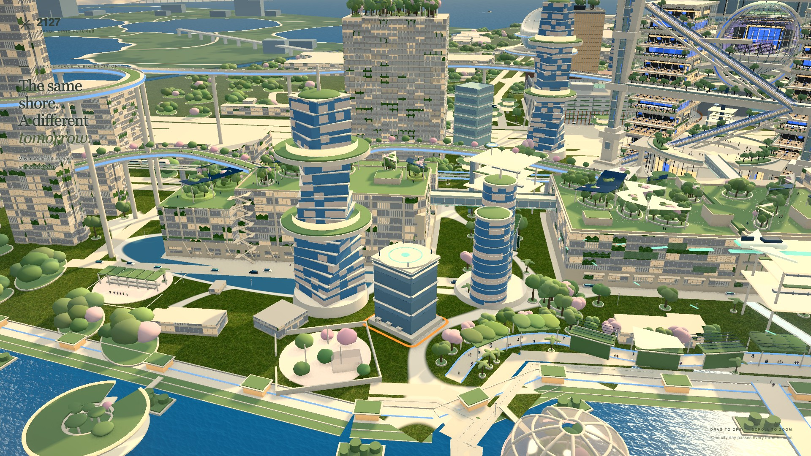](../S0/baseline/nw-focal__-2__h12.jpg) | [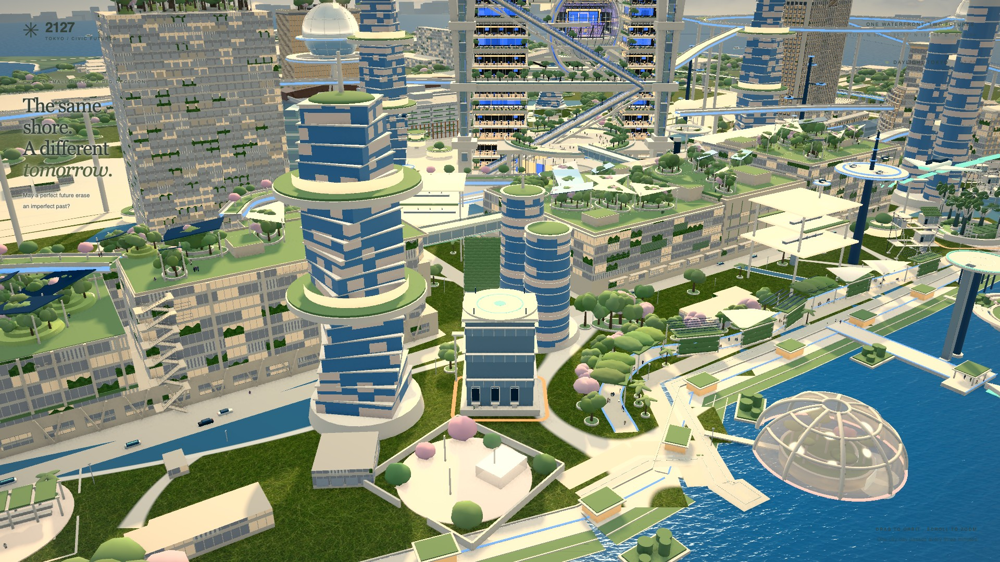](../D/r3/nw-focal/nw-focal__-2__h12.jpg) | [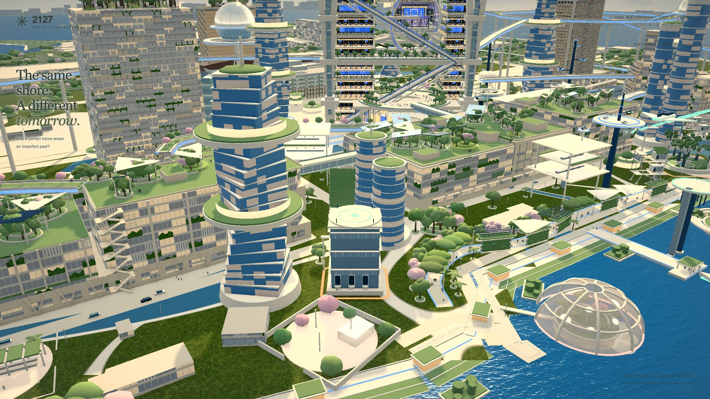](current/nw-focal__-2__h12.jpg) |

S0→Z：鏡位由側向轉正面，服務入口三個深框較S0可見；主體仍遠小於左側藍塔，未能直讀人手服務。

Sector-last→Z：與D r3同pose／本體；本圖屋頂植栽盤面的動態外觀有差異，沒有新增主體改善，仍保留身份缺口。

[D last original eebff28](../D/r3/nw-focal/nw-focal__-2__h12.jpg) · 

S0→Z full MAD 25.654%、subject-union 24.646%、pose changed；D-last→Z full MAD 1.106%、subject-union 0.538%、pose same。MAD 只描述跨 source／pose 像素差，不替代 A4 或美術判斷。

S0→Z numeric delta：width -1.495pp、height -0.983pp、card overlap 0.000pp、A3 hits 1、vsync FPS -0.10、instant calls 182。

D-last→Z numeric delta：width 0.000pp、height 0.000pp、card overlap 0.000pp、A3 hits 0、vsync FPS -0.10、instant calls 0。

A1 PASS；A2 PASS；A3 FAIL (3/9)；A4 0/2；A5 FAIL (vsync 60、instant calls 949/767 S0)；A6 PASS。

完整 bounds width 10.653%、height 25.273%、card overlap 0.000%。

- **V1 FAIL**：小型藍色樓與周邊同語彙高樓競爭，正面深框不足以在兩秒讀出人手服務中心。
- **V2 PASS**：右下海面及後方富士civic core入鏡。
- **V3 FAIL**：前景粉色球冠與孤立圓盆樹仍像裝飾，樹冠及草坪欠連續層次。
- **V4 PASS**：低態仍是完整有入口和人尺度的樓館，並非空地。
- **V5 N/A**：hour12日景；同態hour22原圖另有獨立V5判斷。
- **V6 STATIC PASS**：正面框與基座貼合，未見主體浮件／穿模；靜態不能排除閃爍。

## nw:focal · -2 · h22

| S0 original | Sector-last original | Z current original |
| --- | --- | --- |
| [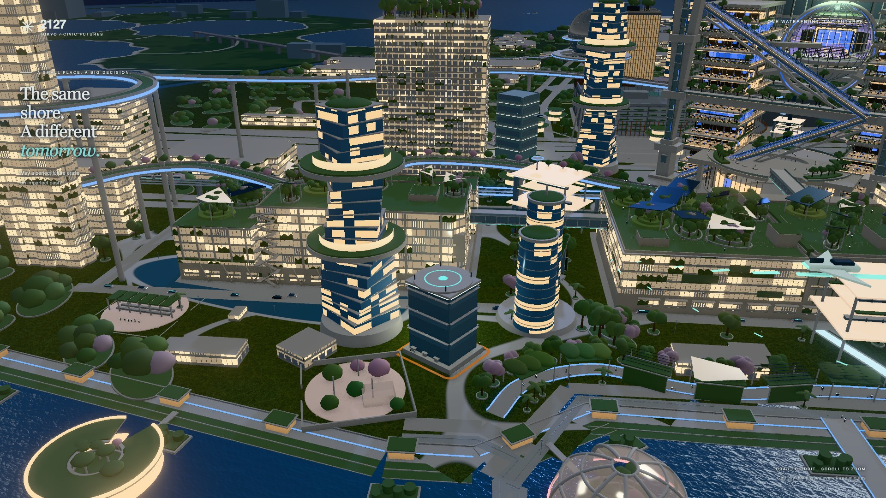](../S0/baseline/nw-focal__-2__h22.jpg) | [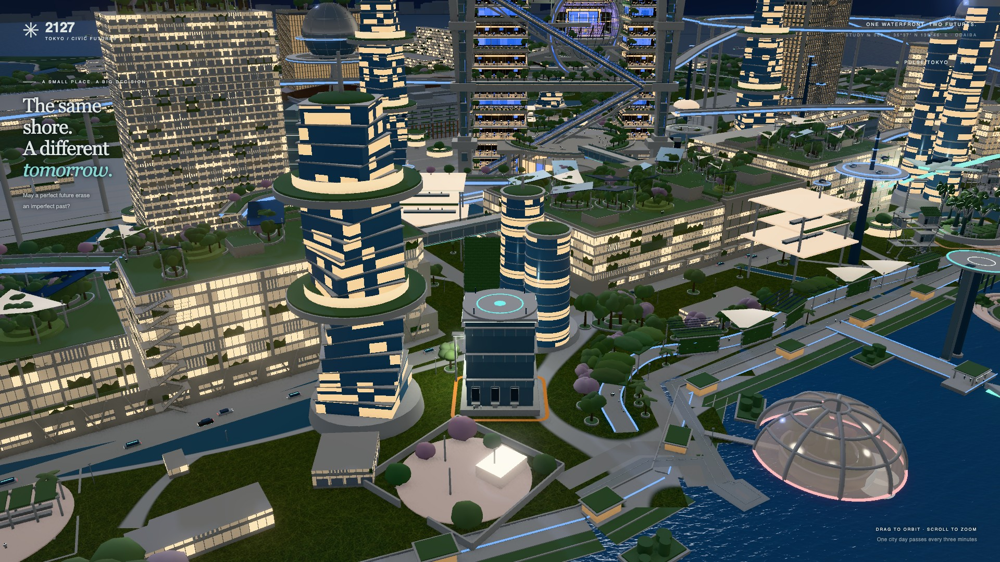](../D/r3/nw-focal/nw-focal__-2__h22.jpg) | [](current/nw-focal__-2__h22.jpg) |

S0→Z：正面服務框較S0側面能看見，但夜間仍與普通深藍辦公樓相似，身份未改善到通過。

Sector-last→Z：與D r3同構圖及入口；背景盤面微差，主體與夜間可讀性缺口保持。

[D last original eebff28](../D/r3/nw-focal/nw-focal__-2__h22.jpg) · 

S0→Z full MAD 23.108%、subject-union 20.479%、pose changed；D-last→Z full MAD 1.100%、subject-union 0.434%、pose same。MAD 只描述跨 source／pose 像素差，不替代 A4 或美術判斷。

S0→Z numeric delta：width -1.495pp、height -0.983pp、card overlap 0.000pp、A3 hits 1、vsync FPS 0.00、instant calls 182。

D-last→Z numeric delta：width 0.000pp、height 0.000pp、card overlap 0.000pp、A3 hits 0、vsync FPS 0.00、instant calls 0。

A1 PASS；A2 PASS；A3 FAIL (3/9)；A4 0/2；A5 FAIL (vsync 60、instant calls 949/767 S0)；A6 PASS。

完整 bounds width 10.653%、height 25.273%、card overlap 0.000%。

- **V1 FAIL**：小型藍色樓與周邊同語彙高樓競爭，正面深框不足以在兩秒讀出人手服務中心。
- **V2 PASS**：右下海面及後方富士civic core入鏡。
- **V3 FAIL**：前景粉色球冠與孤立圓盆樹仍像裝飾，樹冠及草坪欠連續層次。
- **V4 PASS**：低態仍是完整有入口和人尺度的樓館，並非空地。
- **V5 FAIL**：同態夜圖樓身深藍，周圍大樓亮窗更搶眼，服務端口仍難讀。
- **V6 STATIC PASS**：主體入口框及樓腳無明顯浮空／穿模，夜圖不能排除時間閃爍。

## nw:focal · 0 · h12

| S0 original | Sector-last original | Z current original |
| --- | --- | --- |
| [](../S0/baseline/nw-focal__0__h12.jpg) | [](../D/r3/nw-focal/nw-focal__0__h12.jpg) | [](current/nw-focal__0__h12.jpg) |

S0→Z：正面三槽及淺色終端比S0側面可見，但服務混合功能仍未能清楚辨認。

Sector-last→Z：與D r3相同主體／pose，未見新的主體退步或改善；背景植栽盤／AO重載微差另以像素量度記錄。

[D last original eebff28](../D/r3/nw-focal/nw-focal__0__h12.jpg) · 

S0→Z full MAD 25.698%、subject-union 24.651%、pose changed；D-last→Z full MAD 0.602%、subject-union 0.531%、pose same。MAD 只描述跨 source／pose 像素差，不替代 A4 或美術判斷。

S0→Z numeric delta：width -1.495pp、height -0.983pp、card overlap 0.000pp、A3 hits 1、vsync FPS 0.20、instant calls 182。

D-last→Z numeric delta：width 0.000pp、height 0.000pp、card overlap 0.000pp、A3 hits 0、vsync FPS 0.10、instant calls 0。

A1 PASS；A2 PASS；A3 FAIL (3/9)；A4 1/2；A5 FAIL (vsync 60.1、instant calls 949/767 S0)；A6 PASS。

完整 bounds width 10.653%、height 25.273%、card overlap 0.000%。

- **V1 FAIL**：混合態門口出現一個淺色終端，但遠距離只讀成一般藍樓，與人手態差異細小。
- **V2 PASS**：右下海面及後方富士civic core入鏡。
- **V3 FAIL**：前景粉色球冠與孤立圓盆樹仍像裝飾，樹冠及草坪欠連續層次。
- **V4 PASS**：低態仍是完整有入口和人尺度的樓館，並非空地。
- **V5 N/A**：hour12日景；同態hour22原圖另有獨立V5判斷。
- **V6 STATIC PASS**：正面框與基座貼合，未見主體浮件／穿模；靜態不能排除閃爍。

## nw:focal · 0 · h22

| S0 original | Sector-last original | Z current original |
| --- | --- | --- |
| [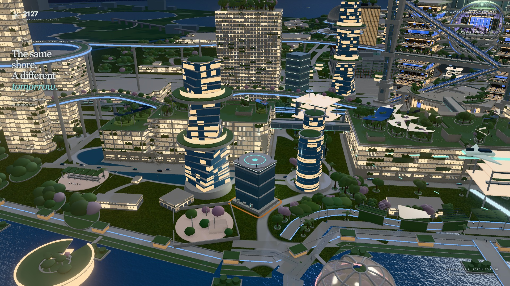](../S0/baseline/nw-focal__0__h22.jpg) | [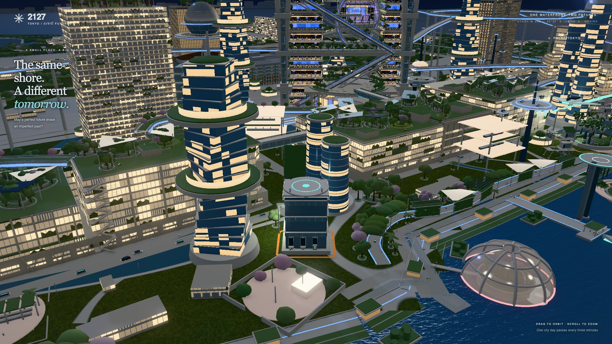](../D/r3/nw-focal/nw-focal__0__h22.jpg) | [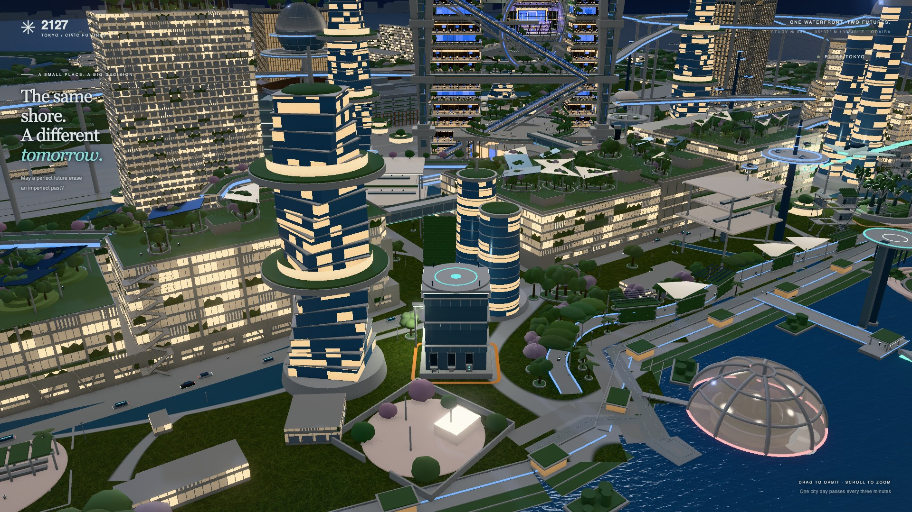](current/nw-focal__0__h22.jpg) |

S0→Z：混合態正面終端比S0側視可見，但夜景仍欠人機共用服務身份。

Sector-last→Z：與D r3同主體及pose，夜間可讀性沒有新增改善，背景微差不作局部優化。

[D last original eebff28](../D/r3/nw-focal/nw-focal__0__h22.jpg) · 

S0→Z full MAD 23.120%、subject-union 20.498%、pose changed；D-last→Z full MAD 1.204%、subject-union 0.449%、pose same。MAD 只描述跨 source／pose 像素差，不替代 A4 或美術判斷。

S0→Z numeric delta：width -1.495pp、height -0.983pp、card overlap 0.000pp、A3 hits 1、vsync FPS 0.10、instant calls 182。

D-last→Z numeric delta：width 0.000pp、height 0.000pp、card overlap 0.000pp、A3 hits 0、vsync FPS -0.10、instant calls 0。

A1 PASS；A2 PASS；A3 FAIL (3/9)；A4 1/2；A5 FAIL (vsync 60、instant calls 949/767 S0)；A6 PASS。

完整 bounds width 10.653%、height 25.273%、card overlap 0.000%。

- **V1 FAIL**：混合態門口出現一個淺色終端，但遠距離只讀成一般藍樓，與人手態差異細小。
- **V2 PASS**：右下海面及後方富士civic core入鏡。
- **V3 FAIL**：前景粉色球冠與孤立圓盆樹仍像裝飾，樹冠及草坪欠連續層次。
- **V4 PASS**：低態仍是完整有入口和人尺度的樓館，並非空地。
- **V5 FAIL**：終端淺面可見，但暗藍樓身和人手低態近似，周邊亮窗更主導畫面。
- **V6 STATIC PASS**：正面框與基座貼合，未見主體浮件／穿模；靜態不能排除閃爍。

## nw:focal · 2 · h12

| S0 original | Sector-last original | Z current original |
| --- | --- | --- |
| [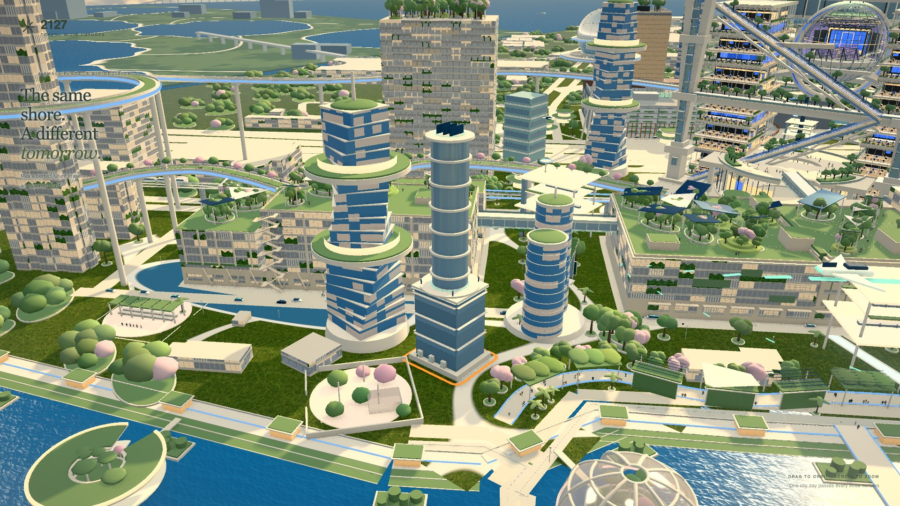](../S0/baseline/nw-focal__2__h12.jpg) | [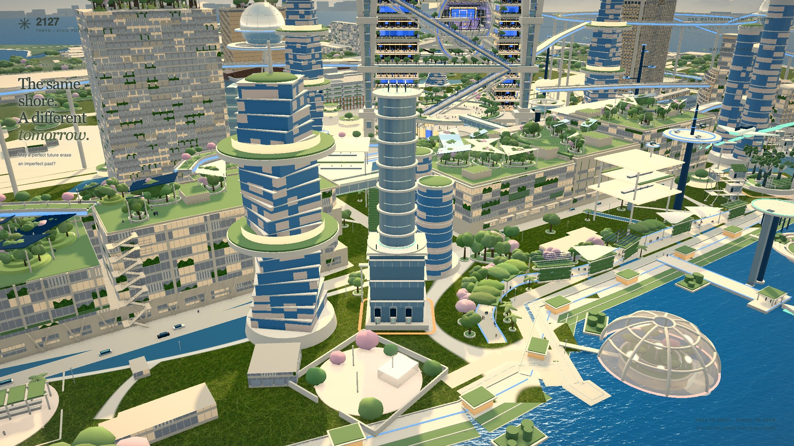](../D/r3/nw-focal/nw-focal__2__h12.jpg) | [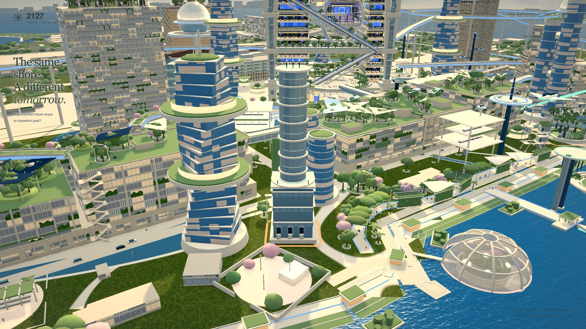](current/nw-focal__2__h12.jpg) |

S0→Z：正面取向及底層服務框比S0側面改善，但高態與旁邊普通藍塔同質，身份缺口仍FAIL。

Sector-last→Z：主體及pose與D r3一致，當前累積source未提供新的主體改善；背景盤面差異另存像素證據。

[D last original eebff28](../D/r3/nw-focal/nw-focal__2__h12.jpg) · 

S0→Z full MAD 25.538%、subject-union 23.488%、pose changed；D-last→Z full MAD 0.602%、subject-union 0.702%、pose same。MAD 只描述跨 source／pose 像素差，不替代 A4 或美術判斷。

S0→Z numeric delta：width -1.511pp、height 3.425pp、card overlap 0.000pp、A3 hits 0、vsync FPS 0.10、instant calls 184。

D-last→Z numeric delta：width 0.000pp、height 0.000pp、card overlap 0.000pp、A3 hits 0、vsync FPS 0.10、instant calls 0。

A1 PASS；A2 PASS；A3 FAIL (3/9)；A4 1/2；A5 FAIL (vsync 60.1、instant calls 959/775 S0)；A6 PASS。

完整 bounds width 11.927%、height 58.086%、card overlap 0.000%。

- **V1 FAIL**：高態樓體較大但仍似藍色一般高樓；底層六槽只見細小亮面，未能直讀自動服務。
- **V2 PASS**：右下海面及後方富士civic core入鏡。
- **V3 FAIL**：前景粉色球冠與孤立圓盆樹仍像裝飾，樹冠及草坪欠連續層次。
- **V4 PASS**：高態是完整分層樓與底座，維持成熟方案。
- **V5 N/A**：hour12日景；同態hour22原圖另有獨立V5判斷。
- **V6 STATIC PASS**：正面框與基座貼合，未見主體浮件／穿模；靜態不能排除閃爍。

## nw:focal · 2 · h22

| S0 original | Sector-last original | Z current original |
| --- | --- | --- |
| [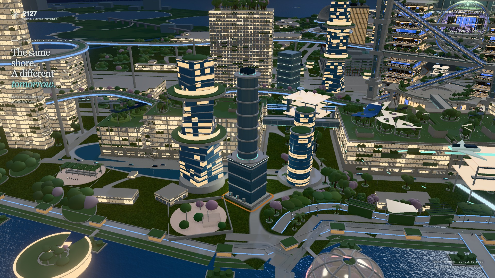](../S0/baseline/nw-focal__2__h22.jpg) | [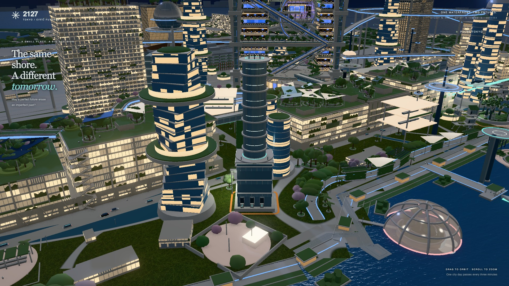](../D/r3/nw-focal/nw-focal__2__h22.jpg) | [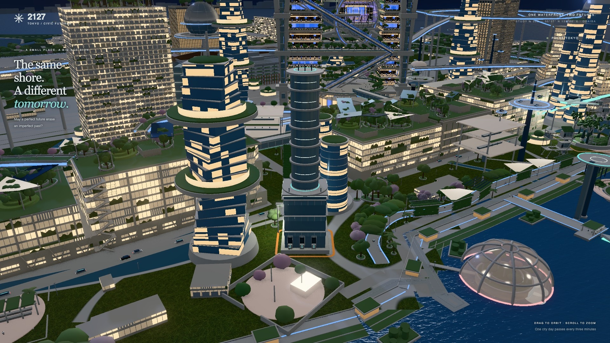](current/nw-focal__2__h22.jpg) |

S0→Z：高態正面下層服務框較S0側面可見，上部環帶輪廓清楚；功能身份仍未通過。

Sector-last→Z：與D r3同樓體／pose及亮環，沒有新的主體改善或明顯退步。

[D last original eebff28](../D/r3/nw-focal/nw-focal__2__h22.jpg) · 

S0→Z full MAD 22.903%、subject-union 20.320%、pose changed；D-last→Z full MAD 1.175%、subject-union 1.237%、pose same。MAD 只描述跨 source／pose 像素差，不替代 A4 或美術判斷。

S0→Z numeric delta：width -1.511pp、height 3.425pp、card overlap 0.000pp、A3 hits 0、vsync FPS 0.00、instant calls 184。

D-last→Z numeric delta：width 0.000pp、height 0.000pp、card overlap 0.000pp、A3 hits 0、vsync FPS 0.00、instant calls 0。

A1 PASS；A2 PASS；A3 FAIL (3/9)；A4 1/2；A5 FAIL (vsync 60、instant calls 959/775 S0)；A6 PASS。

完整 bounds width 11.927%、height 58.086%、card overlap 0.000%。

- **V1 FAIL**：高態樓體較大但仍似藍色一般高樓；底層六槽只見細小亮面，未能直讀自動服務。
- **V2 PASS**：右下海面及後方富士civic core入鏡。
- **V3 FAIL**：前景粉色球冠與孤立圓盆樹仍像裝飾，樹冠及草坪欠連續層次。
- **V4 PASS**：高態是完整分層樓與底座，維持成熟方案。
- **V5 PASS**：新增圓柱上層的亮環分層明顯，與低／中態輪廓可分；服務身份缺口另列V1。
- **V6 STATIC PASS**：正面框與基座貼合，未見主體浮件／穿模；靜態不能排除閃爍。

## nw:district · -8 · h12

| S0 original | Sector-last original | Z current original |
| --- | --- | --- |
| [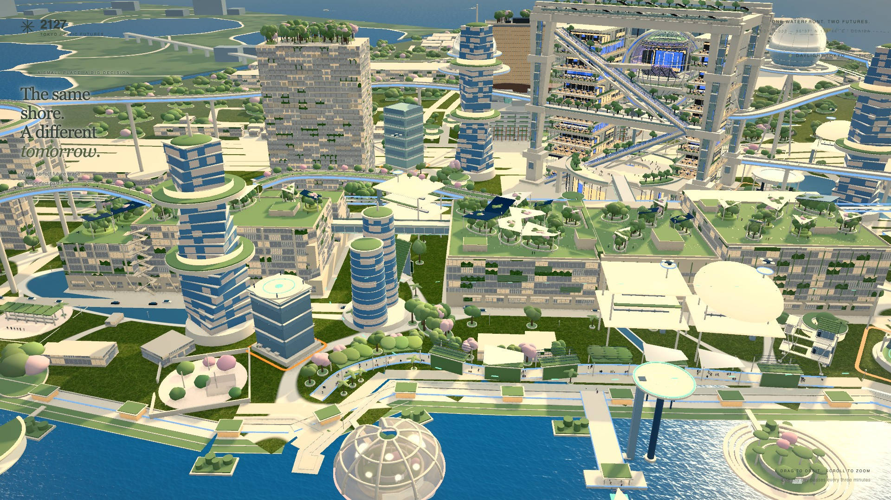](../S0/baseline/nw-district__-8__h12.jpg) | [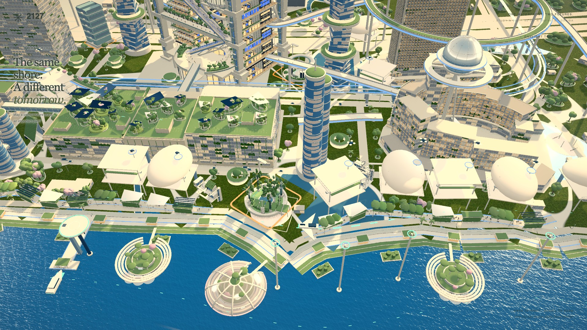](../D/r3/nw-district/nw-district__-8__h12.jpg) | [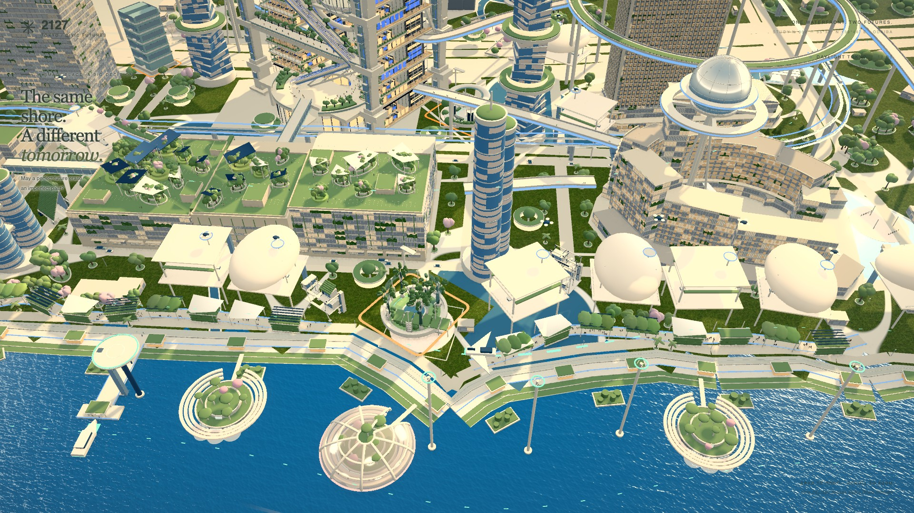](current/nw-district__-8__h12.jpg) |

S0→Z：由S0側視改為較廣的俯視海岸服務列，欄邊與支承略清楚；人手服務面仍被大面積白屋頂遮住，未解決功能辨識。

Sector-last→Z：與D district r3同構圖／亭與欄邊；屋頂小盤面與AO差異可見但沒有新的服務形態改善。

[D last original fbae624](../D/r3/nw-district/nw-district__-8__h12.jpg) · 

S0→Z full MAD 26.095%、subject-union 26.095%、pose changed；D-last→Z full MAD 0.774%、subject-union 0.774%、pose same。MAD 只描述跨 source／pose 像素差，不替代 A4 或美術判斷。

S0→Z numeric delta：width -271.124pp、height -56.917pp、card overlap 4.093pp、A3 hits 0、vsync FPS 0.00、instant calls 383。

D-last→Z numeric delta：width 0.000pp、height 0.000pp、card overlap 0.000pp、A3 hits 0、vsync FPS 0.00、instant calls 369。

A1 PASS；A2 PASS；A3 FAIL (0/9)；A4 0/2；A5 FAIL (vsync 60、instant calls 1244/861 S0)；A6 PASS。

完整 bounds width 119.569%、height 168.168%、card overlap 4.924%。

- **V1 FAIL**：俯視主要讀到白屋頂及圓盤，無法兩秒辨認人手服務列。
- **V2 PASS**：下半海面及右上球體提供明確水岸定位。
- **V3 FAIL**：左側屋頂多個孤立格仔盆景及前方球冠保留，未形成飽滿連續生態層。
- **V4 PASS**：完整服務亭／露台與輔助停機點保留，低自動化並非空地。
- **V5 N/A**：hour12日景；同態hour22原圖另有獨立V5判斷。
- **V6 STATIC PASS**：本圖服務屋面、露台欄邊與支承未見明顯浮件／穿模；不代表時間閃爍已驗。

## nw:district · -8 · h22

| S0 original | Sector-last original | Z current original |
| --- | --- | --- |
| [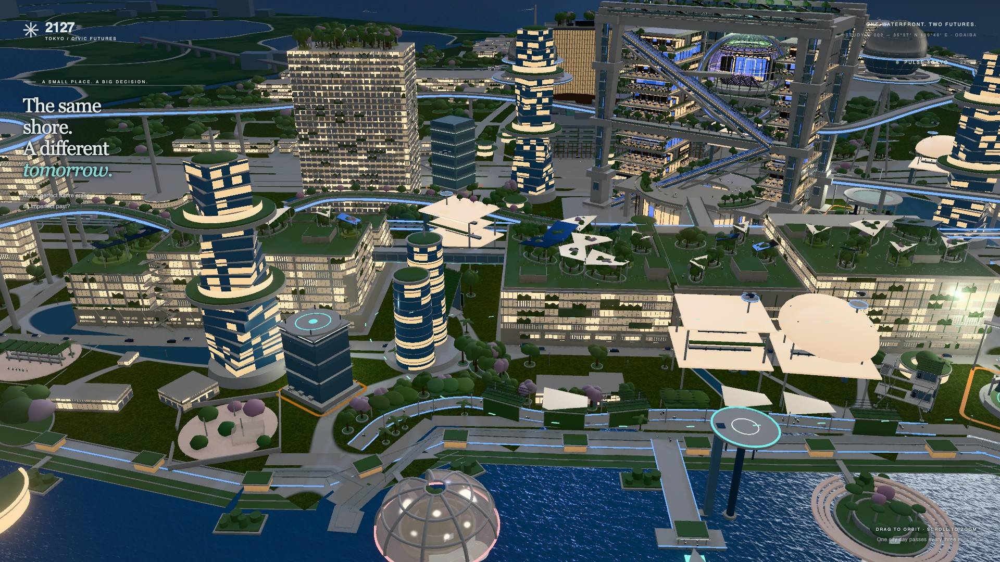](../S0/baseline/nw-district__-8__h22.jpg) | [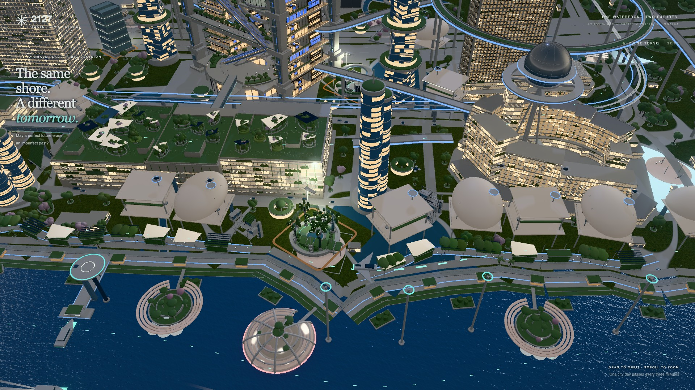](../D/r3/nw-district/nw-district__-8__h22.jpg) | [](current/nw-district__-8__h22.jpg) |

S0→Z：由S0側視改為較廣的俯視海岸服務列，欄邊與支承略清楚；人手服務面仍被大面積白屋頂遮住，未解決功能辨識。

Sector-last→Z：與D district r3同構圖／亭與欄邊；屋頂小盤面與AO差異可見但沒有新的服務形態改善。

[D last original fbae624](../D/r3/nw-district/nw-district__-8__h22.jpg) · 

S0→Z full MAD 22.099%、subject-union 22.099%、pose changed；D-last→Z full MAD 0.432%、subject-union 0.432%、pose same。MAD 只描述跨 source／pose 像素差，不替代 A4 或美術判斷。

S0→Z numeric delta：width -271.124pp、height -56.917pp、card overlap 4.093pp、A3 hits 0、vsync FPS 0.00、instant calls 14。

D-last→Z numeric delta：width 0.000pp、height 0.000pp、card overlap 0.000pp、A3 hits 0、vsync FPS 0.00、instant calls 0。

A1 PASS；A2 PASS；A3 FAIL (0/9)；A4 0/2；A5 PASS (vsync 60、instant calls 875/861 S0)；A6 PASS。

完整 bounds width 119.569%、height 168.168%、card overlap 4.924%。

- **V1 FAIL**：俯視主要讀到白屋頂及圓盤，無法兩秒辨認人手服務列。
- **V2 PASS**：下半海面及右上球體提供明確水岸定位。
- **V3 FAIL**：左側屋頂多個孤立格仔盆景及前方球冠保留，未形成飽滿連續生態層。
- **V4 PASS**：完整服務亭／露台與輔助停機點保留，低自動化並非空地。
- **V5 PASS**：同態夜圖屋頂、柱與停機環輪廓可見；功能辨識不足另列V1。
- **V6 STATIC PASS**：本圖服務屋面、露台欄邊與支承未見明顯浮件／穿模；不代表時間閃爍已驗。

## nw:district · -5 · h12

| S0 original | Sector-last original | Z current original |
| --- | --- | --- |
| [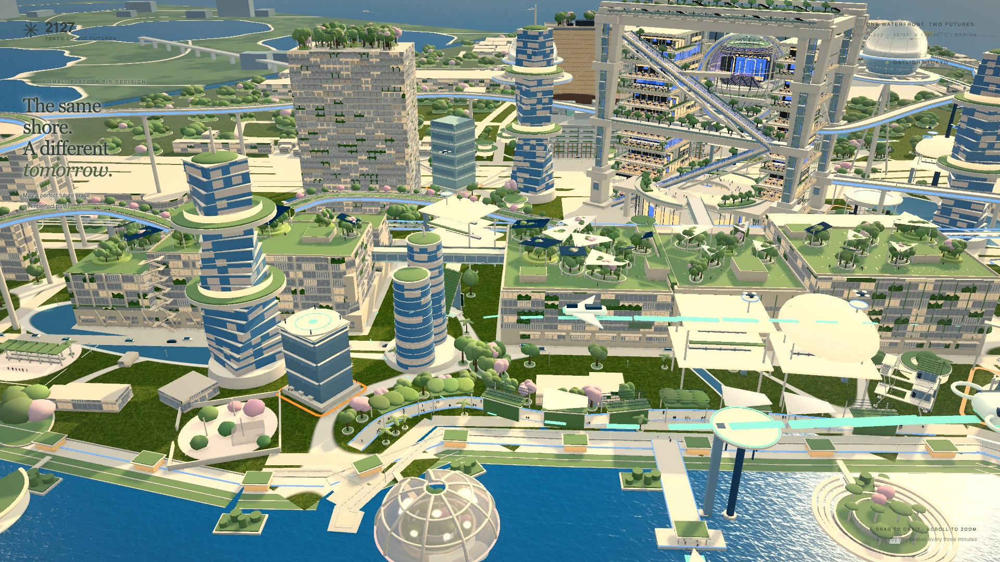](../S0/baseline/nw-district__-5__h12.jpg) | [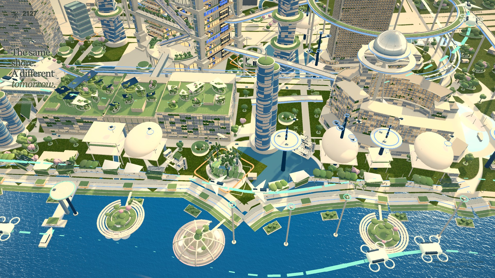](../D/r3/nw-district/nw-district__-5__h12.jpg) | [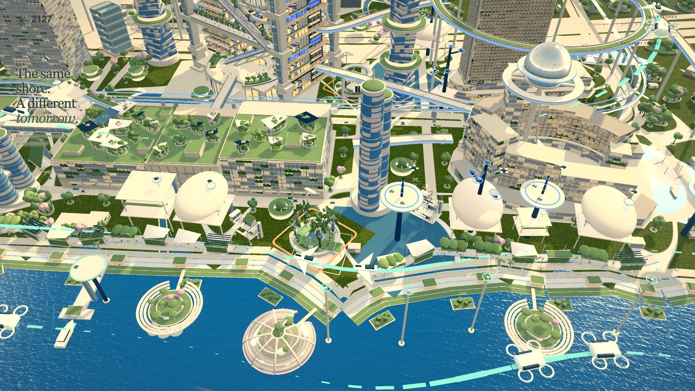](current/nw-district__-5__h12.jpg) |

S0→Z：俯視服務列與藍色drone盤較S0能一起看見；仍欠人手服務可讀性，混合小露台接合不清。

Sector-last→Z：與D r3相同盤／亭配置與鏡位；本圖延續hybrid懸空感，非新功能，背景盤面差異另量。

[D last original fbae624](../D/r3/nw-district/nw-district__-5__h12.jpg) · 

S0→Z full MAD 26.225%、subject-union 26.225%、pose changed；D-last→Z full MAD 0.816%、subject-union 0.816%、pose same。MAD 只描述跨 source／pose 像素差，不替代 A4 或美術判斷。

S0→Z numeric delta：width -241.922pp、height -48.403pp、card overlap 4.154pp、A3 hits 0、vsync FPS 0.00、instant calls 14。

D-last→Z numeric delta：width 0.000pp、height 0.000pp、card overlap 0.000pp、A3 hits 0、vsync FPS 0.00、instant calls 0。

A1 PASS；A2 FAIL；A3 FAIL (0/9)；A4 0/2；A5 PASS (vsync 60、instant calls 875/861 S0)；A6 PASS。

完整 bounds width 117.799%、height 164.089%、card overlap 5.122%。

- **V1 FAIL**：服務亭與藍色drone盤有可見替換，但白屋頂遮住人手服務面，混合服務含義不清。
- **V2 PASS**：下半海面及右上球體提供明確水岸定位。
- **V3 FAIL**：左側屋頂多個孤立格仔盆景及前方球冠保留，未形成飽滿連續生態層。
- **V4 PASS**：完整服務亭／露台與輔助停機點保留，低自動化並非空地。
- **V5 N/A**：hour12日景；同態hour22原圖另有獨立V5判斷。
- **V6 FAIL**：右側小型白色hybrid露台與藍色停機柱的接合載荷路徑不清，視覺上像懸在柱旁。

## nw:district · -5 · h22

| S0 original | Sector-last original | Z current original |
| --- | --- | --- |
| [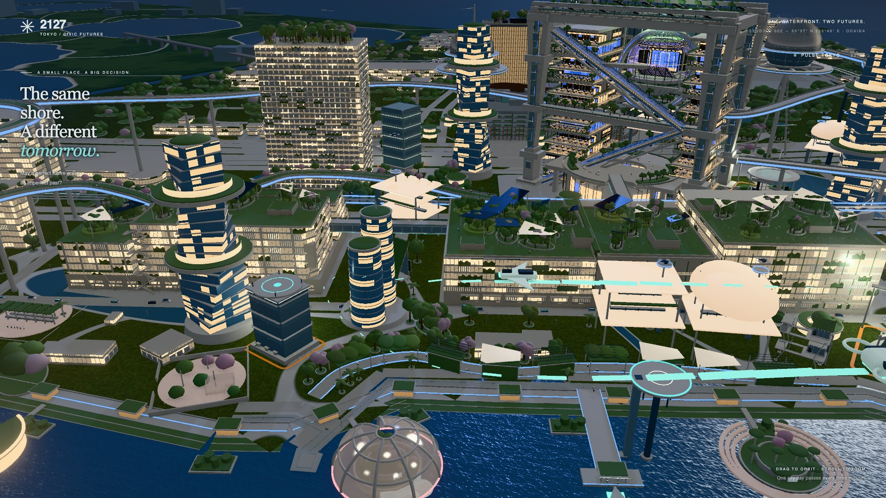](../S0/baseline/nw-district__-5__h22.jpg) | [](../D/r3/nw-district/nw-district__-5__h22.jpg) | [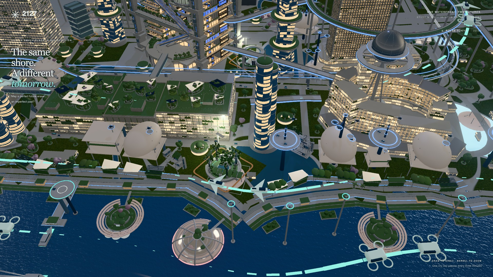](current/nw-district__-5__h22.jpg) |

S0→Z：俯視服務列與藍色drone盤較S0能一起看見；仍欠人手服務可讀性，混合小露台接合不清。

Sector-last→Z：與D r3相同盤／亭配置與鏡位；本圖延續hybrid懸空感，非新功能，背景盤面差異另量。

[D last original fbae624](../D/r3/nw-district/nw-district__-5__h22.jpg) · 

S0→Z full MAD 22.783%、subject-union 22.783%、pose changed；D-last→Z full MAD 0.447%、subject-union 0.447%、pose same。MAD 只描述跨 source／pose 像素差，不替代 A4 或美術判斷。

S0→Z numeric delta：width -241.922pp、height -48.403pp、card overlap 4.154pp、A3 hits 0、vsync FPS -0.10、instant calls 14。

D-last→Z numeric delta：width 0.000pp、height 0.000pp、card overlap 0.000pp、A3 hits 0、vsync FPS -0.10、instant calls 0。

A1 PASS；A2 FAIL；A3 FAIL (0/9)；A4 0/2；A5 PASS (vsync 59.9、instant calls 875/861 S0)；A6 PASS。

完整 bounds width 117.799%、height 164.089%、card overlap 5.122%。

- **V1 FAIL**：服務亭與藍色drone盤有可見替換，但白屋頂遮住人手服務面，混合服務含義不清。
- **V2 PASS**：下半海面及右上球體提供明確水岸定位。
- **V3 FAIL**：左側屋頂多個孤立格仔盆景及前方球冠保留，未形成飽滿連續生態層。
- **V4 PASS**：完整服務亭／露台與輔助停機點保留，低自動化並非空地。
- **V5 PASS**：同態夜圖屋頂、柱與停機環輪廓可見；功能辨識不足另列V1。
- **V6 FAIL**：右側小型白色hybrid露台與藍色停機柱的接合載荷路徑不清，視覺上像懸在柱旁。

## nw:district · 0 · h12

| S0 original | Sector-last original | Z current original |
| --- | --- | --- |
| [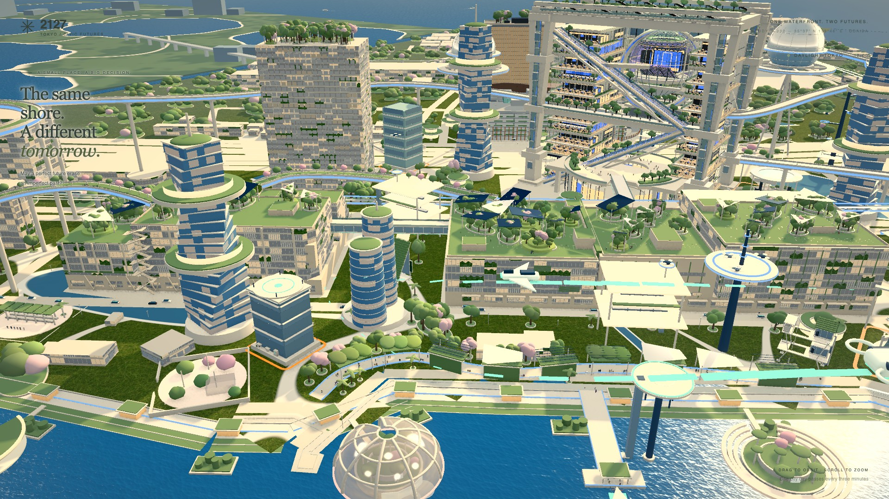](../S0/baseline/nw-district__0__h12.jpg) | [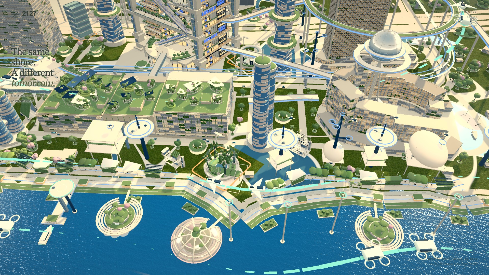](../D/r3/nw-district/nw-district__0__h12.jpg) | [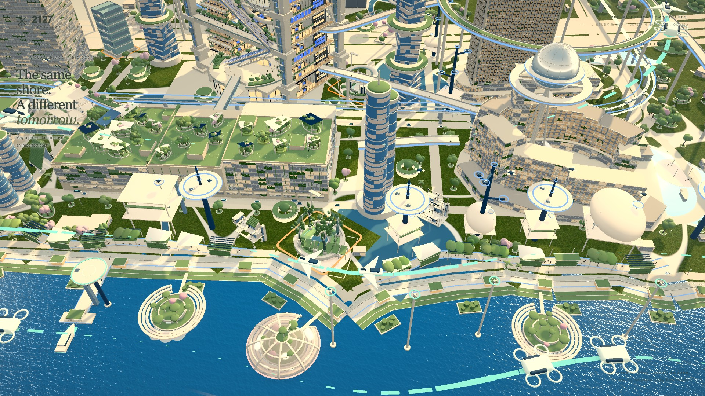](current/nw-district__0__h12.jpg) |

S0→Z：較S0完整看見藍盤／白亭交替，但構圖仍俯視且載荷路徑缺口保持。

Sector-last→Z：與D r3同neutral配置及pose；懸空接合感及背景盆景缺口保持，無新增主體改善。

[D last original fbae624](../D/r3/nw-district/nw-district__0__h12.jpg) · 

S0→Z full MAD 26.064%、subject-union 26.064%、pose changed；D-last→Z full MAD 0.826%、subject-union 0.826%、pose same。MAD 只描述跨 source／pose 像素差，不替代 A4 或美術判斷。

S0→Z numeric delta：width -242.115pp、height -48.704pp、card overlap 4.186pp、A3 hits 0、vsync FPS 0.00、instant calls 14。

D-last→Z numeric delta：width 0.000pp、height 0.000pp、card overlap 0.000pp、A3 hits 0、vsync FPS 0.00、instant calls 0。

A1 PASS；A2 FAIL；A3 FAIL (0/9)；A4 0/2；A5 PASS (vsync 60、instant calls 875/861 S0)；A6 PASS。

完整 bounds width 117.606%、height 163.520%、card overlap 5.148%。

- **V1 FAIL**：中態藍盤與白亭雖能分出類型，卻無清楚人機協作介面；周邊球體與高塔搶走主體焦點。
- **V2 PASS**：下半海面及右上球體提供明確水岸定位。
- **V3 FAIL**：左側屋頂多個孤立格仔盆景及前方球冠保留，未形成飽滿連續生態層。
- **V4 PASS**：完整服務亭／露台與輔助停機點保留，低自動化並非空地。
- **V5 N/A**：hour12日景；同態hour22原圖另有獨立V5判斷。
- **V6 FAIL**：中央及右側白色小露台與drone柱旁的支承關係欠清楚，像懸在水面／柱旁。

## nw:district · 0 · h22

| S0 original | Sector-last original | Z current original |
| --- | --- | --- |
| [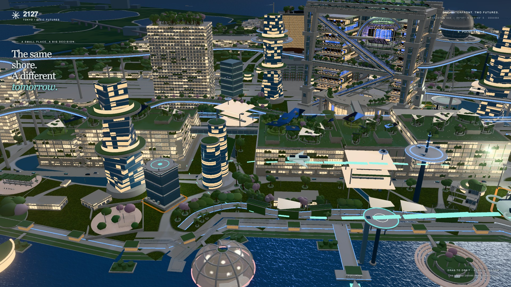](../S0/baseline/nw-district__0__h22.jpg) | [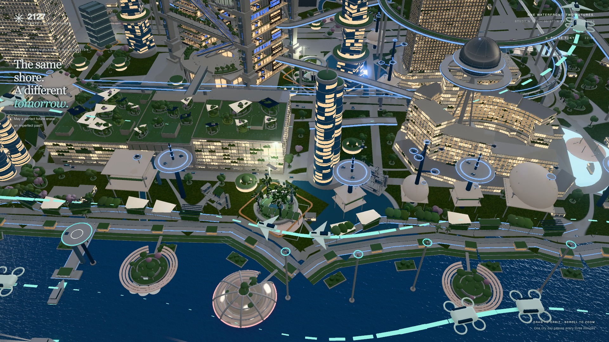](../D/r3/nw-district/nw-district__0__h22.jpg) | [](current/nw-district__0__h22.jpg) |

S0→Z：較S0完整看見藍盤／白亭交替，但構圖仍俯視且載荷路徑缺口保持。

Sector-last→Z：與D r3同neutral配置及pose；懸空接合感及背景盆景缺口保持，無新增主體改善。

[D last original fbae624](../D/r3/nw-district/nw-district__0__h22.jpg) · 

S0→Z full MAD 22.357%、subject-union 22.357%、pose changed；D-last→Z full MAD 0.450%、subject-union 0.450%、pose same。MAD 只描述跨 source／pose 像素差，不替代 A4 或美術判斷。

S0→Z numeric delta：width -242.115pp、height -48.704pp、card overlap 4.186pp、A3 hits 0、vsync FPS 0.10、instant calls 14。

D-last→Z numeric delta：width 0.000pp、height 0.000pp、card overlap 0.000pp、A3 hits 0、vsync FPS 0.00、instant calls 0。

A1 PASS；A2 FAIL；A3 FAIL (0/9)；A4 0/2；A5 PASS (vsync 60、instant calls 875/861 S0)；A6 PASS。

完整 bounds width 117.606%、height 163.520%、card overlap 5.148%。

- **V1 FAIL**：中態藍盤與白亭雖能分出類型，卻無清楚人機協作介面；周邊球體與高塔搶走主體焦點。
- **V2 PASS**：下半海面及右上球體提供明確水岸定位。
- **V3 FAIL**：左側屋頂多個孤立格仔盆景及前方球冠保留，未形成飽滿連續生態層。
- **V4 PASS**：完整服務亭／露台與輔助停機點保留，低自動化並非空地。
- **V5 PASS**：同態夜圖屋頂、柱與停機環輪廓可見；功能辨識不足另列V1。
- **V6 FAIL**：中央及右側白色小露台與drone柱旁的支承關係欠清楚，像懸在水面／柱旁。

## nw:district · 5 · h12

| S0 original | Sector-last original | Z current original |
| --- | --- | --- |
| [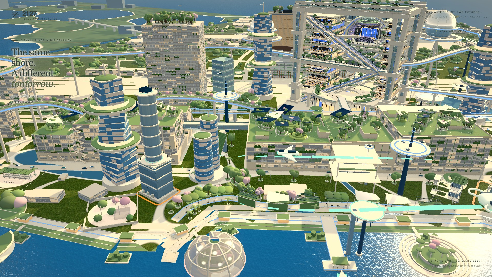](../S0/baseline/nw-district__5__h12.jpg) | [](../D/r3/nw-district/nw-district__5__h12.jpg) | [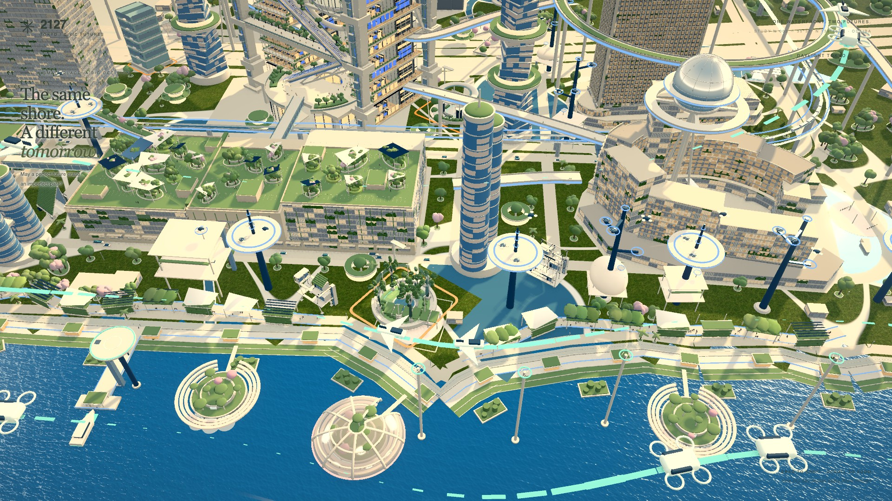](current/nw-district__5__h12.jpg) |

S0→Z：比S0更集中見到多個柱盤與無人機服務列，藍色環邊較有層次；混合小露台接合及格仔綠化缺口保持。

Sector-last→Z：與D r3同盤／hybrid配置與pose，沒有新增主體改善；屋頂盤面方向等像素差仍記錄。

[D last original fbae624](../D/r3/nw-district/nw-district__5__h12.jpg) · 

S0→Z full MAD 25.935%、subject-union 25.935%、pose changed；D-last→Z full MAD 0.709%、subject-union 0.709%、pose same。MAD 只描述跨 source／pose 像素差，不替代 A4 或美術判斷。

S0→Z numeric delta：width -241.928pp、height -48.776pp、card overlap 4.202pp、A3 hits 0、vsync FPS 0.10、instant calls 6。

D-last→Z numeric delta：width 0.000pp、height 0.000pp、card overlap 0.000pp、A3 hits 0、vsync FPS 0.10、instant calls 0。

A1 PASS；A2 FAIL；A3 FAIL (0/9)；A4 0/2；A5 PASS (vsync 60.1、instant calls 875/869 S0)；A6 PASS。

完整 bounds width 117.344%、height 163.388%、card overlap 5.164%。

- **V1 PASS**：多個藍色柱式停機盤與四旋翼及分層環能直接讀成自動服務網絡。
- **V2 PASS**：下半海面及右上球體提供明確水岸定位。
- **V3 FAIL**：左側屋頂多個孤立格仔盆景及前方球冠保留，未形成飽滿連續生態層。
- **V4 PASS**：完整服務亭／露台與輔助停機點保留，低自動化並非空地。
- **V5 N/A**：hour12日景；同態hour22原圖另有獨立V5判斷。
- **V6 FAIL**：右側保留的小白色hybrid露台仍與藍色柱盤載荷路徑脫節，局部懸空感沒有解決。

## nw:district · 5 · h22

| S0 original | Sector-last original | Z current original |
| --- | --- | --- |
| [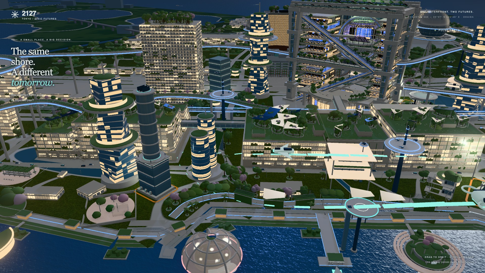](../S0/baseline/nw-district__5__h22.jpg) | [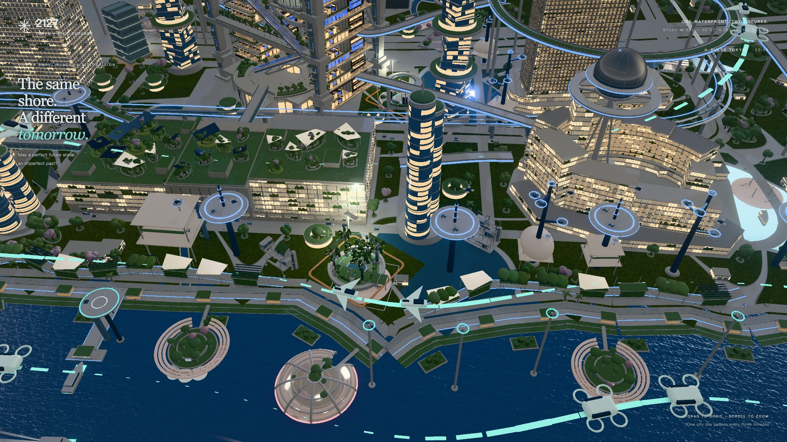](../D/r3/nw-district/nw-district__5__h22.jpg) | [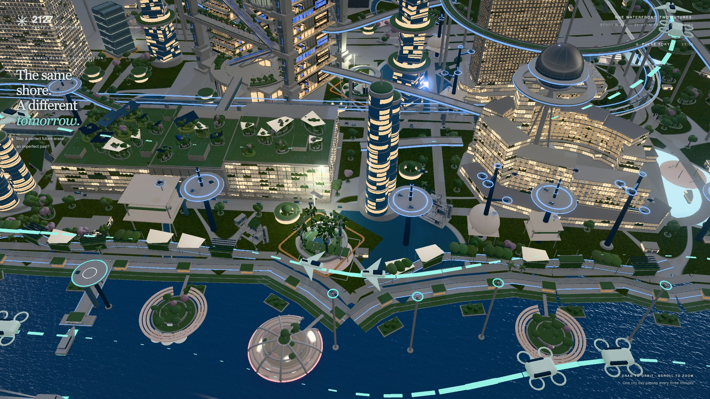](current/nw-district__5__h22.jpg) |

S0→Z：比S0更集中見到多個柱盤與無人機服務列，藍色環邊較有層次；混合小露台接合及格仔綠化缺口保持。

Sector-last→Z：與D r3同盤／hybrid配置與pose，沒有新增主體改善；屋頂盤面方向等像素差仍記錄。

[D last original fbae624](../D/r3/nw-district/nw-district__5__h22.jpg) · 

S0→Z full MAD 22.409%、subject-union 22.409%、pose changed；D-last→Z full MAD 0.733%、subject-union 0.733%、pose same。MAD 只描述跨 source／pose 像素差，不替代 A4 或美術判斷。

S0→Z numeric delta：width -241.928pp、height -48.776pp、card overlap 4.202pp、A3 hits 0、vsync FPS 0.00、instant calls 6。

D-last→Z numeric delta：width 0.000pp、height 0.000pp、card overlap 0.000pp、A3 hits 0、vsync FPS 0.00、instant calls 0。

A1 PASS；A2 FAIL；A3 FAIL (0/9)；A4 0/2；A5 PASS (vsync 60、instant calls 875/869 S0)；A6 PASS。

完整 bounds width 117.344%、height 163.388%、card overlap 5.164%。

- **V1 PASS**：多個藍色柱式停機盤與四旋翼及分層環能直接讀成自動服務網絡。
- **V2 PASS**：下半海面及右上球體提供明確水岸定位。
- **V3 FAIL**：左側屋頂多個孤立格仔盆景及前方球冠保留，未形成飽滿連續生態層。
- **V4 PASS**：完整服務亭／露台與輔助停機點保留，低自動化並非空地。
- **V5 PASS**：同態夜圖屋頂、柱與停機環輪廓可見；功能辨識不足另列V1。
- **V6 FAIL**：右側保留的小白色hybrid露台仍與藍色柱盤載荷路徑脫節，局部懸空感沒有解決。

## nw:district · 8 · h12

| S0 original | Sector-last original | Z current original |
| --- | --- | --- |
| [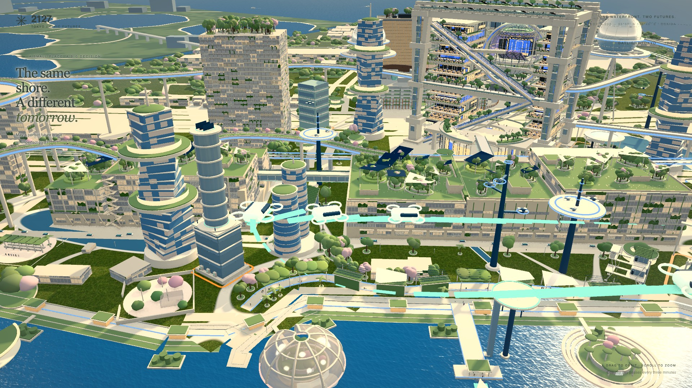](../S0/baseline/nw-district__8__h12.jpg) | [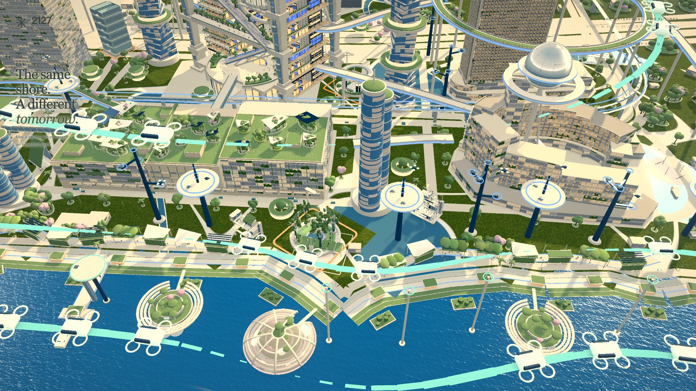](../D/r3/nw-district/nw-district__8__h12.jpg) | [](current/nw-district__8__h12.jpg) |

S0→Z：新俯視較S0集中展開完整drone服務列與欄邊，但近處大四旋翼及背景仍競爭注意，綠化缺口保持。

Sector-last→Z：與D r3同完整高態及pose，主體未見新增改善／退步；不同屋頂盤面方向及AO差異照量。

[D last original fbae624](../D/r3/nw-district/nw-district__8__h12.jpg) · 

S0→Z full MAD 26.160%、subject-union 26.160%、pose changed；D-last→Z full MAD 0.710%、subject-union 0.710%、pose same。MAD 只描述跨 source／pose 像素差，不替代 A4 或美術判斷。

S0→Z numeric delta：width -225.567pp、height -42.380pp、card overlap 4.275pp、A3 hits 0、vsync FPS 0.10、instant calls 6。

D-last→Z numeric delta：width 0.000pp、height 0.000pp、card overlap 0.000pp、A3 hits 0、vsync FPS 0.10、instant calls 0。

A1 PASS；A2 FAIL；A3 FAIL (0/9)；A4 0/2；A5 PASS (vsync 60.1、instant calls 875/869 S0)；A6 PASS。

完整 bounds width 116.159%、height 159.753%、card overlap 5.335%。

- **V1 PASS**：完整藍色drone盤／多支柱與四旋翼路線清楚表達自動服務網絡。
- **V2 PASS**：下半海面及右上球體提供明確水岸定位。
- **V3 FAIL**：左側屋頂多個孤立格仔盆景及前方球冠保留，未形成飽滿連續生態層。
- **V4 PASS**：完整服務亭／露台與輔助停機點保留，低自動化並非空地。
- **V5 N/A**：hour12日景；同態hour22原圖另有獨立V5判斷。
- **V6 STATIC PASS**：此完整高態沒有混合小露台接合缺口，柱盤／基座沒有明顯穿模；動態閃爍仍未完整驗證。

## nw:district · 8 · h22

| S0 original | Sector-last original | Z current original |
| --- | --- | --- |
| [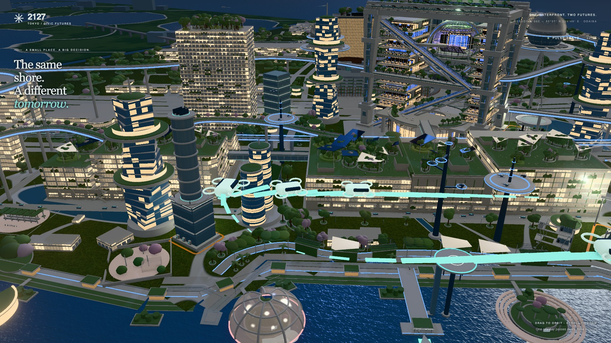](../S0/baseline/nw-district__8__h22.jpg) | [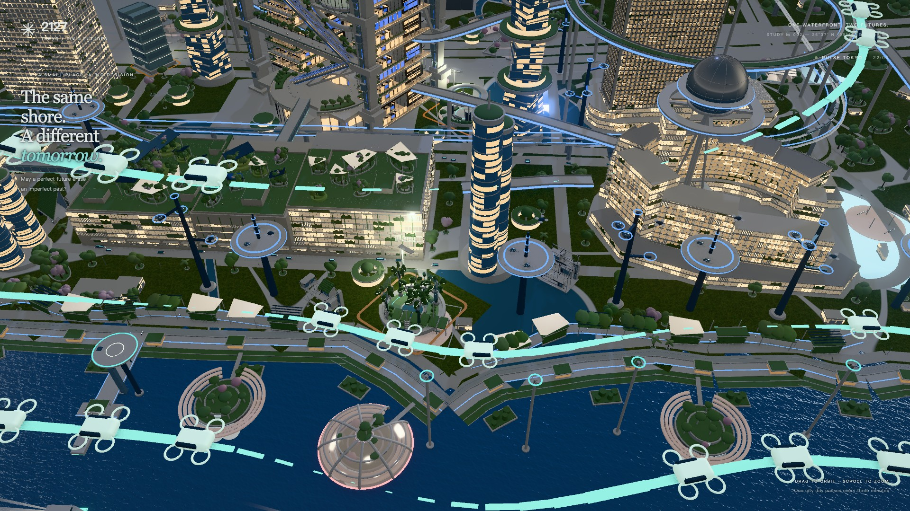](../D/r3/nw-district/nw-district__8__h22.jpg) | [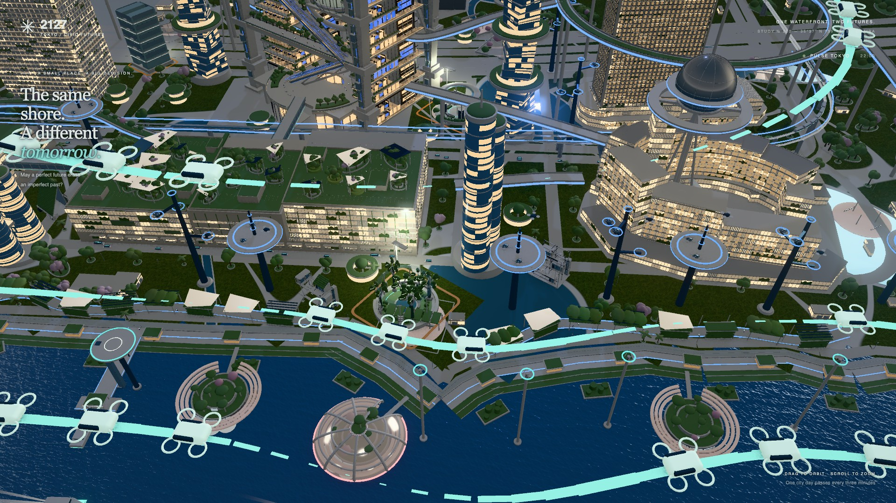](current/nw-district__8__h22.jpg) |

S0→Z：新俯視較S0集中展開完整drone服務列與欄邊，但近處大四旋翼及背景仍競爭注意，綠化缺口保持。

Sector-last→Z：與D r3同完整高態及pose，主體未見新增改善／退步；不同屋頂盤面方向及AO差異照量。

[D last original fbae624](../D/r3/nw-district/nw-district__8__h22.jpg) · 

S0→Z full MAD 23.377%、subject-union 23.377%、pose changed；D-last→Z full MAD 0.971%、subject-union 0.971%、pose same。MAD 只描述跨 source／pose 像素差，不替代 A4 或美術判斷。

S0→Z numeric delta：width -225.567pp、height -42.380pp、card overlap 4.275pp、A3 hits 0、vsync FPS 0.00、instant calls 6。

D-last→Z numeric delta：width 0.000pp、height 0.000pp、card overlap 0.000pp、A3 hits 0、vsync FPS 0.00、instant calls 0。

A1 PASS；A2 FAIL；A3 FAIL (0/9)；A4 0/2；A5 PASS (vsync 60、instant calls 875/869 S0)；A6 PASS。

完整 bounds width 116.159%、height 159.753%、card overlap 5.335%。

- **V1 PASS**：完整藍色drone盤／多支柱與四旋翼路線清楚表達自動服務網絡。
- **V2 PASS**：下半海面及右上球體提供明確水岸定位。
- **V3 FAIL**：左側屋頂多個孤立格仔盆景及前方球冠保留，未形成飽滿連續生態層。
- **V4 PASS**：完整服務亭／露台與輔助停機點保留，低自動化並非空地。
- **V5 PASS**：同態夜圖屋頂、柱與停機環輪廓可見；功能辨識不足另列V1。
- **V6 STATIC PASS**：此完整高態沒有混合小露台接合缺口，柱盤／基座沒有明顯穿模；動態閃爍仍未完整驗證。

## ne:focal · -2 · h12

| S0 original | Sector-last original | Z current original |
| --- | --- | --- |
| [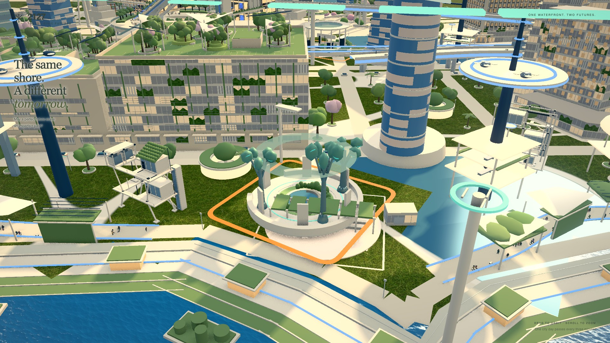](../S0/baseline/ne-focal__-2__h12.jpg) | [](../A/r3/ne-focal__-2__h12.jpg) | [](current/ne-focal__-2__h12.jpg) |

S0→Z：與S0同focal pose；GLB葉簇變綠且有分片、立柱細節較明確，減少青色塑膠感，但高幹稀疏冠層及機械環仍搶眼。

Sector-last→Z：與A r3同park body／pose；累積D後右側白亭／盤的背景細節有差異，未見park本體新增改善。

[A last original b7d5861](../A/r3/ne-focal__-2__h12.jpg) · 

S0→Z full MAD 1.246%、subject-union 2.843%、pose same；A-last→Z full MAD 0.879%、subject-union 0.598%、pose same。MAD 只描述跨 source／pose 像素差，不替代 A4 或美術判斷。

S0→Z numeric delta：width 0.000pp、height 0.000pp、card overlap 0.000pp、A3 hits 0、vsync FPS 0.20、instant calls 2。

A-last→Z numeric delta：width 0.000pp、height 0.000pp、card overlap 0.000pp、A3 hits 0、vsync FPS 0.00、instant calls 0。

A1 PASS；A2 PASS；A3 FAIL (2/9)；A4 0/2；A5 PASS (vsync 60、instant calls 819/817 S0)；A6 PASS。

完整 bounds width 35.810%、height 52.296%、card overlap 0.000%。

- **V1 FAIL**：環形盆地與高桿／梯形機件主導，小公園容易讀成設備試驗盤而非海浜公園。
- **V2 PASS**：前景海面與岸邊步道清楚入鏡。
- **V3 FAIL**：主體少數高幹上葉簇分片仍稀疏，背景孤立球冠／盆景網格保留。
- **V4 PASS**：低及中態均有完整植栽、水盆與冷卻構造，低態非空方案。
- **V5 N/A**：hour12日景；同態hour22原圖另有獨立V5判斷。
- **V6 STATIC PASS**：主體支架／池邊貼合未見明顯浮件或穿模；分片葉輪廓品質缺口列V3，動態閃爍未驗。

## ne:focal · -2 · h22

| S0 original | Sector-last original | Z current original |
| --- | --- | --- |
| [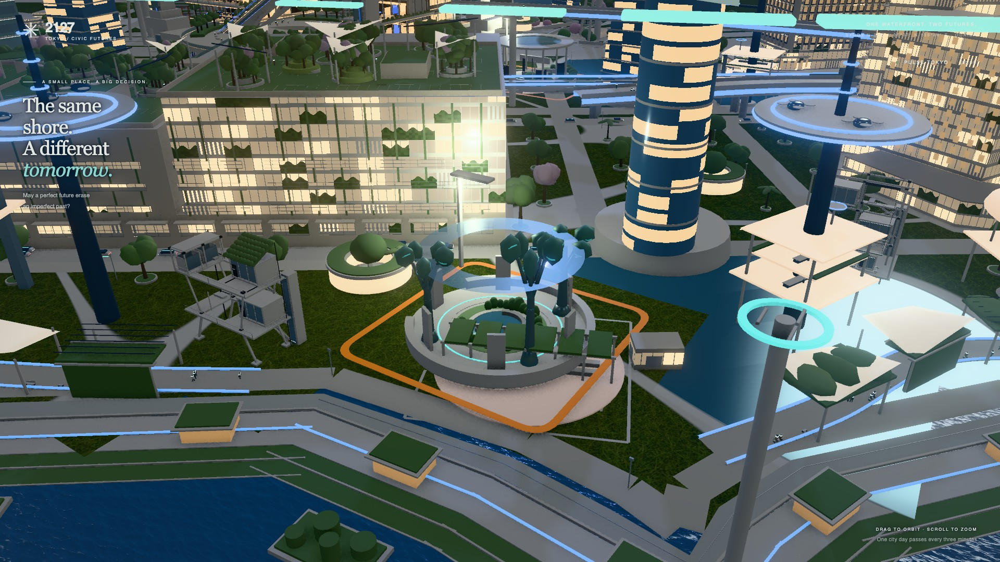](../S0/baseline/ne-focal__-2__h22.jpg) | [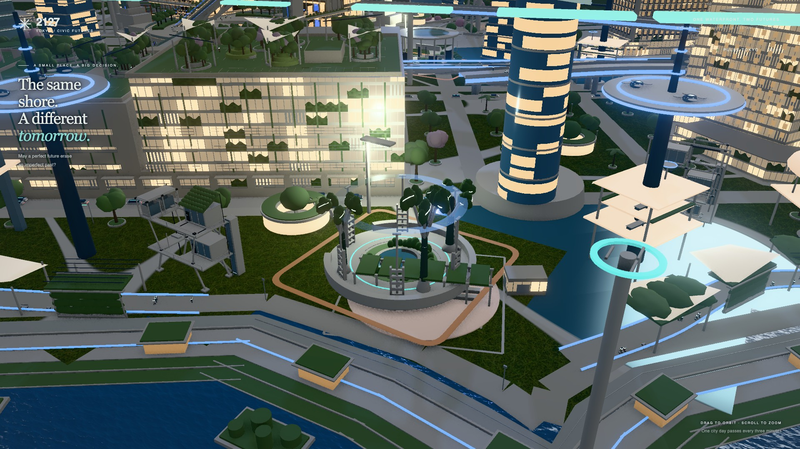](../A/r3/ne-focal__-2__h22.jpg) | [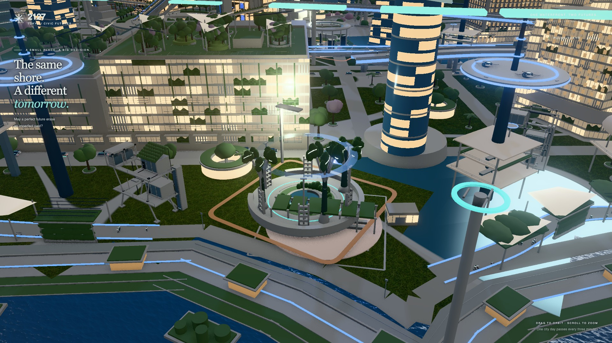](current/ne-focal__-2__h22.jpg) |

S0→Z：與S0同focal pose；GLB葉簇變綠且有分片、立柱細節較明確，減少青色塑膠感，但高幹稀疏冠層及機械環仍搶眼。

Sector-last→Z：與A r3同park body／pose；累積D後右側白亭／盤的背景細節有差異，未見park本體新增改善。

[A last original b7d5861](../A/r3/ne-focal__-2__h22.jpg) · 

S0→Z full MAD 1.403%、subject-union 2.394%、pose same；A-last→Z full MAD 0.917%、subject-union 0.496%、pose same。MAD 只描述跨 source／pose 像素差，不替代 A4 或美術判斷。

S0→Z numeric delta：width 0.000pp、height 0.000pp、card overlap 0.000pp、A3 hits 0、vsync FPS 0.10、instant calls -367。

A-last→Z numeric delta：width 0.000pp、height 0.000pp、card overlap 0.000pp、A3 hits 0、vsync FPS 0.00、instant calls -370。

A1 PASS；A2 PASS；A3 FAIL (2/9)；A4 0/2；A5 FAIL (vsync 60、instant calls 819/1186 S0)；A6 PASS。

完整 bounds width 35.810%、height 52.296%、card overlap 0.000%。

- **V1 FAIL**：環形盆地與高桿／梯形機件主導，小公園容易讀成設備試驗盤而非海浜公園。
- **V2 PASS**：前景海面與岸邊步道清楚入鏡。
- **V3 FAIL**：主體少數高幹上葉簇分片仍稀疏，背景孤立球冠／盆景網格保留。
- **V4 PASS**：低及中態均有完整植栽、水盆與冷卻構造，低態非空方案。
- **V5 FAIL**：同態夜景植栽本體暗，冷光環與鄰樓亮窗比冠層突出。
- **V6 STATIC PASS**：主體支架／池邊貼合未見明顯浮件或穿模；分片葉輪廓品質缺口列V3，動態閃爍未驗。

## ne:focal · 0 · h12

| S0 original | Sector-last original | Z current original |
| --- | --- | --- |
| [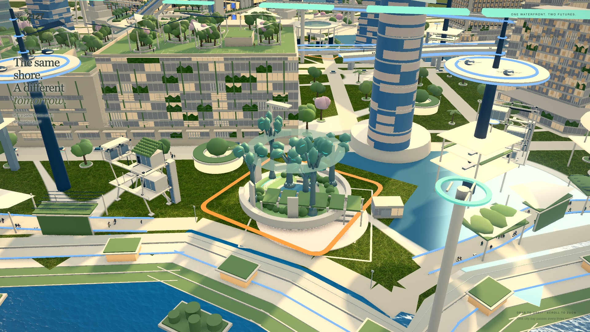](../S0/baseline/ne-focal__0__h12.jpg) | [](../A/r3/ne-focal__0__h12.jpg) | [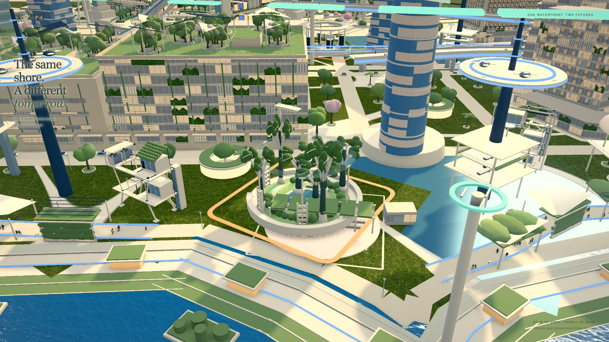](current/ne-focal__0__h12.jpg) |

S0→Z：與S0同focal pose；GLB葉簇變綠且有分片、立柱細節較明確，減少青色塑膠感，但高幹稀疏冠層及機械環仍搶眼。

Sector-last→Z：與A r3同park body／pose；累積D後右側白亭／盤的背景細節有差異，未見park本體新增改善。

[A last original b7d5861](../A/r3/ne-focal__0__h12.jpg) · 

S0→Z full MAD 1.369%、subject-union 3.473%、pose same；A-last→Z full MAD 0.874%、subject-union 0.612%、pose same。MAD 只描述跨 source／pose 像素差，不替代 A4 或美術判斷。

S0→Z numeric delta：width 0.000pp、height 0.000pp、card overlap 0.000pp、A3 hits 0、vsync FPS -0.10、instant calls 2。

A-last→Z numeric delta：width 0.000pp、height 0.000pp、card overlap 0.000pp、A3 hits 0、vsync FPS 0.00、instant calls 0。

A1 PASS；A2 PASS；A3 FAIL (2/9)；A4 0/2；A5 PASS (vsync 60、instant calls 819/817 S0)；A6 PASS。

完整 bounds width 35.810%、height 52.296%、card overlap 0.000%。

- **V1 FAIL**：環形盆地與高桿／梯形機件主導，小公園容易讀成設備試驗盤而非海浜公園。
- **V2 PASS**：前景海面與岸邊步道清楚入鏡。
- **V3 FAIL**：主體少數高幹上葉簇分片仍稀疏，背景孤立球冠／盆景網格保留。
- **V4 PASS**：低及中態均有完整植栽、水盆與冷卻構造，低態非空方案。
- **V5 N/A**：hour12日景；同態hour22原圖另有獨立V5判斷。
- **V6 STATIC PASS**：主體支架／池邊貼合未見明顯浮件或穿模；分片葉輪廓品質缺口列V3，動態閃爍未驗。

## ne:focal · 0 · h22

| S0 original | Sector-last original | Z current original |
| --- | --- | --- |
| [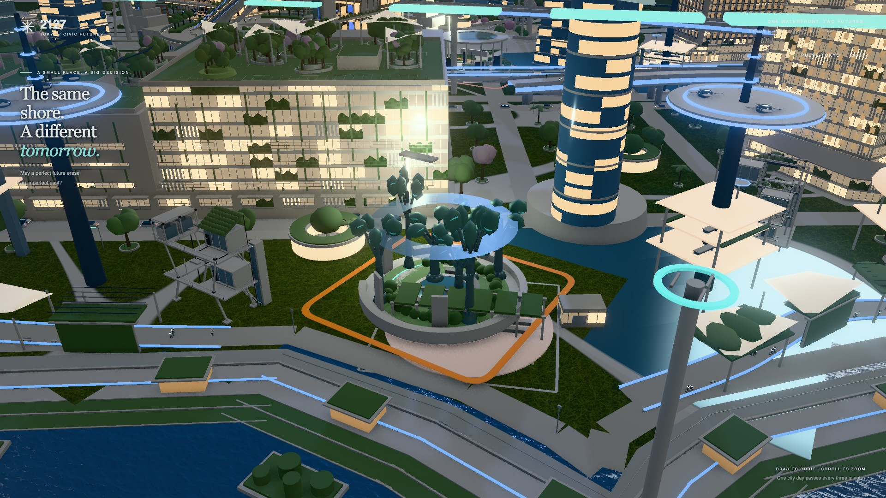](../S0/baseline/ne-focal__0__h22.jpg) | [](../A/r3/ne-focal__0__h22.jpg) | [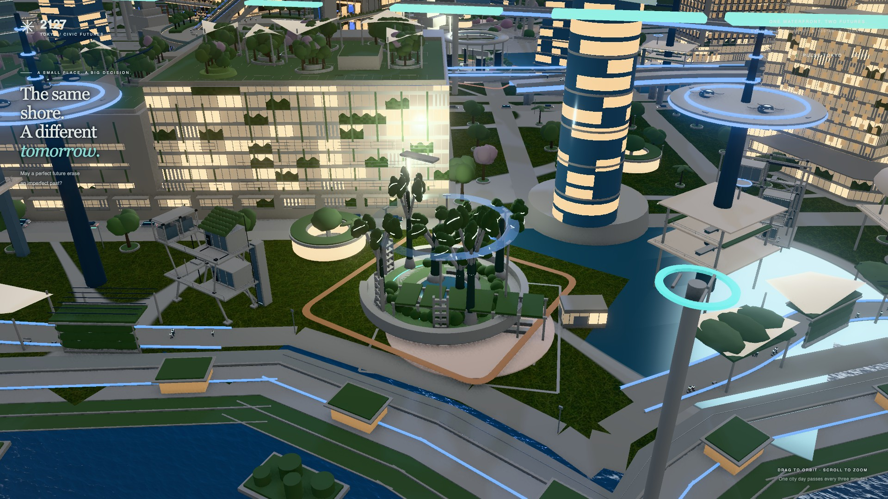](current/ne-focal__0__h22.jpg) |

S0→Z：與S0同focal pose；GLB葉簇變綠且有分片、立柱細節較明確，減少青色塑膠感，但高幹稀疏冠層及機械環仍搶眼。

Sector-last→Z：與A r3同park body／pose；累積D後右側白亭／盤的背景細節有差異，未見park本體新增改善。

[A last original b7d5861](../A/r3/ne-focal__0__h22.jpg) · 

S0→Z full MAD 1.481%、subject-union 2.851%、pose same；A-last→Z full MAD 1.092%、subject-union 0.513%、pose same。MAD 只描述跨 source／pose 像素差，不替代 A4 或美術判斷。

S0→Z numeric delta：width 0.000pp、height 0.000pp、card overlap 0.000pp、A3 hits 0、vsync FPS -0.20、instant calls 2。

A-last→Z numeric delta：width 0.000pp、height 0.000pp、card overlap 0.000pp、A3 hits 0、vsync FPS -0.40、instant calls 0。

A1 PASS；A2 PASS；A3 FAIL (2/9)；A4 0/2；A5 FAIL (vsync 59.8、instant calls 819/817 S0)；A6 PASS。

完整 bounds width 35.810%、height 52.296%、card overlap 0.000%。

- **V1 FAIL**：中態夜景樹簇被冷光環與鄰樓亮窗壓過，像機械展台，公園身份不足。
- **V2 PASS**：前景海面與岸邊步道清楚入鏡。
- **V3 FAIL**：主體少數高幹上葉簇分片仍稀疏，背景孤立球冠／盆景網格保留。
- **V4 PASS**：低及中態均有完整植栽、水盆與冷卻構造，低態非空方案。
- **V5 FAIL**：同態夜景植栽本體暗，冷光環與鄰樓亮窗比冠層突出。
- **V6 STATIC PASS**：主體支架／池邊貼合未見明顯浮件或穿模；分片葉輪廓品質缺口列V3，動態閃爍未驗。

## ne:focal · 2 · h12

| S0 original | Sector-last original | Z current original |
| --- | --- | --- |
| [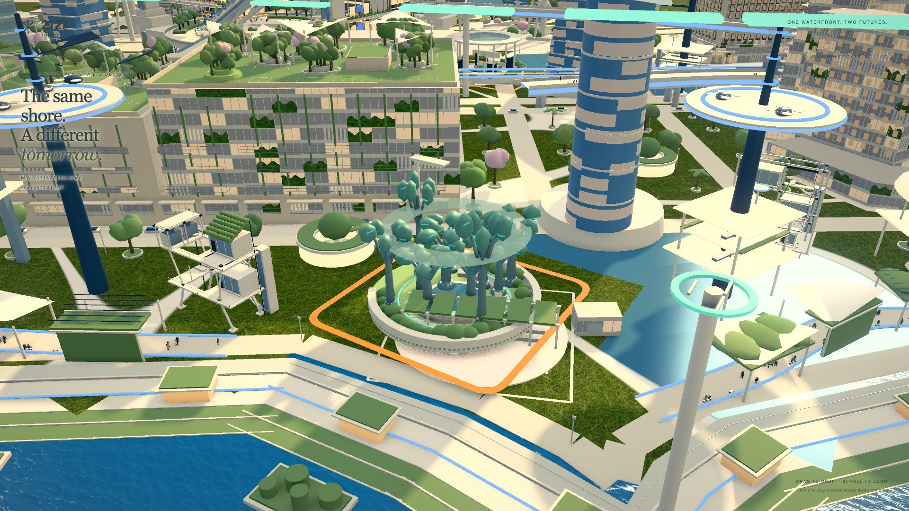](../S0/baseline/ne-focal__2__h12.jpg) | [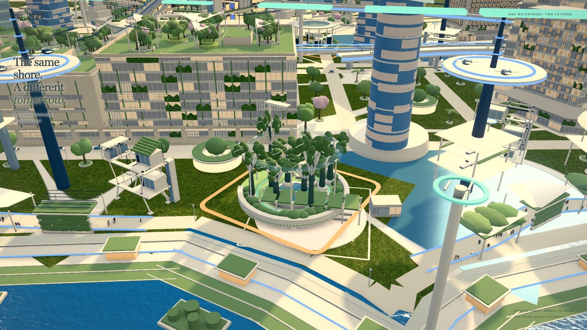](../A/r3/ne-focal__2__h12.jpg) | [](current/ne-focal__2__h12.jpg) |

S0→Z：與S0同pose／權威樹數；綠色分片葉簇減少青色塑膠感，較像植栽公園，但自然冠層品質未達標。

Sector-last→Z：與A r3同主體及pose，新增D背景細節未改park；沒有新的本體改善。

[A last original b7d5861](../A/r3/ne-focal__2__h12.jpg) · 

S0→Z full MAD 1.610%、subject-union 3.683%、pose same；A-last→Z full MAD 0.669%、subject-union 0.604%、pose same。MAD 只描述跨 source／pose 像素差，不替代 A4 或美術判斷。

S0→Z numeric delta：width 0.000pp、height 0.000pp、card overlap 0.000pp、A3 hits 0、vsync FPS 0.00、instant calls 2。

A-last→Z numeric delta：width 0.000pp、height 0.000pp、card overlap 0.000pp、A3 hits 0、vsync FPS 0.10、instant calls 0。

A1 PASS；A2 PASS；A3 FAIL (2/9)；A4 0/2；A5 PASS (vsync 60.1、instant calls 819/817 S0)；A6 PASS。

完整 bounds width 35.810%、height 52.296%、card overlap 0.000%。

- **V1 PASS**：高態較密的多層樹簇與環形公共綠台可直接讀成海邊植栽公園；夜間差異另列V5。
- **V2 PASS**：前景海面與岸邊步道清楚入鏡。
- **V3 FAIL**：數量足但葉簇仍呈分片硬輪廓、粗幹露白，未成飽滿自然冠層；背景盆景亦稀疏。
- **V4 PASS**：完整多層綠台／水盆與支架形成成熟高植栽替代方案。
- **V5 N/A**：hour12日景；同態hour22原圖另有獨立V5判斷。
- **V6 STATIC PASS**：主體支架／池邊貼合未見明顯浮件或穿模；分片葉輪廓品質缺口列V3，動態閃爍未驗。

## ne:focal · 2 · h22

| S0 original | Sector-last original | Z current original |
| --- | --- | --- |
| [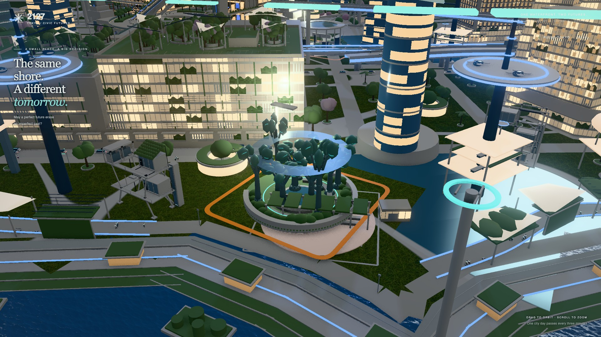](../S0/baseline/ne-focal__2__h22.jpg) | [](../A/r3/ne-focal__2__h22.jpg) | [](current/ne-focal__2__h22.jpg) |

S0→Z：與S0同pose／權威樹數；綠色分片葉簇減少青色塑膠感，較像植栽公園，但自然冠層品質未達標。

Sector-last→Z：與A r3同主體及pose，新增D背景細節未改park；沒有新的本體改善。

[A last original b7d5861](../A/r3/ne-focal__2__h22.jpg) · 

S0→Z full MAD 1.668%、subject-union 2.967%、pose same；A-last→Z full MAD 0.914%、subject-union 0.498%、pose same。MAD 只描述跨 source／pose 像素差，不替代 A4 或美術判斷。

S0→Z numeric delta：width 0.000pp、height 0.000pp、card overlap 0.000pp、A3 hits 0、vsync FPS 0.00、instant calls 2。

A-last→Z numeric delta：width 0.000pp、height 0.000pp、card overlap 0.000pp、A3 hits 0、vsync FPS 0.00、instant calls 0。

A1 PASS；A2 PASS；A3 FAIL (2/9)；A4 0/2；A5 FAIL (vsync 60、instant calls 819/817 S0)；A6 PASS。

完整 bounds width 35.810%、height 52.296%、card overlap 0.000%。

- **V1 PASS**：高態較密的多層樹簇與環形公共綠台可直接讀成海邊植栽公園；夜間差異另列V5。
- **V2 PASS**：前景海面與岸邊步道清楚入鏡。
- **V3 FAIL**：數量足但葉簇仍呈分片硬輪廓、粗幹露白，未成飽滿自然冠層；背景盆景亦稀疏。
- **V4 PASS**：完整多層綠台／水盆與支架形成成熟高植栽替代方案。
- **V5 FAIL**：同態夜景植栽本體暗，冷光環與鄰樓亮窗比冠層突出。
- **V6 STATIC PASS**：主體支架／池邊貼合未見明顯浮件或穿模；分片葉輪廓品質缺口列V3，動態閃爍未驗。

## ne:district · -8 · h12

| S0 original | Sector-last original | Z current original |
| --- | --- | --- |
| [](../S0/baseline/ne-district__-8__h12.jpg) | [](../A/r3/ne-district__-8__h12.jpg) | [](current/ne-district__-8__h12.jpg) |

S0→Z：構圖由S0看較多樓體改為更多海面與岸線，細化遮陽屏／pergola但實際氣候載體更小，低態功能辨識仍不足。

Sector-last→Z：與A r3同環境carrier及pose；累積D的NW白亭／盤／欄邊在背景有細節差異，環境本體未有新增改善。

[A last original b7d5861](../A/r3/ne-district__-8__h12.jpg) · 

S0→Z full MAD 24.509%、subject-union 24.509%、pose changed；A-last→Z full MAD 0.758%、subject-union 0.758%、pose same。MAD 只描述跨 source／pose 像素差，不替代 A4 或美術判斷。

S0→Z numeric delta：width 37.689pp、height 51.451pp、card overlap -1.181pp、A3 hits 0、vsync FPS 0.00、instant calls -164。

A-last→Z numeric delta：width 0.000pp、height 0.000pp、card overlap 0.000pp、A3 hits 0、vsync FPS 0.00、instant calls 0。

A1 PASS；A2 PASS；A3 FAIL (0/9)；A4 0/2；A5 PASS (vsync 60、instant calls 744/908 S0)；A6 PASS。

完整 bounds width 178.027%、height 268.263%、card overlap 2.073%。

- **V1 FAIL**：大幅海面與飛行路線主導，岸邊細小遮陽屏不足以兩秒讀成環境氣候配置。
- **V2 PASS**：海面佔大部分下半畫面，水岸定位清楚。
- **V3 FAIL**：頂部格仔屋頂盆景及孤立球冠仍明顯，岸邊植栽稀疏。
- **V4 PASS**：低態仍保留完整路徑、遮陽與機械冷卻替代方案。
- **V5 N/A**：hour12日景；同態hour22原圖另有獨立V5判斷。
- **V6 STATIC PASS**：環境主體屏／pergola未見明顯浮件／穿模；鄰區hybrid接合缺口見NW判斷，未證全時間無閃爍。

## ne:district · -8 · h22

| S0 original | Sector-last original | Z current original |
| --- | --- | --- |
| [](../S0/baseline/ne-district__-8__h22.jpg) | [](../A/r3/ne-district__-8__h22.jpg) | [](current/ne-district__-8__h22.jpg) |

S0→Z：構圖由S0看較多樓體改為更多海面與岸線，細化遮陽屏／pergola但實際氣候載體更小，低態功能辨識仍不足。

Sector-last→Z：與A r3同環境carrier及pose；累積D的NW白亭／盤／欄邊在背景有細節差異，環境本體未有新增改善。

[A last original b7d5861](../A/r3/ne-district__-8__h22.jpg) · 

S0→Z full MAD 21.411%、subject-union 21.411%、pose changed；A-last→Z full MAD 1.245%、subject-union 1.245%、pose same。MAD 只描述跨 source／pose 像素差，不替代 A4 或美術判斷。

S0→Z numeric delta：width 37.682pp、height 51.412pp、card overlap -1.180pp、A3 hits 0、vsync FPS 0.00、instant calls -164。

A-last→Z numeric delta：width 0.000pp、height 0.000pp、card overlap 0.000pp、A3 hits 0、vsync FPS 0.10、instant calls 0。

A1 PASS；A2 PASS；A3 FAIL (0/9)；A4 0/2；A5 PASS (vsync 60、instant calls 744/908 S0)；A6 PASS。

完整 bounds width 178.020%、height 268.224%、card overlap 2.073%。

- **V1 FAIL**：大幅海面與飛行路線主導，岸邊細小遮陽屏不足以兩秒讀成環境氣候配置。
- **V2 PASS**：海面佔大部分下半畫面，水岸定位清楚。
- **V3 FAIL**：頂部格仔屋頂盆景及孤立球冠仍明顯，岸邊植栽稀疏。
- **V4 PASS**：低態仍保留完整路徑、遮陽與機械冷卻替代方案。
- **V5 FAIL**：同態夜圖岸線亮邊可見，但暗色遮陽屏與背景亮窗難分層次。
- **V6 STATIC PASS**：環境主體屏／pergola未見明顯浮件／穿模；鄰區hybrid接合缺口見NW判斷，未證全時間無閃爍。

## ne:district · -5 · h12

| S0 original | Sector-last original | Z current original |
| --- | --- | --- |
| [](../S0/baseline/ne-district__-5__h12.jpg) | [](../A/r3/ne-district__-5__h12.jpg) | [](current/ne-district__-5__h12.jpg) |

S0→Z：改以更多海面和岸邊全列為中心，綠屏有葉層細節；本階段混合配置差異仍小，功能辨識未過。

Sector-last→Z：與A r3同環境本體／pose；背景NW改動與盤面方向差異保留，未新增環境本體改善。

[A last original b7d5861](../A/r3/ne-district__-5__h12.jpg) · 

S0→Z full MAD 24.487%、subject-union 24.487%、pose changed；A-last→Z full MAD 0.664%、subject-union 0.664%、pose same。MAD 只描述跨 source／pose 像素差，不替代 A4 或美術判斷。

S0→Z numeric delta：width 37.840pp、height 52.355pp、card overlap -1.157pp、A3 hits 0、vsync FPS 0.00、instant calls -164。

A-last→Z numeric delta：width 0.000pp、height 0.000pp、card overlap 0.000pp、A3 hits 0、vsync FPS 0.00、instant calls 0。

A1 PASS；A2 PASS；A3 FAIL (0/9)；A4 0/2；A5 PASS (vsync 60、instant calls 744/908 S0)；A6 PASS。

完整 bounds width 178.833%、height 272.626%、card overlap 2.031%。

- **V1 FAIL**：局部綠冠屏與機械冷卻配置交替，但岸線載體細小，仍被飛行路線及大片海面壓過。
- **V2 PASS**：海面佔大部分下半畫面，水岸定位清楚。
- **V3 FAIL**：頂部格仔屋頂盆景及孤立球冠仍明顯，岸邊植栽稀疏。
- **V4 PASS**：低態仍保留完整路徑、遮陽與機械冷卻替代方案。
- **V5 N/A**：hour12日景；同態hour22原圖另有獨立V5判斷。
- **V6 STATIC PASS**：環境主體屏／pergola未見明顯浮件／穿模；鄰區hybrid接合缺口見NW判斷，未證全時間無閃爍。

## ne:district · -5 · h22

| S0 original | Sector-last original | Z current original |
| --- | --- | --- |
| [](../S0/baseline/ne-district__-5__h22.jpg) | [](../A/r3/ne-district__-5__h22.jpg) | [](current/ne-district__-5__h22.jpg) |

S0→Z：改以更多海面和岸邊全列為中心，綠屏有葉層細節；本階段混合配置差異仍小，功能辨識未過。

Sector-last→Z：與A r3同環境本體／pose；背景NW改動與盤面方向差異保留，未新增環境本體改善。

[A last original b7d5861](../A/r3/ne-district__-5__h22.jpg) · 

S0→Z full MAD 21.260%、subject-union 21.260%、pose changed；A-last→Z full MAD 1.247%、subject-union 1.247%、pose same。MAD 只描述跨 source／pose 像素差，不替代 A4 或美術判斷。

S0→Z numeric delta：width 37.840pp、height 52.355pp、card overlap -1.157pp、A3 hits 0、vsync FPS 0.00、instant calls -164。

A-last→Z numeric delta：width 0.000pp、height 0.000pp、card overlap 0.000pp、A3 hits 0、vsync FPS 0.00、instant calls 0。

A1 PASS；A2 PASS；A3 FAIL (0/9)；A4 0/2；A5 PASS (vsync 60、instant calls 744/908 S0)；A6 PASS。

完整 bounds width 178.833%、height 272.626%、card overlap 2.031%。

- **V1 FAIL**：局部綠冠屏與機械冷卻配置交替，但岸線載體細小，仍被飛行路線及大片海面壓過。
- **V2 PASS**：海面佔大部分下半畫面，水岸定位清楚。
- **V3 FAIL**：頂部格仔屋頂盆景及孤立球冠仍明顯，岸邊植栽稀疏。
- **V4 PASS**：低態仍保留完整路徑、遮陽與機械冷卻替代方案。
- **V5 FAIL**：同態夜圖岸線亮邊可見，但暗色遮陽屏與背景亮窗難分層次。
- **V6 STATIC PASS**：環境主體屏／pergola未見明顯浮件／穿模；鄰區hybrid接合缺口見NW判斷，未證全時間無閃爍。

## ne:district · 0 · h12

| S0 original | Sector-last original | Z current original |
| --- | --- | --- |
| [](../S0/baseline/ne-district__0__h12.jpg) | [](../A/r3/ne-district__0__h12.jpg) | [](current/ne-district__0__h12.jpg) |

S0→Z：與S0不同pose令岸線更完整，綠屏有葉層與pergola層次；整個氣候carrier仍難讀，海面及飛行器主導。

Sector-last→Z：與A r3同neutral環境主體／pose；累積NW背景操作邊與屋頂盤面差異照存，無新增主體改善。

[A last original b7d5861](../A/r3/ne-district__0__h12.jpg) · 

S0→Z full MAD 24.666%、subject-union 24.666%、pose changed；A-last→Z full MAD 0.667%、subject-union 0.667%、pose same。MAD 只描述跨 source／pose 像素差，不替代 A4 或美術判斷。

S0→Z numeric delta：width 37.873pp、height 52.524pp、card overlap -1.153pp、A3 hits 0、vsync FPS 0.00、instant calls -164。

A-last→Z numeric delta：width 0.018pp、height 0.015pp、card overlap -0.000pp、A3 hits 0、vsync FPS 0.00、instant calls 0。

A1 PASS；A2 PASS；A3 FAIL (0/9)；A4 0/2；A5 PASS (vsync 60、instant calls 744/908 S0)；A6 PASS。

完整 bounds width 178.997%、height 273.377%、card overlap 2.023%。

- **V1 FAIL**：中態綠屏／遮陽組合完整，但範圍過廣、局部太小，難在兩秒指出氣候配置的主體。
- **V2 PASS**：海面佔大部分下半畫面，水岸定位清楚。
- **V3 FAIL**：頂部格仔屋頂盆景及孤立球冠仍明顯，岸邊植栽稀疏。
- **V4 PASS**：中態保留連續步道與遮陽／綠屏混合方案，完整成熟。
- **V5 N/A**：hour12日景；同態hour22原圖另有獨立V5判斷。
- **V6 STATIC PASS**：環境主體屏／pergola未見明顯浮件／穿模；鄰區hybrid接合缺口見NW判斷，未證全時間無閃爍。

## ne:district · 0 · h22

| S0 original | Sector-last original | Z current original |
| --- | --- | --- |
| [](../S0/baseline/ne-district__0__h22.jpg) | [](../A/r3/ne-district__0__h22.jpg) | [](current/ne-district__0__h22.jpg) |

S0→Z：與S0不同pose令岸線更完整，綠屏有葉層與pergola層次；整個氣候carrier仍難讀，海面及飛行器主導。

Sector-last→Z：與A r3同neutral環境主體／pose；累積NW背景操作邊與屋頂盤面差異照存，無新增主體改善。

[A last original b7d5861](../A/r3/ne-district__0__h22.jpg) · 

S0→Z full MAD 21.499%、subject-union 21.499%、pose changed；A-last→Z full MAD 1.235%、subject-union 1.235%、pose same。MAD 只描述跨 source／pose 像素差，不替代 A4 或美術判斷。

S0→Z numeric delta：width 37.855pp、height 52.509pp、card overlap -1.153pp、A3 hits 0、vsync FPS 0.10、instant calls -164。

A-last→Z numeric delta：width 0.000pp、height 0.000pp、card overlap 0.000pp、A3 hits 0、vsync FPS 0.10、instant calls 0。

A1 PASS；A2 PASS；A3 FAIL (0/9)；A4 0/2；A5 PASS (vsync 60.1、instant calls 744/908 S0)；A6 PASS。

完整 bounds width 178.979%、height 273.363%、card overlap 2.023%。

- **V1 FAIL**：中態綠屏／遮陽組合完整，但範圍過廣、局部太小，難在兩秒指出氣候配置的主體。
- **V2 PASS**：海面佔大部分下半畫面，水岸定位清楚。
- **V3 FAIL**：頂部格仔屋頂盆景及孤立球冠仍明顯，岸邊植栽稀疏。
- **V4 PASS**：中態保留連續步道與遮陽／綠屏混合方案，完整成熟。
- **V5 FAIL**：同態夜圖岸線亮邊可見，但暗色遮陽屏與背景亮窗難分層次。
- **V6 STATIC PASS**：環境主體屏／pergola未見明顯浮件／穿模；鄰區hybrid接合缺口見NW判斷，未證全時間無閃爍。

## ne:district · 5 · h12

| S0 original | Sector-last original | Z current original |
| --- | --- | --- |
| [](../S0/baseline/ne-district__5__h12.jpg) | [](../A/r3/ne-district__5__h12.jpg) | [](current/ne-district__5__h12.jpg) |

S0→Z：新構圖較集中岸線綠層，屏葉細節有改善；但海面比例更大，夜間綠化輪廓及格仔植栽缺口保持。

Sector-last→Z：與A r3同環境本體／pose，較後NW操作邊只影響背景，未新增主體改善。

[A last original b7d5861](../A/r3/ne-district__5__h12.jpg) · 

S0→Z full MAD 25.212%、subject-union 25.212%、pose changed；A-last→Z full MAD 0.816%、subject-union 0.816%、pose same。MAD 只描述跨 source／pose 像素差，不替代 A4 或美術判斷。

S0→Z numeric delta：width 37.842pp、height 52.294pp、card overlap -1.158pp、A3 hits 0、vsync FPS -0.10、instant calls -162。

A-last→Z numeric delta：width 0.018pp、height 0.015pp、card overlap -0.000pp、A3 hits 0、vsync FPS 0.00、instant calls 369。

A1 PASS；A2 PASS；A3 FAIL (0/9)；A4 0/2；A5 PASS (vsync 60、instant calls 1113/1275 S0)；A6 PASS。

完整 bounds width 178.783%、height 272.521%、card overlap 2.032%。

- **V1 PASS**：較連續的岸線綠冠屏與立面綠層可讀成環境調節水岸，雖然局部功能細節偏小。
- **V2 PASS**：海面佔大部分下半畫面，水岸定位清楚。
- **V3 FAIL**：綠層較多但仍像格仔薄片與盆景，沒有飽滿的連續冠層。
- **V4 PASS**：完整綠屏／pergola與岸線公共路徑構成成熟偏環境方案。
- **V5 N/A**：hour12日景；同態hour22原圖另有獨立V5判斷。
- **V6 STATIC PASS**：環境主體屏／pergola未見明顯浮件／穿模；鄰區hybrid接合缺口見NW判斷，未證全時間無閃爍。

## ne:district · 5 · h22

| S0 original | Sector-last original | Z current original |
| --- | --- | --- |
| [](../S0/baseline/ne-district__5__h22.jpg) | [](../A/r3/ne-district__5__h22.jpg) | [](current/ne-district__5__h22.jpg) |

S0→Z：新構圖較集中岸線綠層，屏葉細節有改善；但海面比例更大，夜間綠化輪廓及格仔植栽缺口保持。

Sector-last→Z：與A r3同環境本體／pose，較後NW操作邊只影響背景，未新增主體改善。

[A last original b7d5861](../A/r3/ne-district__5__h22.jpg) · 

S0→Z full MAD 21.219%、subject-union 21.219%、pose changed；A-last→Z full MAD 1.233%、subject-union 1.233%、pose same。MAD 只描述跨 source／pose 像素差，不替代 A4 或美術判斷。

S0→Z numeric delta：width 37.807pp、height 52.275pp、card overlap -1.157pp、A3 hits 0、vsync FPS 0.00、instant calls -164。

A-last→Z numeric delta：width 0.000pp、height 0.000pp、card overlap 0.000pp、A3 hits 0、vsync FPS 0.00、instant calls 0。

A1 PASS；A2 PASS；A3 FAIL (0/9)；A4 0/2；A5 PASS (vsync 60、instant calls 744/908 S0)；A6 PASS。

完整 bounds width 178.783%、height 272.521%、card overlap 2.032%。

- **V1 PASS**：較連續的岸線綠冠屏與立面綠層可讀成環境調節水岸，雖然局部功能細節偏小。
- **V2 PASS**：海面佔大部分下半畫面，水岸定位清楚。
- **V3 FAIL**：綠層較多但仍像格仔薄片與盆景，沒有飽滿的連續冠層。
- **V4 PASS**：完整綠屏／pergola與岸線公共路徑構成成熟偏環境方案。
- **V5 FAIL**：同態夜圖岸線亮邊可見，但暗色遮陽屏與背景亮窗難分層次。
- **V6 STATIC PASS**：環境主體屏／pergola未見明顯浮件／穿模；鄰區hybrid接合缺口見NW判斷，未證全時間無閃爍。

## ne:district · 8 · h12

| S0 original | Sector-last original | Z current original |
| --- | --- | --- |
| [](../S0/baseline/ne-district__8__h12.jpg) | [](../A/r3/ne-district__8__h12.jpg) | [](current/ne-district__8__h12.jpg) |

S0→Z：新構圖較集中岸線綠層，屏葉細節有改善；但海面比例更大，夜間綠化輪廓及格仔植栽缺口保持。

Sector-last→Z：與A r3同環境本體／pose，較後NW操作邊只影響背景，未新增主體改善。

[A last original b7d5861](../A/r3/ne-district__8__h12.jpg) · 

S0→Z full MAD 25.081%、subject-union 25.081%、pose changed；A-last→Z full MAD 0.669%、subject-union 0.669%、pose same。MAD 只描述跨 source／pose 像素差，不替代 A4 或美術判斷。

S0→Z numeric delta：width 37.332pp、height 51.359pp、card overlap -1.145pp、A3 hits 0、vsync FPS 0.00、instant calls -164。

A-last→Z numeric delta：width 0.027pp、height 0.023pp、card overlap -0.000pp、A3 hits 0、vsync FPS 0.00、instant calls 0。

A1 PASS；A2 PASS；A3 FAIL (0/9)；A4 0/2；A5 PASS (vsync 60、instant calls 744/908 S0)；A6 PASS。

完整 bounds width 178.100%、height 271.804%、card overlap 2.045%。

- **V1 PASS**：較連續的岸線綠冠屏與立面綠層可讀成環境調節水岸，雖然局部功能細節偏小。
- **V2 PASS**：海面佔大部分下半畫面，水岸定位清楚。
- **V3 FAIL**：綠層較多但仍像格仔薄片與盆景，沒有飽滿的連續冠層。
- **V4 PASS**：完整綠屏／pergola與岸線公共路徑構成成熟偏環境方案。
- **V5 N/A**：hour12日景；同態hour22原圖另有獨立V5判斷。
- **V6 STATIC PASS**：環境主體屏／pergola未見明顯浮件／穿模；鄰區hybrid接合缺口見NW判斷，未證全時間無閃爍。

## ne:district · 8 · h22

| S0 original | Sector-last original | Z current original |
| --- | --- | --- |
| [](../S0/baseline/ne-district__8__h22.jpg) | [](../A/r3/ne-district__8__h22.jpg) | [](current/ne-district__8__h22.jpg) |

S0→Z：新構圖較集中岸線綠層，屏葉細節有改善；但海面比例更大，夜間綠化輪廓及格仔植栽缺口保持。

Sector-last→Z：與A r3同環境本體／pose，較後NW操作邊只影響背景，未新增主體改善。

[A last original b7d5861](../A/r3/ne-district__8__h22.jpg) · 

S0→Z full MAD 20.840%、subject-union 20.840%、pose changed；A-last→Z full MAD 1.242%、subject-union 1.242%、pose same。MAD 只描述跨 source／pose 像素差，不替代 A4 或美術判斷。

S0→Z numeric delta：width 37.332pp、height 51.359pp、card overlap -1.145pp、A3 hits 0、vsync FPS 0.20、instant calls -164。

A-last→Z numeric delta：width 0.027pp、height 0.023pp、card overlap -0.000pp、A3 hits 0、vsync FPS 0.00、instant calls 0。

A1 PASS；A2 PASS；A3 FAIL (0/9)；A4 0/2；A5 PASS (vsync 60、instant calls 744/908 S0)；A6 PASS。

完整 bounds width 178.100%、height 271.804%、card overlap 2.045%。

- **V1 PASS**：較連續的岸線綠冠屏與立面綠層可讀成環境調節水岸，雖然局部功能細節偏小。
- **V2 PASS**：海面佔大部分下半畫面，水岸定位清楚。
- **V3 FAIL**：綠層較多但仍像格仔薄片與盆景，沒有飽滿的連續冠層。
- **V4 PASS**：完整綠屏／pergola與岸線公共路徑構成成熟偏環境方案。
- **V5 FAIL**：完整高態的綠冠屏在夜間仍暗，鄰樓亮窗與飛行路線比環境配置更突出。
- **V6 STATIC PASS**：環境主體屏／pergola未見明顯浮件／穿模；鄰區hybrid接合缺口見NW判斷，未證全時間無閃爍。

## sw:focal · -2 · h12

| S0 original | Sector-last original | Z current original |
| --- | --- | --- |
| [](../S0/baseline/sw-focal__-2__h12.jpg) | [](../B/r3/sw-focal__-2__h12.jpg) | [](current/sw-focal__-2__h12.jpg) |

S0→Z：比S0明顯退步：主體移到遠處且中央白柱遮住座位／屋頂，左藍樓與右drone柱更搶眼；曲面環頂及摺屏細節無法補救構圖。

Sector-last→Z：與B r3同pose／commons body，中央柱遮擋完全保持；累積C/D背景細節不構成主體修正。

[B last original 74d6c2b](../B/r3/sw-focal__-2__h12.jpg) · 

S0→Z full MAD 29.913%、subject-union 31.964%、pose changed；B-last→Z full MAD 0.549%、subject-union 0.714%、pose same。MAD 只描述跨 source／pose 像素差，不替代 A4 或美術判斷。

S0→Z numeric delta：width -32.624pp、height -45.885pp、card overlap -0.921pp、A3 hits -3、vsync FPS 0.10、instant calls 216。

B-last→Z numeric delta：width 0.000pp、height 0.000pp、card overlap 0.000pp、A3 hits 0、vsync FPS 0.00、instant calls 2。

A1 PASS；A2 PASS；A3 FAIL (0/9)；A4 0/2；A5 FAIL (vsync 60、instant calls 822/606 S0)；A6 PASS。

完整 bounds width 32.461%、height 26.914%、card overlap 0.000%。

- **V1 FAIL**：遠處小圓亭被中央白柱擋住，不能兩秒讀出安靜私密座位廣場。
- **V2 FAIL**：海面、富士球體及彩虹橋均未在這幅構圖清楚出現。
- **V3 FAIL**：少數球冠／低poly植栽保留，大片草地及背景盆景沒有生態層次。
- **V4 PASS**：私密屏／座位與有蓋公共空間仍是完整替代方案，遮擋不代表低態未建成。
- **V5 N/A**：hour12日景；同態hour22原圖另有獨立V5判斷。
- **V6 STATIC PASS**：可見環頂／基座邊緣未見浮件或穿模；被遮住的座位細節及動態閃爍未驗。

## sw:focal · -2 · h22

| S0 original | Sector-last original | Z current original |
| --- | --- | --- |
| [](../S0/baseline/sw-focal__-2__h22.jpg) | [](../B/r3/sw-focal__-2__h22.jpg) | [](current/sw-focal__-2__h22.jpg) |

S0→Z：比S0明顯退步：主體移到遠處且中央白柱遮住座位／屋頂，左藍樓與右drone柱更搶眼；曲面環頂及摺屏細節無法補救構圖。

Sector-last→Z：與B r3同pose／commons body，中央柱遮擋完全保持；累積C/D背景細節不構成主體修正。

[B last original 74d6c2b](../B/r3/sw-focal__-2__h22.jpg) · 

S0→Z full MAD 27.034%、subject-union 26.312%、pose changed；B-last→Z full MAD 1.771%、subject-union 0.475%、pose same。MAD 只描述跨 source／pose 像素差，不替代 A4 或美術判斷。

S0→Z numeric delta：width -32.624pp、height -45.885pp、card overlap -0.921pp、A3 hits -3、vsync FPS 0.10、instant calls 216。

B-last→Z numeric delta：width 0.000pp、height 0.000pp、card overlap 0.000pp、A3 hits 0、vsync FPS 0.40、instant calls 2。

A1 PASS；A2 PASS；A3 FAIL (0/9)；A4 0/2；A5 FAIL (vsync 60.1、instant calls 822/606 S0)；A6 PASS。

完整 bounds width 32.461%、height 26.914%、card overlap 0.000%。

- **V1 FAIL**：遠處小圓亭被中央白柱擋住，不能兩秒讀出安靜私密座位廣場。
- **V2 FAIL**：海面、富士球體及彩虹橋均未在這幅構圖清楚出現。
- **V3 FAIL**：少數球冠／低poly植栽保留，大片草地及背景盆景沒有生態層次。
- **V4 PASS**：私密屏／座位與有蓋公共空間仍是完整替代方案，遮擋不代表低態未建成。
- **V5 FAIL**：同態夜圖commons暗且被白柱遮擋，鄰樓亮窗與drone柱主導。
- **V6 STATIC PASS**：可見環頂／基座邊緣未見浮件或穿模；被遮住的座位細節及動態閃爍未驗。

## sw:focal · 0 · h12

| S0 original | Sector-last original | Z current original |
| --- | --- | --- |
| [](../S0/baseline/sw-focal__0__h12.jpg) | [](../B/r3/sw-focal__0__h12.jpg) | [](current/sw-focal__0__h12.jpg) |

S0→Z：比S0主體更小且中央柱遮住座位／環頂，明顯構圖退步；本態長椅／屏細節難以辨認。

Sector-last→Z：與B r3同pose／commons body，中央柱遮擋完全保持；累積C/D背景細節不構成主體修正。

[B last original 74d6c2b](../B/r3/sw-focal__0__h12.jpg) · 

S0→Z full MAD 29.653%、subject-union 31.403%、pose changed；B-last→Z full MAD 0.550%、subject-union 0.709%、pose same。MAD 只描述跨 source／pose 像素差，不替代 A4 或美術判斷。

S0→Z numeric delta：width -32.624pp、height -49.525pp、card overlap -0.877pp、A3 hits -2、vsync FPS 0.00、instant calls 216。

B-last→Z numeric delta：width 0.000pp、height 0.000pp、card overlap 0.000pp、A3 hits 0、vsync FPS 0.00、instant calls 2。

A1 PASS；A2 PASS；A3 FAIL (0/9)；A4 0/2；A5 FAIL (vsync 60、instant calls 822/606 S0)；A6 PASS。

完整 bounds width 32.461%、height 26.914%、card overlap 0.000%。

- **V1 FAIL**：混合屏／長椅藏在中央白柱後，只見細小圓亭，無法兩秒辨認座位方案。
- **V2 FAIL**：海面、富士球體及彩虹橋均未在這幅構圖清楚出現。
- **V3 FAIL**：少數球冠／低poly植栽保留，大片草地及背景盆景沒有生態層次。
- **V4 PASS**：完整有蓋廣場與屏／長椅替代方案仍保留；構圖遮擋與成熟度分開判斷。
- **V5 N/A**：hour12日景；同態hour22原圖另有獨立V5判斷。
- **V6 STATIC PASS**：可見環頂／基座邊緣未見浮件或穿模；被遮住的座位細節及動態閃爍未驗。

## sw:focal · 0 · h22

| S0 original | Sector-last original | Z current original |
| --- | --- | --- |
| [](../S0/baseline/sw-focal__0__h22.jpg) | [](../B/r3/sw-focal__0__h22.jpg) | [](current/sw-focal__0__h22.jpg) |

S0→Z：比S0主體更小且中央柱遮住座位／環頂，明顯構圖退步；本態長椅／屏細節難以辨認。

Sector-last→Z：與B r3同pose／commons body，中央柱遮擋完全保持；累積C/D背景細節不構成主體修正。

[B last original 74d6c2b](../B/r3/sw-focal__0__h22.jpg) · 

S0→Z full MAD 26.903%、subject-union 26.034%、pose changed；B-last→Z full MAD 1.791%、subject-union 0.476%、pose same。MAD 只描述跨 source／pose 像素差，不替代 A4 或美術判斷。

S0→Z numeric delta：width -32.624pp、height -49.525pp、card overlap -0.877pp、A3 hits -2、vsync FPS 0.00、instant calls 216。

B-last→Z numeric delta：width 0.000pp、height 0.000pp、card overlap 0.000pp、A3 hits 0、vsync FPS -0.10、instant calls 2。

A1 PASS；A2 PASS；A3 FAIL (0/9)；A4 0/2；A5 FAIL (vsync 60、instant calls 822/606 S0)；A6 PASS。

完整 bounds width 32.461%、height 26.914%、card overlap 0.000%。

- **V1 FAIL**：混合屏／長椅藏在中央白柱後，只見細小圓亭，無法兩秒辨認座位方案。
- **V2 FAIL**：海面、富士球體及彩虹橋均未在這幅構圖清楚出現。
- **V3 FAIL**：少數球冠／低poly植栽保留，大片草地及背景盆景沒有生態層次。
- **V4 PASS**：完整有蓋廣場與屏／長椅替代方案仍保留；構圖遮擋與成熟度分開判斷。
- **V5 FAIL**：同態夜圖commons暗且被白柱遮擋，鄰樓亮窗與drone柱主導。
- **V6 STATIC PASS**：可見環頂／基座邊緣未見浮件或穿模；被遮住的座位細節及動態閃爍未驗。

## sw:focal · 2 · h12

| S0 original | Sector-last original | Z current original |
| --- | --- | --- |
| [](../S0/baseline/sw-focal__2__h12.jpg) | [](../B/r3/sw-focal__2__h12.jpg) | [](current/sw-focal__2__h12.jpg) |

S0→Z：比S0主體更小且中央柱遮住座位／環頂，明顯構圖退步；本態長椅／屏細節難以辨認。

Sector-last→Z：與B r3同pose／commons body，中央柱遮擋完全保持；累積C/D背景細節不構成主體修正。

[B last original 74d6c2b](../B/r3/sw-focal__2__h12.jpg) · 

S0→Z full MAD 29.551%、subject-union 31.186%、pose changed；B-last→Z full MAD 0.550%、subject-union 0.729%、pose same。MAD 只描述跨 source／pose 像素差，不替代 A4 或美術判斷。

S0→Z numeric delta：width -32.624pp、height -49.525pp、card overlap -0.877pp、A3 hits -2、vsync FPS 0.00、instant calls 216。

B-last→Z numeric delta：width 0.000pp、height 0.000pp、card overlap 0.000pp、A3 hits 0、vsync FPS 0.00、instant calls 2。

A1 PASS；A2 PASS；A3 FAIL (0/9)；A4 0/2；A5 FAIL (vsync 60.1、instant calls 822/606 S0)；A6 PASS。

完整 bounds width 32.461%、height 26.914%、card overlap 0.000%。

- **V1 FAIL**：開放共享長椅藏在中央白柱後，只見細小圓亭，無法兩秒辨認座位方案。
- **V2 FAIL**：海面、富士球體及彩虹橋均未在這幅構圖清楚出現。
- **V3 FAIL**：少數球冠／低poly植栽保留，大片草地及背景盆景沒有生態層次。
- **V4 PASS**：完整有蓋廣場與屏／長椅替代方案仍保留；構圖遮擋與成熟度分開判斷。
- **V5 N/A**：hour12日景；同態hour22原圖另有獨立V5判斷。
- **V6 STATIC PASS**：可見環頂／基座邊緣未見浮件或穿模；被遮住的座位細節及動態閃爍未驗。

## sw:focal · 2 · h22

| S0 original | Sector-last original | Z current original |
| --- | --- | --- |
| [](../S0/baseline/sw-focal__2__h22.jpg) | [](../B/r3/sw-focal__2__h22.jpg) | [](current/sw-focal__2__h22.jpg) |

S0→Z：比S0主體更小且中央柱遮住座位／環頂，明顯構圖退步；本態長椅／屏細節難以辨認。

Sector-last→Z：與B r3同pose／commons body，中央柱遮擋完全保持；累積C/D背景細節不構成主體修正。

[B last original 74d6c2b](../B/r3/sw-focal__2__h22.jpg) · 

S0→Z full MAD 26.848%、subject-union 25.915%、pose changed；B-last→Z full MAD 1.791%、subject-union 0.487%、pose same。MAD 只描述跨 source／pose 像素差，不替代 A4 或美術判斷。

S0→Z numeric delta：width -32.624pp、height -49.525pp、card overlap -0.877pp、A3 hits -2、vsync FPS 0.00、instant calls 216。

B-last→Z numeric delta：width 0.000pp、height 0.000pp、card overlap 0.000pp、A3 hits 0、vsync FPS 0.30、instant calls 2。

A1 PASS；A2 PASS；A3 FAIL (0/9)；A4 0/2；A5 FAIL (vsync 60、instant calls 822/606 S0)；A6 PASS。

完整 bounds width 32.461%、height 26.914%、card overlap 0.000%。

- **V1 FAIL**：開放共享長椅藏在中央白柱後，只見細小圓亭，無法兩秒辨認座位方案。
- **V2 FAIL**：海面、富士球體及彩虹橋均未在這幅構圖清楚出現。
- **V3 FAIL**：少數球冠／低poly植栽保留，大片草地及背景盆景沒有生態層次。
- **V4 PASS**：完整有蓋廣場與屏／長椅替代方案仍保留；構圖遮擋與成熟度分開判斷。
- **V5 FAIL**：夜景共享長椅／環頂仍被中央柱遮住，主體細小偏暗；鄰樓亮窗更搶眼。
- **V6 STATIC PASS**：可見環頂／基座邊緣未見浮件或穿模；被遮住的座位細節及動態閃爍未驗。

## sw:district · -8 · h12

| S0 original | Sector-last original | Z current original |
| --- | --- | --- |
| [](../S0/baseline/sw-district__-8__h12.jpg) | [](../B/r3/sw-district__-8__h12.jpg) | [](current/sw-district__-8__h12.jpg) |

S0→Z：改為更高俯視，完整carrier可投影而S0跨near plane；私密半球水房仍可辨，主體較遠，曲頂肋／縫細節只屬局部改善。

Sector-last→Z：與B r3同sharing body／pose；累積C/D的背景局部細節有差異，但私密水房及共享區沒有新增改善或明顯退步。

[B last original 74d6c2b](../B/r3/sw-district__-8__h12.jpg) · 

S0→Z full MAD 24.633%、subject-union 24.633%、pose changed；B-last→Z full MAD 0.607%、subject-union 0.607%、pose same。MAD 只描述跨 source／pose 像素差，不替代 A4 或美術判斷。

S0→Z numeric delta：width 不可量測、height 不可量測、card overlap 不可量測、A3 hits 0、vsync FPS -0.10、instant calls -172。

B-last→Z numeric delta：width 0.000pp、height 0.000pp、card overlap 0.000pp、A3 hits 0、vsync FPS 0.00、instant calls 2。

A1 PASS；A2 PASS；A3 FAIL (0/9)；A4 0/2；A5 PASS (vsync 59.9、instant calls 748/920 S0)；A6 PASS。

完整 bounds width 146.611%、height 254.340%、card overlap 2.655%。

- **V1 PASS**：兩個透明有蓋半球水房與獨立植栽台可讀成私密水岸休憩空間。
- **V2 PASS**：海灣佔下半畫面，水岸定位清楚。
- **V3 FAIL**：頂部屋頂盆景仍棋盤式零散，球冠與孤立樹盆缺層次。
- **V4 PASS**：私密低態有完整可用水房／公共岸線與接岸路徑，不是空白或落後方案。
- **V5 N/A**：hour12日景；同態hour22原圖另有獨立V5判斷。
- **V6 STATIC PASS**：可見穹頂肋、接岸小橋及基座未見明顯浮件／穿模；未驗證完整動態閃爍。

## sw:district · -8 · h22

| S0 original | Sector-last original | Z current original |
| --- | --- | --- |
| [](../S0/baseline/sw-district__-8__h22.jpg) | [](../B/r3/sw-district__-8__h22.jpg) | [](current/sw-district__-8__h22.jpg) |

S0→Z：改為更高俯視，完整carrier可投影而S0跨near plane；私密半球水房仍可辨，主體較遠，曲頂肋／縫細節只屬局部改善。

Sector-last→Z：與B r3同sharing body／pose；累積C/D的背景局部細節有差異，但私密水房及共享區沒有新增改善或明顯退步。

[B last original 74d6c2b](../B/r3/sw-district__-8__h22.jpg) · 

S0→Z full MAD 19.238%、subject-union 19.238%、pose changed；B-last→Z full MAD 0.942%、subject-union 0.942%、pose same。MAD 只描述跨 source／pose 像素差，不替代 A4 或美術判斷。

S0→Z numeric delta：width 不可量測、height 不可量測、card overlap 不可量測、A3 hits 0、vsync FPS 0.00、instant calls -172。

B-last→Z numeric delta：width 0.000pp、height 0.000pp、card overlap 0.000pp、A3 hits 0、vsync FPS -0.10、instant calls 2。

A1 PASS；A2 PASS；A3 FAIL (0/9)；A4 0/2；A5 PASS (vsync 60、instant calls 748/920 S0)；A6 PASS。

完整 bounds width 146.611%、height 254.340%、card overlap 2.655%。

- **V1 PASS**：兩個透明有蓋半球水房與獨立植栽台可讀成私密水岸休憩空間。
- **V2 PASS**：海灣佔下半畫面，水岸定位清楚。
- **V3 FAIL**：頂部屋頂盆景仍棋盤式零散，球冠與孤立樹盆缺層次。
- **V4 PASS**：私密低態有完整可用水房／公共岸線與接岸路徑，不是空白或落後方案。
- **V5 PASS**：同態夜圖半球肋與淡粉邊光保留輪廓，水房與開放盤仍可分。
- **V6 STATIC PASS**：可見穹頂肋、接岸小橋及基座未見明顯浮件／穿模；未驗證完整動態閃爍。

## sw:district · -5 · h12

| S0 original | Sector-last original | Z current original |
| --- | --- | --- |
| [](../S0/baseline/sw-district__-5__h12.jpg) | [](../B/r3/sw-district__-5__h12.jpg) | [](current/sw-district__-5__h12.jpg) |

S0→Z：高俯視使carrier完整可投影，半球曲頂肋與開放盤更能比較；主體較遠且屋頂盆景仍稀疏，未達全部gate。

Sector-last→Z：與B r3同sharing body／pose；累積C/D的背景局部細節有差異，但私密水房及共享區沒有新增改善或明顯退步。

[B last original 74d6c2b](../B/r3/sw-district__-5__h12.jpg) · 

S0→Z full MAD 24.767%、subject-union 24.767%、pose changed；B-last→Z full MAD 0.610%、subject-union 0.610%、pose same。MAD 只描述跨 source／pose 像素差，不替代 A4 或美術判斷。

S0→Z numeric delta：width 不可量測、height 不可量測、card overlap 不可量測、A3 hits 0、vsync FPS 0.00、instant calls -172。

B-last→Z numeric delta：width 0.000pp、height 0.000pp、card overlap 0.000pp、A3 hits 0、vsync FPS 0.00、instant calls 2。

A1 PASS；A2 PASS；A3 FAIL (0/9)；A4 0/2；A5 PASS (vsync 60、instant calls 762/934 S0)；A6 PASS。

完整 bounds width 146.611%、height 254.340%、card overlap 2.655%。

- **V1 PASS**：有蓋半球水房與開放綠盤並存，可讀成混合安靜／共用的水岸空間。
- **V2 PASS**：海灣佔下半畫面，水岸定位清楚。
- **V3 FAIL**：頂部屋頂盆景仍棋盤式零散，球冠與孤立樹盆缺層次。
- **V4 PASS**：混合水房／露台與完整接岸通道均在，成熟方案並非過渡空白。
- **V5 N/A**：hour12日景；同態hour22原圖另有獨立V5判斷。
- **V6 STATIC PASS**：可見穹頂肋、接岸小橋及基座未見明顯浮件／穿模；未驗證完整動態閃爍。

## sw:district · -5 · h22

| S0 original | Sector-last original | Z current original |
| --- | --- | --- |
| [](../S0/baseline/sw-district__-5__h22.jpg) | [](../B/r3/sw-district__-5__h22.jpg) | [](current/sw-district__-5__h22.jpg) |

S0→Z：高俯視使carrier完整可投影，半球曲頂肋與開放盤更能比較；主體較遠且屋頂盆景仍稀疏，未達全部gate。

Sector-last→Z：與B r3同sharing body／pose；累積C/D的背景局部細節有差異，但私密水房及共享區沒有新增改善或明顯退步。

[B last original 74d6c2b](../B/r3/sw-district__-5__h22.jpg) · 

S0→Z full MAD 19.605%、subject-union 19.605%、pose changed；B-last→Z full MAD 0.948%、subject-union 0.948%、pose same。MAD 只描述跨 source／pose 像素差，不替代 A4 或美術判斷。

S0→Z numeric delta：width 不可量測、height 不可量測、card overlap 不可量測、A3 hits 0、vsync FPS -0.10、instant calls -172。

B-last→Z numeric delta：width 0.000pp、height 0.000pp、card overlap 0.000pp、A3 hits 0、vsync FPS -0.10、instant calls 2。

A1 PASS；A2 PASS；A3 FAIL (0/9)；A4 0/2；A5 PASS (vsync 59.8、instant calls 762/934 S0)；A6 PASS。

完整 bounds width 146.611%、height 254.340%、card overlap 2.655%。

- **V1 PASS**：有蓋半球水房與開放綠盤並存，可讀成混合安靜／共用的水岸空間。
- **V2 PASS**：海灣佔下半畫面，水岸定位清楚。
- **V3 FAIL**：頂部屋頂盆景仍棋盤式零散，球冠與孤立樹盆缺層次。
- **V4 PASS**：混合水房／露台與完整接岸通道均在，成熟方案並非過渡空白。
- **V5 PASS**：同態夜圖半球肋與淡粉邊光保留輪廓，水房與開放盤仍可分。
- **V6 STATIC PASS**：可見穹頂肋、接岸小橋及基座未見明顯浮件／穿模；未驗證完整動態閃爍。

## sw:district · 0 · h12

| S0 original | Sector-last original | Z current original |
| --- | --- | --- |
| [](../S0/baseline/sw-district__0__h12.jpg) | [](../B/r3/sw-district__0__h12.jpg) | [](current/sw-district__0__h12.jpg) |

S0→Z：高俯視使carrier完整可投影，半球曲頂肋與開放盤更能比較；主體較遠且屋頂盆景仍稀疏，未達全部gate。

Sector-last→Z：與B r3同sharing body／pose；累積C/D的背景局部細節有差異，但私密水房及共享區沒有新增改善或明顯退步。

[B last original 74d6c2b](../B/r3/sw-district__0__h12.jpg) · 

S0→Z full MAD 24.902%、subject-union 24.902%、pose changed；B-last→Z full MAD 0.610%、subject-union 0.610%、pose same。MAD 只描述跨 source／pose 像素差，不替代 A4 或美術判斷。

S0→Z numeric delta：width 不可量測、height 不可量測、card overlap 不可量測、A3 hits 0、vsync FPS 0.00、instant calls -172。

B-last→Z numeric delta：width 0.000pp、height 0.000pp、card overlap 0.000pp、A3 hits 0、vsync FPS -0.10、instant calls 2。

A1 PASS；A2 PASS；A3 FAIL (0/9)；A4 0/2；A5 PASS (vsync 60、instant calls 762/934 S0)；A6 PASS。

完整 bounds width 145.687%、height 253.179%、card overlap 2.684%。

- **V1 PASS**：有蓋半球水房與開放綠盤並存，可讀成混合安靜／共用的水岸空間。
- **V2 PASS**：海灣佔下半畫面，水岸定位清楚。
- **V3 FAIL**：頂部屋頂盆景仍棋盤式零散，球冠與孤立樹盆缺層次。
- **V4 PASS**：混合水房／露台與完整接岸通道均在，成熟方案並非過渡空白。
- **V5 N/A**：hour12日景；同態hour22原圖另有獨立V5判斷。
- **V6 STATIC PASS**：可見穹頂肋、接岸小橋及基座未見明顯浮件／穿模；未驗證完整動態閃爍。

## sw:district · 0 · h22

| S0 original | Sector-last original | Z current original |
| --- | --- | --- |
| [](../S0/baseline/sw-district__0__h22.jpg) | [](../B/r3/sw-district__0__h22.jpg) | [](current/sw-district__0__h22.jpg) |

S0→Z：高俯視使carrier完整可投影，半球曲頂肋與開放盤更能比較；主體較遠且屋頂盆景仍稀疏，未達全部gate。

Sector-last→Z：與B r3同sharing body／pose；累積C/D的背景局部細節有差異，但私密水房及共享區沒有新增改善或明顯退步。

[B last original 74d6c2b](../B/r3/sw-district__0__h22.jpg) · 

S0→Z full MAD 19.427%、subject-union 19.427%、pose changed；B-last→Z full MAD 1.412%、subject-union 1.412%、pose same。MAD 只描述跨 source／pose 像素差，不替代 A4 或美術判斷。

S0→Z numeric delta：width 不可量測、height 不可量測、card overlap 不可量測、A3 hits 0、vsync FPS 0.30、instant calls -172。

B-last→Z numeric delta：width 0.000pp、height 0.000pp、card overlap 0.000pp、A3 hits 0、vsync FPS 0.30、instant calls 2。

A1 PASS；A2 PASS；A3 FAIL (0/9)；A4 0/2；A5 PASS (vsync 60.3、instant calls 762/934 S0)；A6 PASS。

完整 bounds width 145.687%、height 253.179%、card overlap 2.684%。

- **V1 PASS**：有蓋半球水房與開放綠盤並存，可讀成混合安靜／共用的水岸空間。
- **V2 PASS**：海灣佔下半畫面，水岸定位清楚。
- **V3 FAIL**：頂部屋頂盆景仍棋盤式零散，球冠與孤立樹盆缺層次。
- **V4 PASS**：混合水房／露台與完整接岸通道均在，成熟方案並非過渡空白。
- **V5 PASS**：夜間半球肋、開放台及接岸邊光仍能辨認混合水岸方案。
- **V6 STATIC PASS**：可見穹頂肋、接岸小橋及基座未見明顯浮件／穿模；未驗證完整動態閃爍。

## sw:district · 5 · h12

| S0 original | Sector-last original | Z current original |
| --- | --- | --- |
| [](../S0/baseline/sw-district__5__h12.jpg) | [](../B/r3/sw-district__5__h12.jpg) | [](current/sw-district__5__h12.jpg) |

S0→Z：新俯視讓完整carrier可投影，開放盤與座位環可辨；較遠的構圖與格仔綠化缺口仍在，未成全gate通過。

Sector-last→Z：與B r3同sharing body／pose；累積C/D的背景局部細節有差異，但私密水房及共享區沒有新增改善或明顯退步。

[B last original 74d6c2b](../B/r3/sw-district__5__h12.jpg) · 

S0→Z full MAD 24.788%、subject-union 24.788%、pose changed；B-last→Z full MAD 0.743%、subject-union 0.743%、pose same。MAD 只描述跨 source／pose 像素差，不替代 A4 或美術判斷。

S0→Z numeric delta：width 不可量測、height 不可量測、card overlap 不可量測、A3 hits 0、vsync FPS 0.10、instant calls -172。

B-last→Z numeric delta：width 0.000pp、height 0.000pp、card overlap 0.000pp、A3 hits 0、vsync FPS 0.10、instant calls 2。

A1 PASS；A2 PASS；A3 FAIL (0/9)；A4 0/2；A5 PASS (vsync 60.1、instant calls 762/934 S0)；A6 PASS。

完整 bounds width 143.049%、height 249.191%、card overlap 2.777%。

- **V1 PASS**：開放綠盤、環形座位及公共岸線可直接讀成較共享的水岸休憩空間。
- **V2 PASS**：海灣佔下半畫面，水岸定位清楚。
- **V3 FAIL**：頂部屋頂盆景仍棋盤式零散，球冠與孤立樹盆缺層次。
- **V4 PASS**：開放台及混合內陸庭院完整有接岸通道，成熟公共共享方案。
- **V5 N/A**：hour12日景；同態hour22原圖另有獨立V5判斷。
- **V6 STATIC PASS**：可見穹頂肋、接岸小橋及基座未見明顯浮件／穿模；未驗證完整動態閃爍。

## sw:district · 5 · h22

| S0 original | Sector-last original | Z current original |
| --- | --- | --- |
| [](../S0/baseline/sw-district__5__h22.jpg) | [](../B/r3/sw-district__5__h22.jpg) | [](current/sw-district__5__h22.jpg) |

S0→Z：新俯視讓完整carrier可投影，開放盤與座位環可辨；較遠的構圖與格仔綠化缺口仍在，未成全gate通過。

Sector-last→Z：與B r3同sharing body／pose；累積C/D的背景局部細節有差異，但私密水房及共享區沒有新增改善或明顯退步。

[B last original 74d6c2b](../B/r3/sw-district__5__h22.jpg) · 

S0→Z full MAD 19.429%、subject-union 19.429%、pose changed；B-last→Z full MAD 0.949%、subject-union 0.949%、pose same。MAD 只描述跨 source／pose 像素差，不替代 A4 或美術判斷。

S0→Z numeric delta：width 不可量測、height 不可量測、card overlap 不可量測、A3 hits 0、vsync FPS 0.00、instant calls -172。

B-last→Z numeric delta：width 0.000pp、height 0.000pp、card overlap 0.000pp、A3 hits 0、vsync FPS 0.00、instant calls 2。

A1 PASS；A2 PASS；A3 FAIL (0/9)；A4 0/2；A5 PASS (vsync 60、instant calls 762/934 S0)；A6 PASS。

完整 bounds width 143.049%、height 249.191%、card overlap 2.777%。

- **V1 PASS**：開放綠盤、環形座位及公共岸線可直接讀成較共享的水岸休憩空間。
- **V2 PASS**：海灣佔下半畫面，水岸定位清楚。
- **V3 FAIL**：頂部屋頂盆景仍棋盤式零散，球冠與孤立樹盆缺層次。
- **V4 PASS**：開放台及混合內陸庭院完整有接岸通道，成熟公共共享方案。
- **V5 PASS**：同態夜圖盤邊暖光及座位環保留輪廓，可與有蓋私密水房區分。
- **V6 STATIC PASS**：可見穹頂肋、接岸小橋及基座未見明顯浮件／穿模；未驗證完整動態閃爍。

## sw:district · 8 · h12

| S0 original | Sector-last original | Z current original |
| --- | --- | --- |
| [](../S0/baseline/sw-district__8__h12.jpg) | [](../B/r3/sw-district__8__h12.jpg) | [](current/sw-district__8__h12.jpg) |

S0→Z：完整carrier由S0 near-plane不可投影改為可量度，開放環台仍可辨；俯視較遠，格仔綠化與A3缺口沒有解決。

Sector-last→Z：與B r3同sharing body／pose；累積C/D的背景局部細節有差異，但私密水房及共享區沒有新增改善或明顯退步。

[B last original 74d6c2b](../B/r3/sw-district__8__h12.jpg) · 

S0→Z full MAD 24.807%、subject-union 24.807%、pose changed；B-last→Z full MAD 0.615%、subject-union 0.615%、pose same。MAD 只描述跨 source／pose 像素差，不替代 A4 或美術判斷。

S0→Z numeric delta：width 不可量測、height 不可量測、card overlap 不可量測、A3 hits 0、vsync FPS 0.00、instant calls -172。

B-last→Z numeric delta：width 0.000pp、height 0.000pp、card overlap 0.000pp、A3 hits 0、vsync FPS 0.00、instant calls 2。

A1 PASS；A2 PASS；A3 FAIL (0/9)；A4 0/2；A5 PASS (vsync 60、instant calls 762/934 S0)；A6 PASS。

完整 bounds width 143.049%、height 249.191%、card overlap 2.777%。

- **V1 PASS**：完整開放植栽盤／環形座位與公共步道可讀成共用水岸空間。
- **V2 PASS**：海灣佔下半畫面，水岸定位清楚。
- **V3 FAIL**：頂部屋頂盆景仍棋盤式零散，球冠與孤立樹盆缺層次。
- **V4 PASS**：高共享態完整保留接岸路徑與公共綠台，屬成熟替代方案。
- **V5 N/A**：hour12日景；同態hour22原圖另有獨立V5判斷。
- **V6 STATIC PASS**：可見穹頂肋、接岸小橋及基座未見明顯浮件／穿模；未驗證完整動態閃爍。

## sw:district · 8 · h22

| S0 original | Sector-last original | Z current original |
| --- | --- | --- |
| [](../S0/baseline/sw-district__8__h22.jpg) | [](../B/r3/sw-district__8__h22.jpg) | [](current/sw-district__8__h22.jpg) |

S0→Z：完整carrier由S0 near-plane不可投影改為可量度，開放環台仍可辨；俯視較遠，格仔綠化與A3缺口沒有解決。

Sector-last→Z：與B r3同sharing body／pose；累積C/D的背景局部細節有差異，但私密水房及共享區沒有新增改善或明顯退步。

[B last original 74d6c2b](../B/r3/sw-district__8__h22.jpg) · 

S0→Z full MAD 19.277%、subject-union 19.277%、pose changed；B-last→Z full MAD 1.363%、subject-union 1.363%、pose same。MAD 只描述跨 source／pose 像素差，不替代 A4 或美術判斷。

S0→Z numeric delta：width 不可量測、height 不可量測、card overlap 不可量測、A3 hits 0、vsync FPS 0.00、instant calls -172。

B-last→Z numeric delta：width 0.000pp、height 0.000pp、card overlap 0.000pp、A3 hits 0、vsync FPS -0.10、instant calls 2。

A1 PASS；A2 PASS；A3 FAIL (0/9)；A4 0/2；A5 PASS (vsync 60、instant calls 762/934 S0)；A6 PASS。

完整 bounds width 143.049%、height 249.191%、card overlap 2.777%。

- **V1 PASS**：完整開放植栽盤／環形座位與公共步道可讀成共用水岸空間。
- **V2 PASS**：海灣佔下半畫面，水岸定位清楚。
- **V3 FAIL**：頂部屋頂盆景仍棋盤式零散，球冠與孤立樹盆缺層次。
- **V4 PASS**：高共享態完整保留接岸路徑與公共綠台，屬成熟替代方案。
- **V5 PASS**：同態夜圖盤邊暖光及座位環保留輪廓，可與有蓋私密水房區分。
- **V6 STATIC PASS**：可見穹頂肋、接岸小橋及基座未見明顯浮件／穿模；未驗證完整動態閃爍。

## se:focal · -2 · h12

| S0 original | Sector-last original | Z current original |
| --- | --- | --- |
| [](../S0/baseline/se-focal__-2__h12.jpg) | [](../C/r3/se-focal/se-focal__-2__h12.jpg) | [](current/se-focal__-2__h12.jpg) |

S0→Z：S0高桿低態改為有支承的小型服務廊／核心，避免空高桿；新pose讓本體仍夾在兩大樓間，低態辨識沒有達標。

Sector-last→Z：與C r3同低態服務廊／pose；累積D局部改動在此背景沒有明顯主體影響，未新增改善。

[C last original 67386a4](../C/r3/se-focal/se-focal__-2__h12.jpg) · 

S0→Z full MAD 23.178%、subject-union 24.808%、pose changed；C-last→Z full MAD 0.492%、subject-union 0.654%、pose same。MAD 只描述跨 source／pose 像素差，不替代 A4 或美術判斷。

S0→Z numeric delta：width -1.686pp、height -25.993pp、card overlap 0.000pp、A3 hits 0、vsync FPS -0.20、instant calls -10。

C-last→Z numeric delta：width 0.000pp、height 0.000pp、card overlap 0.000pp、A3 hits 0、vsync FPS -0.10、instant calls 0。

A1 FAIL；A2 PASS；A3 FAIL (1/9)；A4 2/2；A5 PASS (vsync 59.9、instant calls 670/680 S0)；A6 PASS。

完整 bounds width 9.820%、height 17.776%、card overlap 0.000%。

- **V1 FAIL**：中央小型藍色服務廊／核心比兩側大樓小得多，兩秒難認出分散日常機能。
- **V2 PASS**：後方海灣與富士球體入鏡，定位清楚。
- **V3 FAIL**：屋頂孤立球冠／盆景與前景格仔綠地保留，冠層欠連續層次。
- **V4 PASS**：低態保留完整有支承的佔用空間與連接核心，不是空桿或舊式空白地。
- **V5 N/A**：hour12日景；同態hour22原圖另有獨立V5判斷。
- **V6 STATIC PASS**：可見小廊／核心支承未見明顯浮件／穿模，像素較小限制細節判斷；動態閃爍未驗。

## se:focal · -2 · h22

| S0 original | Sector-last original | Z current original |
| --- | --- | --- |
| [](../S0/baseline/se-focal__-2__h22.jpg) | [](../C/r3/se-focal/se-focal__-2__h22.jpg) | [](current/se-focal__-2__h22.jpg) |

S0→Z：S0高桿低態改為有支承的小型服務廊／核心，避免空高桿；新pose讓本體仍夾在兩大樓間，低態辨識沒有達標。

Sector-last→Z：與C r3同低態服務廊／pose；累積D局部改動在此背景沒有明顯主體影響，未新增改善。

[C last original 67386a4](../C/r3/se-focal/se-focal__-2__h22.jpg) · 

S0→Z full MAD 18.082%、subject-union 16.728%、pose changed；C-last→Z full MAD 0.681%、subject-union 0.516%、pose same。MAD 只描述跨 source／pose 像素差，不替代 A4 或美術判斷。

S0→Z numeric delta：width -1.686pp、height -25.993pp、card overlap 0.000pp、A3 hits 0、vsync FPS 0.00、instant calls -10。

C-last→Z numeric delta：width 0.000pp、height 0.000pp、card overlap 0.000pp、A3 hits 0、vsync FPS -0.10、instant calls 0。

A1 FAIL；A2 PASS；A3 FAIL (1/9)；A4 1/2；A5 PASS (vsync 60、instant calls 670/680 S0)；A6 PASS。

完整 bounds width 9.820%、height 17.776%、card overlap 0.000%。

- **V1 FAIL**：中央小型藍色服務廊／核心比兩側大樓小得多，兩秒難認出分散日常機能。
- **V2 PASS**：後方海灣與富士球體入鏡，定位清楚。
- **V3 FAIL**：屋頂孤立球冠／盆景與前景格仔綠地保留，冠層欠連續層次。
- **V4 PASS**：低態保留完整有支承的佔用空間與連接核心，不是空桿或舊式空白地。
- **V5 FAIL**：同態夜圖小藍廊暗且被鄰樓亮窗壓過，低態輪廓難讀。
- **V6 STATIC PASS**：可見小廊／核心支承未見明顯浮件／穿模，像素較小限制細節判斷；動態閃爍未驗。

## se:focal · 0 · h12

| S0 original | Sector-last original | Z current original |
| --- | --- | --- |
| [](../S0/baseline/se-focal__0__h12.jpg) | [](../C/r3/se-focal/se-focal__0__h12.jpg) | [](current/se-focal__0__h12.jpg) |

S0→Z：中態中央空隙／欄邊及核心接合有局部改善，構圖仍被旁邊大樓主導，功能身份未達標。

Sector-last→Z：與C r3同本體／pose，未見累積D造成新的主體退步或改善。

[C last original 67386a4](../C/r3/se-focal/se-focal__0__h12.jpg) · 

S0→Z full MAD 23.093%、subject-union 21.689%、pose changed；C-last→Z full MAD 0.500%、subject-union 0.583%、pose same。MAD 只描述跨 source／pose 像素差，不替代 A4 或美術判斷。

S0→Z numeric delta：width -0.374pp、height -0.315pp、card overlap 0.000pp、A3 hits 0、vsync FPS 0.10、instant calls 0。

C-last→Z numeric delta：width 0.000pp、height 0.000pp、card overlap 0.000pp、A3 hits 0、vsync FPS 0.10、instant calls 0。

A1 PASS；A2 PASS；A3 FAIL (3/9)；A4 2/2；A5 PASS (vsync 60.1、instant calls 678/678 S0)；A6 PASS。

完整 bounds width 10.196%、height 26.438%、card overlap 0.000%。

- **V1 FAIL**：中態仍像一般小型玻璃辦公樓，日常機能混合用途沒有在圖上明確表達。
- **V2 PASS**：後方海灣與富士球體入鏡，定位清楚。
- **V3 FAIL**：屋頂孤立球冠／盆景與前景格仔綠地保留，冠層欠連續層次。
- **V4 PASS**：中態有完整分層佔用空間與核心，成熟混合機能方案。
- **V5 N/A**：hour12日景；同態hour22原圖另有獨立V5判斷。
- **V6 STATIC PASS**：可見小廊／核心支承未見明顯浮件／穿模，像素較小限制細節判斷；動態閃爍未驗。

## se:focal · 0 · h22

| S0 original | Sector-last original | Z current original |
| --- | --- | --- |
| [](../S0/baseline/se-focal__0__h22.jpg) | [](../C/r3/se-focal/se-focal__0__h22.jpg) | [](current/se-focal__0__h22.jpg) |

S0→Z：中態中央空隙／欄邊及核心接合有局部改善，構圖仍被旁邊大樓主導，功能身份未達標。

Sector-last→Z：與C r3同本體／pose，未見累積D造成新的主體退步或改善。

[C last original 67386a4](../C/r3/se-focal/se-focal__0__h22.jpg) · 

S0→Z full MAD 18.031%、subject-union 15.043%、pose changed；C-last→Z full MAD 0.684%、subject-union 0.439%、pose same。MAD 只描述跨 source／pose 像素差，不替代 A4 或美術判斷。

S0→Z numeric delta：width -0.374pp、height -0.315pp、card overlap 0.000pp、A3 hits 0、vsync FPS -0.10、instant calls 371。

C-last→Z numeric delta：width 0.000pp、height 0.000pp、card overlap 0.000pp、A3 hits 0、vsync FPS 0.10、instant calls 371。

A1 PASS；A2 PASS；A3 FAIL (3/9)；A4 1/2；A5 FAIL (vsync 60、instant calls 1049/678 S0)；A6 PASS。

完整 bounds width 10.196%、height 26.438%、card overlap 0.000%。

- **V1 FAIL**：中態仍像一般小型玻璃辦公樓，日常機能混合用途沒有在圖上明確表達。
- **V2 PASS**：後方海灣與富士球體入鏡，定位清楚。
- **V3 FAIL**：屋頂孤立球冠／盆景與前景格仔綠地保留，冠層欠連續層次。
- **V4 PASS**：中態有完整分層佔用空間與核心，成熟混合機能方案。
- **V5 FAIL**：同態夜圖小藍廊暗且被鄰樓亮窗壓過，低態輪廓難讀。
- **V6 STATIC PASS**：可見小廊／核心支承未見明顯浮件／穿模，像素較小限制細節判斷；動態閃爍未驗。

## se:focal · 2 · h12

| S0 original | Sector-last original | Z current original |
| --- | --- | --- |
| [](../S0/baseline/se-focal__2__h12.jpg) | [](../C/r3/se-focal/se-focal__2__h12.jpg) | [](current/se-focal__2__h12.jpg) |

S0→Z：高塔基座轉接肋／操作接點更明確，垂直堆疊可讀；未解決全圖綠化及鄰樓搶眼問題。

Sector-last→Z：與C r3同本體／pose，未見累積D造成新的主體退步或改善。

[C last original 67386a4](../C/r3/se-focal/se-focal__2__h12.jpg) · 

S0→Z full MAD 23.077%、subject-union 22.879%、pose changed；C-last→Z full MAD 0.509%、subject-union 0.571%、pose same。MAD 只描述跨 source／pose 像素差，不替代 A4 或美術判斷。

S0→Z numeric delta：width -0.694pp、height 1.983pp、card overlap 0.000pp、A3 hits 0、vsync FPS -0.20、instant calls 0。

C-last→Z numeric delta：width 0.000pp、height 0.000pp、card overlap 0.000pp、A3 hits 0、vsync FPS -0.20、instant calls 0。

A1 PASS；A2 PASS；A3 FAIL (3/9)；A4 2/2；A5 PASS (vsync 59.8、instant calls 706/706 S0)；A6 PASS。

完整 bounds width 11.526%、height 58.068%、card overlap 0.000%。

- **V1 PASS**：圓柱高塔在中樓上堆疊多層佔用環，可讀成垂直集約機能。
- **V2 PASS**：後方海灣與富士球體入鏡，定位清楚。
- **V3 FAIL**：塔上綠帶仍是重複球簇，背景屋頂盆景與格仔草地欠冠層層次。
- **V4 PASS**：高塔／中層基座及轉接肋完整，成熟垂直集約方案。
- **V5 N/A**：hour12日景；同態hour22原圖另有獨立V5判斷。
- **V6 STATIC PASS**：可見小廊／核心支承未見明顯浮件／穿模，像素較小限制細節判斷；動態閃爍未驗。

## se:focal · 2 · h22

| S0 original | Sector-last original | Z current original |
| --- | --- | --- |
| [](../S0/baseline/se-focal__2__h22.jpg) | [](../C/r3/se-focal/se-focal__2__h22.jpg) | [](current/se-focal__2__h22.jpg) |

S0→Z：高塔基座轉接肋／操作接點更明確，垂直堆疊可讀；未解決全圖綠化及鄰樓搶眼問題。

Sector-last→Z：與C r3同本體／pose，未見累積D造成新的主體退步或改善。

[C last original 67386a4](../C/r3/se-focal/se-focal__2__h22.jpg) · 

S0→Z full MAD 17.998%、subject-union 16.531%、pose changed；C-last→Z full MAD 0.681%、subject-union 0.448%、pose same。MAD 只描述跨 source／pose 像素差，不替代 A4 或美術判斷。

S0→Z numeric delta：width -0.694pp、height 1.983pp、card overlap 0.000pp、A3 hits 0、vsync FPS 0.10、instant calls 0。

C-last→Z numeric delta：width 0.000pp、height 0.000pp、card overlap 0.000pp、A3 hits 0、vsync FPS 0.10、instant calls 0。

A1 PASS；A2 PASS；A3 FAIL (3/9)；A4 0/2；A5 PASS (vsync 60.1、instant calls 706/706 S0)；A6 PASS。

完整 bounds width 11.526%、height 58.068%、card overlap 0.000%。

- **V1 PASS**：圓柱高塔在中樓上堆疊多層佔用環，可讀成垂直集約機能。
- **V2 PASS**：後方海灣與富士球體入鏡，定位清楚。
- **V3 FAIL**：塔上綠帶仍是重複球簇，背景屋頂盆景與格仔草地欠冠層層次。
- **V4 PASS**：高塔／中層基座及轉接肋完整，成熟垂直集約方案。
- **V5 PASS**：高塔層環與垂直輪廓夜間仍清楚，可與中態分辨；低／中態暗部缺口另列。
- **V6 STATIC PASS**：可見小廊／核心支承未見明顯浮件／穿模，像素較小限制細節判斷；動態閃爍未驗。

## se:district · -8 · h12

| S0 original | Sector-last original | Z current original |
| --- | --- | --- |
| [](../S0/baseline/se-district__-8__h12.jpg) | [](../C/r3/se-district/se-district__-8__h12.jpg) | [](current/se-district__-8__h12.jpg) |

S0→Z：新pose避開S0 carrier跨near plane，可投影但全範圍仍裁切；低層服務pods與可通行連廊有細節改善，畫面仍被civic core及前景樓屋頂主導。

Sector-last→Z：與C district r3同SE本體／pose；累積D的前景NW服務亭局部emission／操作邊有差異，不能當SE自身改善。

[C last original 6a82b1c](../C/r3/se-district/se-district__-8__h12.jpg) · 

S0→Z full MAD 26.047%、subject-union 26.675%、pose changed；C-last→Z full MAD 1.359%、subject-union 1.463%、pose same。MAD 只描述跨 source／pose 像素差，不替代 A4 或美術判斷。

S0→Z numeric delta：width 不可量測、height 不可量測、card overlap 不可量測、A3 hits 0、vsync FPS 0.00、instant calls 174。

C-last→Z numeric delta：width 0.000pp、height 0.000pp、card overlap 0.000pp、A3 hits 0、vsync FPS 0.00、instant calls 2。

A1 PASS；A2 FAIL；A3 FAIL (0/9)；A4 0/2；A5 FAIL (vsync 60、instant calls 891/717 S0)；A6 PASS。

完整 bounds width 121.661%、height 235.264%、card overlap 2.681%。

- **V1 FAIL**：分散的小服務pods被左側大樓與civic core壓過，兩秒無法清楚指出本次低機能配置。
- **V2 PASS**：富士球體與後方海灣均入鏡。
- **V3 FAIL**：前景屋頂格仔盆景、球冠與草地薄綠層仍欠連續自然冠層。
- **V4 PASS**：低態有完整分散服務pods與公共路徑，屬成熟低集約替代方案。
- **V5 N/A**：hour12日景；同態hour22原圖另有獨立V5判斷。
- **V6 STATIC PASS**：可見SE連廊／pods沒有明顯浮件／穿模；未包括另標配對dock或完整動態閃爍驗證。

## se:district · -8 · h22

| S0 original | Sector-last original | Z current original |
| --- | --- | --- |
| [](../S0/baseline/se-district__-8__h22.jpg) | [](../C/r3/se-district/se-district__-8__h22.jpg) | [](current/se-district__-8__h22.jpg) |

S0→Z：新pose避開S0 carrier跨near plane，可投影但全範圍仍裁切；低層服務pods與可通行連廊有細節改善，畫面仍被civic core及前景樓屋頂主導。

Sector-last→Z：與C district r3同SE本體／pose；累積D的前景NW服務亭局部emission／操作邊有差異，不能當SE自身改善。

[C last original 6a82b1c](../C/r3/se-district/se-district__-8__h22.jpg) · 

S0→Z full MAD 20.616%、subject-union 21.046%、pose changed；C-last→Z full MAD 1.086%、subject-union 1.166%、pose same。MAD 只描述跨 source／pose 像素差，不替代 A4 或美術判斷。

S0→Z numeric delta：width 不可量測、height 不可量測、card overlap 不可量測、A3 hits 0、vsync FPS 0.00、instant calls 174。

C-last→Z numeric delta：width 0.000pp、height 0.000pp、card overlap 0.000pp、A3 hits 0、vsync FPS 0.00、instant calls 2。

A1 PASS；A2 FAIL；A3 FAIL (0/9)；A4 0/2；A5 FAIL (vsync 60、instant calls 891/717 S0)；A6 PASS。

完整 bounds width 121.661%、height 235.264%、card overlap 2.681%。

- **V1 FAIL**：分散的小服務pods被左側大樓與civic core壓過，兩秒無法清楚指出本次低機能配置。
- **V2 PASS**：富士球體與後方海灣均入鏡。
- **V3 FAIL**：前景屋頂格仔盆景、球冠與草地薄綠層仍欠連續自然冠層。
- **V4 PASS**：低態有完整分散服務pods與公共路徑，屬成熟低集約替代方案。
- **V5 FAIL**：同態夜圖低服務pods偏暗，被civic core及鄰樓亮窗吞沒。
- **V6 STATIC PASS**：可見SE連廊／pods沒有明顯浮件／穿模；未包括另標配對dock或完整動態閃爍驗證。

## se:district · -5 · h12

| S0 original | Sector-last original | Z current original |
| --- | --- | --- |
| [](../S0/baseline/se-district__-5__h12.jpg) | [](../C/r3/se-district/se-district__-5__h12.jpg) | [](current/se-district__-5__h12.jpg) |

S0→Z：新pose避免S0 carrier跨near plane，局部連廊通道／冠層細節改善；完整carrier仍裁切，畫面核心競爭不變。

Sector-last→Z：與C district r3同SE本體／pose；累積D的前景NW服務亭局部emission／操作邊有差異，不能當SE自身改善。

[C last original 6a82b1c](../C/r3/se-district/se-district__-5__h12.jpg) · 

S0→Z full MAD 25.857%、subject-union 25.857%、pose changed；C-last→Z full MAD 0.831%、subject-union 0.831%、pose same。MAD 只描述跨 source／pose 像素差，不替代 A4 或美術判斷。

S0→Z numeric delta：width 不可量測、height 不可量測、card overlap 不可量測、A3 hits 0、vsync FPS 0.00、instant calls 174。

C-last→Z numeric delta：width 0.000pp、height 0.000pp、card overlap 0.000pp、A3 hits 0、vsync FPS 0.00、instant calls 2。

A1 PASS；A2 FAIL；A3 FAIL (0/9)；A4 0/2；A5 FAIL (vsync 60、instant calls 891/717 S0)；A6 PASS。

完整 bounds width 178.813%、height 335.794%、card overlap 1.649%。

- **V1 FAIL**：少量高塔分散在畫面邊緣，小服務pods仍被civic core與前景屋頂壓過，局部機能配置難讀。
- **V2 PASS**：富士球體與後方海灣均入鏡。
- **V3 FAIL**：前景屋頂格仔盆景、球冠與草地薄綠層仍欠連續自然冠層。
- **V4 PASS**：分散pods與部分高塔及連廊完整共存，成熟混合替代方案。
- **V5 N/A**：hour12日景；同態hour22原圖另有獨立V5判斷。
- **V6 STATIC PASS**：可見SE連廊／pods沒有明顯浮件／穿模；未包括另標配對dock或完整動態閃爍驗證。

## se:district · -5 · h22

| S0 original | Sector-last original | Z current original |
| --- | --- | --- |
| [](../S0/baseline/se-district__-5__h22.jpg) | [](../C/r3/se-district/se-district__-5__h22.jpg) | [](current/se-district__-5__h22.jpg) |

S0→Z：新pose避免S0 carrier跨near plane，局部連廊通道／冠層細節改善；完整carrier仍裁切，畫面核心競爭不變。

Sector-last→Z：與C district r3同SE本體／pose；累積D的前景NW服務亭局部emission／操作邊有差異，不能當SE自身改善。

[C last original 6a82b1c](../C/r3/se-district/se-district__-5__h22.jpg) · 

S0→Z full MAD 20.805%、subject-union 20.805%、pose changed；C-last→Z full MAD 1.424%、subject-union 1.424%、pose same。MAD 只描述跨 source／pose 像素差，不替代 A4 或美術判斷。

S0→Z numeric delta：width 不可量測、height 不可量測、card overlap 不可量測、A3 hits 0、vsync FPS 0.00、instant calls 174。

C-last→Z numeric delta：width 0.000pp、height 0.000pp、card overlap 0.000pp、A3 hits 0、vsync FPS 0.10、instant calls 2。

A1 PASS；A2 FAIL；A3 FAIL (0/9)；A4 0/2；A5 FAIL (vsync 60.1、instant calls 891/717 S0)；A6 PASS。

完整 bounds width 178.813%、height 335.794%、card overlap 1.649%。

- **V1 FAIL**：少量高塔分散在畫面邊緣，小服務pods仍被civic core與前景屋頂壓過，局部機能配置難讀。
- **V2 PASS**：富士球體與後方海灣均入鏡。
- **V3 FAIL**：前景屋頂格仔盆景、球冠與草地薄綠層仍欠連續自然冠層。
- **V4 PASS**：分散pods與部分高塔及連廊完整共存，成熟混合替代方案。
- **V5 PASS**：同態夜圖新高塔的亮窗及環層仍可與低態區分，低pods細節仍偏暗。
- **V6 STATIC PASS**：可見SE連廊／pods沒有明顯浮件／穿模；未包括另標配對dock或完整動態閃爍驗證。

## se:district · 0 · h12

| S0 original | Sector-last original | Z current original |
| --- | --- | --- |
| [](../S0/baseline/se-district__0__h12.jpg) | [](../C/r3/se-district/se-district__0__h12.jpg) | [](current/se-district__0__h12.jpg) |

S0→Z：新pose避免S0 carrier跨near plane，局部連廊通道／冠層細節改善；完整carrier仍裁切，畫面核心競爭不變。

Sector-last→Z：與C district r3同SE本體／pose；累積D的前景NW服務亭局部emission／操作邊有差異，不能當SE自身改善。

[C last original 6a82b1c](../C/r3/se-district/se-district__0__h12.jpg) · 

S0→Z full MAD 25.912%、subject-union 25.912%、pose changed；C-last→Z full MAD 1.366%、subject-union 1.366%、pose same。MAD 只描述跨 source／pose 像素差，不替代 A4 或美術判斷。

S0→Z numeric delta：width 不可量測、height 不可量測、card overlap 不可量測、A3 hits 0、vsync FPS 0.00、instant calls 184。

C-last→Z numeric delta：width 0.000pp、height 0.000pp、card overlap 0.000pp、A3 hits 0、vsync FPS 0.10、instant calls 2。

A1 PASS；A2 FAIL；A3 FAIL (0/9)；A4 0/2；A5 FAIL (vsync 60、instant calls 899/715 S0)；A6 PASS。

完整 bounds width 182.501%、height 340.671%、card overlap 1.592%。

- **V1 PASS**：多個分層藍塔與低層服務空間共存，可讀成混合機能的district。
- **V2 PASS**：富士球體與後方海灣均入鏡。
- **V3 FAIL**：前景屋頂格仔盆景、球冠與草地薄綠層仍欠連續自然冠層。
- **V4 PASS**：分散pods與部分高塔及連廊完整共存，成熟混合替代方案。
- **V5 N/A**：hour12日景；同態hour22原圖另有獨立V5判斷。
- **V6 STATIC PASS**：可見SE連廊／pods沒有明顯浮件／穿模；未包括另標配對dock或完整動態閃爍驗證。

## se:district · 0 · h22

| S0 original | Sector-last original | Z current original |
| --- | --- | --- |
| [](../S0/baseline/se-district__0__h22.jpg) | [](../C/r3/se-district/se-district__0__h22.jpg) | [](current/se-district__0__h22.jpg) |

S0→Z：新pose避免S0 carrier跨near plane，局部連廊通道／冠層細節改善；完整carrier仍裁切，畫面核心競爭不變。

Sector-last→Z：與C district r3同SE本體／pose；累積D的前景NW服務亭局部emission／操作邊有差異，不能當SE自身改善。

[C last original 6a82b1c](../C/r3/se-district/se-district__0__h22.jpg) · 

S0→Z full MAD 21.351%、subject-union 21.351%、pose changed；C-last→Z full MAD 1.759%、subject-union 1.759%、pose same。MAD 只描述跨 source／pose 像素差，不替代 A4 或美術判斷。

S0→Z numeric delta：width 不可量測、height 不可量測、card overlap 不可量測、A3 hits 0、vsync FPS 0.20、instant calls 184。

C-last→Z numeric delta：width 0.000pp、height 0.000pp、card overlap 0.000pp、A3 hits 0、vsync FPS 0.00、instant calls 2。

A1 PASS；A2 FAIL；A3 FAIL (0/9)；A4 0/2；A5 FAIL (vsync 60、instant calls 899/715 S0)；A6 PASS。

完整 bounds width 182.501%、height 340.671%、card overlap 1.592%。

- **V1 PASS**：多個分層藍塔與低層服務空間共存，可讀成混合機能的district。
- **V2 PASS**：富士球體與後方海灣均入鏡。
- **V3 FAIL**：前景屋頂格仔盆景、球冠與草地薄綠層仍欠連續自然冠層。
- **V4 PASS**：分散pods與部分高塔及連廊完整共存，成熟混合替代方案。
- **V5 PASS**：夜間多座分層藍塔／連廊輪廓可見，與低態pods方案有可讀差異。
- **V6 STATIC PASS**：可見SE連廊／pods沒有明顯浮件／穿模；未包括另標配對dock或完整動態閃爍驗證。

## se:district · 5 · h12

| S0 original | Sector-last original | Z current original |
| --- | --- | --- |
| [](../S0/baseline/se-district__5__h12.jpg) | [](../C/r3/se-district/se-district__5__h12.jpg) | [](current/se-district__5__h12.jpg) |

S0→Z：新pose避開near plane，通道與塔身轉接有局部改善；完整carrier仍超出viewport、前景屋頂及civic core競爭注意。

Sector-last→Z：與C district r3同SE本體／pose；累積D的前景NW服務亭局部emission／操作邊有差異，不能當SE自身改善。

[C last original 6a82b1c](../C/r3/se-district/se-district__5__h12.jpg) · 

S0→Z full MAD 25.758%、subject-union 25.758%、pose changed；C-last→Z full MAD 1.485%、subject-union 1.485%、pose same。MAD 只描述跨 source／pose 像素差，不替代 A4 或美術判斷。

S0→Z numeric delta：width 不可量測、height 不可量測、card overlap 不可量測、A3 hits 0、vsync FPS 0.00、instant calls 184。

C-last→Z numeric delta：width 0.000pp、height 0.000pp、card overlap 0.000pp、A3 hits 0、vsync FPS -0.10、instant calls 2。

A1 PASS；A2 FAIL；A3 FAIL (0/9)；A4 0/2；A5 FAIL (vsync 60、instant calls 927/743 S0)；A6 PASS。

完整 bounds width 182.042%、height 340.516%、card overlap 1.597%。

- **V1 PASS**：多個高層塔、空中連廊與堆疊基座可讀成垂直集約機能網絡。
- **V2 PASS**：富士球體與後方海灣均入鏡。
- **V3 FAIL**：前景屋頂格仔盆景、球冠與草地薄綠層仍欠連續自然冠層。
- **V4 PASS**：高集約方案有完整塔身、基座與可通行連廊，非未完成高樓殼。
- **V5 N/A**：hour12日景；同態hour22原圖另有獨立V5判斷。
- **V6 STATIC PASS**：可見SE連廊／pods沒有明顯浮件／穿模；未包括另標配對dock或完整動態閃爍驗證。

## se:district · 5 · h22

| S0 original | Sector-last original | Z current original |
| --- | --- | --- |
| [](../S0/baseline/se-district__5__h22.jpg) | [](../C/r3/se-district/se-district__5__h22.jpg) | [](current/se-district__5__h22.jpg) |

S0→Z：新pose避開near plane，通道與塔身轉接有局部改善；完整carrier仍超出viewport、前景屋頂及civic core競爭注意。

Sector-last→Z：與C district r3同SE本體／pose；累積D的前景NW服務亭局部emission／操作邊有差異，不能當SE自身改善。

[C last original 6a82b1c](../C/r3/se-district/se-district__5__h22.jpg) · 

S0→Z full MAD 21.652%、subject-union 21.652%、pose changed；C-last→Z full MAD 1.712%、subject-union 1.712%、pose same。MAD 只描述跨 source／pose 像素差，不替代 A4 或美術判斷。

S0→Z numeric delta：width 不可量測、height 不可量測、card overlap 不可量測、A3 hits 0、vsync FPS 0.10、instant calls 184。

C-last→Z numeric delta：width 0.000pp、height 0.000pp、card overlap 0.000pp、A3 hits 0、vsync FPS 0.00、instant calls 2。

A1 PASS；A2 FAIL；A3 FAIL (0/9)；A4 0/2；A5 FAIL (vsync 60、instant calls 927/743 S0)；A6 PASS。

完整 bounds width 182.042%、height 340.516%、card overlap 1.597%。

- **V1 PASS**：多個高層塔、空中連廊與堆疊基座可讀成垂直集約機能網絡。
- **V2 PASS**：富士球體與後方海灣均入鏡。
- **V3 FAIL**：前景屋頂格仔盆景、球冠與草地薄綠層仍欠連續自然冠層。
- **V4 PASS**：高集約方案有完整塔身、基座與可通行連廊，非未完成高樓殼。
- **V5 PASS**：夜間多座分層藍塔／連廊輪廓可見，與低態pods方案有可讀差異。
- **V6 STATIC PASS**：可見SE連廊／pods沒有明顯浮件／穿模；未包括另標配對dock或完整動態閃爍驗證。

## se:district · 8 · h12

| S0 original | Sector-last original | Z current original |
| --- | --- | --- |
| [](../S0/baseline/se-district__8__h12.jpg) | [](../C/r3/se-district/se-district__8__h12.jpg) | [](current/se-district__8__h12.jpg) |

S0→Z：新pose避開near plane，通道與塔身轉接有局部改善；完整carrier仍超出viewport、前景屋頂及civic core競爭注意。

Sector-last→Z：與C district r3同SE本體／pose；累積D的前景NW服務亭局部emission／操作邊有差異，不能當SE自身改善。

[C last original 6a82b1c](../C/r3/se-district/se-district__8__h12.jpg) · 

S0→Z full MAD 25.522%、subject-union 25.522%、pose changed；C-last→Z full MAD 1.591%、subject-union 1.591%、pose same。MAD 只描述跨 source／pose 像素差，不替代 A4 或美術判斷。

S0→Z numeric delta：width 不可量測、height 不可量測、card overlap 不可量測、A3 hits 0、vsync FPS 0.00、instant calls 184。

C-last→Z numeric delta：width 0.000pp、height 0.000pp、card overlap 0.000pp、A3 hits 0、vsync FPS 0.00、instant calls 2。

A1 PASS；A2 FAIL；A3 FAIL (0/9)；A4 0/2；A5 FAIL (vsync 60、instant calls 927/743 S0)；A6 PASS。

完整 bounds width 184.950%、height 332.126%、card overlap 1.612%。

- **V1 PASS**：多個高層塔、空中連廊與堆疊基座可讀成垂直集約機能網絡。
- **V2 PASS**：富士球體與後方海灣均入鏡。
- **V3 FAIL**：前景屋頂格仔盆景、球冠與草地薄綠層仍欠連續自然冠層。
- **V4 PASS**：高集約方案有完整塔身、基座與可通行連廊，非未完成高樓殼。
- **V5 N/A**：hour12日景；同態hour22原圖另有獨立V5判斷。
- **V6 STATIC PASS**：可見SE連廊／pods沒有明顯浮件／穿模；未包括另標配對dock或完整動態閃爍驗證。

## se:district · 8 · h22

| S0 original | Sector-last original | Z current original |
| --- | --- | --- |
| [](../S0/baseline/se-district__8__h22.jpg) | [](../C/r3/se-district/se-district__8__h22.jpg) | [](current/se-district__8__h22.jpg) |

S0→Z：新pose避開near plane，通道與塔身轉接有局部改善；完整carrier仍超出viewport、前景屋頂及civic core競爭注意。

Sector-last→Z：與C district r3同SE本體／pose；累積D的前景NW服務亭局部emission／操作邊有差異，不能當SE自身改善。

[C last original 6a82b1c](../C/r3/se-district/se-district__8__h22.jpg) · 

S0→Z full MAD 22.271%、subject-union 22.271%、pose changed；C-last→Z full MAD 1.059%、subject-union 1.059%、pose same。MAD 只描述跨 source／pose 像素差，不替代 A4 或美術判斷。

S0→Z numeric delta：width 不可量測、height 不可量測、card overlap 不可量測、A3 hits 0、vsync FPS 0.00、instant calls 184。

C-last→Z numeric delta：width 0.000pp、height 0.000pp、card overlap 0.000pp、A3 hits 0、vsync FPS 0.00、instant calls 2。

A1 PASS；A2 FAIL；A3 FAIL (0/9)；A4 0/2；A5 FAIL (vsync 60、instant calls 927/743 S0)；A6 PASS。

完整 bounds width 184.950%、height 332.126%、card overlap 1.612%。

- **V1 PASS**：多個高層塔、空中連廊與堆疊基座可讀成垂直集約機能網絡。
- **V2 PASS**：富士球體與後方海灣均入鏡。
- **V3 FAIL**：前景屋頂格仔盆景、球冠與草地薄綠層仍欠連續自然冠層。
- **V4 PASS**：高集約方案有完整塔身、基座與可通行連廊，非未完成高樓殼。
- **V5 PASS**：完整高集約塔群的亮窗／分層及連廊在夜景仍可辨，輪廓與低態不同。
- **V6 STATIC PASS**：可見SE連廊／pods沒有明顯浮件／穿模；未包括另標配對dock或完整動態閃爍驗證。

## energy:garden · baseline · h12

| S0 original | Sector-last original | Z current original |
| --- | --- | --- |
| [](../S0/baseline/energy-garden__baseline__h12.jpg) | [](../A/r3/energy-garden__baseline__h12.jpg) | [](current/energy-garden__baseline__h12.jpg) |

S0→Z：同為沒有第一水庭的baseline；新側向pose改變岸線構圖，不能把空位當美術改善。

Sector-last→Z：與A r3同第一水庭body／pose；此獨立energy fixture的主體沒有新增改動，當前原圖另量，不能沿用舊圖當Z。

[A last original b7d5861](../A/r3/energy-garden__baseline__h12.jpg) · 

S0→Z full MAD 20.888%、subject-union 不可量測、pose changed；A-last→Z full MAD 0.325%、subject-union 不可量測、pose same。MAD 只描述跨 source／pose 像素差，不替代 A4 或美術判斷。

S0→Z numeric delta：width 不可量測、height 不可量測、card overlap 不可量測、A3 hits 0、vsync FPS -0.10、instant calls 16。

A-last→Z numeric delta：width 不可量測、height 不可量測、card overlap 不可量測、A3 hits 0、vsync FPS 0.00、instant calls 0。

A1 N/A；A2 N/A；A3 N/A (0/9)；A4 1/2；A5 PASS (vsync 60、instant calls 478/462 S0)；A6 PASS。

完整 bounds width 不可量測、height 不可量測、card overlap 不可量測。

- **V1 N/A**：baseline沒有第一水庭，無能源主體可辨認。
- **V2 PASS**：海面及水岸步道清楚提供定位。
- **V3 FAIL**：背景球冠／孤立圓盆與海上扁冠仍稀疏，欠生態層次。
- **V4 PASS**：baseline水岸及有設備方案都保留完整公共路徑，未把沒有此設備等同落後。
- **V5 N/A**：hour12日景；同態hour22原圖另有獨立V5判斷。
- **V6 N/A**：沒有第一水庭主體；不虛報細節通過。

## energy:garden · baseline · h22

| S0 original | Sector-last original | Z current original |
| --- | --- | --- |
| [](../S0/baseline/energy-garden__baseline__h22.jpg) | [](../A/r3/energy-garden__baseline__h22.jpg) | [](current/energy-garden__baseline__h22.jpg) |

S0→Z：同為沒有第一水庭的baseline；新側向pose改變岸線構圖，不能把空位當美術改善。

Sector-last→Z：與A r3同第一水庭body／pose；此獨立energy fixture的主體沒有新增改動，當前原圖另量，不能沿用舊圖當Z。

[A last original b7d5861](../A/r3/energy-garden__baseline__h22.jpg) · 

S0→Z full MAD 18.316%、subject-union 不可量測、pose changed；A-last→Z full MAD 0.286%、subject-union 不可量測、pose same。MAD 只描述跨 source／pose 像素差，不替代 A4 或美術判斷。

S0→Z numeric delta：width 不可量測、height 不可量測、card overlap 不可量測、A3 hits 0、vsync FPS -0.10、instant calls 16。

A-last→Z numeric delta：width 不可量測、height 不可量測、card overlap 不可量測、A3 hits 0、vsync FPS 0.00、instant calls 0。

A1 N/A；A2 N/A；A3 N/A (0/9)；A4 0/2；A5 PASS (vsync 60、instant calls 478/462 S0)；A6 PASS。

完整 bounds width 不可量測、height 不可量測、card overlap 不可量測。

- **V1 N/A**：baseline沒有第一水庭，無能源主體可辨認。
- **V2 PASS**：海面及水岸步道清楚提供定位。
- **V3 FAIL**：背景球冠／孤立圓盆與海上扁冠仍稀疏，欠生態層次。
- **V4 PASS**：baseline水岸及有設備方案都保留完整公共路徑，未把沒有此設備等同落後。
- **V5 N/A**：該部件不存在；背景夜景已查看但不當主體通過。
- **V6 N/A**：沒有第一水庭主體；不虛報細節通過。

## energy:garden · a · h12

| S0 original | Sector-last original | Z current original |
| --- | --- | --- |
| [](../S0/baseline/energy-garden__a__h12.jpg) | [](../A/r3/energy-garden__a__h12.jpg) | [](current/energy-garden__a__h12.jpg) |

S0→Z：新側向pose減少S0前景柱跨過水庭，支架操作邊較明確；雙層水盤／渦輪可讀但主體比S0稍小，綠化未改善。

Sector-last→Z：與A r3同第一水庭body／pose；此獨立energy fixture的主體沒有新增改動，當前原圖另量，不能沿用舊圖當Z。

[A last original b7d5861](../A/r3/energy-garden__a__h12.jpg) · 

S0→Z full MAD 21.375%、subject-union 24.333%、pose changed；A-last→Z full MAD 0.353%、subject-union 0.480%、pose same。MAD 只描述跨 source／pose 像素差，不替代 A4 或美術判斷。

S0→Z numeric delta：width -1.338pp、height -12.048pp、card overlap 0.000pp、A3 hits 0、vsync FPS 0.00、instant calls 16。

A-last→Z numeric delta：width 0.000pp、height 0.000pp、card overlap 0.000pp、A3 hits 0、vsync FPS 0.10、instant calls 0。

A1 PASS；A2 PASS；A3 FAIL (0/9)；A4 1/2；A5 PASS (vsync 60.1、instant calls 512/496 S0)；A6 PASS。

完整 bounds width 37.824%、height 42.732%、card overlap 0.000%。

- **V1 PASS**：上水盤、下方渦輪／機械棚及接岸通道能讀成水庭儲能設施。
- **V2 PASS**：海面及水岸步道清楚提供定位。
- **V3 FAIL**：背景球冠／孤立圓盆與海上扁冠仍稀疏，欠生態層次。
- **V4 PASS**：baseline水岸及有設備方案都保留完整公共路徑，未把沒有此設備等同落後。
- **V5 N/A**：hour12日景；同態hour22原圖另有獨立V5判斷。
- **V6 STATIC PASS**：可見支架、欄邊與接岸小橋未見浮件／穿模；完整60秒動態閃爍未驗。

## energy:garden · a · h22

| S0 original | Sector-last original | Z current original |
| --- | --- | --- |
| [](../S0/baseline/energy-garden__a__h22.jpg) | [](../A/r3/energy-garden__a__h22.jpg) | [](current/energy-garden__a__h22.jpg) |

S0→Z：新側向pose減少S0前景柱跨過水庭，支架操作邊較明確；雙層水盤／渦輪可讀但主體比S0稍小，綠化未改善。

Sector-last→Z：與A r3同第一水庭body／pose；此獨立energy fixture的主體沒有新增改動，當前原圖另量，不能沿用舊圖當Z。

[A last original b7d5861](../A/r3/energy-garden__a__h22.jpg) · 

S0→Z full MAD 18.352%、subject-union 17.348%、pose changed；A-last→Z full MAD 0.298%、subject-union 0.366%、pose same。MAD 只描述跨 source／pose 像素差，不替代 A4 或美術判斷。

S0→Z numeric delta：width -1.338pp、height -12.048pp、card overlap 0.000pp、A3 hits 0、vsync FPS -0.10、instant calls 16。

A-last→Z numeric delta：width 0.000pp、height 0.000pp、card overlap 0.000pp、A3 hits 0、vsync FPS -0.30、instant calls 0。

A1 PASS；A2 PASS；A3 FAIL (0/9)；A4 0/2；A5 PASS (vsync 59.8、instant calls 512/496 S0)；A6 PASS。

完整 bounds width 37.824%、height 42.732%、card overlap 0.000%。

- **V1 PASS**：上水盤、下方渦輪／機械棚及接岸通道能讀成水庭儲能設施。
- **V2 PASS**：海面及水岸步道清楚提供定位。
- **V3 FAIL**：背景球冠／孤立圓盆與海上扁冠仍稀疏，欠生態層次。
- **V4 PASS**：baseline水岸及有設備方案都保留完整公共路徑，未把沒有此設備等同落後。
- **V5 PASS**：同態夜圖雙盤、白色支架及渦輪棚仍可分，核心機件偏暗但輪廓維持。
- **V6 STATIC PASS**：可見支架、欄邊與接岸小橋未見浮件／穿模；完整60秒動態閃爍未驗。

## energy:garden · mixed · h12

| S0 original | Sector-last original | Z current original |
| --- | --- | --- |
| [](../S0/baseline/energy-garden__mixed__h12.jpg) | [](../A/r3/energy-garden__mixed__h12.jpg) | [](current/energy-garden__mixed__h12.jpg) |

S0→Z：混合配置沿同一雙盤水庭body；新側向pose減少S0前景柱跨過設備，設備沒有因mixed再增添部件。

Sector-last→Z：與A r3同第一水庭body／pose；mixed同a外觀一致，當前另截，不能捏造選項差異。

[A last original b7d5861](../A/r3/energy-garden__mixed__h12.jpg) · 

S0→Z full MAD 21.324%、subject-union 24.335%、pose changed；A-last→Z full MAD 0.345%、subject-union 0.476%、pose same。MAD 只描述跨 source／pose 像素差，不替代 A4 或美術判斷。

S0→Z numeric delta：width -1.338pp、height -12.048pp、card overlap 0.000pp、A3 hits 0、vsync FPS -0.10、instant calls 16。

A-last→Z numeric delta：width 0.000pp、height 0.000pp、card overlap 0.000pp、A3 hits 0、vsync FPS 0.00、instant calls 0。

A1 PASS；A2 PASS；A3 FAIL (0/9)；A4 0/2；A5 PASS (vsync 60、instant calls 512/496 S0)；A6 PASS。

完整 bounds width 37.824%、height 42.732%、card overlap 0.000%。

- **V1 PASS**：上水盤、下方渦輪／機械棚及接岸通道能讀成水庭儲能設施。
- **V2 PASS**：海面及水岸步道清楚提供定位。
- **V3 FAIL**：背景球冠／孤立圓盆與海上扁冠仍稀疏，欠生態層次。
- **V4 PASS**：baseline水岸及有設備方案都保留完整公共路徑，未把沒有此設備等同落後。
- **V5 N/A**：hour12日景；同態hour22原圖另有獨立V5判斷。
- **V6 STATIC PASS**：可見支架、欄邊與接岸小橋未見浮件／穿模；完整60秒動態閃爍未驗。

## energy:garden · mixed · h22

| S0 original | Sector-last original | Z current original |
| --- | --- | --- |
| [](../S0/baseline/energy-garden__mixed__h22.jpg) | [](../A/r3/energy-garden__mixed__h22.jpg) | [](current/energy-garden__mixed__h22.jpg) |

S0→Z：混合配置沿同一雙盤水庭body；新側向pose減少S0前景柱跨過設備，設備沒有因mixed再增添部件。

Sector-last→Z：與A r3同第一水庭body／pose；mixed同a外觀一致，當前另截，不能捏造選項差異。

[A last original b7d5861](../A/r3/energy-garden__mixed__h22.jpg) · 

S0→Z full MAD 18.284%、subject-union 17.349%、pose changed；A-last→Z full MAD 0.299%、subject-union 0.360%、pose same。MAD 只描述跨 source／pose 像素差，不替代 A4 或美術判斷。

S0→Z numeric delta：width -1.338pp、height -12.048pp、card overlap 0.000pp、A3 hits 0、vsync FPS -0.10、instant calls 16。

A-last→Z numeric delta：width 0.000pp、height 0.000pp、card overlap 0.000pp、A3 hits 0、vsync FPS 0.10、instant calls 0。

A1 PASS；A2 PASS；A3 FAIL (0/9)；A4 0/2；A5 PASS (vsync 60、instant calls 512/496 S0)；A6 PASS。

完整 bounds width 37.824%、height 42.732%、card overlap 0.000%。

- **V1 PASS**：上水盤、下方渦輪／機械棚及接岸通道能讀成水庭儲能設施。
- **V2 PASS**：海面及水岸步道清楚提供定位。
- **V3 FAIL**：背景球冠／孤立圓盆與海上扁冠仍稀疏，欠生態層次。
- **V4 PASS**：baseline水岸及有設備方案都保留完整公共路徑，未把沒有此設備等同落後。
- **V5 PASS**：同態夜圖雙盤、白色支架及渦輪棚仍可分，核心機件偏暗但輪廓維持。
- **V6 STATIC PASS**：可見支架、欄邊與接岸小橋未見浮件／穿模；完整60秒動態閃爍未驗。

## energy:garden2 · baseline · h12

| S0 original | Sector-last original | Z current original |
| --- | --- | --- |
| [](../S0/baseline/energy-garden2__baseline__h12.jpg) | [](../D/r2/energy-garden2/energy-garden2__baseline__h12.jpg) | [](current/energy-garden2__baseline__h12.jpg) |

S0→Z：S0→Z降低俯視角，海面與水岸仍完整；第二水庭在baseline缺席，沒有把不存在的設備當作framing通過。

Sector-last→Z：與D r2同第二水庭pose；背景有累積source變化，baseline仍只有海面公共水岸。

[D last original 0066eed](../D/r2/energy-garden2/energy-garden2__baseline__h12.jpg) · 

S0→Z full MAD 13.976%、subject-union 不可量測、pose changed；D-last→Z full MAD 0.268%、subject-union 不可量測、pose same。MAD 只描述跨 source／pose 像素差，不替代 A4 或美術判斷。

S0→Z numeric delta：width 不可量測、height 不可量測、card overlap 不可量測、A3 hits 0、vsync FPS 0.10、instant calls 28。

D-last→Z numeric delta：width 不可量測、height 不可量測、card overlap 不可量測、A3 hits 0、vsync FPS 0.10、instant calls 0。

A1 N/A；A2 N/A；A3 N/A (0/9)；A4 1/2；A5 PASS (vsync 60.1、instant calls 429/401 S0)；A6 PASS。

完整 bounds width 不可量測、height 不可量測、card overlap 不可量測。

- **V1 N/A**：baseline沒有第一水庭，無能源主體可辨認。
- **V2 PASS**：海面及水岸步道清楚提供定位。
- **V3 FAIL**：背景球冠／孤立圓盆與海上扁冠仍稀疏，欠生態層次。
- **V4 PASS**：baseline水岸及有設備方案都保留完整公共路徑，未把沒有此設備等同落後。
- **V5 N/A**：hour12日景；同態hour22原圖另有獨立V5判斷。
- **V6 N/A**：沒有第一水庭主體；不虛報細節通過。

## energy:garden2 · baseline · h22

| S0 original | Sector-last original | Z current original |
| --- | --- | --- |
| [](../S0/baseline/energy-garden2__baseline__h22.jpg) | [](../D/r2/energy-garden2/energy-garden2__baseline__h22.jpg) | [](current/energy-garden2__baseline__h22.jpg) |

S0→Z：S0→Z降低俯視角，海面與水岸仍完整；第二水庭在baseline缺席，沒有把不存在的設備當作framing通過。

Sector-last→Z：與D r2同第二水庭pose；背景有累積source變化，baseline仍只有海面公共水岸。

[D last original 0066eed](../D/r2/energy-garden2/energy-garden2__baseline__h22.jpg) · 

S0→Z full MAD 14.433%、subject-union 不可量測、pose changed；D-last→Z full MAD 0.233%、subject-union 不可量測、pose same。MAD 只描述跨 source／pose 像素差，不替代 A4 或美術判斷。

S0→Z numeric delta：width 不可量測、height 不可量測、card overlap 不可量測、A3 hits 0、vsync FPS 0.00、instant calls 28。

D-last→Z numeric delta：width 不可量測、height 不可量測、card overlap 不可量測、A3 hits 0、vsync FPS 0.00、instant calls 0。

A1 N/A；A2 N/A；A3 N/A (0/9)；A4 0/2；A5 PASS (vsync 60、instant calls 429/401 S0)；A6 PASS。

完整 bounds width 不可量測、height 不可量測、card overlap 不可量測。

- **V1 N/A**：baseline沒有第一水庭，無能源主體可辨認。
- **V2 PASS**：海面及水岸步道清楚提供定位。
- **V3 FAIL**：背景球冠／孤立圓盆與海上扁冠仍稀疏，欠生態層次。
- **V4 PASS**：baseline水岸及有設備方案都保留完整公共路徑，未把沒有此設備等同落後。
- **V5 N/A**：該部件不存在；背景夜景已查看但不當主體通過。
- **V6 N/A**：沒有第一水庭主體；不虛報細節通過。

## energy:garden2 · a · h12

| S0 original | Sector-last original | Z current original |
| --- | --- | --- |
| [](../S0/baseline/energy-garden2__a__h12.jpg) | [](../D/r2/energy-garden2/energy-garden2__a__h12.jpg) | [](current/energy-garden2__a__h12.jpg) |

S0→Z：S0→Z較低側角讓渦輪正面與上水盤支架分離；完整主體仍可讀，球冠綠化沒有改善。

Sector-last→Z：與D r2同第二水庭body／pose；Z原圖的支架、棚與接岸橋與最後量測一致。

[D last original 0066eed](../D/r2/energy-garden2/energy-garden2__a__h12.jpg) · 

S0→Z full MAD 14.259%、subject-union 17.793%、pose changed；D-last→Z full MAD 0.307%、subject-union 0.383%、pose same。MAD 只描述跨 source／pose 像素差，不替代 A4 或美術判斷。

S0→Z numeric delta：width 0.003pp、height -5.523pp、card overlap 0.000pp、A3 hits 0、vsync FPS 0.20、instant calls 28。

D-last→Z numeric delta：width 0.000pp、height 0.000pp、card overlap 0.000pp、A3 hits 0、vsync FPS 0.00、instant calls 0。

A1 PASS；A2 PASS；A3 FAIL (0/9)；A4 1/2；A5 PASS (vsync 60.1、instant calls 471/443 S0)；A6 PASS。

完整 bounds width 39.100%、height 50.281%、card overlap 0.000%。

- **V1 PASS**：上水盤、下方渦輪／機械棚及接岸通道能讀成水庭儲能設施。
- **V2 PASS**：海面及水岸步道清楚提供定位。
- **V3 FAIL**：背景球冠／孤立圓盆與海上扁冠仍稀疏，欠生態層次。
- **V4 PASS**：baseline水岸及有設備方案都保留完整公共路徑，未把沒有此設備等同落後。
- **V5 N/A**：hour12日景；同態hour22原圖另有獨立V5判斷。
- **V6 STATIC PASS**：可見支架、欄邊與接岸小橋未見浮件／穿模；完整60秒動態閃爍未驗。

## energy:garden2 · a · h22

| S0 original | Sector-last original | Z current original |
| --- | --- | --- |
| [](../S0/baseline/energy-garden2__a__h22.jpg) | [](../D/r2/energy-garden2/energy-garden2__a__h22.jpg) | [](current/energy-garden2__a__h22.jpg) |

S0→Z：S0→Z較低側角讓渦輪正面與上水盤支架分離；完整主體仍可讀，球冠綠化沒有改善。

Sector-last→Z：與D r2同第二水庭body／pose；Z原圖的支架、棚與接岸橋與最後量測一致。

[D last original 0066eed](../D/r2/energy-garden2/energy-garden2__a__h22.jpg) · 

S0→Z full MAD 14.234%、subject-union 14.681%、pose changed；D-last→Z full MAD 0.263%、subject-union 0.314%、pose same。MAD 只描述跨 source／pose 像素差，不替代 A4 或美術判斷。

S0→Z numeric delta：width 0.003pp、height -5.523pp、card overlap 0.000pp、A3 hits 0、vsync FPS 0.00、instant calls 28。

D-last→Z numeric delta：width 0.000pp、height 0.000pp、card overlap 0.000pp、A3 hits 0、vsync FPS 0.00、instant calls 0。

A1 PASS；A2 PASS；A3 FAIL (0/9)；A4 0/2；A5 PASS (vsync 60、instant calls 471/443 S0)；A6 PASS。

完整 bounds width 39.100%、height 50.281%、card overlap 0.000%。

- **V1 PASS**：上水盤、下方渦輪／機械棚及接岸通道能讀成水庭儲能設施。
- **V2 PASS**：海面及水岸步道清楚提供定位。
- **V3 FAIL**：背景球冠／孤立圓盆與海上扁冠仍稀疏，欠生態層次。
- **V4 PASS**：baseline水岸及有設備方案都保留完整公共路徑，未把沒有此設備等同落後。
- **V5 PASS**：夜圖上水盤、白支架、渦輪風扇與接岸小橋仍能分辨，機械棚表面偏暗。
- **V6 STATIC PASS**：可見支架、欄邊與接岸小橋未見浮件／穿模；完整60秒動態閃爍未驗。

## energy:garden2 · mixed · h12

| S0 original | Sector-last original | Z current original |
| --- | --- | --- |
| [](../S0/baseline/energy-garden2__mixed__h12.jpg) | [](../D/r2/energy-garden2/energy-garden2__mixed__h12.jpg) | [](current/energy-garden2__mixed__h12.jpg) |

S0→Z：較低側角讓渦輪、雙盤與接岸橋分離；mixed沿a同水庭body，背景右側另見累積source配電橋，未把背景差異當水庭部件變化。

Sector-last→Z：與D r2同第二庭body／pose；mixed右方配電橋仍存在，水庭本身沒有新增選項差異。

[D last original 0066eed](../D/r2/energy-garden2/energy-garden2__mixed__h12.jpg) · 

S0→Z full MAD 14.569%、subject-union 17.831%、pose changed；D-last→Z full MAD 0.316%、subject-union 0.390%、pose same。MAD 只描述跨 source／pose 像素差，不替代 A4 或美術判斷。

S0→Z numeric delta：width 0.003pp、height -5.523pp、card overlap 0.000pp、A3 hits 0、vsync FPS 0.10、instant calls 30。

D-last→Z numeric delta：width 0.000pp、height 0.000pp、card overlap 0.000pp、A3 hits 0、vsync FPS 0.10、instant calls 2。

A1 PASS；A2 PASS；A3 FAIL (0/9)；A4 0/2；A5 PASS (vsync 60.1、instant calls 485/455 S0)；A6 PASS。

完整 bounds width 39.100%、height 50.281%、card overlap 0.000%。

- **V1 PASS**：上水盤、下方渦輪／機械棚及接岸通道能讀成水庭儲能設施。
- **V2 PASS**：海面及水岸步道清楚提供定位。
- **V3 FAIL**：背景球冠／孤立圓盆與海上扁冠仍稀疏，欠生態層次。
- **V4 PASS**：baseline水岸及有設備方案都保留完整公共路徑，未把沒有此設備等同落後。
- **V5 N/A**：hour12日景；同態hour22原圖另有獨立V5判斷。
- **V6 STATIC PASS**：可見支架、欄邊與接岸小橋未見浮件／穿模；完整60秒動態閃爍未驗。

## energy:garden2 · mixed · h22

| S0 original | Sector-last original | Z current original |
| --- | --- | --- |
| [](../S0/baseline/energy-garden2__mixed__h22.jpg) | [](../D/r2/energy-garden2/energy-garden2__mixed__h22.jpg) | [](current/energy-garden2__mixed__h22.jpg) |

S0→Z：較低側角讓渦輪、雙盤與接岸橋分離；mixed沿a同水庭body，背景右側另見累積source配電橋，未把背景差異當水庭部件變化。

Sector-last→Z：與D r2同第二庭body／pose；mixed右方配電橋仍存在，水庭本身沒有新增選項差異。

[D last original 0066eed](../D/r2/energy-garden2/energy-garden2__mixed__h22.jpg) · 

S0→Z full MAD 14.433%、subject-union 14.659%、pose changed；D-last→Z full MAD 0.281%、subject-union 0.333%、pose same。MAD 只描述跨 source／pose 像素差，不替代 A4 或美術判斷。

S0→Z numeric delta：width 0.003pp、height -5.523pp、card overlap 0.000pp、A3 hits 0、vsync FPS 0.00、instant calls 30。

D-last→Z numeric delta：width 0.000pp、height 0.000pp、card overlap 0.000pp、A3 hits 0、vsync FPS -0.20、instant calls 2。

A1 PASS；A2 PASS；A3 FAIL (0/9)；A4 0/2；A5 PASS (vsync 59.9、instant calls 485/455 S0)；A6 PASS。

完整 bounds width 39.100%、height 50.281%、card overlap 0.000%。

- **V1 PASS**：上水盤、下方渦輪／機械棚及接岸通道能讀成水庭儲能設施。
- **V2 PASS**：海面及水岸步道清楚提供定位。
- **V3 FAIL**：背景球冠／孤立圓盆與海上扁冠仍稀疏，欠生態層次。
- **V4 PASS**：baseline水岸及有設備方案都保留完整公共路徑，未把沒有此設備等同落後。
- **V5 PASS**：夜圖上水盤、白支架、渦輪風扇與接岸小橋仍能分辨，機械棚表面偏暗。
- **V6 STATIC PASS**：可見支架、欄邊與接岸小橋未見浮件／穿模；完整60秒動態閃爍未驗。

## energy:ring · baseline · h12

| S0 original | Sector-last original | Z current original |
| --- | --- | --- |
| [](../S0/baseline/energy-ring__baseline__h12.jpg) | [](../C/r2/energy-ring/energy-ring__baseline__h12.jpg) | [](current/energy-ring__baseline__h12.jpg) |

S0→Z：較S0偏側俯視改為接近正面，富士球體與梯橋關係更清楚；baseline無儲能環，沒有把缺席主體算作可見。

Sector-last→Z：與C r2同ring pose，baseline同為沒有環的成熟富士街區；當前累積source另截。

[C last original 67386a4](../C/r2/energy-ring/energy-ring__baseline__h12.jpg) · 

S0→Z full MAD 22.150%、subject-union 不可量測、pose changed；C-last→Z full MAD 0.401%、subject-union 不可量測、pose same。MAD 只描述跨 source／pose 像素差，不替代 A4 或美術判斷。

S0→Z numeric delta：width 不可量測、height 不可量測、card overlap 不可量測、A3 hits 0、vsync FPS 0.00、instant calls -173。

C-last→Z numeric delta：width 不可量測、height 不可量測、card overlap 不可量測、A3 hits 0、vsync FPS -0.10、instant calls 0。

A1 N/A；A2 N/A；A3 N/A (0/9)；A4 0/2；A5 PASS (vsync 59.9、instant calls 421/594 S0)；A6 PASS。

完整 bounds width 不可量測、height 不可量測、card overlap 不可量測。

- **V1 N/A**：baseline沒有第一水庭，無能源主體可辨認。
- **V2 PASS**：富士球體、巨大框架、斜橋及左側海面／遠橋提供台場定位。
- **V3 FAIL**：樓層綠邊整齊但仍是重複球冠，沒有多層林下生態。
- **V4 PASS**：無儲能環仍是完整成熟的球體、辦公層及公共梯橋方案。
- **V5 N/A**：hour12日景；同態hour22原圖另有獨立V5判斷。
- **V6 N/A**：沒有第一水庭主體；不虛報細節通過。

## energy:ring · baseline · h22

| S0 original | Sector-last original | Z current original |
| --- | --- | --- |
| [](../S0/baseline/energy-ring__baseline__h22.jpg) | [](../C/r2/energy-ring/energy-ring__baseline__h22.jpg) | [](current/energy-ring__baseline__h22.jpg) |

S0→Z：較S0偏側俯視改為接近正面，富士球體與梯橋關係更清楚；baseline無儲能環，沒有把缺席主體算作可見。

Sector-last→Z：與C r2同ring pose，baseline同為沒有環的成熟富士街區；當前累積source另截。

[C last original 67386a4](../C/r2/energy-ring/energy-ring__baseline__h22.jpg) · 

S0→Z full MAD 15.729%、subject-union 不可量測、pose changed；C-last→Z full MAD 0.331%、subject-union 不可量測、pose same。MAD 只描述跨 source／pose 像素差，不替代 A4 或美術判斷。

S0→Z numeric delta：width 不可量測、height 不可量測、card overlap 不可量測、A3 hits 0、vsync FPS 1.60、instant calls 4。

C-last→Z numeric delta：width 不可量測、height 不可量測、card overlap 不可量測、A3 hits 0、vsync FPS 0.10、instant calls 0。

A1 N/A；A2 N/A；A3 N/A (0/9)；A4 0/2；A5 PASS (vsync 60.1、instant calls 421/417 S0)；A6 PASS。

完整 bounds width 不可量測、height 不可量測、card overlap 不可量測。

- **V1 N/A**：baseline沒有第一水庭，無能源主體可辨認。
- **V2 PASS**：富士球體、巨大框架、斜橋及左側海面／遠橋提供台場定位。
- **V3 FAIL**：樓層綠邊整齊但仍是重複球冠，沒有多層林下生態。
- **V4 PASS**：無儲能環仍是完整成熟的球體、辦公層及公共梯橋方案。
- **V5 N/A**：該部件不存在；背景夜景已查看但不當主體通過。
- **V6 N/A**：沒有第一水庭主體；不虛報細節通過。

## energy:ring · b · h12

| S0 original | Sector-last original | Z current original |
| --- | --- | --- |
| [](../S0/baseline/energy-ring__b__h12.jpg) | [](../C/r2/energy-ring/energy-ring__b__h12.jpg) | [](current/energy-ring__b__h12.jpg) |

S0→Z：較S0偏側俯視改接近正面，轉子、兩個軸承與後方富士球體分離較明確；四個操作標記只作細節，不當選項或工程效益證據。

Sector-last→Z：與C r2同儲能環body／pose；操作標記與輪帶仍在，當前累積source另截，不沿用sector圖。

[C last original 67386a4](../C/r2/energy-ring/energy-ring__b__h12.jpg) · 

S0→Z full MAD 22.526%、subject-union 23.422%、pose changed；C-last→Z full MAD 0.397%、subject-union 0.590%、pose same。MAD 只描述跨 source／pose 像素差，不替代 A4 或美術判斷。

S0→Z numeric delta：width 3.346pp、height -6.351pp、card overlap 0.000pp、A3 hits 0、vsync FPS 0.10、instant calls 4。

C-last→Z numeric delta：width 0.000pp、height 0.000pp、card overlap 0.000pp、A3 hits 0、vsync FPS 0.10、instant calls 0。

A1 PASS；A2 PASS；A3 FAIL (0/9)；A4 0/2；A5 PASS (vsync 60.1、instant calls 447/443 S0)；A6 PASS。

完整 bounds width 42.782%、height 79.848%、card overlap 0.000%。

- **V1 PASS**：大中空轉子、兩個軸承及重複cassette可讀成機械儲能環，與後方劇場球體分開。
- **V2 PASS**：富士球體、巨大框架、斜橋及左側海面／遠橋提供台場定位。
- **V3 FAIL**：樓層綠邊整齊但仍是重複球冠，沒有多層林下生態。
- **V4 PASS**：無儲能環仍是完整成熟的球體、辦公層及公共梯橋方案。
- **V5 N/A**：hour12日景；同態hour22原圖另有獨立V5判斷。
- **V6 STATIC PASS**：輪帶、軸承與操作標記在此原圖未見明顯浮件／穿模；完整60秒旋轉閃爍未驗。

## energy:ring · b · h22

| S0 original | Sector-last original | Z current original |
| --- | --- | --- |
| [](../S0/baseline/energy-ring__b__h22.jpg) | [](../C/r2/energy-ring/energy-ring__b__h22.jpg) | [](current/energy-ring__b__h22.jpg) |

S0→Z：較S0偏側俯視改接近正面，轉子、兩個軸承與後方富士球體分離較明確；四個操作標記只作細節，不當選項或工程效益證據。

Sector-last→Z：與C r2同儲能環body／pose；操作標記與輪帶仍在，當前累積source另截，不沿用sector圖。

[C last original 67386a4](../C/r2/energy-ring/energy-ring__b__h22.jpg) · 

S0→Z full MAD 15.804%、subject-union 18.334%、pose changed；C-last→Z full MAD 0.338%、subject-union 0.478%、pose same。MAD 只描述跨 source／pose 像素差，不替代 A4 或美術判斷。

S0→Z numeric delta：width 3.346pp、height -6.351pp、card overlap 0.000pp、A3 hits 0、vsync FPS 0.00、instant calls 4。

C-last→Z numeric delta：width 0.000pp、height 0.000pp、card overlap 0.000pp、A3 hits 0、vsync FPS -0.20、instant calls 0。

A1 PASS；A2 PASS；A3 FAIL (0/9)；A4 0/2；A5 PASS (vsync 60、instant calls 447/443 S0)；A6 PASS。

完整 bounds width 42.782%、height 79.848%、card overlap 0.000%。

- **V1 PASS**：大中空轉子、兩個軸承及重複cassette可讀成機械儲能環，與後方劇場球體分開。
- **V2 PASS**：富士球體、巨大框架、斜橋及左側海面／遠橋提供台場定位。
- **V3 FAIL**：樓層綠邊整齊但仍是重複球冠，沒有多層林下生態。
- **V4 PASS**：無儲能環仍是完整成熟的球體、辦公層及公共梯橋方案。
- **V5 PASS**：夜圖輪帶外緣與雙軸承仍可連續辨認，和亮球體分開；上半輪cassette細節偏暗。
- **V6 STATIC PASS**：輪帶、軸承與操作標記在此原圖未見明顯浮件／穿模；完整60秒旋轉閃爍未驗。

## energy:ring · mixed · h12

| S0 original | Sector-last original | Z current original |
| --- | --- | --- |
| [](../S0/baseline/energy-ring__mixed__h12.jpg) | [](../C/r2/energy-ring/energy-ring__mixed__h12.jpg) | [](current/energy-ring__mixed__h12.jpg) |

S0→Z：較S0接近正面構圖，環與富士球體分離；mixed沿b同一個環body，其他能源配置差異不假稱環本身改變。

Sector-last→Z：與C r2同ring body／pose，mixed同b的環部件一致；另截Z作累積source比對。

[C last original 67386a4](../C/r2/energy-ring/energy-ring__mixed__h12.jpg) · 

S0→Z full MAD 22.526%、subject-union 23.423%、pose changed；C-last→Z full MAD 0.395%、subject-union 0.585%、pose same。MAD 只描述跨 source／pose 像素差，不替代 A4 或美術判斷。

S0→Z numeric delta：width 3.346pp、height -6.351pp、card overlap 0.000pp、A3 hits 0、vsync FPS 0.00、instant calls 4。

C-last→Z numeric delta：width 0.000pp、height 0.000pp、card overlap 0.000pp、A3 hits 0、vsync FPS 0.00、instant calls 0。

A1 PASS；A2 PASS；A3 FAIL (0/9)；A4 0/2；A5 PASS (vsync 60、instant calls 447/443 S0)；A6 PASS。

完整 bounds width 42.782%、height 79.848%、card overlap 0.000%。

- **V1 PASS**：大中空轉子、兩個軸承及重複cassette可讀成機械儲能環，與後方劇場球體分開。
- **V2 PASS**：富士球體、巨大框架、斜橋及左側海面／遠橋提供台場定位。
- **V3 FAIL**：樓層綠邊整齊但仍是重複球冠，沒有多層林下生態。
- **V4 PASS**：無儲能環仍是完整成熟的球體、辦公層及公共梯橋方案。
- **V5 N/A**：hour12日景；同態hour22原圖另有獨立V5判斷。
- **V6 STATIC PASS**：輪帶、軸承與操作標記在此原圖未見明顯浮件／穿模；完整60秒旋轉閃爍未驗。

## energy:ring · mixed · h22

| S0 original | Sector-last original | Z current original |
| --- | --- | --- |
| [](../S0/baseline/energy-ring__mixed__h22.jpg) | [](../C/r2/energy-ring/energy-ring__mixed__h22.jpg) | [](current/energy-ring__mixed__h22.jpg) |

S0→Z：較S0接近正面構圖，環與富士球體分離；mixed沿b同一個環body，其他能源配置差異不假稱環本身改變。

Sector-last→Z：與C r2同ring body／pose，mixed同b的環部件一致；另截Z作累積source比對。

[C last original 67386a4](../C/r2/energy-ring/energy-ring__mixed__h22.jpg) · 

S0→Z full MAD 15.802%、subject-union 18.332%、pose changed；C-last→Z full MAD 0.332%、subject-union 0.473%、pose same。MAD 只描述跨 source／pose 像素差，不替代 A4 或美術判斷。

S0→Z numeric delta：width 3.346pp、height -6.351pp、card overlap 0.000pp、A3 hits 0、vsync FPS -0.10、instant calls 4。

C-last→Z numeric delta：width 0.000pp、height 0.000pp、card overlap 0.000pp、A3 hits 0、vsync FPS 0.00、instant calls 0。

A1 PASS；A2 PASS；A3 FAIL (0/9)；A4 0/2；A5 PASS (vsync 60、instant calls 447/443 S0)；A6 PASS。

完整 bounds width 42.782%、height 79.848%、card overlap 0.000%。

- **V1 PASS**：大中空轉子、兩個軸承及重複cassette可讀成機械儲能環，與後方劇場球體分開。
- **V2 PASS**：富士球體、巨大框架、斜橋及左側海面／遠橋提供台場定位。
- **V3 FAIL**：樓層綠邊整齊但仍是重複球冠，沒有多層林下生態。
- **V4 PASS**：無儲能環仍是完整成熟的球體、辦公層及公共梯橋方案。
- **V5 PASS**：夜圖輪帶外緣與雙軸承仍可連續辨認，和亮球體分開；上半輪cassette細節偏暗。
- **V6 STATIC PASS**：輪帶、軸承與操作標記在此原圖未見明顯浮件／穿模；完整60秒旋轉閃爍未驗。

## energy:wing · baseline · h12

| S0 original | Sector-last original | Z current original |
| --- | --- | --- |
| [](../S0/baseline/energy-wing__baseline__h12.jpg) | [](../D/r3/energy-wing/energy-wing__baseline__h12.jpg) | [](current/energy-wing__baseline__h12.jpg) |

S0→Z：最後wing恢復S0同pose；baseline海面水岸與住宅／球冠背景整體相若，無機翼主體，未把缺席當framing通過。

Sector-last→Z：與D r3同pose；baseline維持沒有接收翼的成熟公共水岸，背景累積source另截比對。

[D last original c6b5607](../D/r3/energy-wing/energy-wing__baseline__h12.jpg) · 

S0→Z full MAD 0.300%、subject-union 不可量測、pose same；D-last→Z full MAD 0.305%、subject-union 不可量測、pose same。MAD 只描述跨 source／pose 像素差，不替代 A4 或美術判斷。

S0→Z numeric delta：width 不可量測、height 不可量測、card overlap 不可量測、A3 hits 0、vsync FPS 0.00、instant calls 0。

D-last→Z numeric delta：width 不可量測、height 不可量測、card overlap 不可量測、A3 hits 0、vsync FPS 0.00、instant calls 0。

A1 N/A；A2 N/A；A3 N/A (0/9)；A4 0/2；A5 PASS (vsync 60、instant calls 358/358 S0)；A6 PASS。

完整 bounds width 不可量測、height 不可量測、card overlap 不可量測。

- **V1 N/A**：baseline沒有第一水庭，無能源主體可辨認。
- **V2 PASS**：海面及水岸步道清楚提供定位。
- **V3 FAIL**：大塊光滑球冠與孤立圓盆仍主導，樹冠沒有細葉及林下層次。
- **V4 PASS**：baseline水岸及有設備方案都保留完整公共路徑，未把沒有此設備等同落後。
- **V5 N/A**：hour12日景；同態hour22原圖另有獨立V5判斷。
- **V6 N/A**：沒有第一水庭主體；不虛報細節通過。

## energy:wing · baseline · h22

| S0 original | Sector-last original | Z current original |
| --- | --- | --- |
| [](../S0/baseline/energy-wing__baseline__h22.jpg) | [](../D/r3/energy-wing/energy-wing__baseline__h22.jpg) | [](current/energy-wing__baseline__h22.jpg) |

S0→Z：最後wing恢復S0同pose；baseline海面水岸與住宅／球冠背景整體相若，無機翼主體，未把缺席當framing通過。

Sector-last→Z：與D r3同pose；baseline維持沒有接收翼的成熟公共水岸，背景累積source另截比對。

[D last original c6b5607](../D/r3/energy-wing/energy-wing__baseline__h22.jpg) · 

S0→Z full MAD 0.253%、subject-union 不可量測、pose same；D-last→Z full MAD 0.249%、subject-union 不可量測、pose same。MAD 只描述跨 source／pose 像素差，不替代 A4 或美術判斷。

S0→Z numeric delta：width 不可量測、height 不可量測、card overlap 不可量測、A3 hits 0、vsync FPS 0.00、instant calls 0。

D-last→Z numeric delta：width 不可量測、height 不可量測、card overlap 不可量測、A3 hits 0、vsync FPS -0.10、instant calls 0。

A1 N/A；A2 N/A；A3 N/A (0/9)；A4 0/2；A5 PASS (vsync 60、instant calls 358/358 S0)；A6 PASS。

完整 bounds width 不可量測、height 不可量測、card overlap 不可量測。

- **V1 N/A**：baseline沒有第一水庭，無能源主體可辨認。
- **V2 PASS**：海面及水岸步道清楚提供定位。
- **V3 FAIL**：大塊光滑球冠與孤立圓盆仍主導，樹冠沒有細葉及林下層次。
- **V4 PASS**：baseline水岸及有設備方案都保留完整公共路徑，未把沒有此設備等同落後。
- **V5 N/A**：該部件不存在；背景夜景已查看但不當主體通過。
- **V6 N/A**：沒有第一水庭主體；不虛報細節通過。

## energy:wing · a · h12

| S0 original | Sector-last original | Z current original |
| --- | --- | --- |
| [](../S0/baseline/energy-wing__a__h12.jpg) | [](../D/r3/energy-wing/energy-wing__a__h12.jpg) | [](current/energy-wing__a__h12.jpg) |

S0→Z：同S0 pose，雙葉表面反光收斂、板框與服務頸細節較清楚；仍像岸邊太陽能板，未形成軌道能源接收身份。

Sector-last→Z：與D r3同wing body／S0 pose，當前另截；小型a翼沒有額外部件或新用途，背景綠化缺口保持。

[D last original c6b5607](../D/r3/energy-wing/energy-wing__a__h12.jpg) · 

S0→Z full MAD 0.462%、subject-union 1.453%、pose same；D-last→Z full MAD 0.324%、subject-union 0.294%、pose same。MAD 只描述跨 source／pose 像素差，不替代 A4 或美術判斷。

S0→Z numeric delta：width 0.000pp、height 0.000pp、card overlap 0.000pp、A3 hits 0、vsync FPS 0.10、instant calls 0。

D-last→Z numeric delta：width 0.000pp、height 0.000pp、card overlap 0.000pp、A3 hits 0、vsync FPS 0.10、instant calls 0。

A1 PASS；A2 PASS；A3 FAIL (0/9)；A4 0/2；A5 PASS (vsync 60.1、instant calls 368/368 S0)；A6 PASS。

完整 bounds width 27.352%、height 45.694%、card overlap 0.000%。

- **V1 FAIL**：雙葉與支柱可辨，但只看圖較像普通太陽能板，不能明確說出軌道接收翼身份。
- **V2 PASS**：海面及水岸步道清楚提供定位。
- **V3 FAIL**：大塊光滑球冠與孤立圓盆仍主導，樹冠沒有細葉及林下層次。
- **V4 PASS**：雙葉、服務頸及海面基座構成完整小型能源方案，baseline仍保留成熟公共水岸。
- **V5 N/A**：hour12日景；同態hour22原圖另有獨立V5判斷。
- **V6 STATIC PASS**：板框、斜撐、服務頸與基座在此原圖未見明顯浮件／穿模；完整動畫／閃爍未驗。

## energy:wing · a · h22

| S0 original | Sector-last original | Z current original |
| --- | --- | --- |
| [](../S0/baseline/energy-wing__a__h22.jpg) | [](../D/r3/energy-wing/energy-wing__a__h22.jpg) | [](current/energy-wing__a__h22.jpg) |

S0→Z：同S0 pose，雙葉表面反光收斂、板框與服務頸細節較清楚；仍像岸邊太陽能板，未形成軌道能源接收身份。

Sector-last→Z：與D r3同wing body／S0 pose，當前另截；小型a翼沒有額外部件或新用途，背景綠化缺口保持。

[D last original c6b5607](../D/r3/energy-wing/energy-wing__a__h22.jpg) · 

S0→Z full MAD 0.295%、subject-union 0.532%、pose same；D-last→Z full MAD 0.259%、subject-union 0.209%、pose same。MAD 只描述跨 source／pose 像素差，不替代 A4 或美術判斷。

S0→Z numeric delta：width 0.000pp、height 0.000pp、card overlap 0.000pp、A3 hits 0、vsync FPS -0.10、instant calls 0。

D-last→Z numeric delta：width 0.000pp、height 0.000pp、card overlap 0.000pp、A3 hits 0、vsync FPS 0.00、instant calls 0。

A1 PASS；A2 PASS；A3 FAIL (0/9)；A4 0/2；A5 PASS (vsync 60、instant calls 368/368 S0)；A6 PASS。

完整 bounds width 27.352%、height 45.694%、card overlap 0.000%。

- **V1 FAIL**：雙葉與支柱可辨，但只看圖較像普通太陽能板，不能明確說出軌道接收翼身份。
- **V2 PASS**：海面及水岸步道清楚提供定位。
- **V3 FAIL**：大塊光滑球冠與孤立圓盆仍主導，樹冠沒有細葉及林下層次。
- **V4 PASS**：雙葉、服務頸及海面基座構成完整小型能源方案，baseline仍保留成熟公共水岸。
- **V5 PASS**：夜圖藍色雙葉、板框、分叉桿及基座仍分開可讀；沒有用反光證明軌道身份。
- **V6 STATIC PASS**：板框、斜撐、服務頸與基座在此原圖未見明顯浮件／穿模；完整動畫／閃爍未驗。

## energy:wing · b · h12

| S0 original | Sector-last original | Z current original |
| --- | --- | --- |
| [](../S0/baseline/energy-wing__b__h12.jpg) | [](../D/r3/energy-wing/energy-wing__b__h12.jpg) | [](current/energy-wing__b__h12.jpg) |

S0→Z：同S0 pose的大型雙葉，表面反光收斂、細板框仍可見；只改善工藝，軌道接收身份沒有變清楚。

Sector-last→Z：與D r3同body／pose；b按原權威比例比a大，兩葉數量與用途保持，不假稱新增設備。

[D last original c6b5607](../D/r3/energy-wing/energy-wing__b__h12.jpg) · 

S0→Z full MAD 0.594%、subject-union 1.245%、pose same；D-last→Z full MAD 0.321%、subject-union 0.342%、pose same。MAD 只描述跨 source／pose 像素差，不替代 A4 或美術判斷。

S0→Z numeric delta：width 0.000pp、height 0.000pp、card overlap 0.000pp、A3 hits 0、vsync FPS 0.00、instant calls 0。

D-last→Z numeric delta：width 0.000pp、height 0.000pp、card overlap 0.000pp、A3 hits 0、vsync FPS 0.00、instant calls 0。

A1 PASS；A2 PASS；A3 FAIL (1/9)；A4 0/2；A5 PASS (vsync 60、instant calls 368/368 S0)；A6 PASS。

完整 bounds width 43.077%、height 69.009%、card overlap 0.000%。

- **V1 FAIL**：雙葉與支柱可辨，但只看圖較像普通太陽能板，不能明確說出軌道接收翼身份。
- **V2 PASS**：海面及水岸步道清楚提供定位。
- **V3 FAIL**：大塊光滑球冠與孤立圓盆仍主導，樹冠沒有細葉及林下層次。
- **V4 PASS**：雙葉、服務頸及海面基座構成完整小型能源方案，baseline仍保留成熟公共水岸。
- **V5 N/A**：hour12日景；同態hour22原圖另有獨立V5判斷。
- **V6 STATIC PASS**：板框、斜撐、服務頸與基座在此原圖未見明顯浮件／穿模；完整動畫／閃爍未驗。

## energy:wing · b · h22

| S0 original | Sector-last original | Z current original |
| --- | --- | --- |
| [](../S0/baseline/energy-wing__b__h22.jpg) | [](../D/r3/energy-wing/energy-wing__b__h22.jpg) | [](current/energy-wing__b__h22.jpg) |

S0→Z：同S0 pose的大型雙葉，表面反光收斂、細板框仍可見；只改善工藝，軌道接收身份沒有變清楚。

Sector-last→Z：與D r3同body／pose；b按原權威比例比a大，兩葉數量與用途保持，不假稱新增設備。

[D last original c6b5607](../D/r3/energy-wing/energy-wing__b__h22.jpg) · 

S0→Z full MAD 0.386%、subject-union 0.641%、pose same；D-last→Z full MAD 0.262%、subject-union 0.253%、pose same。MAD 只描述跨 source／pose 像素差，不替代 A4 或美術判斷。

S0→Z numeric delta：width 0.000pp、height 0.000pp、card overlap 0.000pp、A3 hits 0、vsync FPS 0.10、instant calls 0。

D-last→Z numeric delta：width 0.000pp、height 0.000pp、card overlap 0.000pp、A3 hits 0、vsync FPS 0.10、instant calls 0。

A1 PASS；A2 PASS；A3 FAIL (1/9)；A4 0/2；A5 PASS (vsync 60.1、instant calls 368/368 S0)；A6 PASS。

完整 bounds width 43.077%、height 69.009%、card overlap 0.000%。

- **V1 FAIL**：雙葉與支柱可辨，但只看圖較像普通太陽能板，不能明確說出軌道接收翼身份。
- **V2 PASS**：海面及水岸步道清楚提供定位。
- **V3 FAIL**：大塊光滑球冠與孤立圓盆仍主導，樹冠沒有細葉及林下層次。
- **V4 PASS**：雙葉、服務頸及海面基座構成完整小型能源方案，baseline仍保留成熟公共水岸。
- **V5 PASS**：夜圖大型雙葉、分叉桿與海面基座輪廓可讀；表面深藍細節偏暗，軌道身份缺口不變。
- **V6 STATIC PASS**：板框、斜撐、服務頸與基座在此原圖未見明顯浮件／穿模；完整動畫／閃爍未驗。

## energy:wing · mixed · h12

| S0 original | Sector-last original | Z current original |
| --- | --- | --- |
| [](../S0/baseline/energy-wing__mixed__h12.jpg) | [](../D/r3/energy-wing/energy-wing__mixed__h12.jpg) | [](current/energy-wing__mixed__h12.jpg) |

S0→Z：同S0 pose，mixed沿b大型雙葉body；反光收斂與板框細節改善，沒有新增葉片／接收身份證據。

Sector-last→Z：與D r3同body／pose；mixed同b的翼大小一致，不捏造同body選項差異。

[D last original c6b5607](../D/r3/energy-wing/energy-wing__mixed__h12.jpg) · 

S0→Z full MAD 0.595%、subject-union 1.249%、pose same；D-last→Z full MAD 0.319%、subject-union 0.339%、pose same。MAD 只描述跨 source／pose 像素差，不替代 A4 或美術判斷。

S0→Z numeric delta：width 0.000pp、height 0.000pp、card overlap 0.000pp、A3 hits 0、vsync FPS 0.00、instant calls -226。

D-last→Z numeric delta：width 0.000pp、height 0.000pp、card overlap 0.000pp、A3 hits 0、vsync FPS 0.20、instant calls -226。

A1 PASS；A2 PASS；A3 FAIL (1/9)；A4 0/2；A5 PASS (vsync 60.1、instant calls 378/604 S0)；A6 PASS。

完整 bounds width 43.077%、height 69.009%、card overlap 0.000%。

- **V1 FAIL**：雙葉與支柱可辨，但只看圖較像普通太陽能板，不能明確說出軌道接收翼身份。
- **V2 PASS**：海面及水岸步道清楚提供定位。
- **V3 FAIL**：大塊光滑球冠與孤立圓盆仍主導，樹冠沒有細葉及林下層次。
- **V4 PASS**：雙葉、服務頸及海面基座構成完整小型能源方案，baseline仍保留成熟公共水岸。
- **V5 N/A**：hour12日景；同態hour22原圖另有獨立V5判斷。
- **V6 STATIC PASS**：板框、斜撐、服務頸與基座在此原圖未見明顯浮件／穿模；完整動畫／閃爍未驗。

## energy:wing · mixed · h22

| S0 original | Sector-last original | Z current original |
| --- | --- | --- |
| [](../S0/baseline/energy-wing__mixed__h22.jpg) | [](../D/r3/energy-wing/energy-wing__mixed__h22.jpg) | [](current/energy-wing__mixed__h22.jpg) |

S0→Z：同S0 pose，mixed沿b大型雙葉body；反光收斂與板框細節改善，沒有新增葉片／接收身份證據。

Sector-last→Z：與D r3同body／pose；mixed同b的翼大小一致，不捏造同body選項差異。

[D last original c6b5607](../D/r3/energy-wing/energy-wing__mixed__h22.jpg) · 

S0→Z full MAD 0.384%、subject-union 0.642%、pose same；D-last→Z full MAD 0.264%、subject-union 0.260%、pose same。MAD 只描述跨 source／pose 像素差，不替代 A4 或美術判斷。

S0→Z numeric delta：width 0.000pp、height 0.000pp、card overlap 0.000pp、A3 hits 0、vsync FPS 0.00、instant calls 0。

D-last→Z numeric delta：width 0.000pp、height 0.000pp、card overlap 0.000pp、A3 hits 0、vsync FPS 0.00、instant calls 0。

A1 PASS；A2 PASS；A3 FAIL (1/9)；A4 0/2；A5 PASS (vsync 60、instant calls 378/378 S0)；A6 PASS。

完整 bounds width 43.077%、height 69.009%、card overlap 0.000%。

- **V1 FAIL**：雙葉與支柱可辨，但只看圖較像普通太陽能板，不能明確說出軌道接收翼身份。
- **V2 PASS**：海面及水岸步道清楚提供定位。
- **V3 FAIL**：大塊光滑球冠與孤立圓盆仍主導，樹冠沒有細葉及林下層次。
- **V4 PASS**：雙葉、服務頸及海面基座構成完整小型能源方案，baseline仍保留成熟公共水岸。
- **V5 PASS**：夜圖大型雙葉、分叉桿與海面基座輪廓可讀；表面深藍細節偏暗，軌道身份缺口不變。
- **V6 STATIC PASS**：板框、斜撐、服務頸與基座在此原圖未見明顯浮件／穿模；完整動畫／閃爍未驗。

## energy:island · baseline · h12

| S0 original | Sector-last original | Z current original |
| --- | --- | --- |
| [](../S0/baseline/energy-island__baseline__h12.jpg) | [](../D/r2/energy-island/energy-island__baseline__h12.jpg) | [](current/energy-island__baseline__h12.jpg) |

S0→Z：S0→Z略降島視角與重新置中，baseline仍為沒有島體的完整海灣／公共水岸；沒有把大片海面當設備framing通過。

Sector-last→Z：與D r2同island pose；baseline同樣無島，當前累積source背景另截，不假稱設備變化。

[D last original 44521a0](../D/r2/energy-island/energy-island__baseline__h12.jpg) · 

S0→Z full MAD 9.986%、subject-union 不可量測、pose changed；D-last→Z full MAD 0.143%、subject-union 不可量測、pose same。MAD 只描述跨 source／pose 像素差，不替代 A4 或美術判斷。

S0→Z numeric delta：width 不可量測、height 不可量測、card overlap 不可量測、A3 hits 0、vsync FPS -0.10、instant calls 4。

D-last→Z numeric delta：width 不可量測、height 不可量測、card overlap 不可量測、A3 hits 0、vsync FPS -0.10、instant calls 0。

A1 N/A；A2 N/A；A3 N/A (0/9)；A4 1/2；A5 PASS (vsync 59.9、instant calls 407/403 S0)；A6 PASS。

完整 bounds width 不可量測、height 不可量測、card overlap 不可量測。

- **V1 N/A**：baseline沒有第一水庭，無能源主體可辨認。
- **V2 PASS**：大片海灣、岸邊公共通道及海上船隻清楚提供水岸定位。
- **V3 FAIL**：背景球冠／孤立圓盆與海上扁冠仍稀疏，欠生態層次。
- **V4 PASS**：無能源島仍是完整可使用的成熟海灣方案，沒有空置廢墟語義。
- **V5 N/A**：hour12日景；同態hour22原圖另有獨立V5判斷。
- **V6 N/A**：沒有第一水庭主體；不虛報細節通過。

## energy:island · baseline · h22

| S0 original | Sector-last original | Z current original |
| --- | --- | --- |
| [](../S0/baseline/energy-island__baseline__h22.jpg) | [](../D/r2/energy-island/energy-island__baseline__h22.jpg) | [](current/energy-island__baseline__h22.jpg) |

S0→Z：S0→Z略降島視角與重新置中，baseline仍為沒有島體的完整海灣／公共水岸；沒有把大片海面當設備framing通過。

Sector-last→Z：與D r2同island pose；baseline同樣無島，當前累積source背景另截，不假稱設備變化。

[D last original 44521a0](../D/r2/energy-island/energy-island__baseline__h22.jpg) · 

S0→Z full MAD 10.600%、subject-union 不可量測、pose changed；D-last→Z full MAD 0.125%、subject-union 不可量測、pose same。MAD 只描述跨 source／pose 像素差，不替代 A4 或美術判斷。

S0→Z numeric delta：width 不可量測、height 不可量測、card overlap 不可量測、A3 hits 0、vsync FPS 0.00、instant calls 4。

D-last→Z numeric delta：width 不可量測、height 不可量測、card overlap 不可量測、A3 hits 0、vsync FPS 0.00、instant calls 0。

A1 N/A；A2 N/A；A3 N/A (0/9)；A4 0/2；A5 PASS (vsync 60、instant calls 407/403 S0)；A6 PASS。

完整 bounds width 不可量測、height 不可量測、card overlap 不可量測。

- **V1 N/A**：baseline沒有第一水庭，無能源主體可辨認。
- **V2 PASS**：大片海灣、岸邊公共通道及海上船隻清楚提供水岸定位。
- **V3 FAIL**：背景球冠／孤立圓盆與海上扁冠仍稀疏，欠生態層次。
- **V4 PASS**：無能源島仍是完整可使用的成熟海灣方案，沒有空置廢墟語義。
- **V5 N/A**：該部件不存在；背景夜景已查看但不當主體通過。
- **V6 N/A**：沒有第一水庭主體；不虛報細節通過。

## energy:island · c · h12

| S0 original | Sector-last original | Z current original |
| --- | --- | --- |
| [](../S0/baseline/energy-island__c__h12.jpg) | [](../D/r2/energy-island/energy-island__c__h12.jpg) | [](current/energy-island__c__h12.jpg) |

S0→Z：較S0稍低及置中，雙罩、服務房、甲板與連岸橋更成組；操作邊只作局部細節，沒有新容量／工程安全宣稱。

Sector-last→Z：與D r2同island body／pose；c島體、甲板操作邊及服務橋維持，累積source另截。

[D last original 44521a0](../D/r2/energy-island/energy-island__c__h12.jpg) · 

S0→Z full MAD 12.263%、subject-union 14.296%、pose changed；D-last→Z full MAD 0.199%、subject-union 0.300%、pose same。MAD 只描述跨 source／pose 像素差，不替代 A4 或美術判斷。

S0→Z numeric delta：width 0.472pp、height 0.590pp、card overlap -4.016pp、A3 hits 0、vsync FPS 0.00、instant calls 4。

D-last→Z numeric delta：width 0.000pp、height 0.000pp、card overlap 0.000pp、A3 hits 0、vsync FPS 0.20、instant calls 0。

A1 PASS；A2 PASS；A3 FAIL (2/9)；A4 1/2；A5 PASS (vsync 60.1、instant calls 433/429 S0)；A6 PASS。

完整 bounds width 72.772%、height 67.070%、card overlap 3.343%。

- **V1 PASS**：雙罩大型設備、獨立海上甲板、服務房與專用橋可讀成海上能源島；未作真人兩秒測試。
- **V2 PASS**：大片海灣、岸邊公共通道及海上船隻清楚提供水岸定位。
- **V3 FAIL**：背景球冠／孤立圓盆與海上扁冠仍稀疏，欠生態層次。
- **V4 PASS**：雙罩、護欄、服務房、平台及接岸橋組成完整成熟方案，c和mixed共用同一本體。
- **V5 N/A**：hour12日景；同態hour22原圖另有獨立V5判斷。
- **V6 STATIC PASS**：原尺寸罩體、甲板、欄邊、服務房及橋支承未見明顯浮件／穿模；完整動態閃爍未驗。

## energy:island · c · h22

| S0 original | Sector-last original | Z current original |
| --- | --- | --- |
| [](../S0/baseline/energy-island__c__h22.jpg) | [](../D/r2/energy-island/energy-island__c__h22.jpg) | [](current/energy-island__c__h22.jpg) |

S0→Z：較S0稍低及置中，雙罩、服務房、甲板與連岸橋更成組；操作邊只作局部細節，沒有新容量／工程安全宣稱。

Sector-last→Z：與D r2同island body／pose；c島體、甲板操作邊及服務橋維持，累積source另截。

[D last original 44521a0](../D/r2/energy-island/energy-island__c__h22.jpg) · 

S0→Z full MAD 11.372%、subject-union 11.494%、pose changed；D-last→Z full MAD 0.167%、subject-union 0.241%、pose same。MAD 只描述跨 source／pose 像素差，不替代 A4 或美術判斷。

S0→Z numeric delta：width 0.472pp、height 0.590pp、card overlap -4.016pp、A3 hits 0、vsync FPS 0.00、instant calls 4。

D-last→Z numeric delta：width 0.000pp、height 0.000pp、card overlap 0.000pp、A3 hits 0、vsync FPS -0.20、instant calls 0。

A1 PASS；A2 PASS；A3 FAIL (2/9)；A4 0/2；A5 PASS (vsync 60、instant calls 433/429 S0)；A6 PASS。

完整 bounds width 72.772%、height 67.070%、card overlap 3.343%。

- **V1 PASS**：雙罩大型設備、獨立海上甲板、服務房與專用橋可讀成海上能源島；未作真人兩秒測試。
- **V2 PASS**：大片海灣、岸邊公共通道及海上船隻清楚提供水岸定位。
- **V3 FAIL**：背景球冠／孤立圓盆與海上扁冠仍稀疏，欠生態層次。
- **V4 PASS**：雙罩、護欄、服務房、平台及接岸橋組成完整成熟方案，c和mixed共用同一本體。
- **V5 PASS**：夜圖雙罩、甲板外緣、服務房及接岸橋輪廓分開可讀；罩體表面偏暗，未以操作細燈證明工程功能。
- **V6 STATIC PASS**：原尺寸罩體、甲板、欄邊、服務房及橋支承未見明顯浮件／穿模；完整動態閃爍未驗。

## energy:island · mixed · h12

| S0 original | Sector-last original | Z current original |
| --- | --- | --- |
| [](../S0/baseline/energy-island__mixed__h12.jpg) | [](../D/r2/energy-island/energy-island__mixed__h12.jpg) | [](current/energy-island__mixed__h12.jpg) |

S0→Z：較S0置中與稍低，mixed同c的島體維持，背景有水庭／接收翼；沒有將其他設備出現誤當島體選項差異。

Sector-last→Z：與D r2同島體／pose；mixed與c共用同一成熟body，操作邊及橋維持，當前另截。

[D last original 44521a0](../D/r2/energy-island/energy-island__mixed__h12.jpg) · 

S0→Z full MAD 12.414%、subject-union 14.463%、pose changed；D-last→Z full MAD 0.205%、subject-union 0.311%、pose same。MAD 只描述跨 source／pose 像素差，不替代 A4 或美術判斷。

S0→Z numeric delta：width 0.472pp、height 0.590pp、card overlap -4.016pp、A3 hits 0、vsync FPS 0.00、instant calls -222。

D-last→Z numeric delta：width 0.000pp、height 0.000pp、card overlap 0.000pp、A3 hits 0、vsync FPS -0.10、instant calls 0。

A1 PASS；A2 PASS；A3 FAIL (2/9)；A4 0/2；A5 PASS (vsync 60、instant calls 465/687 S0)；A6 PASS。

完整 bounds width 72.772%、height 67.070%、card overlap 3.343%。

- **V1 PASS**：雙罩大型設備、獨立海上甲板、服務房與專用橋可讀成海上能源島；未作真人兩秒測試。
- **V2 PASS**：大片海灣、岸邊公共通道及海上船隻清楚提供水岸定位。
- **V3 FAIL**：背景球冠／孤立圓盆與海上扁冠仍稀疏，欠生態層次。
- **V4 PASS**：雙罩、護欄、服務房、平台及接岸橋組成完整成熟方案，c和mixed共用同一本體。
- **V5 N/A**：hour12日景；同態hour22原圖另有獨立V5判斷。
- **V6 STATIC PASS**：原尺寸罩體、甲板、欄邊、服務房及橋支承未見明顯浮件／穿模；完整動態閃爍未驗。

## energy:island · mixed · h22

| S0 original | Sector-last original | Z current original |
| --- | --- | --- |
| [](../S0/baseline/energy-island__mixed__h22.jpg) | [](../D/r2/energy-island/energy-island__mixed__h22.jpg) | [](current/energy-island__mixed__h22.jpg) |

S0→Z：較S0置中與稍低，mixed同c的島體維持，背景有水庭／接收翼；沒有將其他設備出現誤當島體選項差異。

Sector-last→Z：與D r2同島體／pose；mixed與c共用同一成熟body，操作邊及橋維持，當前另截。

[D last original 44521a0](../D/r2/energy-island/energy-island__mixed__h22.jpg) · 

S0→Z full MAD 11.414%、subject-union 11.561%、pose changed；D-last→Z full MAD 0.170%、subject-union 0.247%、pose same。MAD 只描述跨 source／pose 像素差，不替代 A4 或美術判斷。

S0→Z numeric delta：width 0.472pp、height 0.590pp、card overlap -4.016pp、A3 hits 0、vsync FPS -0.10、instant calls 4。

D-last→Z numeric delta：width 0.000pp、height 0.000pp、card overlap 0.000pp、A3 hits 0、vsync FPS 0.10、instant calls 0。

A1 PASS；A2 PASS；A3 FAIL (2/9)；A4 0/2；A5 PASS (vsync 60、instant calls 465/461 S0)；A6 PASS。

完整 bounds width 72.772%、height 67.070%、card overlap 3.343%。

- **V1 PASS**：雙罩大型設備、獨立海上甲板、服務房與專用橋可讀成海上能源島；未作真人兩秒測試。
- **V2 PASS**：大片海灣、岸邊公共通道及海上船隻清楚提供水岸定位。
- **V3 FAIL**：背景球冠／孤立圓盆與海上扁冠仍稀疏，欠生態層次。
- **V4 PASS**：雙罩、護欄、服務房、平台及接岸橋組成完整成熟方案，c和mixed共用同一本體。
- **V5 PASS**：夜圖雙罩、甲板外緣、服務房及接岸橋輪廓分開可讀；罩體表面偏暗，未以操作細燈證明工程功能。
- **V6 STATIC PASS**：原尺寸罩體、甲板、欄邊、服務房及橋支承未見明顯浮件／穿模；完整動態閃爍未驗。

## hero · neutral · h12

| S0 original | Sector-last original | Z current original |
| --- | --- | --- |
| [](../S0/baseline/hero__neutral__h12.jpg) | [](../A/r3/hero__neutral__h12.jpg) [](../B/r3/hero__neutral__h12.jpg) [](../C/r2/energy-ring/hero__neutral__h12.jpg) [](../D/r2/energy-island/hero__neutral__h12.jpg) | [](current/hero__neutral__h12.jpg) |

S0→Z：Hero同S0 pose、FOV與全城構圖；累積A–D有局部冠層／服務面／支承細節，遠景仍以中央富士框架、海灣與遠橋主導，沒有把小像素差稱整體達標。

Sector-last→Z：與A/B/C/D各自最後hero保持同pose；A/B/C背景包含其後sector累積改動，D最後source與Z相同。逐sector像素差另列，不混用不同source當本次圖。

[A last original b7d5861](../A/r3/hero__neutral__h12.jpg) · [B last original 74d6c2b](../B/r3/hero__neutral__h12.jpg) · [C last original 67386a4](../C/r2/energy-ring/hero__neutral__h12.jpg) · [D last original 44521a0](../D/r2/energy-island/hero__neutral__h12.jpg) · 

S0→Z full MAD 0.695%、subject-union 不可量測、pose same；A-last→Z full MAD 0.688%、subject-union 不可量測、pose same；B-last→Z full MAD 0.513%、subject-union 不可量測、pose same；C-last→Z full MAD 0.480%、subject-union 不可量測、pose same；D-last→Z full MAD 0.402%、subject-union 不可量測、pose same。MAD 只描述跨 source／pose 像素差，不替代 A4 或美術判斷。

S0→Z numeric delta：width 不可量測、height 不可量測、card overlap 不可量測、A3 hits 不可量測、vsync FPS 0.00、instant calls 4。

A-last→Z numeric delta：width 不可量測、height 不可量測、card overlap 不可量測、A3 hits 不可量測、vsync FPS 0.00、instant calls 2。

B-last→Z numeric delta：width 不可量測、height 不可量測、card overlap 不可量測、A3 hits 不可量測、vsync FPS 0.00、instant calls 2。

C-last→Z numeric delta：width 不可量測、height 不可量測、card overlap 不可量測、A3 hits 不可量測、vsync FPS 0.00、instant calls 2。

D-last→Z numeric delta：width 不可量測、height 不可量測、card overlap 不可量測、A3 hits 不可量測、vsync FPS 0.00、instant calls 0。

A1 N/A；A2 N/A；A3 N/A (—/9)；A4 0/0；A5 PASS (vsync 60、instant calls 952/948 S0)；A6 PASS。

完整 bounds width 不可量測、height 不可量測、card overlap 不可量測。

- **V1 PASS**：可讀成完整海灣未來街區，中央富士框架／球體與沿岸設施構成城市全景；非真人兩秒測試。
- **V2 PASS**：海灣、富士框架球體與遠處彩虹橋同時入鏡。
- **V3 FAIL**：全城屋頂及水岸仍有重複球冠、圓盆與大片單層綠地，局部疊葉沒有消除整圖缺口。
- **V4 PASS**：各區完整量體、交通層、公共水岸與住宅共存，neutral不是空置或舊城。
- **V5 N/A**：hour12日景；同態hour22原圖另有獨立V5判斷。
- **V6 STATIC PASS**：全景尺度未見明顯浮件／穿模；不能據遠景排除各近鏡接合缺口或完整動態閃爍。

## hero · neutral · h22

| S0 original | Sector-last original | Z current original |
| --- | --- | --- |
| [](../S0/baseline/hero__neutral__h22.jpg) | [](../A/r3/hero__neutral__h22.jpg) [](../B/r3/hero__neutral__h22.jpg) [](../C/r2/energy-ring/hero__neutral__h22.jpg) [](../D/r2/energy-island/hero__neutral__h22.jpg) | [](current/hero__neutral__h22.jpg) |

S0→Z：Hero同S0 pose、FOV與全城構圖；累積A–D有局部冠層／服務面／支承細節，遠景仍以中央富士框架、海灣與遠橋主導，沒有把小像素差稱整體達標。

Sector-last→Z：與A/B/C/D各自最後hero保持同pose；A/B/C背景包含其後sector累積改動，D最後source與Z相同。逐sector像素差另列，不混用不同source當本次圖。

[A last original b7d5861](../A/r3/hero__neutral__h22.jpg) · [B last original 74d6c2b](../B/r3/hero__neutral__h22.jpg) · [C last original 67386a4](../C/r2/energy-ring/hero__neutral__h22.jpg) · [D last original 44521a0](../D/r2/energy-island/hero__neutral__h22.jpg) · 

S0→Z full MAD 0.789%、subject-union 不可量測、pose same；A-last→Z full MAD 0.660%、subject-union 不可量測、pose same；B-last→Z full MAD 0.700%、subject-union 不可量測、pose same；C-last→Z full MAD 0.670%、subject-union 不可量測、pose same；D-last→Z full MAD 0.330%、subject-union 不可量測、pose same。MAD 只描述跨 source／pose 像素差，不替代 A4 或美術判斷。

S0→Z numeric delta：width 不可量測、height 不可量測、card overlap 不可量測、A3 hits 不可量測、vsync FPS 0.00、instant calls 4。

A-last→Z numeric delta：width 不可量測、height 不可量測、card overlap 不可量測、A3 hits 不可量測、vsync FPS 0.00、instant calls 2。

B-last→Z numeric delta：width 不可量測、height 不可量測、card overlap 不可量測、A3 hits 不可量測、vsync FPS 0.00、instant calls 2。

C-last→Z numeric delta：width 不可量測、height 不可量測、card overlap 不可量測、A3 hits 不可量測、vsync FPS 0.00、instant calls 2。

D-last→Z numeric delta：width 不可量測、height 不可量測、card overlap 不可量測、A3 hits 不可量測、vsync FPS 0.00、instant calls 0。

A1 N/A；A2 N/A；A3 N/A (—/9)；A4 0/0；A5 PASS (vsync 60、instant calls 952/948 S0)；A6 PASS。

完整 bounds width 不可量測、height 不可量測、card overlap 不可量測。

- **V1 PASS**：可讀成完整海灣未來街區，中央富士框架／球體與沿岸設施構成城市全景；非真人兩秒測試。
- **V2 PASS**：海灣、富士框架球體與遠處彩虹橋同時入鏡。
- **V3 FAIL**：全城屋頂及水岸仍有重複球冠、圓盆與大片單層綠地，局部疊葉沒有消除整圖缺口。
- **V4 PASS**：各區完整量體、交通層、公共水岸與住宅共存，neutral不是空置或舊城。
- **V5 PASS**：夜圖中央框架／球體、沿岸公共環線與街區量體輪廓清楚；遠景不證明每個focal近鏡夜間皆可讀。
- **V6 STATIC PASS**：全景尺度未見明顯浮件／穿模；不能據遠景排除各近鏡接合缺口或完整動態閃爍。

## A4 原門檻

| Shot | Hour | Pair | MAD | Required | Result |
| --- | --- | --- | --- | --- | --- |
| nw:focal | 12 | -2→0 | 0.630% | 6.000% | FAIL |
| nw:focal | 12 | 0→2 | 7.202% | 6.000% | PASS |
| nw:focal | 12 | -2→2 | 7.608% | 12.000% | FAIL |
| nw:focal | 22 | -2→0 | 0.526% | 6.000% | FAIL |
| nw:focal | 22 | 0→2 | 6.587% | 6.000% | PASS |
| nw:focal | 22 | -2→2 | 6.980% | 12.000% | FAIL |
| nw:district | 12 | -8→-5 | 2.823% | 6.000% | FAIL |
| nw:district | 12 | -5→0 | 1.470% | 6.000% | FAIL |
| nw:district | 12 | 0→5 | 1.441% | 6.000% | FAIL |
| nw:district | 12 | 5→8 | 3.079% | 6.000% | FAIL |
| nw:district | 12 | -8→8 | 6.417% | 12.000% | FAIL |
| nw:district | 22 | -8→-5 | 2.224% | 6.000% | FAIL |
| nw:district | 22 | -5→0 | 1.258% | 6.000% | FAIL |
| nw:district | 22 | 0→5 | 1.301% | 6.000% | FAIL |
| nw:district | 22 | 5→8 | 3.519% | 6.000% | FAIL |
| nw:district | 22 | -8→8 | 5.622% | 12.000% | FAIL |
| ne:focal | 12 | -2→0 | 3.626% | 6.000% | FAIL |
| ne:focal | 12 | 0→2 | 2.790% | 6.000% | FAIL |
| ne:focal | 12 | -2→2 | 4.848% | 12.000% | FAIL |
| ne:focal | 22 | -2→0 | 3.363% | 6.000% | FAIL |
| ne:focal | 22 | 0→2 | 2.105% | 6.000% | FAIL |
| ne:focal | 22 | -2→2 | 4.140% | 12.000% | FAIL |
| ne:district | 12 | -8→-5 | 1.005% | 6.000% | FAIL |
| ne:district | 12 | -5→0 | 1.249% | 6.000% | FAIL |
| ne:district | 12 | 0→5 | 1.319% | 6.000% | FAIL |
| ne:district | 12 | 5→8 | 0.960% | 6.000% | FAIL |
| ne:district | 12 | -8→8 | 2.613% | 12.000% | FAIL |
| ne:district | 22 | -8→-5 | 0.905% | 6.000% | FAIL |
| ne:district | 22 | -5→0 | 1.363% | 6.000% | FAIL |
| ne:district | 22 | 0→5 | 1.388% | 6.000% | FAIL |
| ne:district | 22 | 5→8 | 0.853% | 6.000% | FAIL |
| ne:district | 22 | -8→8 | 2.757% | 12.000% | FAIL |
| sw:focal | 12 | -2→0 | 1.383% | 6.000% | FAIL |
| sw:focal | 12 | 0→2 | 2.358% | 6.000% | FAIL |
| sw:focal | 12 | -2→2 | 3.258% | 12.000% | FAIL |
| sw:focal | 22 | -2→0 | 1.041% | 6.000% | FAIL |
| sw:focal | 22 | 0→2 | 1.671% | 6.000% | FAIL |
| sw:focal | 22 | -2→2 | 2.333% | 12.000% | FAIL |
| sw:district | 12 | -8→-5 | 1.180% | 6.000% | FAIL |
| sw:district | 12 | -5→0 | 1.068% | 6.000% | FAIL |
| sw:district | 12 | 0→5 | 1.190% | 6.000% | FAIL |
| sw:district | 12 | 5→8 | 0.556% | 6.000% | FAIL |
| sw:district | 12 | -8→8 | 1.767% | 12.000% | FAIL |
| sw:district | 22 | -8→-5 | 1.350% | 6.000% | FAIL |
| sw:district | 22 | -5→0 | 1.372% | 6.000% | FAIL |
| sw:district | 22 | 0→5 | 1.534% | 6.000% | FAIL |
| sw:district | 22 | 5→8 | 0.993% | 6.000% | FAIL |
| sw:district | 22 | -8→8 | 1.544% | 12.000% | FAIL |
| se:focal | 12 | -2→0 | 15.251% | 6.000% | PASS |
| se:focal | 12 | 0→2 | 7.185% | 6.000% | PASS |
| se:focal | 12 | -2→2 | 12.914% | 12.000% | PASS |
| se:focal | 22 | -2→0 | 11.112% | 6.000% | PASS |
| se:focal | 22 | 0→2 | 4.880% | 6.000% | FAIL |
| se:focal | 22 | -2→2 | 9.054% | 12.000% | FAIL |
| se:district | 12 | -8→-5 | 2.464% | 6.000% | FAIL |
| se:district | 12 | -5→0 | 2.037% | 6.000% | FAIL |
| se:district | 12 | 0→5 | 2.719% | 6.000% | FAIL |
| se:district | 12 | 5→8 | 2.502% | 6.000% | FAIL |
| se:district | 12 | -8→8 | 7.111% | 12.000% | FAIL |
| se:district | 22 | -8→-5 | 2.918% | 6.000% | FAIL |
| se:district | 22 | -5→0 | 2.516% | 6.000% | FAIL |
| se:district | 22 | 0→5 | 2.182% | 6.000% | FAIL |
| se:district | 22 | 5→8 | 2.710% | 6.000% | FAIL |
| se:district | 22 | -8→8 | 5.773% | 12.000% | FAIL |
| energy:garden | 12 | baseline→a | 6.644% | 6.000% | PASS |
| energy:garden | 12 | a→mixed | 0.476% | 6.000% | FAIL |
| energy:garden | 12 | baseline→mixed | 6.647% | 12.000% | FAIL |
| energy:garden | 22 | baseline→a | 4.144% | 6.000% | FAIL |
| energy:garden | 22 | a→mixed | 0.353% | 6.000% | FAIL |
| energy:garden | 22 | baseline→mixed | 4.143% | 12.000% | FAIL |
| energy:garden2 | 12 | baseline→a | 7.389% | 6.000% | PASS |
| energy:garden2 | 12 | a→mixed | 0.737% | 6.000% | FAIL |
| energy:garden2 | 12 | baseline→mixed | 7.685% | 12.000% | FAIL |
| energy:garden2 | 22 | baseline→a | 5.269% | 6.000% | FAIL |
| energy:garden2 | 22 | a→mixed | 0.429% | 6.000% | FAIL |
| energy:garden2 | 22 | baseline→mixed | 5.369% | 12.000% | FAIL |
| energy:ring | 12 | baseline→b | 3.438% | 6.000% | FAIL |
| energy:ring | 12 | b→mixed | 0.585% | 6.000% | FAIL |
| energy:ring | 12 | baseline→mixed | 3.441% | 12.000% | FAIL |
| energy:ring | 22 | baseline→b | 2.668% | 6.000% | FAIL |
| energy:ring | 22 | b→mixed | 0.469% | 6.000% | FAIL |
| energy:ring | 22 | baseline→mixed | 2.665% | 12.000% | FAIL |
| energy:wing | 12 | baseline→a | 4.563% | 6.000% | FAIL |
| energy:wing | 12 | a→b | 5.826% | 6.000% | FAIL |
| energy:wing | 12 | b→mixed | 0.346% | 6.000% | FAIL |
| energy:wing | 12 | baseline→mixed | 5.072% | 12.000% | FAIL |
| energy:wing | 22 | baseline→a | 2.493% | 6.000% | FAIL |
| energy:wing | 22 | a→b | 3.063% | 6.000% | FAIL |
| energy:wing | 22 | b→mixed | 0.254% | 6.000% | FAIL |
| energy:wing | 22 | baseline→mixed | 2.675% | 12.000% | FAIL |
| energy:island | 12 | baseline→c | 6.057% | 6.000% | PASS |
| energy:island | 12 | c→mixed | 0.692% | 6.000% | FAIL |
| energy:island | 12 | baseline→mixed | 6.437% | 12.000% | FAIL |
| energy:island | 22 | baseline→c | 2.988% | 6.000% | FAIL |
| energy:island | 22 | c→mixed | 0.479% | 6.000% | FAIL |
| energy:island | 22 | baseline→mixed | 3.231% | 12.000% | FAIL |

## A5 全28組

雙 uncapping flags，載入至少16s，各兩個至少5s rAF窗，raw shadow calls/outliers 不過濾。

| Shot | Hour | FPS / S0 | Raw calls | Mean / S0 calls | Gate |
| --- | --- | --- | --- | --- | --- |
| nw:focal | 12 | 89.388 / 95.561 (93.541%) | 959/959 | 959/775 | FAIL |
| nw:focal | 22 | 89.232 / 91.226 (97.815%) | 959/959 | 959/961.5 | PASS |
| nw:district | 12 | 92.641 / 79.513 (116.511%) | 875/875 | 875/869 | PASS |
| nw:district | 22 | 92.323 / 86.751 (106.423%) | 875/875 | 875/869 | PASS |
| ne:focal | 12 | 101.952 / 99.535 (102.429%) | 819/819 | 819/817 | PASS |
| ne:focal | 22 | 102.623 / 102.333 (100.283%) | 819/1190 | 1004.5/817 | FAIL |
| ne:district | 12 | 103.848 / 86.328 (120.295%) | 744/744 | 744/908 | PASS |
| ne:district | 22 | 103.882 / 83.988 (123.686%) | 744/744 | 744/908 | PASS |
| sw:focal | 12 | 102.032 / 114.943 (88.767%) | 822/822 | 822/606 | FAIL |
| sw:focal | 22 | 101.819 / 112.858 (90.218%) | 822/1193 | 1007.5/606 | FAIL |
| sw:district | 12 | 106.327 / 86.971 (122.256%) | 762/762 | 762/934 | PASS |
| sw:district | 22 | 105.907 / 86.149 (122.935%) | 762/762 | 762/1118.5 | PASS |
| se:focal | 12 | 101.022 / 98.778 (102.272%) | 706/706 | 706/706 | PASS |
| se:focal | 22 | 100.567 / 99.899 (100.669%) | 706/706 | 706/897.5 | PASS |
| se:district | 12 | 90.664 / 94.166 (96.280%) | 927/927 | 927/743 | FAIL |
| se:district | 22 | 90.457 / 93.163 (97.095%) | 927/927 | 927/743 | FAIL |
| energy:garden | 12 | 101.332 / 101.768 (99.571%) | 512/512 | 512/496 | PASS |
| energy:garden | 22 | 100.599 / 102.281 (98.356%) | 512/512 | 512/496 | PASS |
| energy:garden2 | 12 | 104.759 / 104.254 (100.484%) | 485/485 | 485/455 | PASS |
| energy:garden2 | 22 | 104.192 / 103.695 (100.479%) | 485/485 | 485/455 | PASS |
| energy:ring | 12 | 101.296 / 98.149 (103.206%) | 447/447 | 447/443 | PASS |
| energy:ring | 22 | 101.350 / 99.831 (101.522%) | 447/447 | 447/443 | PASS |
| energy:wing | 12 | 135.208 / 132.052 (102.390%) | 378/378 | 378/378 | PASS |
| energy:wing | 22 | 134.053 / 133.598 (100.341%) | 378/378 | 378/378 | PASS |
| energy:island | 12 | 105.538 / 99.789 (105.762%) | 465/465 | 465/461 | PASS |
| energy:island | 22 | 105.512 / 100.523 (104.963%) | 465/465 | 465/461 | PASS |
| hero | 12 | 90.779 / 86.334 (105.148%) | 952/952 | 952/948 | PASS |
| hero | 22 | 90.364 / 89.420 (101.056%) | 952/952 | 952/948 | PASS |

## Owner decisions / limits

A/B/C/D 各自接受、部分接受或棄用，A3/A4 維持／另定量度定義／接受現狀，以及是否追加超限輪，全部仍由 owner 決定。本批不改 gate、不填 AABB 空隙、不捏造同 energy body 的 option 差異、不回復或混用未量測 pose/builder。完整 world-AABB 的 offscreen/gap misses 不全等於前景遮擋；near-plane invalid 仍 FAIL。全部失敗／retry／原圖留存。

只測開發 Mac Chrome1920×1080/DPR1/default；V1為session判斷，非真人兩秒測試；V6 STATIC PASS 不證明全時間無閃爍。展示硬件、Safari/iPad、Windows、實體HDMI、長跑及真人理解未驗。
