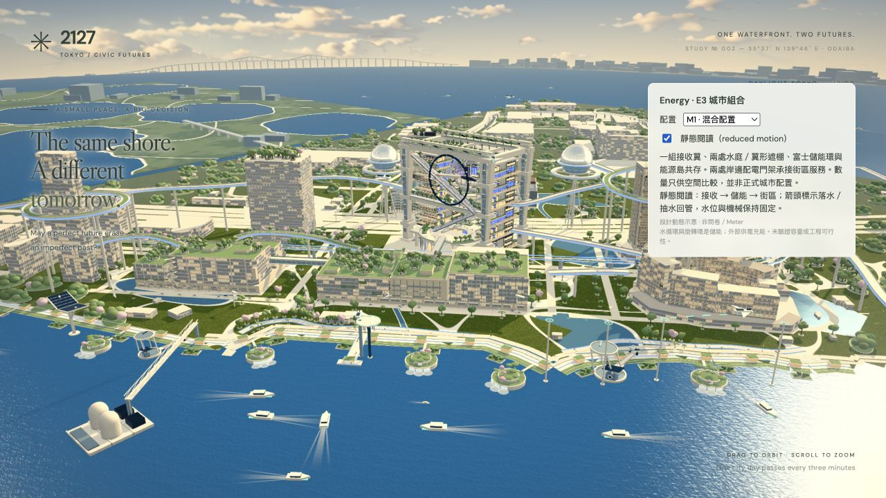

# E4模型接口準備（2026-10-24）

**這不是E4正式接入驗收。** Q3是否替換及保留氣候狀態的產品決定仍待確認；[方案](../../docs/ENERGY_CITY_PLAN.md#e4評審草案四題與能源權威配置2026-10-24待產品決定)／[交接](../../docs/handoffs/energy-city.md)。

- Base：`b8bccad9275283fd5aa3a19a1c0d37602345cc95`＋本分支模型接口改動；source hashes見`source-hashes.txt`。Node26.0.0，macOS Codex in-app Chromium／WebGL2，1280×720，預設quality，原hero。
- Root完整npm test（含實際loopback HTTP／WebSocket及81組原四題）、build、whitespace PASS。36種獨立配置確認水庭數／翼尺寸／環／島及配電條件、目標副本隔離、mesh重用；E3淨空與動態檢查保留。
- Browser：`?energy=mixed&hour=12&reviewTime=50`；原生選單切A、B、C、baseline、mixed，B啟用靜態閱讀後繼續切換。五種輪廓、文字及visibility一致；[console](console.json) warn／error為空。未錄完整network trace；沒有改OS reduced-motion。
- [混合配置靜態閱讀截圖](model-preparation.png)於上述DEV流程取得，只驗證拆出configure接口後原預設仍正常；沒有用DEV圖證明正式問卷接入。
- 正式Q3／權威state／CityView／migration／新舊歷史／retry／single-A/B新能源流程尚未實作或驗收；沒有FPS／硬件／Safari／iPad／Windows／訪客理解測量。

