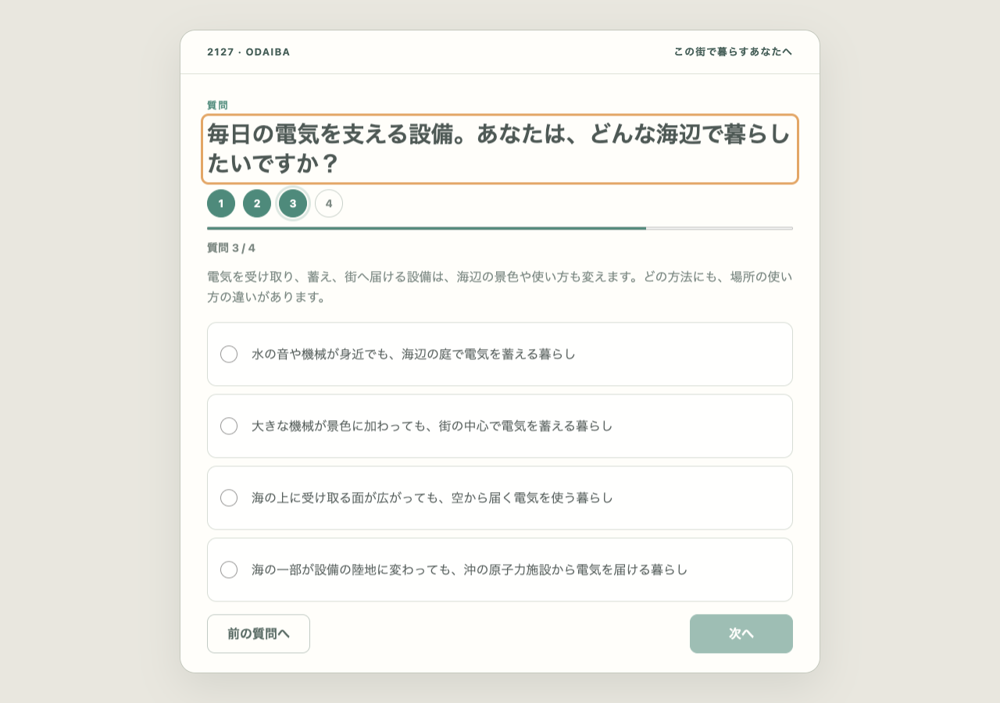
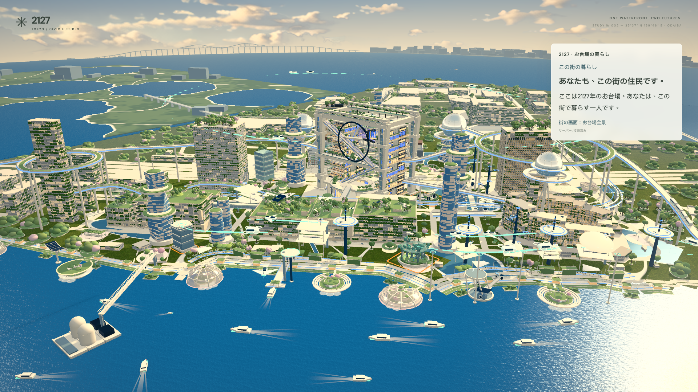

# E4正式問卷與權威配置證據 — 2026-10-24

這裡使用正式question-set4、真實scratch SQLite／HTTP／WebSocket及`?survey`；沒有使用DEV `?energy`代替接入驗收。[規則](../../../docs/ENERGY_CITY_PLAN.md#e4正式接入2026-10-24)／[實際commit與整合狀態](../../../docs/handoffs/energy-city.md)。

- macOS開發機，已安裝的Chrome **156.0.8078.47** headless／WebGL2；City1920×1080、預設quality、原hero；Guest1280×900，DPR1。Hour12／18.5／22；actor用實時本機clock，沒有固定reviewTime或另記每張圖的精確actor秒數。GPU／FPS、實際展覽硬件、Safari／iPad／Windows及訪客理解未測。
- [browser.json](browser.json)保存實際exceptions、console與network紀錄。Page exceptions為0；預期舊session409、favicon404及兩次刻意中止proposal請求分開列出；核對沒有其他失敗。Browser reduced-motion為模擬偏好，沒有改OS全域設定。
- 由含一份已保存v3氣候回答及舊草稿的schema7檔案開始，實際升至8。原文／舊已提交ID可恢復；Q1／Q2／Q4選項保留，舊Q3不自動選能源。第一份能源回答沒有設施差異，第二份才顯示一庭；pre/post-commit失去回應都以同ID重試，只累計一次。實際Undo移除水庭，reconnect／reset恢復權威狀態。
- 混合圖由**16份有效能源提案，四類各4票**產出（另有1份舊氣候提案）；server給一庭、小翼、儲能環、能源島。使用真實提交與最新snapshot，非DEV M1預設。Fixture以11s跳過舊閱讀，以16s跳過Undo／seed等待；這些不是訪客閱讀時間測量。
- 約2.6秒旅程及3秒局部淡入保留；模型檢查確認能源橋／公共路保持原高度，幾何與材質資源不逐幀建立。第一次無可見變化、第二次實際結果、Undo、日暮夜、TCP重連、reduced motion、1440×900普通resize、reset與舊ID重試全部通過。

| 正式證據 | 圖像 |
| --- | --- |
| 新Q3，四個native radio，舊氣候選項不自動帶入 | [Q3](q3-current.png)／[核對](review-current.png) |
| 繼承的舊氣候城市／首票配置維持 | [繼承](inherited-climate.png)／[無設備差異結果](recorded-no-change.png) |
| 第二票，實際一庭；結果句出現時仍在過渡，另留settled圖 | [live結果](live-one-garden-result.png)／[完整一庭](one-garden-settled.png) |
| Undo後回前一配置 | [Undo](undo-restored.png) |
| 真實累計混合配置，同hero日／暮／夜 | [12:00](mixed-12.png)／[18:30](mixed-18.5.png)／[22:00](mixed-22.png) |
| Browser reduced-motion／reset | [靜態閱讀](mixed-reduced-motion.png)／[reset](reset-baseline.png) |

現行來源SHA-256記錄在`source-hashes.json`；verified／integrated commits及main CI以handoff為準。上層原`model-preparation.png`是前輪接口準備歷史，不作正式驗收。P3／P4／P2居民回歸全部PASS，保存在相鄰資料夾；P3實測A/B閱讀間隔10,002ms。能源與程序district／fallback focal的324個band／seed／翼尺寸組合、164,088次實際幾何及全周掃掠檢查亦PASS；未窮盡late roofs／GLB／任意seed或連續全城碰撞。實際commit結果見handoff；E5仍另留後續。
