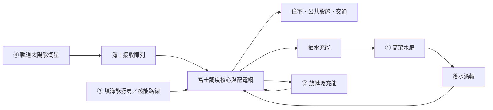

# 台場2127 — 能源城市計劃

2026-10-24。Owner：Codex；產品決策：cc100053。狀態：**E1–E3完成；E4配置接口與評審草案進行中，待Q3產品決定；E5硬件驗收未開始**。

本文件記錄使用者要求的能源篇規劃、E1概念、E2靜態空間比較及E3城市組合／動態。候選方案不等於已核准的模型、問卷或計分變更；現行行為以 [EXHIBITION_SPEC](EXHIBITION_SPEC.md) 為準，實際驗證見 [任務交接](handoffs/energy-city.md)。

## 目標與範圍

透過能源的收集、儲存、分配與使用，讓整座台場有更多可辨識的未來形態；離開富士電視台，街區仍能讀到相同系統。延續 [CITY MASTER TASTE](ODAIBA_2127_REFERENCES/CITY_MASTER_TASTE.md) 的百年演化、可理解工程、海陸共同運作、克制外觀及居民尺度。

四個研究領域先作企劃分類，逐篇提出可混合的城市變化：

| 領域 | 研究問題 | 本輪範圍 |
| --- | --- | --- |
| 建築・居住 | 建物や都市空間はどう変わる？ | 後續；能源設施如何進入建築，先記錄接口 |
| 交通・物流 | 人や物の移動はどう変わる？ | 後續；保留既有航路、泊位與步行通道 |
| 環境・エネルギー | 都市の資源や環境への対応はどう変わる？ | **先做能源子題**；不代表資源、水質、生態等已研究完成 |
| 社会・生活 | 人々の暮らしや社会の仕組みはどう変わる？ | 後續；先描述能源選擇的日常影響 |

此分類尚未取代現有四題／四個Meter。每位居民仍交一份四題提案、繼承累積城市；E1–E3不改問卷、歷史答案、資料庫、演算法或全城天空氣氛。E4候選改動見文末評審草案，尚未接入。

## 分階段計劃

| 步驟 | 工作與交付 | 完成條件 | 狀態 |
| --- | --- | --- | --- |
| **E1：系統與形態定義** | 四個原始構想對照、能源流程、三種城市方向及混合範例、居民選擇草案、現況衝突與模組對照 | 四個構想都有角色；每個方向有地標／街區／生活差異；分清現況、提案與未驗證項目 | **已完成，見下文** |
| E2：同鏡頭空間原型 | 在root現有DEV review機制旁建立可隔離的靜態比較原型；先做一組接收翼、一組水庭、一組外置旋轉環、一組能源島量體 | 原始hero鏡頭可比較基準及三種方向；日景可辨識；有實際佔地／淨空檢查；不覆寫正式問卷 | **已完成，含M1靜態混合；見下文** |
| E3：城市組合與動態 | 擴展環／翼／水層到少量街區；做至少一個混合配置；加入有因果的緩慢機械／水流動作 | 差異來自輪廓與空間分布；不是只換色或加光；混合狀態完整；reduced motion可靜態閱讀 | **已完成DEV實作與桌面驗證，見下文** |
| E4：居民提案與權威配置 | 與其他三領域協調四題方向，定義答案→累積狀態→實際配置→結果卡；決定是否沿用或修訂現有軸 | 明確定義可共存／互斥項、歷史相容性、無可見改變文案；不能直接把A/B/C塞成現有環境軸low/mixed/high | **配置接口／方案已準備，Q3方向待確認；尚未正式接入** |
| E5：驗證與整合 | 測試、build、瀏覽器與日夜比較、實際硬件性能、文件同步；完成當階段後按Git流程整合 | [VALIDATION](VALIDATION.md) 適用檢查通過；未測項與視覺目標差距獨立列出 | 未開始 |

各實作階段都要先跑適用檢查及更新交接，不能延至E5才驗證。E2完成靜態比較，E3完成少量街區擴展／動態及本輪驗證；E4才處理問卷串接。

## E1成果：四個原始構想與整合角色

| 構想 | 保留的想像 | 本計劃的角色 | 在城市中可見的證據 |
| --- | --- | --- | --- |
| ① 吸水後強力噴出，觀光兼能源 | 水本身成為觀光地標與大型機械景觀 | **海の蓄電庭園**：用外部電力抽水至高處；放水通過渦輪回收部分能量。噴泉／可見瀑布是景觀支路，不把水反覆噴射描述成淨能源來源 | 上下水庭、可辨識落差、回水路徑、渦輪室；步道看得到水庫與機械的關係 |
| ② 電視消失，富士球體像倉鼠輪旋轉發電 | 熟悉地標變成巨大、帶幽默感的旋轉機械 | **回転する都市電池**：先探索球體外置的旋轉儲能環；充電驅動、釋放時供電。旋轉不憑空生電 | 固定核心與旋轉外環分離；公共動線不跟著旋轉；居民能觀察運轉 |
| ③ 填海建核電站，聯想到3・11 | 能源便利與海岸佔用／歷史記憶之間的不安 | **エネルギーのために増える陸地**：核能設施作獨立供電路線，填海與基礎設施擴張成為空間代價 | 分段填海岸線、能源設施量體、檢修區及連接橋；不以煙霧顏色暗示輻射，不預設重演事故 |
| ④ 衛星持續向富士輸送宇宙能源 | 台場成為連接宇宙與日常生活的入口 | **軌道エネルギー港**：採宇宙太陽能作推演基礎；海上接收陣列收能，富士作可見調度核心；接收面積未有工程驗證 | 海上展開的接收翼、固定核心、連到街區的配電構造；光束只可作示意，不能冒充真實微波可見性 |

「電視全滅」屬②的候選世界觀，不是已核准背景。現行富士為媒體總部及球體劇場；本輪先採可附加的外環方案，保留原構想的完全轉用版本供後續比較，未刪除媒體用途。

### 一套可以理解的能源流程

①②④可組成同一系統，③可獨立或成為混合供電來源。圖中儲能回路有損耗，不表示永動或自給率；未計算MW、容量、供電戶數或環境效益。亦不把核能與軌道能源排成道德高低或科技年代。

### 三種成熟城市方向

A／B／C是形態比較標籤，並非現有Meter bands，也不是三選一已定案的問卷。

| 方向 | 地標與遠景 | 街區形態 | 居民生活與取捨 |
| --- | --- | --- | --- |
| **A 海と暮らす** | 多個低至中層水環，海面空隙連續；能源來源仍可含軌道輸入 | 分散水庭、短水橋、局部接收翼；能源設施與公共空間交錯 | 屋企附近接觸水聲與機械；更多日常接觸，也佔用較多分散公共空間 |
| **B 空とつながる** | 少量大型海上接收翼，富士外環成為動態中心 | 集中接收／儲能，透過配電連接向街區伸展；其餘屋頂保留公共用途 | 地面可留較連續空間；大型共用設施主導景觀與服務組織 |
| **C 陸地を増やす** | 有明確邊界的外擴能源島與長連橋，原岸線仍可辨識 | 集中能源設施與檢修空間；市內以配電節點與少量儲能為主 | 能源設施較遠離日常步道，但海灣使用與城市邊界明顯改變；穩定供電是設定訴求，未有可靠度證明 |

**混合範例M1**：保留一個共用海上接收陣列；兩處街區水庭承擔可見儲能／公共空間；富士外環呈現充放電；遠景保留一段能源島。呢個例子用來檢查四個構想能否同時讀懂，不是正式設施數量或預設配置。

### 空間分工與圖案語言

以下是相對位置研究，未經量度、碰撞或鏡頭投影驗證，不能直接當施工座標。

| 空間 | E2候選操作 | 必須保留的關係 |
| --- | --- | --- |
| 富士核心 | 在球體外探索一組獨立支承旋轉環；核心只表達調度，不假設小球體能接收全城電力 | 劇場、工作翼、中央大空隙、既有球體泊位及公共轉乘 |
| 海浜公園側／沿岸 | 試一組上下水庭及回水路徑；接到可辨識公共入口 | 環境focal site、promenade、潮汐邊緣；不直接覆寫現有冷卻／植栽配置 |
| 六座water rooms附近 | 先研究相鄰或共享結構的能源層；不把六座全部改成電廠 | 六座數量、均勻分布、私密／共享用途、連岸步道、船道 |
| Aqua City／DECKS與街區屋頂 | 試少量翼形／環形設備，使系統在地標以外仍可閱讀 | 既有屋頂居民、遮蔭、已發布roof carriers與行走空間 |
| 外海 | 比較接收陣列與填海能源島輪廓；畫清新增邊界 | 有明岸線／連橋、遠景層次、船路、空中航路與hero視線 |

三種語言共同使用現有象牙結構、金屬、玻璃及海水材質角色：

- **環**：地標旋轉機械 → 街區儲能框架 → 公共水庭邊界；尺寸與用途改變，不把富士球體複製到每棟樓。
- **翼**：海上接收面 → 屋頂設備 → 與公共遮蔭整合的構造；遮蔭翼只有具備對應設備才稱接收器。
- **水層**：上水庫 → 可見落差／機械 → 下水庭；閉合回水關係，避免裝飾瀑布冒充發電證據。

輪廓、支承、用途與空間分布先成立；夜間發光只補充運作可讀性。衛星可在敘事圖解出現，不要求在hero天空放大到不合理比例。

### 居民選擇草案

候選問題：**「毎日の電気を支える設備と、どんな距離で暮らしたいですか？」**

| 候選回答 | 城市應回應的生活偏好 | 日後結果卡的證據要求 |
| --- | --- | --- |
| 水辺や家の近くで、エネルギーの仕組みに触れたい。 | 接近、分散、與公共空間共同使用 | 實際水庭位置／公共接點由前到後如何改變 |
| 街の拠点にまとめて、身近な空間を広く使いたい。 | 集中共用，附近少放設備 | 實際集中設施與釋放／重配的街區位置；不可只憑答案聲稱空間變大 |
| 海の先に設備を集め、街の電力を支えたい。 | 接受外海能源用地以支撐城市 | 實際能源島邊界／連橋／街區配電配置；不可推論核能必然是唯一答案 |

這題探索「與設施的生活距離」，未同時衡量能源種類、風險承擔或土地政策。E4需與其餘領域一起決定問題能否表達所需取捨；不將上述三個回答直接配成−1／0／+1。居民只貢獻累積偏好，結果卡仍須以實際前後配置說明，與 [變化說明卡任務](handoffs/change-explanation.md) 對齊。

候選背景文案：

> 2127年のお台場では、エネルギーが街の風景になっている。空から届く電力、回転する球体、海へ流れ落ちる水。その組み合わせが、住民の暮らしと海岸のかたちを変えていく。

## 現況對照與後續改動範圍

核對基準：`1bbffeababd32f8ecc5642c1082a05ac558b6a2c`。CodeGraph在原checkout查閱富士核心、載入及海上空間位置／呼叫關係，其餘責任對照PROJECT；下列檔案與該基準無差異。以下是可重用位置，不代表已接入能源功能。

| 現有模組／路徑 | 可重用的責任與後續影響 |
| --- | --- |
| [civicCore.ts](../src/civicCore.ts)、[odaibaScene.ts](../src/odaibaScene.ts) | 程序富士核心／載入及occupants發布；外環需另留可動部分，不能隨靜態幾何烘焙，也不能帶動既有人物／劇場 |
| [waterRooms.ts](../src/waterRooms.ts)、[skyways.ts](../src/skyways.ts) | `shoreRoomBays()`共用六座海上空間位置，且查船路；skyways與district共用這些位置，不能單邊另算新位置 |
| [amphibiousShore.ts](../src/amphibiousShore.ts)、[layout.ts](../src/layout.ts)、[mobility.ts](../src/mobility.ts) | 潮汐邊緣、城市邊界、步道與海空航路；新設施須以實際幾何檢查通道與泊位淨空 |
| [cityRig.ts](../src/cityRig.ts)、[coastalCanopy.ts](../src/coastalCanopy.ts) | 共享工廠／材質、現有屋頂平台；優先重用，重複構件用instancing，不新增資產套件或逐幀建立幾何 |
| [districtMeters.ts](../src/districtMeters.ts)、[cityChangeManager.ts](../src/cityChangeManager.ts)、[createCityChangeManager.ts](../src/createCityChangeManager.ts) | 既有carrier、配對、seed及前後變化證據；E2先隔離比較，E4才決定能源targets，保留3秒retarget及立即恢復契約 |
| [cityView.ts](../survey/src/shared/cityView.ts)、[scoreEngine.ts](../survey/src/survey/scoreEngine.ts)、[正式四題](../survey/src/survey/questions.exhibition.json) | server權威配置／累積演算法／問題；目前沒有能源種類分配契約，不能在renderer私下由環境分數重解讀 |
| [surveyAtmosphere.ts](../src/surveyAtmosphere.ts) | 大屏幕設施及結果卡；只能描述畫面實際配置；文案接入時同步[RESIDENT_COPY](RESIDENT_COPY.md) |

後續檢查範圍：root的[odaiba幾何檢查](../tests/odaiba.test.ts)、[district carriers](../tests/districtMeters.test.ts)、[結果卡](../tests/surveyAtmosphere.test.ts)，以及root／survey真實HTTP/WebSocket pipeline。E4若改shared state／問題，需補survey狀態、replay、舊答案與相容性檢查；`module-swap/`仍是legacy v1，不加入能源功能。

## E1驗收與下一步

- [x] 四個原始構想均保留；明確區分來源、儲能與供電分配。
- [x] 三種方向及一個混合範例都有地標、街區與生活層次。
- [x] 有離開富士核心仍成立的環／翼／水層語言。
- [x] 標明媒體劇場、六座water rooms、四題／Meter語義等既有約束。
- [x] 列出模組、受影響的呼叫關係、資料契約與後續驗證範圍。
- [x] E2實際座標、幾何淨空、公共通行及同鏡頭靜態比較；詳見下文及交接，並非工程／硬件驗收。
- [x] E3少量街區組合、混合配置、慢速因果動態與靜態閱讀；詳見下文限制。
- [ ] E4正式問卷及計分映射、E5硬件驗證。

下一步：E4協調正式問卷／權威配置；本輪只完成E3，不更改四題／Meter。

## E2成果：隔離的靜態空間比較（2026-10-24）

Root Vite DEV 開 `?energy=baseline&hour=12&reviewTime=20`，右上選單切換基準、A、B、C、M1；原hero鏡頭、光照與actor time不變。`energy`只在沒有`survey`、`meters`、`scaleLab`時啟動，production build移除整個動態import。沒有新增dependency或修改survey／module-swap。

| 量體 | 實際位置與空間關係 | 可讀證據 |
| --- | --- | --- |
| 接收翼 | 基座`(125,0,-424)`，分叉桅杆支承一對折翼；A為0.65倍，B／M1完整尺寸 | 接收面位於海面上方，留出六座water rooms與連岸路；水下服務線不畫成能源光束 |
| 上下水庭 | 下庭中心`(-310,0,-151)`、半徑14 m；上庭中心`(-302,23,-151)`、半徑12 m | 落水管連渦輪室／轉子，獨立抽水回管回到上庭；分叉支承、下庭公共看台及4 m連岸緩坡。水面是靜態材質，不模擬流量 |
| 富士前置外環 | 中心`(-18,100,-24)`、半徑31 m；固定軸承掛到現有前方transfer frame，rotor獨立batch | 最初水平環在hero不清楚，貼近立環又碰到斜向公共路線；最後向海側移出，避開劇場／工作翼／斜街與頂部泊位。它是前置附加設備，並非把劇場本體旋轉 |
| 能源島 | 中心`(-60,0,-470)`、三段40 m寬caissons，兩個封閉核能路線候選量體、檢修區 | 新岸界、原岸線與中間海水清楚分開；18 m高跨水桁橋接`(20,18,-352)`，兩端檢修升降井；橋下保留船道。沒有事故／輻射特效 |

A＝水庭＋小翼；B＝完整翼＋富士環；C＝能源島＋檢修橋；M1＝四組共存。A/B/C沒有改成環境Meter的low/mixed/high；M1在E2先做靜態共存檢查，E3的城市擴展與動態仍未開始。

實作：[energyPrototype](../src/energyPrototype.ts)只建立一次量體／共享材質batch，切換只改visibility與翼scale；[devEnergy](../src/devEnergy.ts)提供DEV選單及可重開URL；[幾何檢查](../tests/energyPrototype.test.ts)加入root npm test。四組共19個材質batch；rotor保留獨立群組。

驗證：[五張原hero日景與補充近景](../artifacts/energy-city-e2/README.md)。320秒船隊週期每0.5秒檢查全部可見船體的保守包圍盒（21,595個），另檢查22 m航空走廊、兩種泊位、公共路、六座rooms／連岸路、beacons、真實tidal-edge上的新水庭步道、四站hero視線及原hero畫框；前置rotor與實際civicCore網格不相交。這是離散幾何檢查，並非連續碰撞／海岸／結構／電力工程認證。Root test/build與整合結果記錄於[交接](handoffs/energy-city.md)。

已知視覺限度：hero能讀到輪廓與新增岸界，但管線／渦輪細節需近景；環在劇場前方，並非貼殼同心機械；能源島及橋仍是概念量體。E3需在這些實際淨空內進一步設計，不能把E2當成最終美術或工程尺寸。

## E3成果：城市組合與慢速因果動態（2026-10-24）

沿用原DEV隔離及hero framing。A與M1增加DECKS外側第二水庭，中心`(30,0,-395)`、比例0.72；與原`(-310,0,-151)`水庭形成兩處沿岸生活節點，兩庭各有翼形檢修遮棚、落水框管、獨立抽水回管與連岸步道。兩處岸邊環／翼配電門架在所有非基準方向保留：A以分散水層為主，B以大型接收翼／富士環為主，C以島／橋及低矮配電門架為主；M1完整共存。沒有新增全城球體或佔用六座water rooms。

| 循環時間 | 因果閱讀 | 實際動作 |
| --- | --- | --- |
| 0–20秒：充能 | 接收／外部供電 → 儲能 | 回管標記上行、上庭水面升／下庭降，環從0.02緩增至0.08 rad/s |
| 20–40秒：暫存 | 保水／維持旋轉 | 水位不變、管內標記隱藏、渦輪停定；環保持0.08 rad/s |
| 40–60秒：釋能／分配 | 落水 → 渦輪 → 沿岸門架／街區 | 落水標記下行、上庭降／下庭升、渦輪平滑轉一周，門架服務軌標記向岸移動，環減至0.02 rad/s |

上述60秒是敘事節拍，並非電力、水量、容量、效率或可靠度模擬。C沒有水庭／環時，配電標記全程運作，不假裝依賴不存在的儲能；核能量體沒有事故特效。水流／服務軌上的小標記是流向示意，不是可見微波或真實電流。地下／水下配電不另畫跨天光束；門架表示服務接點，不聲稱已設計完整電網。

`reviewTime=10|30|50`可固定三階段；所有位置由絕對時間計算，重開可重現，沒有逐幀建立geometry／material。共36個合併／水面mesh及4個flow InstancedMesh；第二水庭共享第一庭geometry／materials。原`devFrame`更新接入，production build移除整個工具。

系統`prefers-reduced-motion`或面板「靜態閱讀」會把本輪能源機械、水位和所有流向標記固定於同一完整示意；永久箭頭、設備及三段流程文字保留，其他既有城市actor沿用原路徑。瀏覽器驗證採面板啟用同一靜態分支，未改OS的全域動態設定。

最初第二庭碰水上轉乘泊位，移位後通過；完整掃掠亦促使固定軸承退到旋轉面後方、外露渦輪提高0.5 m。幾何檢查現在包含富士環全周保守環形掃掠、兩庭渦輪全周圓盤掃掠、兩條步道對真實tidal-edge、既有21,595個船體樣本、公共／航空／泊位與四站hero視線。這不是全城連續碰撞或工程認證。

[實際五配置／日暮夜／動態與靜態比較](../artifacts/energy-city-e3/README.md)與[交接](handoffs/energy-city.md)記錄檢查。Hero可讀兩處水庭、集中環／翼與外擴岸界；小流向／水位及配電細節仍需近景。保留前置環而非貼球殼的限制，能源島仍為候選量體；實測FPS、展覽硬件、Safari／iPad及工程可行性未驗證。E3交付不包含E4權威配置／問卷。

## 參考與推演界線

- [美國能源部：Pumped Storage Hydropower](https://www.energy.gov/cmei/water/pumped-storage-hydropower)：確認上下水庫、抽水充能與落水經渦輪釋能的原理；不驗證本案水庭尺寸或效能。2026-10-24查閱。
- [JAXA：宇宙太陽光発電研究](https://www.ard.jaxa.jp/research/ssps/ssps.html)：宇宙太陽能經微波／雷射傳輸的研究方向；本輪搜尋摘要核對，正文工具讀取逾時。台場接收翼、富士調度核心與2127規模屬設計推演，並無已實現之主張。
- 旋轉環、核能島及公共水庭的形態屬本案候選設計；未驗證結構、電力容量、接收面積、噪音、水質或海岸工程。3・11作歷史記憶與風險配置敘事，不將災難設成獎勵動畫或必然結局。

## E4評審草案：四題與能源權威配置（2026-10-24，待產品決定）

本節是可實作方案，**尚未核准／接入正式問卷**。現行四題及version3保持有效，不能把舊cooling答案當成能源偏好。

### 建議的唯一題目變更

Q1服務（交通／物流的日常服務接口）、Q2共享（社会・生活）、Q4分散／集中（建築・居住）的文字、ids及軸保持不變；這不是宣稱其他三領域研究已完成。只把Q3由夏日涼感改為環境・能源的生活取捨；問題集升至4，使用新id `energy-2127`。

問題：**毎日の電気を支える設備。あなたは、どんな海辺で暮らしたいですか？**

背景：**電気を受け取り、蓄え、街へ届ける設備は、海辺の景色や使い方も変えます。どの方法にも、場所の使い方の違いがあります。**

| 新option id | 選項（日文草案） | 對應可見設備 |
| --- | --- | --- |
| `water-storage` | 水の音や機械が身近でも、海辺の庭で電気を蓄える暮らし | 上下水庭，最多兩處；由外部供電抽水充能 |
| `rotor-storage` | 大きな機械が景色に加わっても、街の中心で電気を蓄える暮らし | 富士前置儲能環；劇場不轉，外部供電充能 |
| `orbital-supply` | 海の上に受け取る面が広がっても、空から届く電気を使う暮らし | 軌道能源接收翼；不宣稱工程已實現 |
| `island-supply` | 海の一部が設備の陸地に変わっても、沖の原子力施設から電気を届ける暮らし | 能源島及檢修橋；不承諾可靠度或災難結局 |

四種選擇是四種生活取捨；其中兩種是儲能，兩種是供電來源，不稱作四種等價發電技術，也不要求城市自給。公共電網／外部供電始終是敘事前提，未畫完整電網。

### 累積、共存與模型

- 能源採**獨立四類累積票數**，不加入既有environmentalPriority的−1／0／+1刻度，不把A／B／C當bands。每份新提案只給所選能源類別一票；同ID重試不重計，Undo從active history排除，reset開新累積。
- 候選門檻：每類至少兩票，且 `該類票數 / (能源提案數 + 4) ≥ 0.2` 才出現。水庭在比例≥0.4時兩處，否則一處；接收翼在比例≥0.4時大翼，否則小翼；環及島各最多一組。四個虛擬基準席位只是克制第一票跳變的展示門檻，不是未記錄的居民。比例不代表容量／供電比。
- 共存：水庭、環、接收翼、島可以任意組合；小／大翼互斥、同一水庭位置的有／無互斥。任一設備出現就顯示兩處沿岸配電門架；沒有儲能時配電持續，儲能組合維持60秒示意循環。
- 例：第一票水庭→仍維持既有配置；第二票水庭→一處庭；第三票水庭→兩庭。水／環／翼／島各四票（16份）→四類各0.2，共存一庭、小翼、環、島。此門檻只是假設，正式接入前須確認。
- Server由完整active能源歷史產出版本化配置（水庭數、翼尺寸、環／島開關）；root只套用配置。A／B／C／M1繼續作DEV比較預設，不成為正式enum。

### 歷史與結果契約

- 舊cooling原文、effects、scores、proposal before/after、重試及replay保留。舊答案對能源累積為「未回答」，不是零票偏好或反對票。
- **需要產品確認的取捨：新Q3不再更新夏日氣候偏好。** 保留舊氣候軸及其舊提案計算；新能源提案對氣候為缺席，不以中性0票稀釋舊記憶，也不因其他三軸人數增加而拉伸氣候。氣候配置由最後有效舊氣候狀態及舊氣候回答人數決定；新run沒有舊氣候回答時維持目前D=0的成熟混合氣候。
- 新版server需明確保存／重播缺席、各軸回答數與能源票；不在renderer修補。資料庫migration保留原資料；新舊草稿走既有version guard／重新預約流程，提交成功的舊ID仍先回原紀錄。
- 前後證據比較實際能源數量／翼尺寸／可見開關，與其他三軸既有carrier evidence合併；時間循環／seed／票數本身不算設施改變。各設備卡只描述實際存在設備。
- 有改變：**ほかの住民の声と重なり、海辺の蓄電庭園が一か所加わりました。**（依實際設備／位置替換；不由本人的選項推論共同結果。）
- 票數改變但配置維持：**あなたの思いが、住民の声に加わりました。街のエネルギー設備は、今の配置を受け継いでいます。** 無前後證據沿用保守保存確認。
- 保留single／A-B排序、10秒閱讀、約2.6秒旅程＋3秒retarget、snapshot／Undo／reset／reconnect及reduced-motion立即恢復。module-swap保留legacy v1並拒絕v2。

**待決問題：是否接受「只替換Q3、其餘三題不變、氣候停止收新票並保留既有狀態、能源獨立四類累積」？** 若必須繼續讓居民回答夏日氣候偏好，就需要另定四題取捨，不能私自以相同答案同時推論能源來源。
