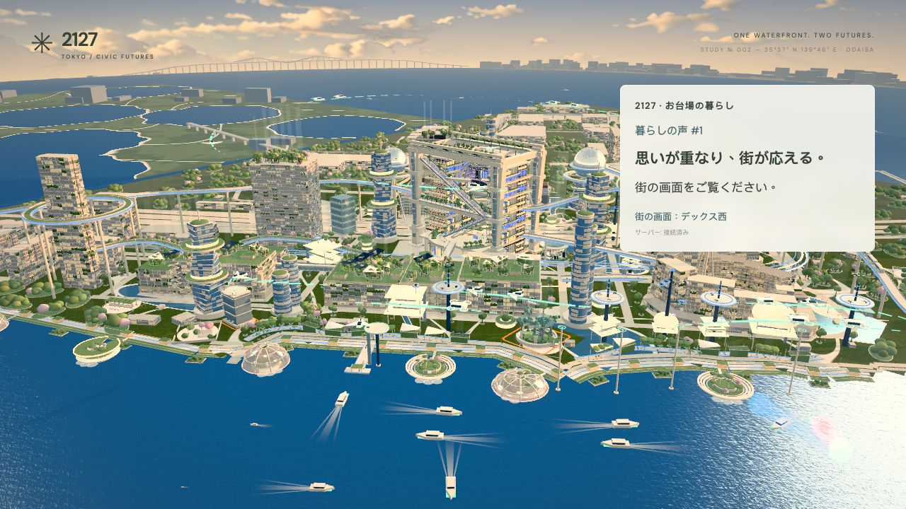
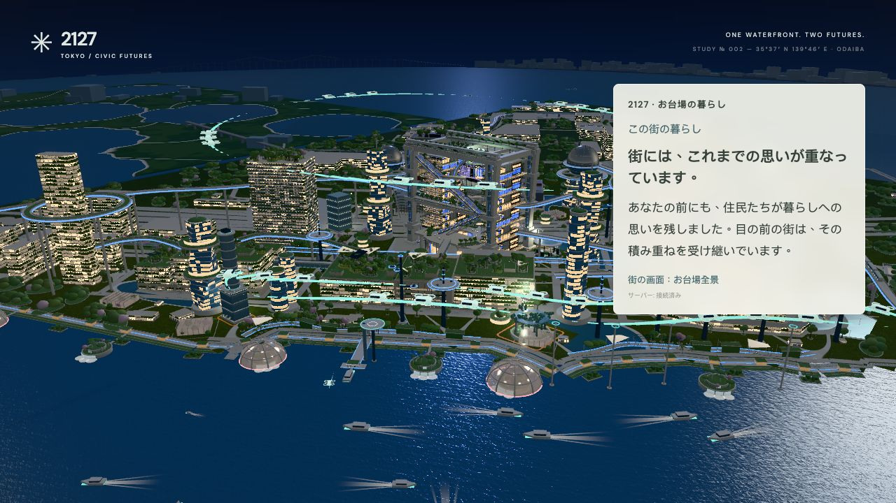
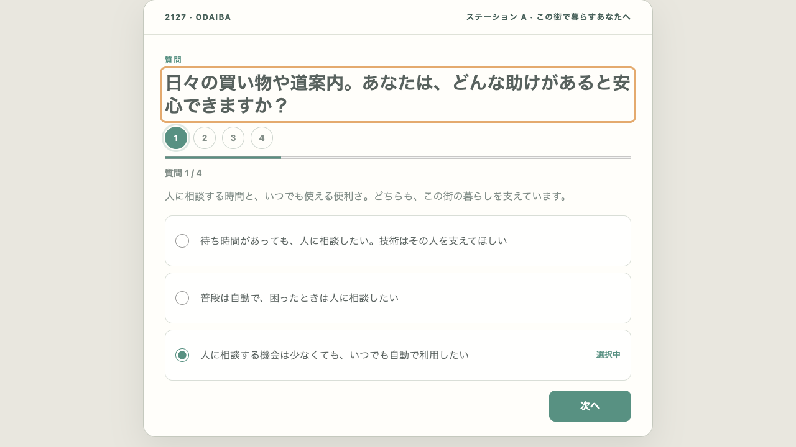
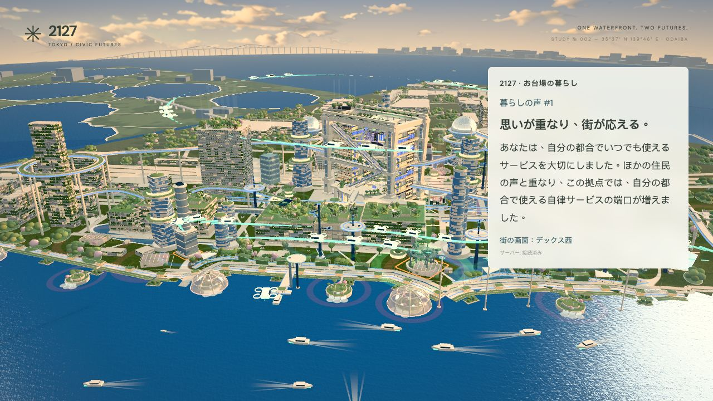
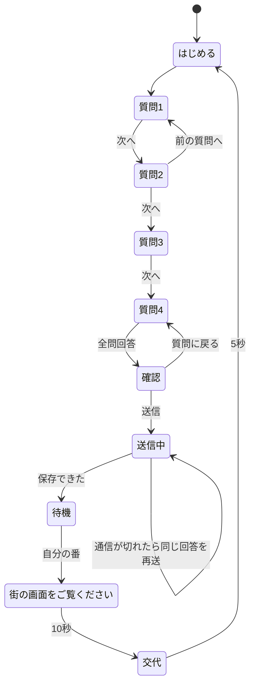
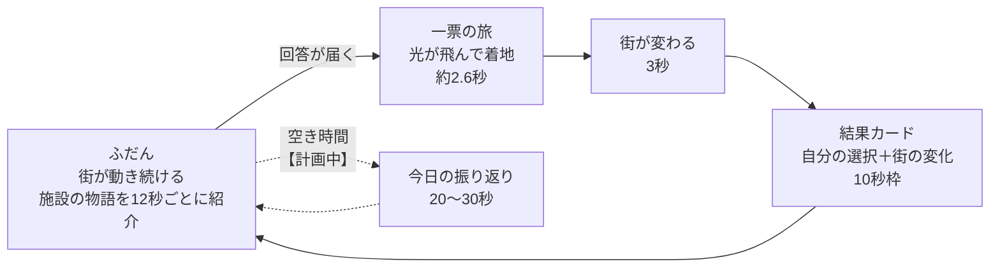
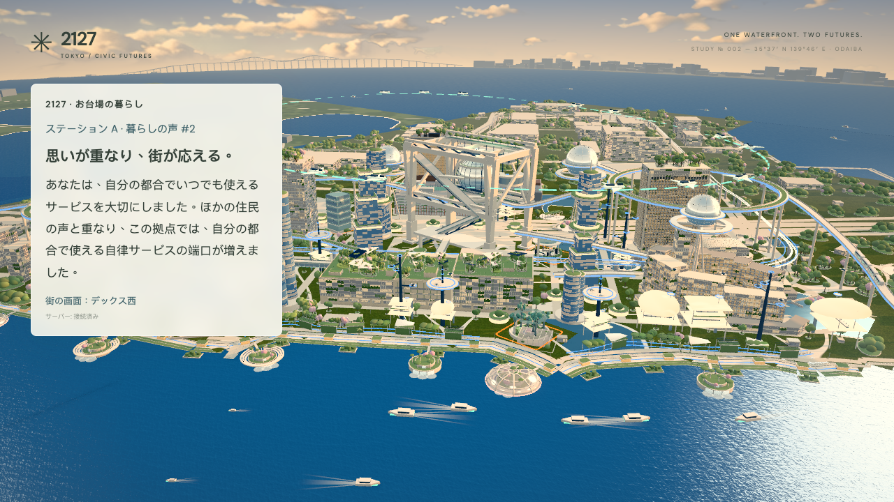
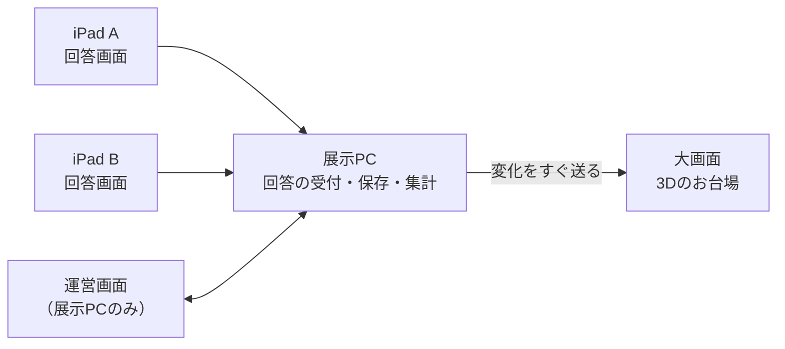

# Mind craft― 選択の積み重ねから生まれる、100年後の都市 ―（みんなの選択をひとつずつ紡ぎ、その積み重ねを街の変化として映し出す参加型未来都市。）

**未来創造展 企画書 v0.3（作成中・Markdown版）**

- 作成：2026-10-15／前版：初版 v0.1（10/5）、提案版 v0.2（10/8）
- 想定読者：先生・審査の方・他班のメンバー（専門知識は不要です）
- 状態ラベル：**【動く】** いまPC上で実際に動かせる／**【計画中】** 作り方まで決めてある／**【検討中】** 方向は出ていて、これから決める
- 技術の詳細は GitHub 内の [展示仕様](EXHIBITION_SPEC.md) にあります。本書では「何を、なぜ、どう体験してもらうか」を説明します。

---

## 0. 一枚でわかる要約

> **来場者は「2127年のお台場に暮らす住民」になり、日々の暮らしについていくつかの問いに答えます。答えは大画面の3D都市に積み重なり、街の姿が少しずつ変わります。次の来場者は、その街を受け継いで答えます。**

| 見どころ | 内容 |
| --- | --- |
| **共感できる問い** | 「暑い夏はどんな涼しさがいい？」など、誰でも自分ごととして答えられる日常の問いです。正解はありません。 |
| **大きなスケール** | 舞台は約720m×680mのお台場の街区全体です。高層の建物、海の上の船、3層の空の航路、歩く人々が、100年後の都市として動き続けます。 |
| **動く街** | 回答が届くと、光が街へ飛んで着地し、3秒かけて建物や広場が組み変わります。この仕組みは**【動く】**状態で、PCで実演できます。 |

体験時間の目安は1人あたり約2〜3分です（回答、街の変化を見る10秒、交代5秒）。回答時間はまだ実測していません。

---

## 1. なぜこの作品をつくるのか

「100年後の街は、誰が決めるのでしょうか。」

これまで街のかたちは、行政や大企業によって決められてきました。そこに住む住民が決めることは、ほとんどありませんでした。もし100年後の未来を住民が決めるとしたら、街はどうなるのでしょうか。この作品をきっかけに、その可能性を考えてみたいと思います。

未来都市の展示というと、完成した未来の姿を**見る**ものが多くあります。けれども実際の街は、一人の設計者が描いた絵ではありません。そこに暮らす大勢の人の「こう暮らしたい」が重なり合い、少しずつ形になっていくものです。

この作品では、その「重なり合い」を数分で体験できるようにします。来場者が自分の望む暮らしを選ぶと、その選択がほかの人の選択と混ざって街の形になります。自分の思い通りにはならないかもしれません。それでも、自分の声が確かに街の一部になっている。その感覚を持ち帰ってもらうことが、この作品の目的です。

体験を通して、来場者に次の3つを感じてもらいたいと考えています。

1. **自分なら**、未来の街でどう暮らしたいか。
2. **ほかの人は**、どんな未来を望んでいるのか。
3. **違う望みが重なる**と、街はどんな形になるのか。

→ そのために、来場者には「見学者」ではなく「住民」になってもらいます。

---

## 2. コンセプト：3つの柱

### 柱1　あなたは、この街の住民の一人

来場者は計画者でも審査員でもなく、**2127年のお台場に暮らす一人の住民**です。答えるのは「この街をどう設計するか」ではなく、「毎日をどう過ごしたいか」です。一人の答えで街が決まることはありません。たくさんの住民の声のひとつとして、街に重なっていきます。

### 柱2　正解のない未来

どの選択肢も、2127年に成り立つ**成熟した暮らし方**として描きます。たとえば「人に相談できるサービス」は遅れた街ではなく、「自動のサービス」は冷たい街ではありません。「その中間」も、どっちつかずではなく、両方を取り入れた独自の暮らし方です。来場者が「間違えた」と感じないことを大切にしています。

### 柱3　積み重なり、受け継がれる街

回答はその場限りのアンケートでは終わりません。街に保存され、次の来場者がその街を受け継ぎます。会期を通して、来場者全員で一つの未来都市を育てていきます。

### 発表の評価軸との対応

| 評価軸 | この作品での答え |
| --- | --- |
| コンセプト | 「あなたの選択が、次の人の暮らす街になる。」 |
| 動くもの | 3D都市が回答に応じて実際に変化します【動く】 |
| スケールの大きさ | 街区全体、100年後、来場者全員の声 |
| 誰もが共感できること | 買い物、休憩、夏の暑さ、用事の済ませ方といった日常の問い |

→ では、その住民たちが暮らすのはどんな街なのでしょうか。

---

## 3. 舞台：2127年のお台場

### なぜお台場か

- **人がつくった土地。** お台場は海を埋め立ててつくられた街です。「人の選択が土地そのものを形づくる」というこの作品のテーマと、最初から重なっています。
- **未来の象徴。** 臨海副都心として「未来の街」を掲げてきた場所で、多くの人がイメージを持っています。
- **記憶を受け継ぐ街。** 2127年の街には、フジテレビの骨組みや球体が、街をつなぐ構造としてそのまま受け継がれています。

*大画面の例。右上のカードに住民の声の番号と案内が出ます。*

### スケール感（すべて現在動いている内容です【動く】）

- 約720m×680mのお台場の中心街区。アクアシティ、デックス、ダイバーシティ、ヒルトン、日航ホテルなどの地標と、2127年の姿になったフジテレビ。
- 空には3層の航路（地域間160〜170m／街の航路80〜100m／サービス用ドローン30〜45m）、海には船、街には歩く人、自動運転のポッド、ゆりかもめが走ります。
- 3分で1日が巡り、朝・昼・夕・夜と街の光が変わります。夜は建物や人の明かりが灯ります。

→ この街で、来場者は実際に何をするのでしょうか。

---

## 4. 体験の物語（来場者の目線で）

ある来場者の数分間を、順番に追ってみます。

**① 大画面に気づく。** 展示の前に来ると、大画面には動き続ける2127年のお台場が映っています。右上のカードが「あなたも、この街の住民です。」と語りかけます。

**② iPadで答える。** 手元のiPadで「はじめる」を押すと、日常についての問いが1問ずつ出ます。どの問いにも短い背景の一文がついていて、どちらの選択肢にも良さがあることが分かります。

**③ 確かめて、送る。** 全部答えたら、自分の答えを一覧で確認してから送信します。問いに答えるたびに街が変わるのではなく、**全部の答えを「一つの暮らしの提案」として**届けます。

**④ 一票が街へ飛ぶ。** 大画面を見上げると、自分の答えが色のついた光になって画面の端から飛び立ち、街のそれぞれの場所に着地します（約2.6秒）。

**⑤ 街が応える。** 着地した場所から、3秒かけて建物や広場が組み変わります。実際に変わった場所だけが光って示されます。

**⑥ 結果を読む（10秒）。** カードに「あなたは○○を大切にしました。ほかの住民の声と重なり、この場所では△△が増えました。」と表示されます。前半は**自分の選択**、後半は**みんなの声で街がどうなったか**を伝えます。

**⑦ 次の人へ（5秒）。** iPadは自動で最初の画面に戻り、次の来場者が、いま変わったばかりの街を受け継いで答え始めます。来場者が去ったあとも、その人の光の点は街の上空に残ります（直近64人分）。

→ この流れを支えている画面は3種類です。

---

## 5. 画面と画面遷移

### 3つの画面の役割

| 画面 | どこで見るか | 役割 |
| --- | --- | --- |
| **回答画面（Guest）** | 来場者の手元のiPad（2台） | 問い・選択・確認・送信・「街の画面をご覧ください」の案内 |
| **街の画面（City）** | 会場の大画面 | 3D都市、施設の物語、変化と結果の説明 |
| **運営画面（Admin）** | スタッフのPC | 状況の確認、体験の中断、街のリセット、直前の取り消し、昼夜の切り替え |

### 回答画面の遷移

※ 現行は4問です。問いを増やした場合も、「確認してから一度だけ送る」という流れは変わりません（6章）。

### 街の画面の状態

### 2台同時に答えられる【動く】

iPadは「ステーションA」「ステーションB」の2台を用意し、2人が同時に答えられます。大画面の結果表示は重ならないよう順番に予約され、10秒以上の間隔をあけて1人ずつ見せます。待っている人のiPadには「回答を記録しました。街の画面で順番にご案内しますので、お待ちください。」と表示されます。

→ では、来場者はどんな問いに答えるのでしょうか。

---

## 6. 問いの設計

### 方針

1. **日常の場面で聞く。** 「都市計画をどうするか」ではなく、「買い物」「休憩」「暑い日」「用事」といった誰にでもある場面で聞きます。
2. **正解をつくらない。** 3つの選択肢は、どれも2127年の成熟した暮らしです。
3. **真ん中も一つの暮らし方。** 中間の選択肢は「わからない」ではなく、「両方を取り入れる」という選択です。
4. **答えと街の変化がつながって見える。** 選んだことが、街のどこに、どう表れるのかが目で見て分かる問いにします。

### 「性格診断」ではなく「暮らしの問い」にした理由

提案版v0.2では、性格や思考の傾向を尋ねる「性格診断」型の問い（最大10問）を検討しました。v0.2から引き継ぐのは次の4点です。

- 問いを増やすこと（最大10問）
- 変化が目で見て分かること
- 個人の結果と共有の街を分けて考えること
- 来場者を否定しない中立的な言葉づかい

一方で、問いの**中身**は性格診断ではなく暮らしの問いにします。理由は3つあります。

- **性格を判定すると、来場者に「タイプ」を貼ることになる。** 心理テストのような結果は、根拠のない診断だと受け取られたり、望まない分類をされたと感じられたりするおそれがあります。
- **性格と街の形の関係は、説明しにくい。** 「外向的だから高層ビル」には必然性がありません。「夏は木陰で涼みたい → 木が増える」なら、誰にでも因果が伝わります。
- **コンセプトとずれる。** この作品の来場者は「診断される人」ではなく、「暮らし方を選ぶ住民」です。

### 現行の4問【動く】

各問いは街の「物差し」（7章）の一つと、その変化が一番よく見える場所に対応しています。

| | 問い（iPadに表示される文） | 3つの選択肢の方向 | よく変わる場所 |
| --- | --- | --- | --- |
| Q1 | 日々の買い物や道案内。あなたは、どんな助けがあると安心できますか？ | 人に相談 ↔ 普段は自動、困ったら人 ↔ いつでも自動 | デックス西 |
| Q2 | 海辺で一時間、自由に過ごせるなら。あなたは、どんな場所で休みたいですか？ | 静かな予約席 ↔ 半分ずつ ↔ 誰でも使える海辺 | アクアシティ南 |
| Q3 | 厳しい夏の日、海辺を歩くなら。あなたは、どんな涼しさが心地よいですか？ | 屋根と冷却設備 ↔ 半分ずつ ↔ 木陰と植栽 | お台場海浜公園 |
| Q4 | 買い物や日々の用事。あなたは、どんな街のめぐり方が好きですか？ | 低い建物をめぐる ↔ 混ざった街 ↔ 一つのタワーで | フジテレビ東 |

### 追加の問いの候補【検討中】

チームで作った9つの候補（[question_candidates.md](../question_candidates.md)）です。どれも同じ方針で書かれています。

| 候補 | 場面 | 見ている価値観 | 街での見え方（案） |
| --- | --- | --- | --- |
| 1 | 移動手段の持ち方 | 移動を個人で持つか、分け合うか | 専用ポッドの格納庫 ↔ 共有ポッドの乗り場・船着き場 |
| 2 | 新しい乗り場 | 新しい技術との距離感 | 洗練された車両 ↔ 試作機が並ぶ実験乗り場 |
| 3 | 街の案内サービス | 便利さと個人情報 | （見せ方を検討中） |
| 4 | 住まいの管理 | 人と機械、どちらが判断するか | 住民が操作する共用パネル ↔ 自律ロボット・配送口 |
| 5 | 雨の生かし方 | 設備で制御するか、自然の循環か | 貯水・処理施設 ↔ 雨庭・水路・湿地 |
| 6 | 日用品の手に入れ方 | 回収して作り直すか、直して使うか | 再資源化プラント ↔ 修理工房の通り |
| 7 | 帰り道 | 時間を短くするか、途中を楽しむか | 直結する空中連絡路 ↔ 寄り道を誘う遊歩道 |
| 8 | 通う施設のかたち | 計画して固めるか、変え続けるか | 作り込みの建物 ↔ 組み替わる可変建築 |
| 9 | 海辺の駅 | 機能か、体験か | 機能的な駅 ↔ 展望デッキのある駅 |

### 問いを増やすときの2つの道【検討中】

| | 案A：いまの4つの物差しを深める | 案B：新しい物差しを足す |
| --- | --- | --- |
| 考え方 | 候補1・4・5・7のように、既存の4つの物差しにつながる問いを足す（例：1つの物差しに2問ずつ、計8問） | 候補2・3・6・8・9のように、新しい価値観の軸を足す |
| 街の変化 | 今ある変化の仕組みをそのまま使える | 新しい軸ごとに、街の新しい変化（建物・設備）をつくる必要がある |
| 体験時間 | やや延びる | 延びる |
| 23日までの現実性 | 高い | 低い（変化の制作が必要） |

**提案**：23日の仕様発表は案Aを基本にします。案Bの候補は「今後の拡張」として示します。問いの数（4問／6問／8問／最大10問）は、実際にiPadで回答時間を測ってから決めます。

→ 答えが集まると、街は具体的にどう変わるのでしょうか。

---

## 7. 街はどう変わるのか

### 4つの「物差し」

街には4つの物差し（内部では「メーター」と呼んでいます）があり、それぞれが住民の声の積み重なりで左右に振れます。どちらの端も、2127年の成熟した街の姿です。

| 物差し | 一方の端 | 真ん中 | もう一方の端 | 街で変わるもの |
| --- | --- | --- | --- | --- |
| サービス | 人に相談できる街 | 普段は自動、困ったら人へ | 時間に縛られないサービス | 対面の窓口や自律端末、歩く人やポッドの数、空を飛ぶ機体やドローン |
| 海辺の居場所 | 海辺に、自分の時間を | 静けさと出会いのあいだ | 予約せずに、海辺へ | 海に浮かぶ6つの部屋、中庭、広場の人の集まり方 |
| 夏の涼しさ | 設備がつくる夏の居場所 | 設備と木陰が支え合う道 | 木陰をつないで、海辺を歩く | 日よけの帆、冷却塔、屋上の緑、建物の壁の植栽 |
| 街のめぐり方 | 用事のあいだに、海辺を歩く | 歩く日も、上へ向かう日も | 暮らしを、縦につなぐ | 点在する低い建物、中くらいの建物、タワー、空中ロビーと連絡橋 |

（表の言葉は、大画面のカードに実際に出る見出しです。）

変化は4つの中心地点だけでなく、その周りの街区全体に広がります。物差しどうしの組み合わせで生まれる施設もあります（例：自動化が進み、かつ海辺が開かれていると、それに合った施設が現れる）。

### 声はどう積み重なるのか

街は「最後に答えた人の街」にも「単純な多数決の街」にもならないように作っています。

- **これまで全員の傾向**：今まで答えた全員の平均。街の土台になります。
- **最近の声**：直近の何人かの答え。いま街に来ている人たちの空気を少し強めに反映します。

この2つを足し合わせて、物差しの位置を決めます。そのため、一人の答えで街がひっくり返ることはありません。一方で、同じ方向の声が続けば、街ははっきりと向きを変えます。たとえるなら、**大きな船のかじ**のようなものです。一人が回しても少ししか曲がりませんが、何人かが同じ方向に回すと、船は確かに向きを変えます。

最初の来場者のころは変化を控えめにし、人数が増えるにつれて変化をはっきり見せるように調整しています【動く】。計算式は付録にあります。

→ ただ、一人ひとりの変化は小さくなりがちです。そこで、「みんなの声」を目に見える形にする工夫をしています。

---

## 8. 「みんなの声」を見えるようにする工夫

| 工夫 | 内容 | 状態 |
| --- | --- | --- |
| 一票の旅 | 自分の答えが光になって街へ飛び、着地した場所から街が変わる | 【動く】 |
| 声の光 | 答えた人の光の点が、街の上空に残り続ける（直近64人分。昼は淡く、夜は明るく） | 【動く】 |
| 結果カード | 「自分の選択」と「みんなの声で街に起きた変化」を分けて伝える | 【動く】 |
| 今日の台場の振り返り | 大画面の空き時間に20〜30秒で、朝からの街の移り変わりを早送りで見せる。街の向きが大きく変わった瞬間を3〜4か所選び、「#47 アクアシティ南が、開かれた水辺に。」のように紹介する | 【計画中】 |
| はじめと今の比較 | 開場時の街と今の街を切り替えて見せる。スタッフの説明にも使う | 【検討中】 |
| 個人の街 | 自分の答えだけで街ができたらどうなるかを、手元で見せる。iPadやスマホで3Dを動かすのは負荷が大きいため、画像・動画などの方法を比べる | 【検討中】 |

「今日の振り返り」は、次のような問題に応えるための計画です。一人ひとりの変化は小さく、列に並んでいる人には「街がみんなの声でできている」ことが伝わりにくい。振り返りで「街は一つひとつの声から生まれ、今日も何度か向きを変えてきた。次の声はあなた」というメッセージを届けます。

→ こうした体験を、会場でどう運営するのかを説明します。

---

## 9. 会場と運営

### 会場の構成

- 大画面1面（街の画面）
- iPad 2台（ステーションA・B）
- 運営用PC 1台（サーバーと運営画面）
- 展示用のネットワーク（会場内だけで完結）

### 混雑時の回答方法【検討中】

列が長くなったときの予備として、印刷したQRコードから来場者自身のスマートフォンで答えられるようにする案です。スマホから答えた人も同じ街に反映されます。ただし、同時に何人まで受け付けられるか、機種ごとの表示崩れ、会場の通信環境を確認する必要があります。iPadでの回答は、いつでも選べるようにします。

### スタッフの仕事

| 時間帯 | スタッフがすること | 準備するもの |
| --- | --- | --- |
| 開場前 | 大画面・iPad・ネットワーク・街の状態を確認 | PC、大画面、iPad 2台、操作マニュアル |
| 案内 | 展示の説明、iPadへの誘導 | 短い説明文、案内掲示 |
| 体験中 | 困っている来場者の操作を手伝う | 簡単なFAQ |
| 混雑時 | QR回答を案内（検討中） | QRの印刷物 |
| 変化が分かりにくいとき | 振り返りや比較表示を使って説明（計画中／検討中） | 表示切り替えの操作 |
| トラブル時 | 止まった体験の中断、必要に応じて街をリセット | 運営画面、復旧手順書 |
| 閉場時 | 街の状態と記録を確認 | 保存・復元の手順 |

### 安心して運営するための仕組み【動く】

- 街の状態は保存され、PCを再起動しても続きから始まります。
- 通信が途切れても、同じ回答を二重に数えません。つながり直した画面は、最新の街にすぐ戻ります。
- 運営画面では次の操作ができます。
  - 街のリセット（来場者の総数は保ったまま、新しい街を始める）
  - 直前の1人分の取り消し（次の人が始める前だけ）
  - 昼・夜・自動の切り替え
- 自動でリセットすることはありません。リセットはスタッフの判断で行います。
- 「表示の切り替え」と「データの削除」は別の操作にし、誤操作を防ぎます。

→ 最後に、これらがどんな仕組みでつながっているかを簡単に示します。

---

## 10. しくみ（簡単なシステム構成）

- 回答は展示PCに集められ、そこで「物差し」の位置を計算して保存します。
- 計算した結果はすぐに大画面へ送られ、3Dの街が変わります。
- 3Dの街はWebブラウザで動いており、特別なアプリは必要ありません。
- 技術の詳細（使っている技術、データの形、検証方法）は GitHub の [展示仕様](EXHIBITION_SPEC.md)、[しくみの説明](PROJECT.md)、[検証方法](VALIDATION.md) にまとめています。

---

## 11. 現在地とこれから

### いまの状態

| 状態 | 内容 |
| --- | --- |
| 【動く】 | 2127年のお台場の3D都市（日夜の変化、人・車・船・空の交通）／4問の回答／4つの物差しと積み重ね／一票の旅と声の光／結果カード／2台同時回答／保存と再開／リセット・取り消し・昼夜切り替え |
| 【計画中】 | 今日の台場の振り返り |
| 【検討中】 | 問いの追加（6章）／QR回答／はじめと今の比較／個人の街 |
| まだ確かめていないこと | 実際のiPadでの操作感／10秒で結果を読み取れるか／来場者に因果が伝わるか／長時間の連続運転／当日のトラブル対応手順 |

ソフトウェアとしての流れはPC上で確認済みです。ただし、実際の会場機材や来場者での確認はまだです。上の「まだ確かめていないこと」は、今後のテストで確かめます。

### 仕様発表に向けて

| 日 | 見せるもの | 決めること |
| --- | --- | --- |
| **10/16（第1回）** | 本書のコンセプトと体験の物語、PCでの実演（回答 → 一票の旅 → 街の変化 → 結果） | 方向性について意見をもらう |
| **10/23（第2回）** | 問いの確定版、画面遷移の確定版、追加機能の範囲 | 問いの数と内容、振り返り・QR・比較・個人の街のどれを作るか |

---

## 12. これから決めたいこと

1. **問いの数**：4問のままにするか、6問・8問・最大10問に増やすか。実際の回答時間を測ってから決めます。
2. **追加する問い**：案A（いまの物差しを深める）を基本にした場合、候補のどれを採用するか。
3. **今日の振り返り**：
   - 長さを20秒にするか30秒にするか
   - 「今日」を日付で区切るか、リセットで区切るか
   - iPadの最初の画面に「これまでに○人の声が街を形づくりました」を出すか
4. **QR回答**：会場の通信環境で実現できるか。
5. **はじめと今の比較**、**個人の街**：作るか、作るならどの方法にするか。
6. **会場での確認**：実機iPadでのテスト日、当日のリセット・復旧手順。

---

## 付録

### 用語集

| 本書の言い方 | 内部・技術での言い方 |
| --- | --- |
| 回答画面 | Guest |
| 街の画面 | City |
| 運営画面 | Admin |
| 暮らしの提案（全問の答え一式） | proposal |
| 物差し | Meter（automation／publicSharing／environmentalPriority／urbanConcentration） |
| 一票の旅 | vote journey |
| 今日の振り返り | day-replay |

### 積み重ねの計算式

n人目の答えを v（−1／0／+1）とします。物差しごとに、次のように更新します。

- これまで全員の合計：Sₙ = Sₙ₋₁ + v
- 最近の声：Rₙ = 0.75 × Rₙ₋₁ + 0.25 × v
- 物差しの位置：Mₙ = 6 × (Sₙ / n + Rₙ)。範囲は −12〜+12 です。

街の見た目は、Mに人数に応じた倍率（1人目は0.85倍、12人目以降は2.4倍）をかけた値で決まります。この値が −3以下なら一方の端、+3以上ならもう一方の端、その間なら真ん中の形になります。詳しくは [展示仕様](EXHIBITION_SPEC.md#累積與權威-layout) を参照してください。

### 参照した資料

- 初版 企画・基本仕様書 v0.1（2026-10-05）
- 提案版 統合基本仕様書 v0.2（2026-10-08）
- [展示仕様](EXHIBITION_SPEC.md)、[住民向け文言](RESIDENT_COPY.md)、[今日の振り返りの計画](handoffs/day-replay.md)、[問いの候補](../question_candidates.md)
